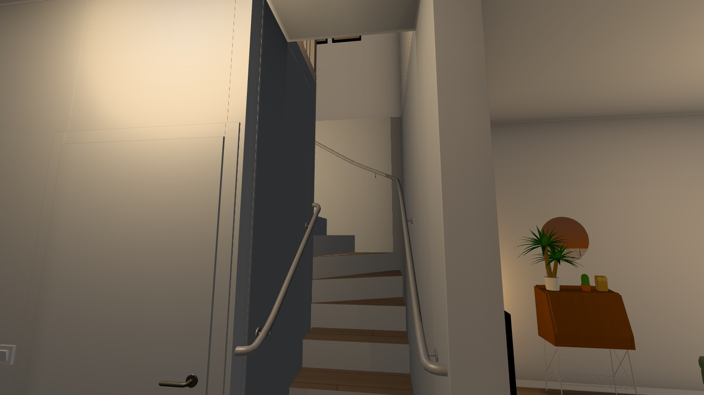
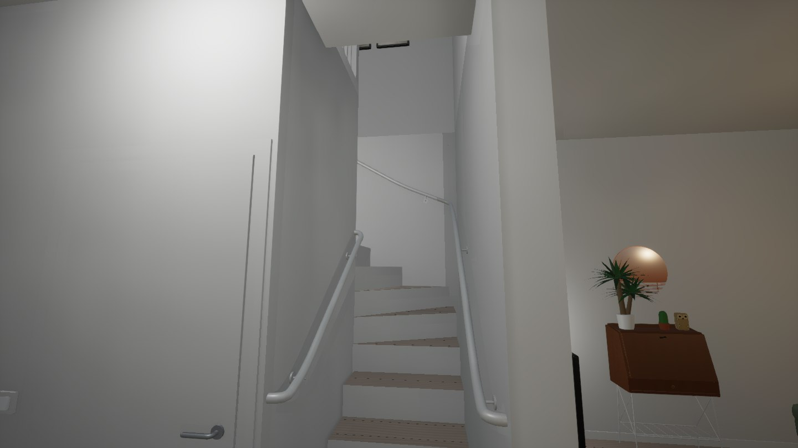

# Fresh-checkout sync and the stair view at 22:00 (#2380, #2381, #2382)

A fresh Windows worktree of `main` at 80786d65 (no LFS locks, every versioned asset read-only) with the export
artifact `unreal-export-885d9c273f4c39ce` (exported from c22d059e):

| Check | Result |
|---|---|
| `sync-import.ps1 -ExportFrom …` | `LUNDEN_SYNC_IMPORT_OK`, complete sync stamp, release gate current, 6 min; Git tree unchanged |
| second `sync-import.ps1` (no `-ExportFrom`) | `LUNDEN_SYNC_IMPORT_OK` in 3 min 42 s; every zone and builder skipped or unchanged; Git tree unchanged |
| `compose_world.py --check` (in both syncs) | `L_Lunden` matches `world-levels.json` (facade level added in 80786d65) |
| `test_seasons`, `test_lighting`, `test_vegetation` on `L_Lunden` | 3 passed, 0 failed |
| `check-sun.mjs` on `lighting-result.json` | 20 directions, worst difference 0.0000° |

Stair view `stairs-evening` (21 June 2026, 22:00, clear, all lamps), `crop-stats.cjs` with
`tools/unreal-engine/tests/stair-lighting-crops.json`:

| Crop | Web lum | Unreal lum | Unreal / web | R/B web → Unreal |
|---|---:|---:|---:|---|
| frame | 0.1848 | 0.2206 | 1.19 | 1.31 → 1.05 |
| shaft wall | 0.0271 | 0.1813 | 6.69 | 0.94 → 1.01 |
| riser | 0.0766 | 0.1498 | 1.96 | 1.25 → 1.01 |
| tread | 0.0284 | 0.0873 | 3.07 | 2.08 → 1.17 |
| hall door | 0.7082 | 0.6629 | 0.94 | 1.32 → 1.00 |

The first native render with the generated stair light functions: the full frame is within #2369's 0.8–1.25 band
(the four-frame gate was not run). The shaft wall and tread remain brighter than the web (#2369), and the Unreal
light is neutral where the web's lamp light is warm.

