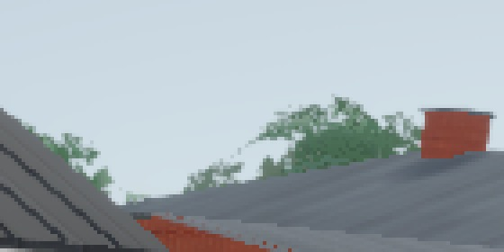

# #2383 verification: the foliage master's collection references

These checks ran on Windows in a fresh checkout at `e72c5f55`, with a complete sync of the export from `1ae9b74b`
(current for `e72c5f55`).

The two wind parameters of `M_LundenFoliage` read nothing. The master in `8dd34253` held two
`CollectionParameter` expressions for `MPC_LundenWeather` whose GUIDs no longer existed in the collection. The
collection had been rebuilt with new parameter structs before #2381 made it keep them. The material still compiled.
The proof comes from a T3D export of the saved master (scratch lister; `ParameterId` is protected from Python), with
each GUID looked up in the committed collection
([before](collection-params-before.json), [after](collection-params-after.json)):

| Expression | Before | After `98e30542` |
|---|---|---|
| `MPC_LundenVegetation` | `Month` 14966F14…, resolves to `Month` | `Month` 14966F14…, resolves to `Month` |
| `MPC_LundenWeather` | no name, 7AC4555C…, resolves to nothing | `WindX` CECC0620…, resolves to `WindX` |
| `MPC_LundenWeather` | no name, E98B7F31…, resolves to nothing | `WindY` 0434B124…, resolves to `WindY` |

`build_vegetation.py` now puts those three GUIDs into the master's spec hash. A changed GUID therefore rebuilds the
master, and `--check` fails on it: before the rebuild it reported `M_LundenFoliage: stale spec hash`. After the rebuild,
`--check` passed twice (`LUNDEN_VEGETATION_CHECK_OK`). The first rebuild left one old `WindX` expression in the graph,
because `delete_all_material_expressions` missed it. The builder now deletes every expression the master still owns,
and the second rebuild has exactly three.

`test_vegetation` on the composed `L_Lunden` (save isolation, no level streamed in memory) passed:
`LUNDEN_VEGETATION_OK` 507 trees and 9 hedges within 10 cm and in their height class, 4,163 foliage instances. Its one
warning comes from `Generated/FacadeLighting/BP_LundenFacade`: "GetScalarParameterValue was pruned because its Exec pin
is not connected" (the facade, not this issue).

The tree crown behind the house to the left of START was solid dark grey in #2326's picture
([before](../2326/unreal-start-day-crown.jpg)). The same `capture_lighting.py` `start-day` shot after the rebuild shows
green leaves, as on the web ([web](../2326/web-start-day-crown.jpg)):

