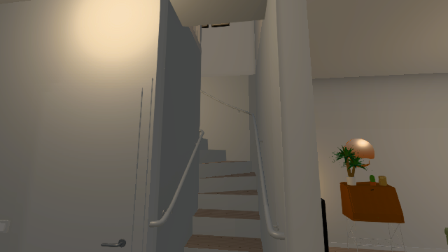
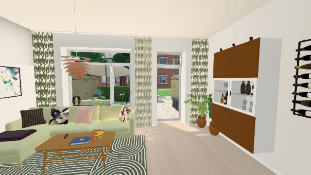
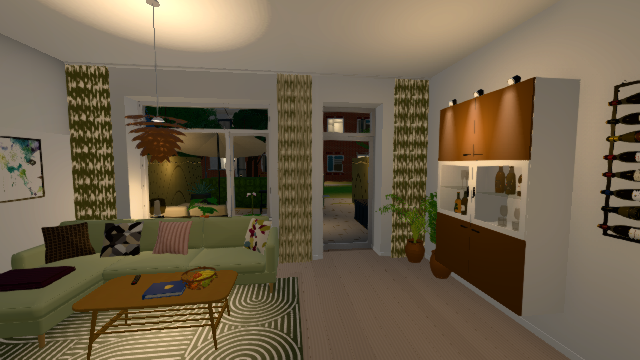
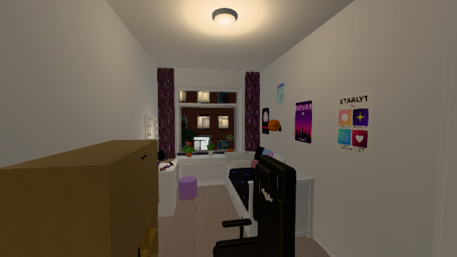

# Exported lamp colours — #2384

Runtime source: `aca244698c7b8e3e02dc957aa58b91898433a0e2`, Unreal 5.8.4, Linux CPU-Vulkan/SM5 diagnostic profile, 640×360 SceneCapture. This is original-only Unreal work; there is no public web transfer or Windows release/performance claim.

The lamp actor now stores the exported linear RGB and reapplies it on its existing light events. The builder writes the serialized component colour after the final actor and light-function property changes, which previously reconstructed 30 of the 38 components with white light. All 38 saved/reconstructed/event colours now match the export; all 28 stair masks and the existing intensity, radius and temperature settings are preserved. The light colours are not chosen by eye.

Two existing native night material guesses accompany the source-colour correction: the upper curtain emission profile and the cabinet veneer night endpoint. Source textures, UVs, source RGB, alpha, day profiles, cabinet wash radiance and source point-light power remain intact. Profile trials are measurements of native rendering, not physical material parameters or proof that other materials match the web.

The acceptance contract was frozen before the captures. It keeps the original stair/full-frame criteria and all 14 existing furniture/spot crops, including the settled evening web reference from #2485. No crop, reference or tolerance was changed to fit the result. Acceptance and image tables below are populated only after the final actual measurement.

## Functional evidence reused by exact source and package hashes

`lighting-test-proof.json`, `lighting-result.json`, `check-sun-proof.json` and `lighting-test-reuse-contract.json` bind the actual successful NullRHI test to the unchanged lighting source, test assertions, export and seven saved Lighting packages. The private observer adds only before/after readbacks: removing those additions reproduces the canonical test bytes exactly. The original two-second wait and minimum five-game-minute assertion are unchanged.

Actual Automation: one Success, zero Fail; native/runner exit 0 in 183.89 seconds. The test records 38 source colours, 10 sun cases, 8 dusk cases, 4 weather cases and 3 cloud-drift cases. The clock advanced 20.126 game minutes in 2.013 seconds of actual simulation. The canonical sun checker passed all 104 values and 20 directions. The two later material-profile changes do not alter any of those lighting inputs; the final reuse audit checks their exact hashes again.

The earlier rendered test failed because its clock did not advance; its cause is not proven. That separate gap is #2491. The standalone success is not a rendered PIE clock success. The recurring outer-command exit 143 is #2473 and is reported separately from native process and written runner results.

## Final rendered evidence

The one canonical Chromium measurement batch passed all locked criteria (`acceptance-gate.json`, canonical exit 0). Stair R/B relative to the web is **0.930 for the frame and 1.024 at the hall door**, both within ±10%. Full-frame luminance ratios are 0.958 day, 0.942 evening, 0.877 stairs and 0.877 upper floor. All 14 existing furniture/spot luminance rows and the existing curtain/cabinet hue guards pass. The corrected upper curtain has R/G 1.033 and B/G 0.951 relative to the source; the evening cabinet front has R/G 1.096 and B/G 0.935. The final runtime uses curtain gain (80,140,220) and cabinet night factor (.755,.720,.600).

The actual final cached canonical sequence completed: export, seasons, import, ten derived builders, compose/import/Nanite checks, fresh sync stamp, release gate, actual original-PBR/fade contract and four captures. All 247 authored packages remained byte-exact and read-only. The final native process and inner runner both exited 0 in 381.57 seconds; the outer command returned 143 (#2473), which is not reported as an overall clean exit. `sync-steps.json`, `sync-guards.json`, `native-outcome.json` and `run-limits.json` preserve those separate results. Functional test reuse passes all 45 source/package bindings after this final build.

All four complete native images and all four locked web originals were viewed, not just the passing crops. `whole-image-review.json` records their hashes and the remaining known visual gaps: stair contrast #2480; Silvia #2482 and the separate SKOGSGRÄNSEN mirror #2490; emissive/halo/wall issues #2460/#2481/#2484/#2489; furniture/floor/sofa differences #2486/#2487/#2447; and glass/exterior differences #2459/#2488/#2428. No new unmapped regression was found. Passing this issue does not claim those open gaps are resolved.

Images were committed in `f2710f0346350e7d27bddeaa88183a8cd37a4b76`, all eight raw URLs verified HTTPS200 with exact SHA256, and [embedded in the issue before closure](https://github.com/solwation/lunden-3d-apartment/issues/2384#issuecomment-7224445458). `image-url-proof.json` preserves those reads. No retired or before strategy images were added to this issue; earlier failure records remain private/textual evidence.
