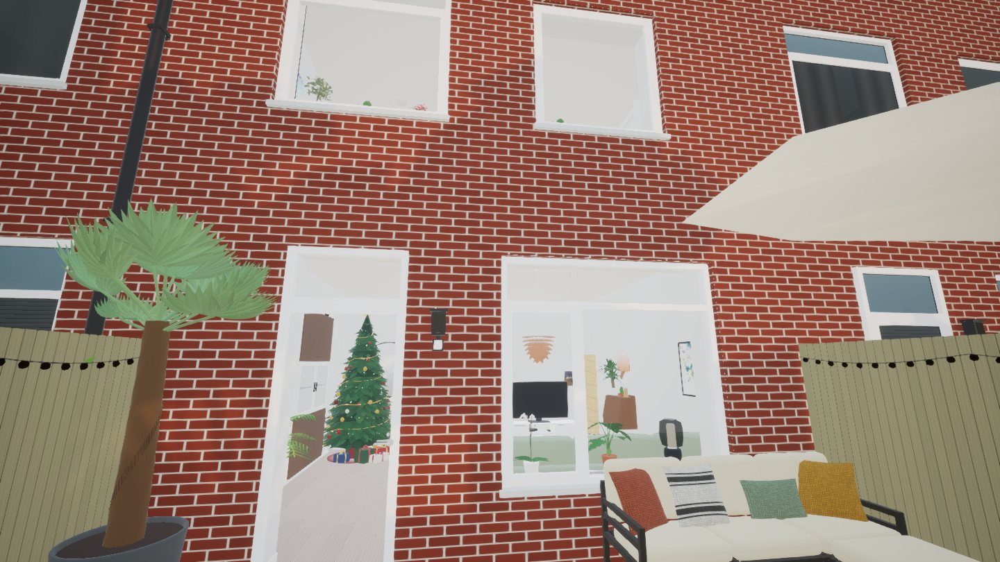
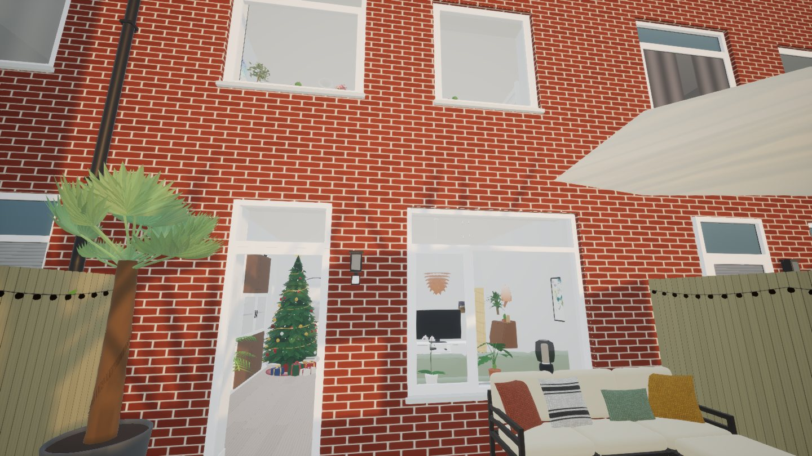
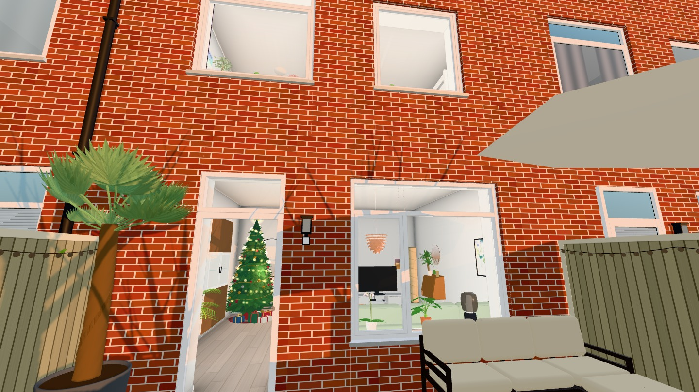
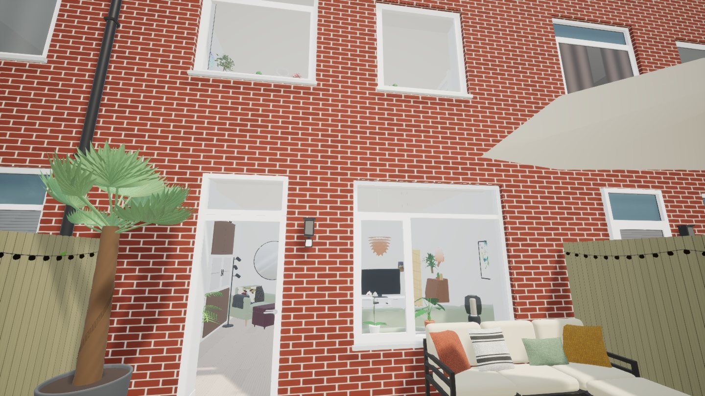
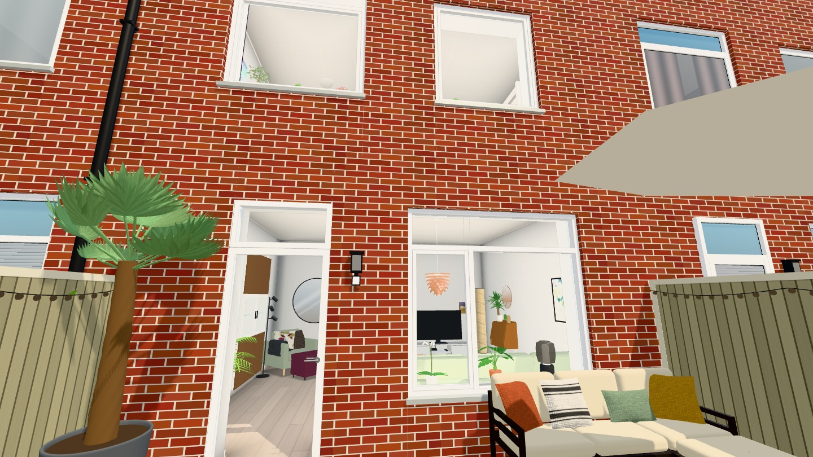
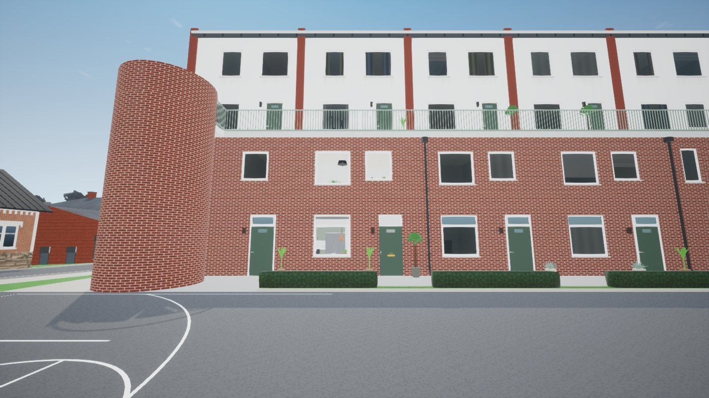
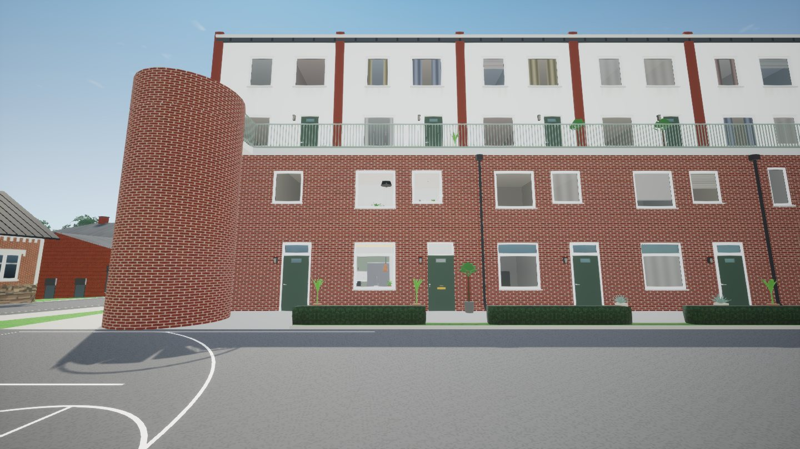
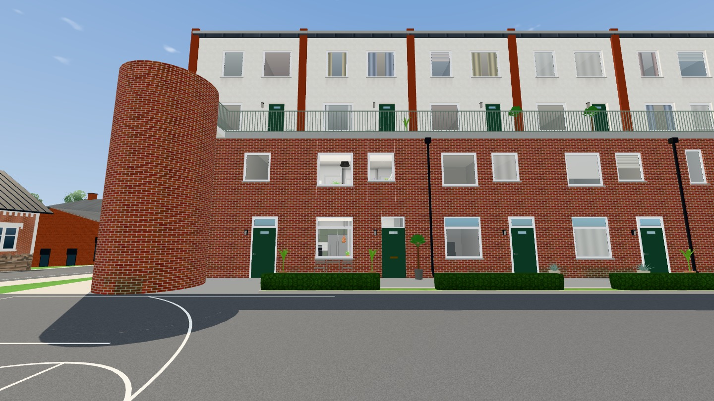

# Sun shadows on the patio wall (#2386)

**Cause.** The shadows were never missing from the captures alone. Both the game and the captures light the day with
two sources: the sun, which casts the shadows, and the `Ambient` post-process cubemap, an unshadowed fill.
The fill is added outside the exposure and the sun inside it. At #2313's 8 lux, one web unit of sun therefore reached
the screen about 11 × weaker than one web unit of fill. On the 24 December patio wall the sun added about 0.03 to
0.05 linear and the fill about 0.18, so sunlit and shaded brick differed by only 1.1–1.4 ×. The web shows about 2 ×.
`r.Shadow.Virtual.Enable 0` in the capture scripts (cascaded shadow maps for one-shot captures) and the game's virtual
shadow maps gave the same picture: [cascaded](probe-cascaded-shadows.jpg), [virtual](probe-virtual-shadows.jpg).
The probe left Nanite on, which explains the white triangles in both. With the fill switched off, the sun's shadows
are all there: [without the fill](probe-without-fill.jpg).

**Fix (`build_lighting.py`).** `SUN_LUX` goes from 8 to 20, and the web's clear-day `ambient` and `hemi` in the fill are
multiplied by `CLEAR_FILL` 0.75. `SKY_LUMINANCE` and `SKY_OVERCAST` are divided by the same 2.5, so the sky keeps its level.
The moon keeps the web's `moonlight` share of the sun. There is still one shadow-casting sun, and the render cost is
unchanged: only light intensities changed. The trial values came from `capture_lighting.py --set=…` and were then built
into `BP_LundenSky`, `BP_LundenLamp`, `M_LundenPrecipitation` and `T_LundenHemisphere` from export 6cd49a48 (main bf9718ae).

| `crop-stats.cjs`, Unreal / web | Before (8 lux) | After |
|---|---:|---:|
| Living room 14:00 | 0.99 | 0.89 |
| START 14:00 | 1.21 | 1.18 |
| Patio 21 June 14:00 | 1.07 | 1.03 |
| Patio 24 December 14:00 | 1.04 | 1.00 |
| START under rain | 1.39 | 1.43 |
| Living room 22:00 | 0.61 | 0.64 |
| Stairs 22:00 | 1.27 | 1.23 |
| START night, against the old build | – | sky 1.01, frame 1.16 |

All 14:00 frames are within 0.8–1.25. Rain and the living room at 22:00 were already outside the band before this
change, and the change leaves them essentially where they were. `sync-import.ps1` with the change ended with
`LUNDEN_SYNC_IMPORT_OK`. `build_lighting.py --check`, `test_lighting`, `test_seasons` and `check-sun.mjs` (20 directions,
0.0000°) all passed.

| | Before | After | Web |
|---|---|---|---|
| Patio, 24 December |  |  |  |
| Patio, 21 June | |  |  |
| START, 21 June |  |  |  |

The before pictures come from export 885d9c27. The after pictures come from 6cd49a48, whose winter trees cast bare
branches, as on the web.
