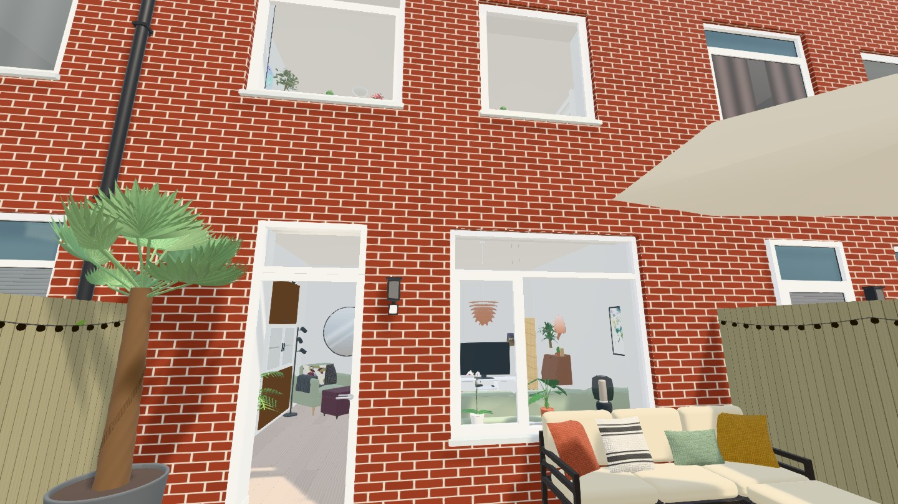
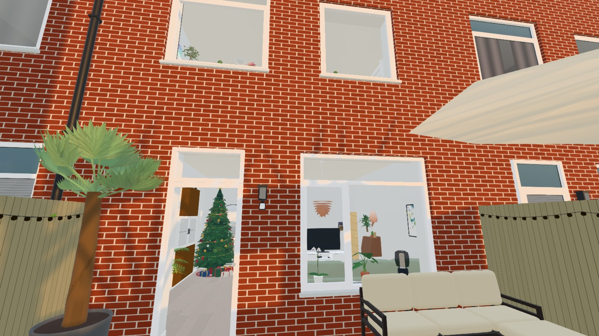
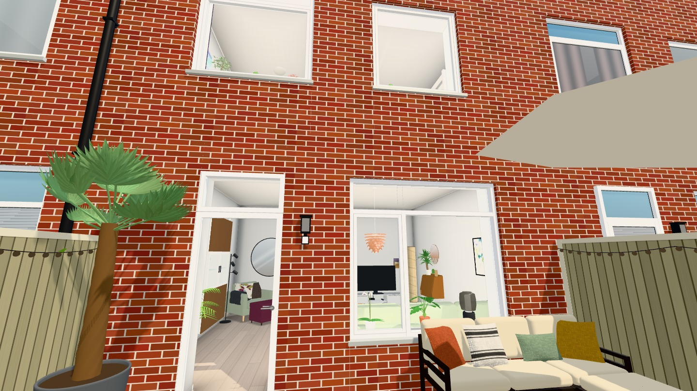
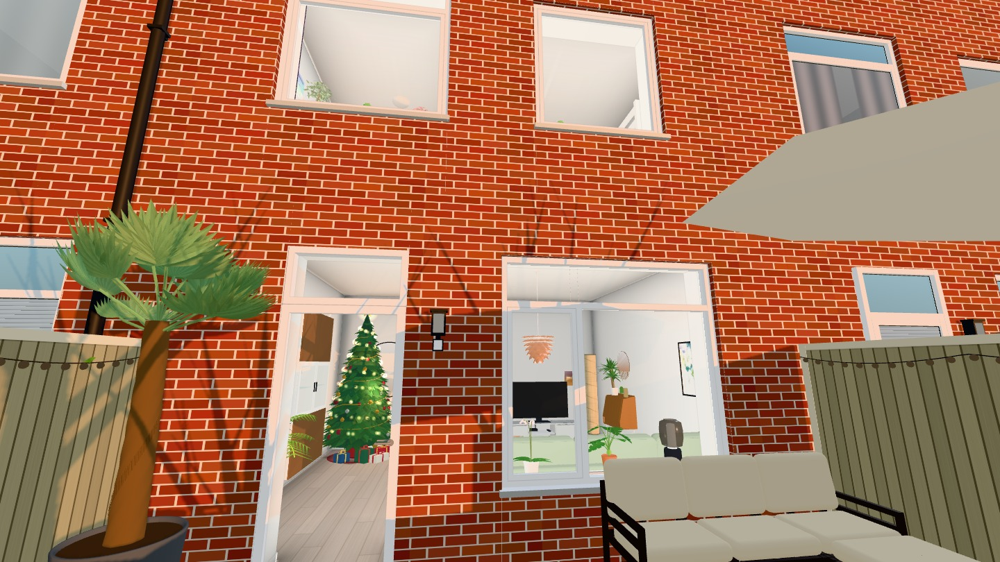

# Patio cushions follow the web's season in Unreal (#2387)

The web lays the patio sofa's four decorative cushions in the cushion box outside `src/patio.js` `cushionsOut`'s months
(April to September). The exporter (c871baa1) puts that rule on the sofa's cushion part as the date window
`season:patioCushions` 401..930, and `BPC_LundenSeasons` hides the part outside it, as it does for the Christmas tree
and its corner (#2303).

Unreal: a new Windows worktree at ea08ec2d with a full `sync-import.ps1` of the CI export `unreal-export-16d460b945a05cfc`
(source hash 16d460b9, exported from c871baa1; sync stamp complete, 14 steps). Pictures from
`capture_lighting.py patio-summer,patio-christmas` (`-RenderOffScreen`), cameras and hours from
`tests/lighting-shots.json`. Web references: [docs/verification/2326](../2326/README.md).

| Check | Result |
|---|---|
| `check-export.mjs --dir <CI export>` | pass: 11 files, 9,356 nodes, 314 sources |
| `season-rule.test.mjs --export <CI export>` | pass: `furn_veronasofa_l0_x462_z1309__1` patioCushions 401..930, 366 web dates, no mismatch |
| `test_seasons` in PIE on `L_Lunden` | pass: the cushion part has one window; BeginPlay (22 Nov) hides it; 14 dates agree with the web for tree, corner and cushions, the cushions shown with collision exactly on the `cushions` rows (1 Apr – 30 Sep); 191 seasonal actors |
| Patio, 21 June 14:00 | pass: red, striped, green and yellow cushions on the sofa, as on the web |
| Patio, 24 December 14:00 | pass: sofa without cushions, as on the web |

| | 21 June | 24 December |
|---|---|---|
| Unreal |  |  |
| Web (#2326) |  |  |

Remaining differences in these pairs, each with an open issue:
- The living room looks paler through the door and window: #2388.
- The palm's leaves are paler: #2389.
- The low winter sun is neutral white in Unreal and warm orange on the web (frames and brick): #2398.
- The winter shadows on the patio wall are weaker and softer, and the parasol's underside and the fence lighter: #2423.

Not ported: the web also takes the cushions in under rain clouds; a date window cannot carry live weather (#2331).
