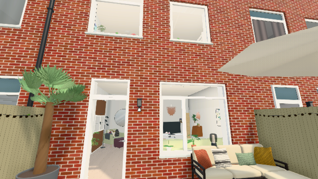
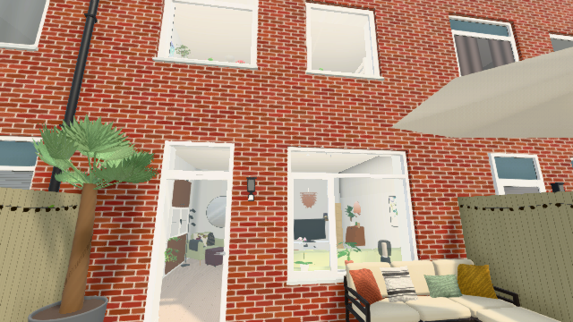
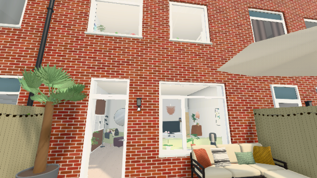

# Separate source indirect terms; rejected (#2388)

This no-save follow-up separates the source painted-room PMREM from the source
Ambient/Hemisphere/window term in the previously rejected
[complete day candidate](../source-day-candidate/README.md). The original
material remains in use. Neither separated variant passes the original criteria.

Actual Linux Native/runner/tool results: **0/0/0**, Native 291.65 seconds,
recorded runner child 291.719 seconds. The same composed world was rendered four
times at the original source patio camera, June 21 at 14:00, clear weather,
all lamps off, 640 × 360, vertical FOV72. Native source HEAD is
`9b9abd58b4820334bdedb635889acad51f4ba15f`, after the separate Basic correction.

The material copies, instance and collection are private and unsaved. The existing
verified v3 atlas is reused without importing or repeating its upload proof: its
physical SHA remains `578aa960c1269dc422e1f810742d1835245bd36336f8aad7c1c7b43f80058f13`.
The original source HLSL formulas are unchanged beneath literal 0/1 term gates.
Opacity0.1, roughness0.02, tint, source display gain and every other PBR parameter
remain fixed. The copies retain AO0; the original remains unmodified.

The original ±15% criteria, source web measurements and three rectangles are reused
without adjustment. Each cell gives linear luminance ratio / mean pixel-HSV
saturation ratio against the original web reference.

| Variant | Door | Lower window | Upper window |
| --- | --- | --- | --- |
| Original | 1.0113 / 0.8593 PASS | 0.9229 / 1.0309 PASS | 1.0133 / 1.3333 FAIL |
| PMREM only | 1.1617 / 0.5937 FAIL | 1.0350 / 0.8453 FAIL | 1.0663 / 1.1242 PASS |
| Ambient/Hemi/window only | 1.1304 / 0.5837 FAIL | 1.0038 / 0.9974 PASS | 1.0559 / 1.0755 PASS |

The Ambient-only variant improves both window criteria but loses too much door
saturation. PMREM alone also fails the door. These results do not support adopting
either variant, adding both terms, or fitting a gain/opacity to the images. They
do not isolate the remaining discrepancy to one native BRDF or indirect-light path.
Direct source Fill BRDF is not supplied by this private trial. Global #2424 remains
open and its activation policy stays off.

Actual read-only MegaLights values are EnableForProject0, Allowed1, Volume1,
TranslucencyVolume1. These are recorded configuration observations, not a claim
that a particular GPU branch executed or caused the difference.

External postflight passed: all 250 authored assets remain exact and0444;
all5,227 Generated files,12 Import files and535 dependencies are exact. No assets
were saved. All35 original glass bindings and runtime state were restored.
Before/after original images have **0 changed RGB pixels**. PMREM-only changes
39,369 pixels; Ambient-only changes39,360. Compilation returned no errors.
The previous pre-Basic baseline differs by110 full-frame pixels, with **0 changes
inside all three frozen glass rectangles**; no full-frame equality is claimed
between those different source revisions.

Root reviewed all four original PNGs below. The full capture, frozen meter reports,
external postflight, actual process results and exact capture/preparation scripts
are retained alongside them. The source atlas/module proof remains in the preceding
candidate record rather than being repeated. This is original-only Unreal
diagnostics; no web, downstream, release or player-changelog change applies.

