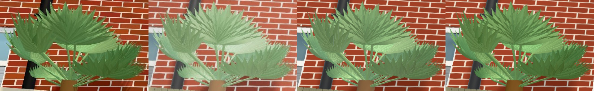
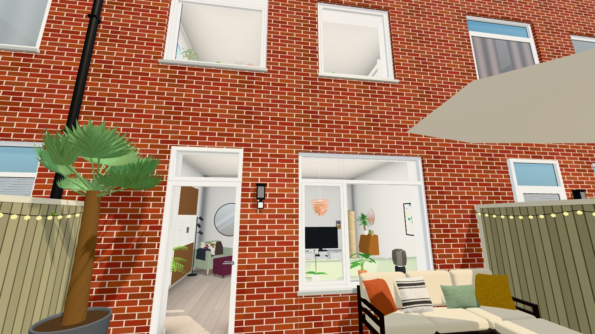
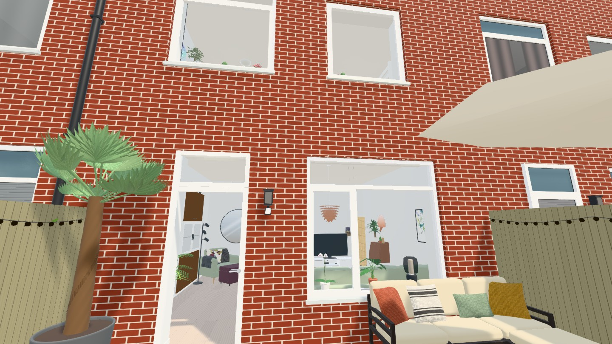
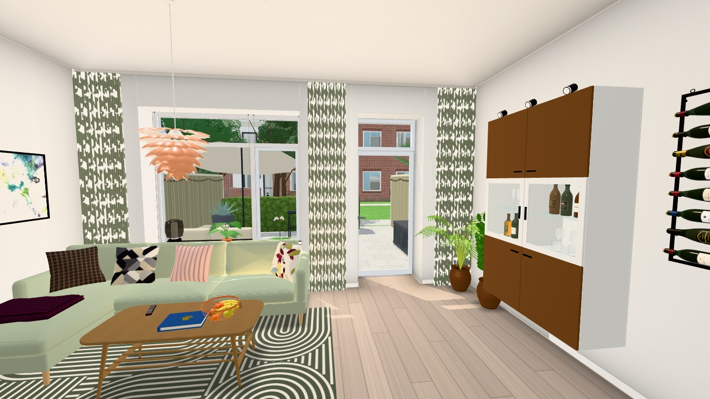
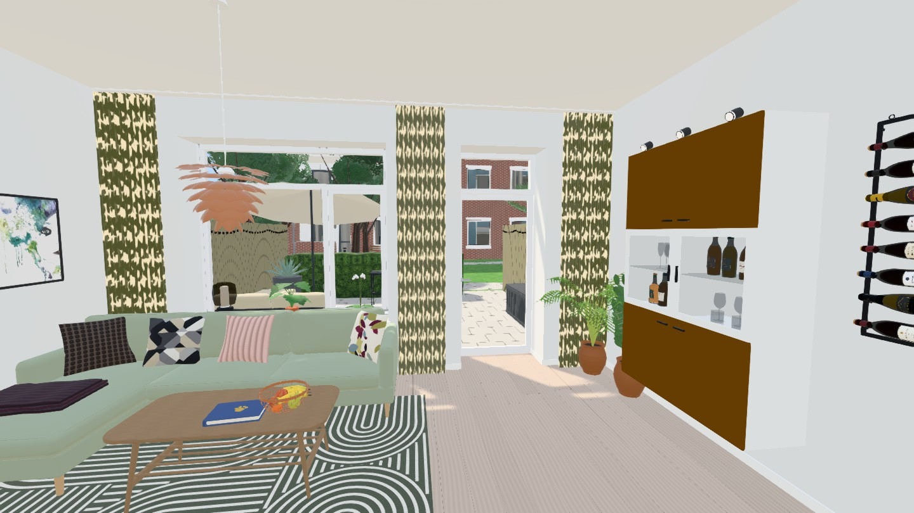

# #2389 verification: the patio palm's leaf colour

Unreal Editor 5.8.4 on Windows 11, 2026-11-22, in a fresh checkout at `ea08ec2d` with a complete `sync-import.ps1`
from the CI export `unreal-export-16d460b945a05cfc` (`LUNDEN_SYNC_IMPORT_OK`, `LUNDEN_CHECK_OK`). Pictures:
`tests/capture_vegetation.py` on the composed `L_Lunden`, `views.json` cameras `patio` and `living-room`, 21 June
14:00, clear, game exposure ([`unreal-capture.json`](unreal-capture.json)). Web halves: the committed desktop Ultra
captures of #2289/#2318 (patio) and #2321 (living room). The palm's web source (`src/patio.js` `detailedPalm`,
`PATIO.palmDetail`) has not changed since.

## The leaf material path is correct

- The palm is an imported furnishing in `l1007-uteplats` (`furn_planter_l0_x43_z1324`, four parts). Its leaves use
  the key `std_ffffff_r68_m0_vc_ds`: white × the web's vertex colours (HSL 0.29–0.32, 0.42, 0.20–0.27), roughness
  0.68, two-sided. In Unreal the instance has `M_LundenGltfVertexColor` (#2321) as its parent, `RoughnessFactor`
  0.68, `MetallicFactor` 0 and `SpecularFactor` 1.
- **No season reaches it.** `M_LundenFoliage`, `MI_LundenLeaf`/`MI_LundenPerennial` and `MPC_LundenVegetation.Month`
  are used only by `build_vegetation.py`'s generated foliage (crowns, courtyard perennials, vines). The #2383 rebuild
  (`98e30542`) and the season parameter do not touch potted plants.
- **The vertex colours stay linear.** three.js `GLTFExporter` writes the linear `color` attribute as `COLOR_0`.
  Interchange's `GLTFMeshFactory.cpp` applies `SRGBToLinear` before the static mesh build. This compensates for the
  build's `ToFColor(true)`, so the `VertexColor` node returns the web's linear value.

## Measurements

Mean sRGB of the leaf pixels (green-dominant: G > R + 8 and G > B + 8) in the crop x 0.06–0.28, y 0.36–0.58 of the
1440 × 810 patio view:

| Picture | R | G | B | vs web |
|---|---:|---:|---:|---|
| web | 90.7 | 127.7 | 70.9 | |
| Unreal, #2318 (`0ea093fb`, before #2396) | 146.9 | 175.1 | 131.5 | +62 % / +37 % / +85 % |
| Unreal now (`ea08ec2d`) | 116.3 | 150.3 | 100.1 | +28 % / +18 % / +41 % |
| Unreal now, palm leaf `SpecularFactor` 0 (in memory) | 97.2 | 137.6 | 77.0 | +7 % / +8 % / +9 % |

1. **Most of the #2318 difference was the old capture path and tonemapper.** The #2318 picture predates #2396's
   display-path capture (`48a7c75a`, `b442c723`) and the web's NeutralToneMapping (`4af7f0bb`). It lifted every
   surface: the brick was 206,138,118 against the web's 168,88,59.
2. **The remainder is specular reflection, and it does not come from the sun.** With the leaf material's specular at
   0, the crop lies within ±10 % on all three channels. With the sun's `specular_scale` at 0, it moves by only
   2 levels (114,149,98). The web lights its plain `MeshStandardMaterial`s with a `HemisphereLight` and an `AmbientLight`.
   It has no `scene.environment`, so the ambient light adds no specular. Only materials with their own `envMap` reflect
   (glass, copper, chrome, cars). Unreal's sky light also reflects from every surface, which lifts dark, smoother
   surfaces most. These include the palm's leaves (roughness 0.68, albedo about 0.02–0.09 linear), the hedges (#2411)
   and the bridge railings (#2391). The extra light is bluish, which matches the cold cast that #2394 tracks.
3. **The surfaces around it are also slightly paler.** Brick 174,97,73 against 168,88,59, the green cushion 155,174,142
   against 140,160,124 and the fence 131,126,96 against 116,111,79. This is #2394's general cold and pale daylight.
4. **The fix lies outside the plant material.** In this capture, turning off Lumen reflections, the reflection
   environment and SSR with console variables or capture show flags changed nothing measurable. A global
   specular change would also be wrong for the plants indoors. With `SpecularFactor` 0 on all 61 vertex-coloured
   instances, the living room's fern went from 110,143,81 to 94,135,48 (web 128,157,80). Indoors, Unreal's fern is
   already darker than the web's, not paler.

## Other potted plants checked

| Plant | Material path | Result |
|---|---|---|
| Patio fan palm (`detailedPalm`) | `M_LundenGltfVertexColor`, no season | paler outdoors (above) |
| Living-room fern in its terracotta pot | `M_LundenGltfVertexColor`, no season | not paler: Unreal 110,143,81, web 128,157,80 (slightly darker) |

| Web | Unreal now |
|---|---|
|  |  |
|  |  |

Diagnostic only, not a proposed look: [the patio with the palm leaves' specular at 0](unreal-patio-leaf-specular-0.jpg).

## Checks

- `test_vegetation` (PIE, `run-tests.ps1`): passed. 507 trees and 9 hedges are within 10 cm and in their height class,
  with 4,163 foliage instances and 448 blocking trunks with no problems.
- `sync-import.ps1` full run: `LUNDEN_SYNC_IMPORT_OK`, worktree clean afterwards.
