# Outdoor daylight in Unreal against the web (#2390)

Unreal Editor 5.8.4 on Windows 11, 2026-11-21, headless. Warm Windows checkout at `554cd47e` (#2386's sun and fill
balance) with the Actions export `unreal-export-6cd49a48091e4bc5`; `sync-import.ps1` passed (`LUNDEN_SYNC_IMPORT_OK`,
`build_lighting.py`: "assets unchanged", so the committed #2386 lighting is what was rendered). Web: `9f662b65`,
whose `src/` is identical to `554cd47e`.

## What was wrong in the pictures

`tests/capture_vegetation.py` rendered at the pilot rig's fixed exposure bias 0 instead of the game's locked
exposure (`capture_light.game_bias`, −1.965 EV at 14:00 in June), which `capture_l1007.py` and `capture_exterior.py`
already used. Every outdoor pair made with it (#2281, #2308, #2323, #2325) was about 2 EV over-exposed before the
tone curve. Fixed in `639aa06d`; `unreal-capture.json` records `exposureBias` per view.

## Pictures

The six #2325 views plus START, 1440 × 810, 72° vertical, 21 June 14:00, clear ([`views.json`](views.json)). Web:
`capture-web-views.cjs`, desktop Ultra, SwiftShader ([`web-capture.json`](web-capture.json)). Unreal:
`capture_vegetation.py` on `L_Lunden` at the game's exposure ([`unreal-capture.json`](unreal-capture.json)).

| Web | Unreal |
|---|---|
| 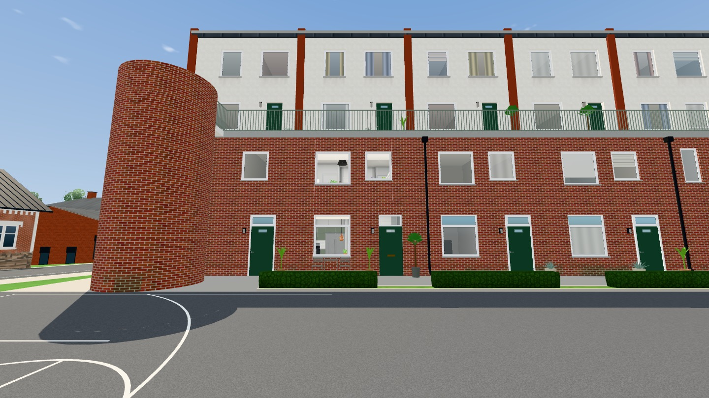 | 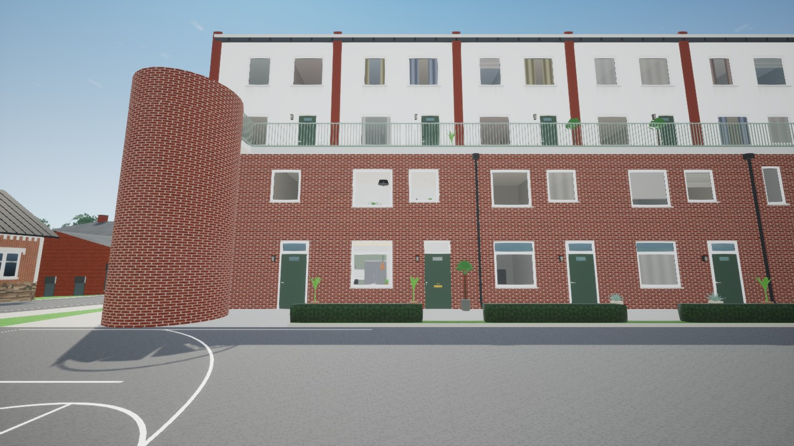 |
| 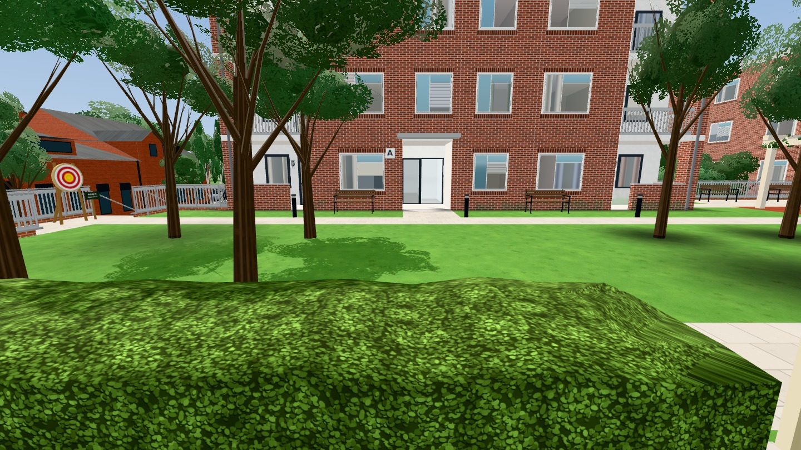 | 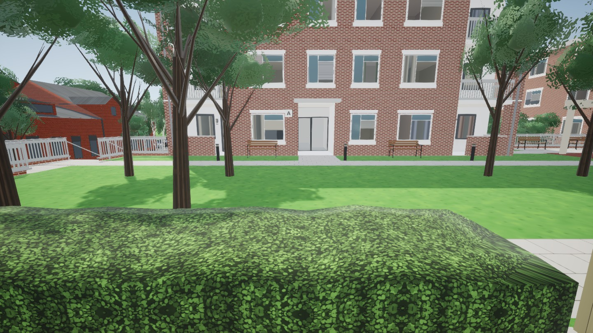 |
| 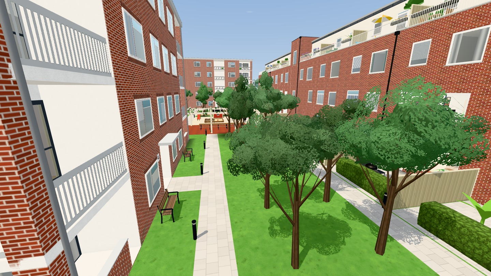 | 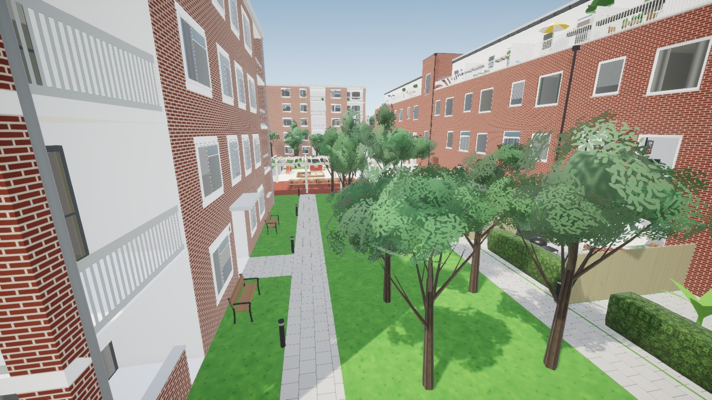 |
| 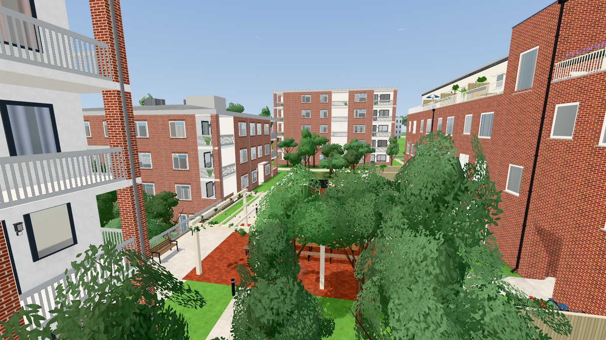 | 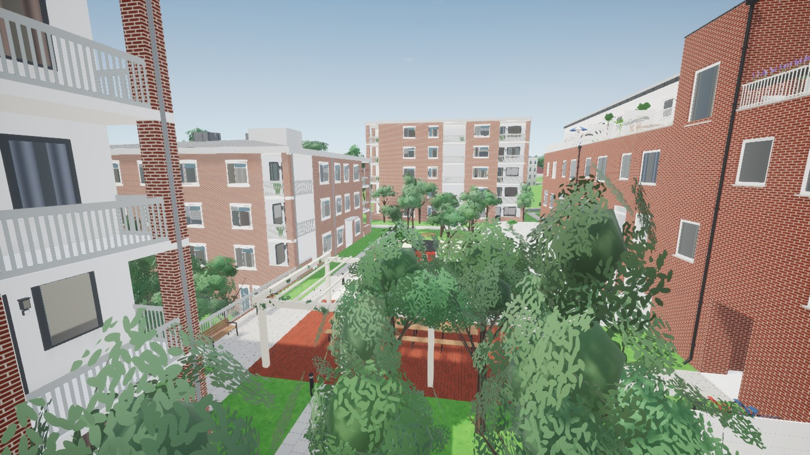 |
| 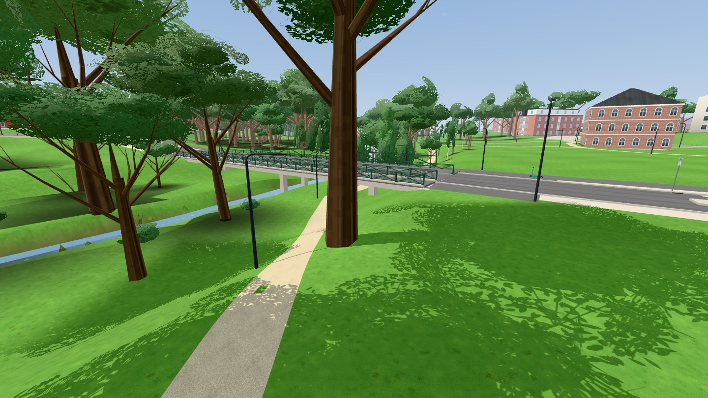 | 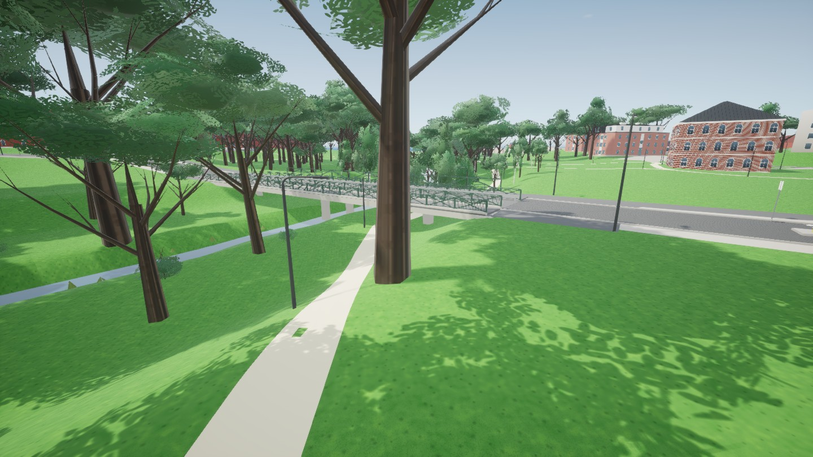 |
| 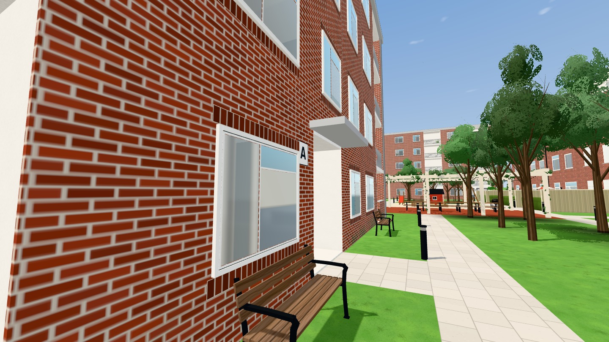 | 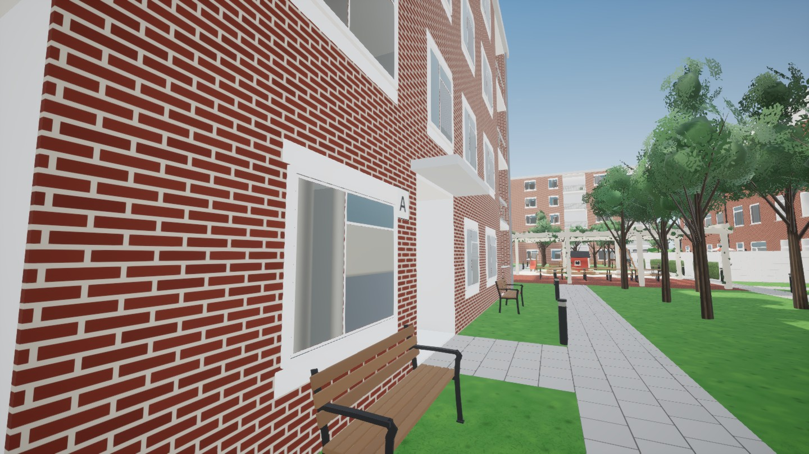 |
| 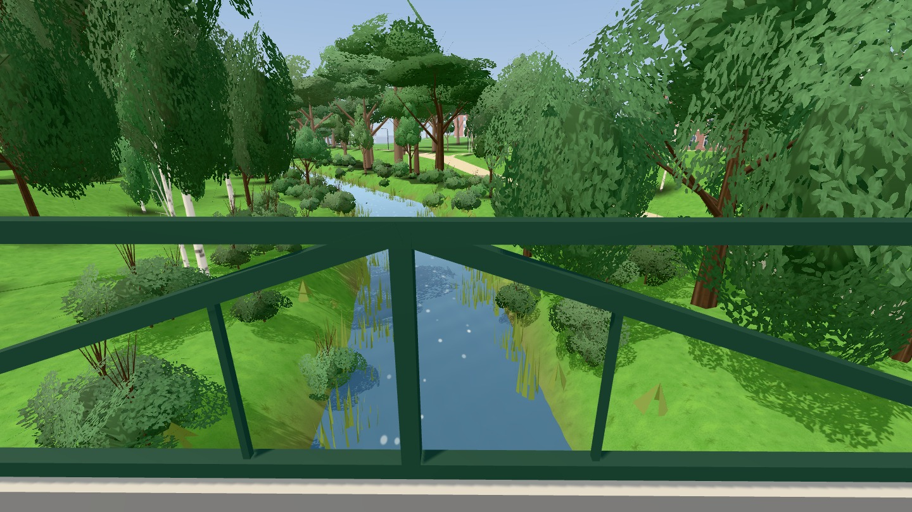 | 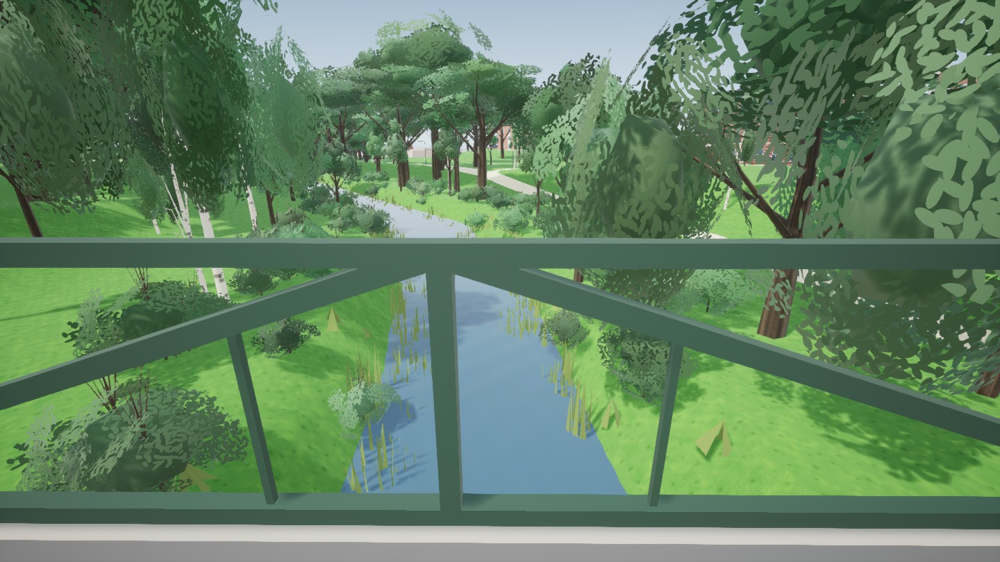 |

## Crops

Three crops per view ([`crops.json`](crops.json)), measured with `tests/crop-stats.cjs`
([`crop-stats.json`](crop-stats.json)) and scored with [`score.py`](score.py): the ratio of mean luminance and of the
HSV saturation of the mean sRGB colour (Unreal ÷ web). Saturation is left out for near-grey crops (web saturation
below 0.1). A view's ratio is the geometric mean of its crops.

| View | Crop | Web sRGB | Unreal sRGB | Luminance | Saturation |
|---|---|---|---|---:|---:|
| start | sky | 153, 185, 222 | 162, 189, 209 | 1.04 | 0.73 |
| start | brick | 126, 71, 54 | 142, 99, 88 | 1.61 | 0.66 |
| start | asphalt | 132, 131, 128 | 154, 154, 154 | 1.43 | – |
| patio-lawn | brick | 117, 76, 56 | 138, 119, 106 | 1.88 | 0.45 |
| patio-lawn | lawn | 108, 165, 64 | 114, 168, 93 | 1.06 | 0.73 |
| patio-lawn | hedge | 64, 94, 23 | 78, 104, 60 | 1.27 | 0.56 |
| courtyard | sky | 158, 188, 222 | 174, 195, 212 | 1.09 | 0.62 |
| courtyard | lawn | 111, 165, 63 | 83, 136, 67 | 0.63 | 0.82 |
| courtyard | loggia-rail | 204, 204, 200 | 186, 189, 190 | 0.81 | – |
| courtyard-loggias | sky | 157, 187, 222 | 174, 195, 212 | 1.10 | 0.61 |
| courtyard-loggias | brick | 162, 130, 119 | 154, 139, 136 | 1.05 | 0.44 |
| courtyard-loggias | loggia-rail | 163, 169, 174 | 162, 167, 171 | 0.98 | – |
| river | sky | 150, 178, 207 | 168, 188, 202 | 1.09 | 0.62 |
| river | far-lawn | 126, 148, 107 | 156, 175, 146 | 1.41 | 0.60 |
| river | far-water | 89, 120, 120 | 113, 141, 140 | 1.35 | 0.74 |
| entrance-a | sky | 130, 163, 193 | 132, 163, 183 | 0.94 | 0.85 |
| entrance-a | brick | 131, 78, 59 | 131, 90, 81 | 1.31 | 0.70 |
| entrance-a | letter-plate | 157, 156, 156 | 196, 198, 198 | 1.31 | – |
| river-bridge | sky | 141, 173, 189 | 162, 185, 186 | 1.11 | 0.51 |
| river-bridge | water | 86, 126, 143 | 119, 157, 171 | 1.62 | 0.77 |
| river-bridge | lawn | 52, 95, 52 | 81, 116, 79 | 1.45 | 0.70 |

Per view, three stages with the same crops: the #2325 pictures (bias 0, before #2386), this issue's capture fix
alone (game exposure, `9f662b65`), and the capture fix on #2386's lighting (`554cd47e`, the pictures above).

| View | Bias 0 (#2325) | Game exposure | + #2386 lighting |
|---|---|---|---|
| start | – | 1.37 / 0.67 | 1.34 / 0.69 |
| patio-lawn | 1.80 / 0.51 | 1.53 / 0.54 | 1.37 / 0.57 |
| courtyard | 1.14 / 0.39 | 0.96 / 0.69 | **0.82** / 0.71 |
| courtyard-loggias | 1.45 / 0.29 | 1.16 / 0.53 | **1.04** / 0.52 |
| river | 1.86 / 0.39 | 1.32 / 0.59 | 1.28 / 0.65 |
| entrance-a | 1.62 / 0.45 | 1.32 / 0.76 | **1.17** / 0.77 |
| river-bridge | 1.65 / 0.39 | 1.32 / 0.67 | 1.38 / 0.65 |

(luminance / saturation, Unreal ÷ web; bold = luminance within 0.8–1.25)

## Result

- **Luminance:** 3 of the 6 #2325 views are within 0.8–1.25 (courtyard, courtyard-loggias, entrance-a); START,
  patio, river and river-bridge are at 1.28–1.38. Every sky crop is within (0.94–1.11).
- **Saturation:** no view is within. Every coloured crop is less saturated in Unreal, by about the same factor
  (0.44–0.85): the sky as well as lawn, hedge, brick and water. The sky's luminance already matches, so a uniform
  loss of saturation across sky and materials points to the display transform (the web's `NeutralToneMapping`
  against Unreal's filmic tonemapper), which #2396 owns, not to the sun or sky intensity.
- **Not met:** the issue's acceptance (4 of 6 within, luminance and saturation). The tonemapper and `EXPOSURE_BIAS`
  belong to #2396, so no sun or sky value was changed here.
- `test_lighting` and `check-sun.mjs` were run on `554cd47e` by #2386
  ([verification](../2386/README.md)); this issue changed no lighting asset or builder.

**Inconclusive diagnostic (not used above):** a scratch run read the linear `FinalColorHDR` and `SceneColorHDR` of
the same crops to apply three's `NeutralToneMapping` offline, and repeated the river views with the river
materials' Specular set to 0. `RenderingLibrary.read_render_target_raw_pixel_area` returned 20–30 times more pixels
than the crops hold, so those numbers do not belong to the crops. The water's Specular-0 variant changed its
(wrong) area by under 2 %.
