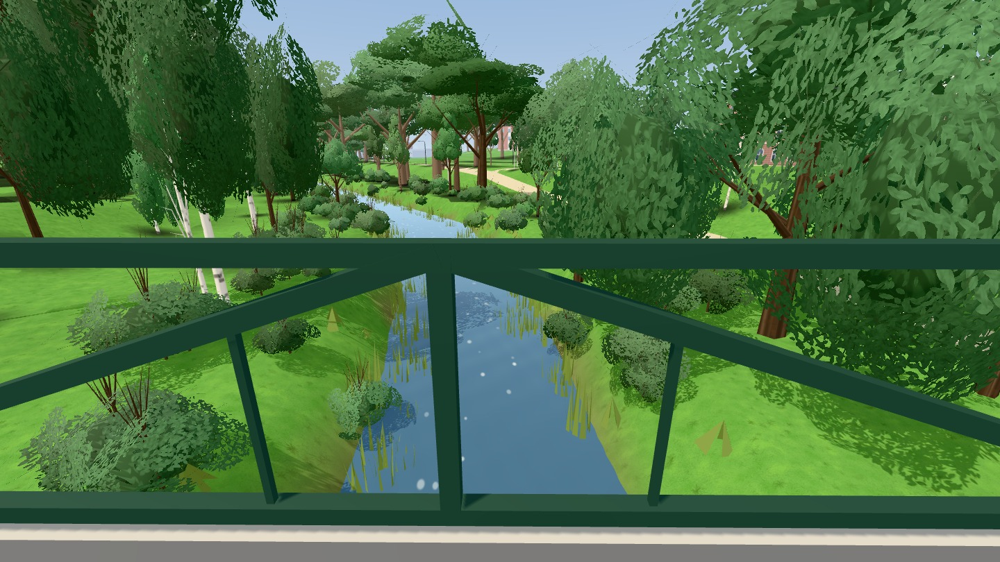
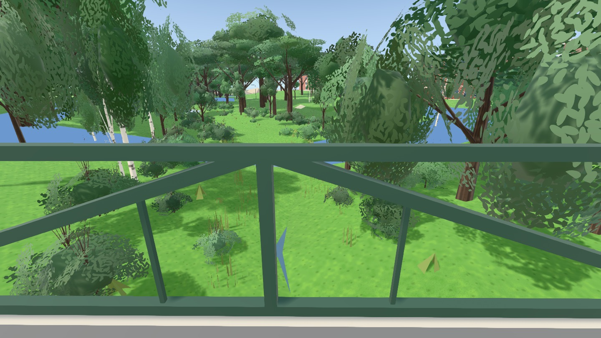
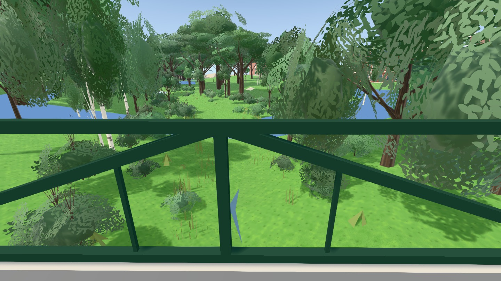

# The cycle bridge's railings in Unreal: export colour against sky reflection (#2391)

Unreal Editor 5.8.4 on Windows 11, 2026-11-22, headless (`-RenderOffScreen`). Warm Windows checkout
`lunden-ue-wt/opus-release-2419` at `8a5cd9bc`, imported from the export of `c871baa1` (current for that checkout).
Web: `9c84932a`, desktop Ultra, SwiftShader, `capture-web-views.cjs` with the #2390 river-bridge camera (21 June
14:00, clear, 1440 × 810, 72° vertical).

**Result: the railing's material path from the export is right; the difference is Unreal's sky reflection.**
Nothing was changed. The remaining work waits for #2424, which fixes the reflection in the light chain instead of per material.

## What reaches Unreal

- The railing is `bridges-steel` in `omgivning` (`src/riverbridge.js`): key `std_ffffff_r55_m45_vc`, white base,
  metalness 0.45, roughness 0.55, and the colour as vertex colours. 20,880 of its 21,672 vertices carry `gcSteel`/`green`
  `0x3d5a4e` as linear (0.0467, 0.1022, 0.0762) in the GLB's `COLOR_0`, and 792 carry galvanised `0x9ea5a3`.
- Interchange keeps that colour linear. `GLTFMeshFactory.cpp` applies `SRGBToLinear` before the static mesh build's
  `ToFColor(true)`, so the vertex buffer holds the linear value. `M_LundenGltfVertexColor` (#2321) multiplies it in.
  The imported instance has `BaseColorFactor` 1, `MetallicFactor` 0.45, `RoughnessFactor` 0.55 and `SpecularFactor`
  1 (the glTF default). These are the web's values.

## Measurement with and without reflection

`probe_rail.py` (a scratch commandlet, not a tool: hard-coded checkout path; Nanite off only on the bridge meshes)
renders the view several times. Between renders it changes only the railing instance, in memory, and saves nothing:

| Picture | Railing instance |
|---|---|
| [`unreal-river-bridge.jpg`](unreal-river-bridge.jpg) | as imported |
| [`unreal-river-bridge-specular-0.jpg`](unreal-river-bridge-specular-0.jpg) | `SpecularFactor` 0 |
| [`unreal-river-bridge-no-reflection.jpg`](unreal-river-bridge-no-reflection.jpg) | the web's indirect response: `BaseColorFactor` × (1 − 0.45), metallic 0, specular 0 |
| [`unreal-river-bridge-grey-reference.jpg`](unreal-river-bridge-grey-reference.jpg) | neutral matte reference, linear 0.04 (vertex colour divided out), metallic 0, specular 0 |

The web side has the same neutral reference on `bridges-steel` (`vertexColors` off, colour 0.04, metalness 0):
[`web-river-bridge-grey-reference.jpg`](web-river-bridge-grey-reference.jpg).

| Web | Unreal, as imported |
|---|---|
|  |  |
| **Unreal, `SpecularFactor` 0** | **Unreal, without reflection** |
|  |  |

Crops ([`crops.json`](crops.json)): the shaded inner faces of the top rail, the bottom rail and the middle post, plus
the sunlit top of the bottom rail. Values come from `tests/crop-stats.cjs` on the lossless PNG renders
([`crop-stats.txt`](crop-stats.txt)); the committed JPEG copies read 2–3 levels lower in the dim red channel
(chroma subsampling on the thin bars). [`normalise.py`](normalise.py) removes the daylight difference
([`normalise-result.txt`](normalise-result.txt)). It undoes the sRGB encoding and three.js `NeutralToneMapping`
(Unreal's `M_LundenNeutralTonemap`, #2396; only its toe applies at these levels). It then divides each channel by the
Unreal ÷ web ratio of the neutral reference on the same faces, which is 0.94–1.03 on the shaded faces and 0.88–0.91 on
the sunlit top, and tone-maps back:

| Crop | Web sRGB | As imported | `SpecularFactor` 0 | Without reflection | Deviation without reflection |
|---|---|---|---|---|---|
| top rail | 25, 63.5, 45 | 61.7, 91.6, 75.6 | 33.9, 76, 57 | 22.9, 63.6, 45.0 | −8.3, +0.2, 0.0 % |
| bottom rail | 23, 62, 44 | 60.3, 88.3, 72.4 | 37.7, 75.6, 57.3 | 21.1, 61.2, 43.1 | −8.4, −1.3, −2.0 % |
| post | 22.9, 61.8, 44.2 | 61.6, 91, 74.3 | 33, 74.1, 55.4 | 20.6, 61.8, 43.6 | −9.9, 0.0, −1.4 % |
| bottom rail, sunlit top | 48.3, 86.1, 65.6 | 83.1, 115.5, 99.5 | 57.3, 99.9, 80.2 | 42.4, 85.1, 62.7 | −12.2, −1.1, −4.5 % |

(Unreal columns before the last are raw sRGB means; the "without reflection" column is daylight-normalised.)

- **As imported**, the shaded faces are 2.2–2.4 times the web's luminance and greyish (R/B 0.81–0.83 against 0.52–0.56).
- **`SpecularFactor` 0** still leaves 1.45–1.5 times. The metal's own F0 (0.45 × colour) also mirrors sky and ground.
- **Without any reflection**, every shaded face is within ±10 % per channel of the web after the daylight
  normalisation (worst: the post's red, −9.9 %). So the export colour, the vertex colours and the factors are right.
  The sunlit top is 12 % low in red because this test also removes the sun highlight that the web keeps
  (F0 = mix(0.04, colour, metalness)). A light-side fix leaves that highlight in place.

#2389 found the same thing on the patio palm's leaves and so did the hedges (#2411). A per-material switch is the wrong fix:
on the living-room fern it makes the leaves too dark. The fix belongs in the sky light's reflection rule, #2424
(`build_lighting.py`/`BP_LundenSky`, Lighting locks held for #2394). Remeasure the railing there with these crops and
`normalise.py`. A per-material patch that was tried here and not delivered is described in the issue.

## Other visible differences in the pair

- The grey checkered tree and shrub foliage of the #2325 Unreal picture is not in these renders (foliage textured, as in #2390).
- In this probe the river under the bridge is missing and water shows beside the far banks. The probe turned Nanite
  off only on the bridge meshes, so the ground and river were drawn by a one-shot commandlet capture, which draws
  Nanite as coarse panels (#2298). The official `capture_vegetation.py` turns Nanite off on every mesh and showed the
  river in #2390. Not a game difference; not checked further here.
- Paler, less saturated daylight overall and the water's colour: #2390 / #2394 (lighting) and #2325's water note.
