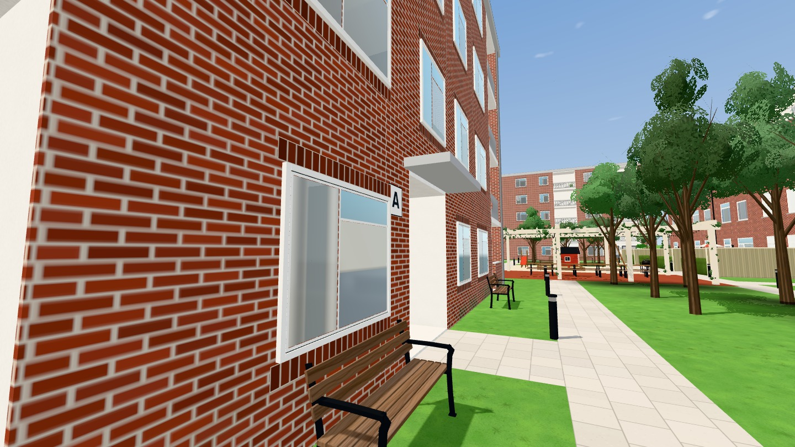
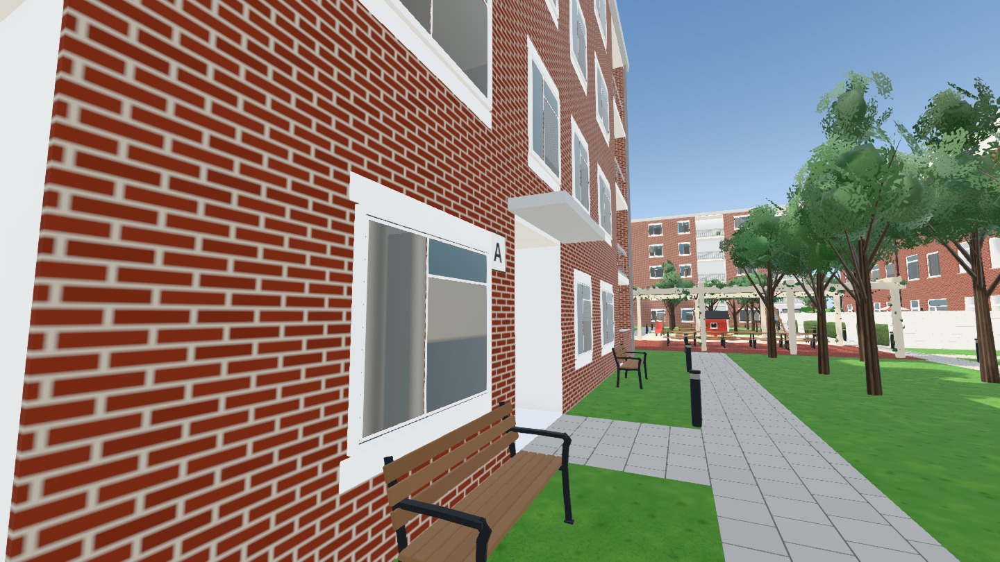
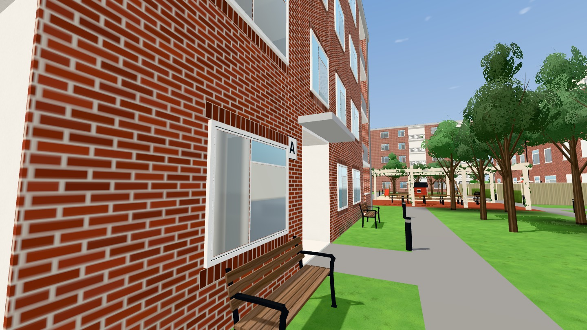
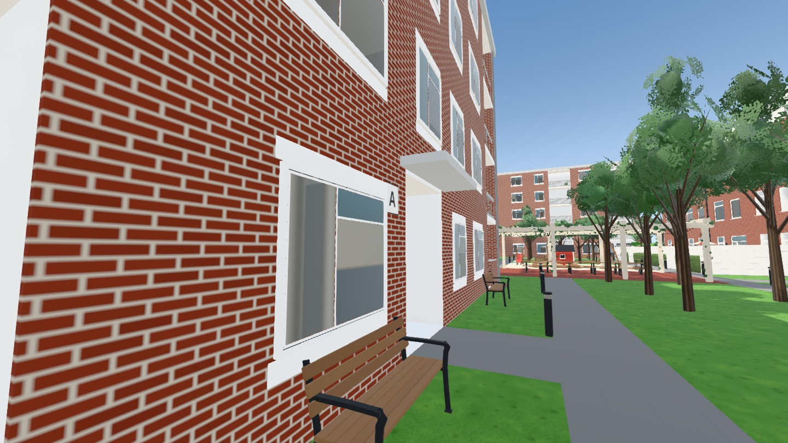
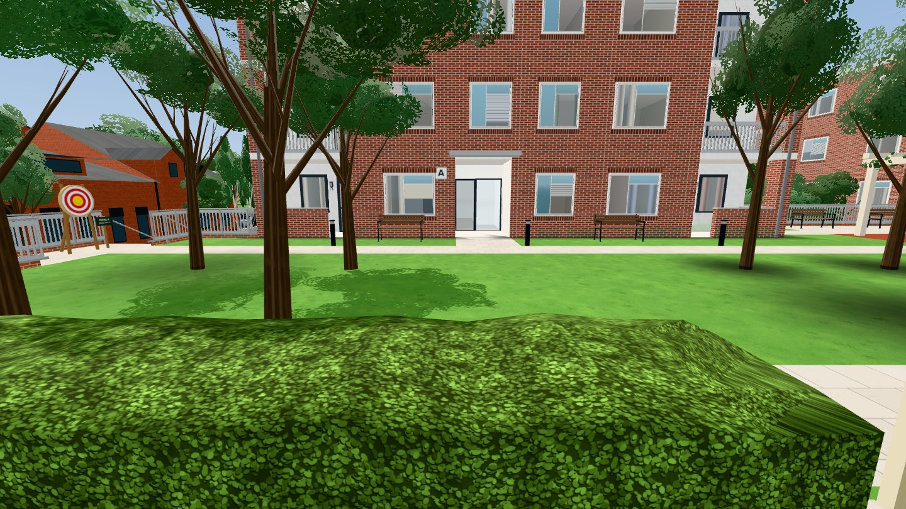
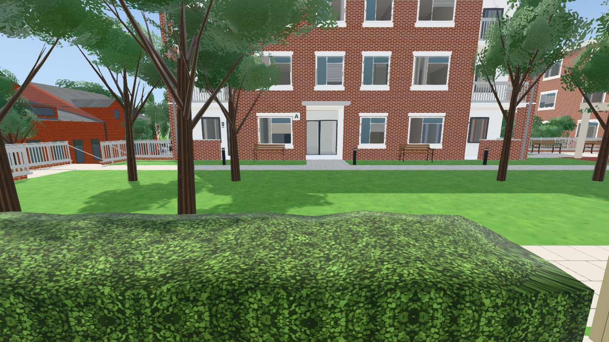
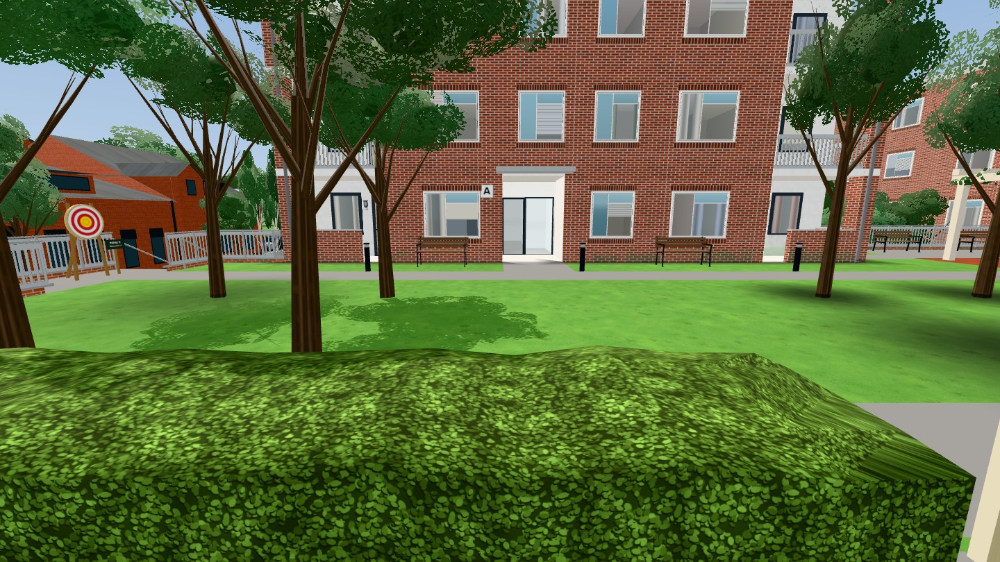
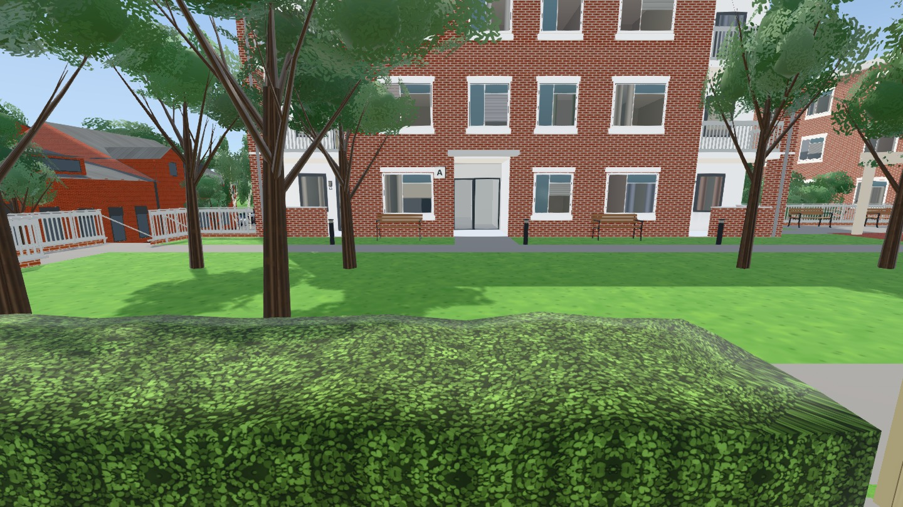
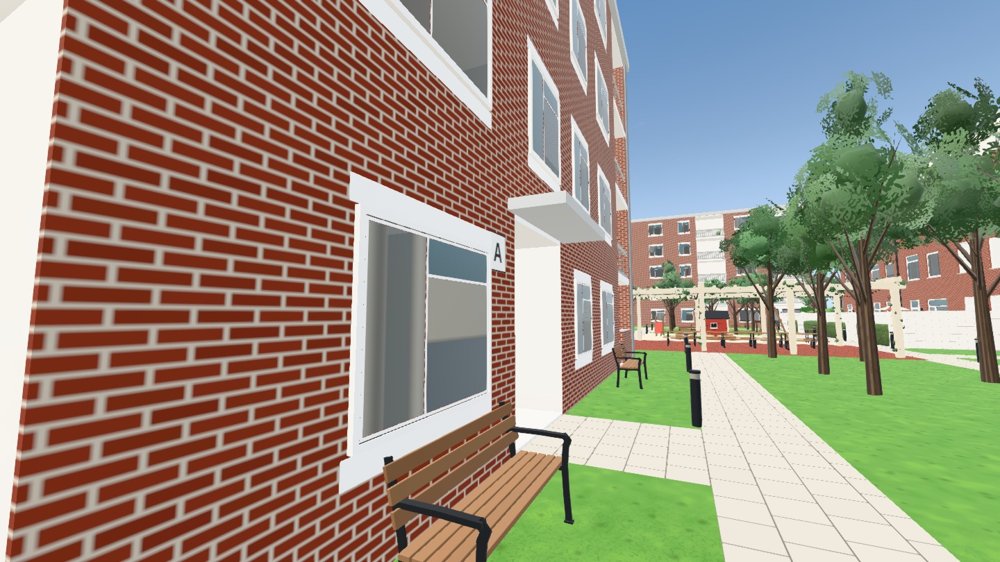

# Courtyard walks in Unreal: paving material against the sun's shadow (#2392)

Unreal Editor 5.8.4 on Windows 11, 2026-11-22, headless (`-RenderOffScreen`). Warm Windows checkout
`lunden-ue-wt/opus-release-2419` at `488976a4`, imported from the export of `c871baa1`. No paving source or paving entry
of `material-map.json` has changed since that export. Web: `c67c0c8e`, desktop Ultra, SwiftShader, a scratch copy of
`capture-web-views.cjs` with #2325's `entrance-a` and `patio-lawn` cameras (21 June 14:00, clear, 1440 × 810, 72°
vertical).

**Result: the walks' material path is right. They look grey in Unreal because they lie in the Å-husen's sun shadow,
which the web does not draw.** Nothing in the game was changed. The remaining difference belongs to #2426.

## What reaches Unreal

- The courtyard walks are `src/courtyard.js` `mats.paving` (`pavingTexture()`, white times the canvas, roughness
  0.95), key `std_ffffff_r95_m0_tex` on `gard/mesh_l0_xm2640_z3230_ym42` and `omgivning/mesh_l0_xm1690_z991_ym44`.
  Hus L's terrace and L1007's patio use the same canvas (`std_ffffff_r100_m0_tex`).
- In the composed world all four meshes draw `MI_LundenPatioPaving` (logged by [`probe_walk.py`](probe_walk.py)).
  Its `Color` is linear (0.479, 0.462, 0.429), which is `PATIO.paving.color` [184, 181, 175], the canvas's slab
  colour. It has 40 cm slabs in half bond, 8 mm `#6f6b65` joints and roughness 0.93.
- `tests/test_materials.py` fails when either walk mesh loses that rule. With the courtyard-slab rule removed (a
  scratch edit, reverted), it exits 1 with `paving look of key std_ffffff_r95_m0_tex on omgivning/mesh_l0_xm1690_z991_ym44
  reaches the import default (draws no paving)` and the same for `gard/mesh_l0_xm2640_z3230_ym42`. On the unchanged map
  it prints `MATERIAL_COVERAGE_OK`.

## Measurement against a neutral reference

[`probe_walk.py`](probe_walk.py) (a scratch commandlet, not a tool: the checkout path is hard-coded) renders both views
twice and saves nothing. The first render uses `MI_LundenPatioPaving` as built. The second turns it into a neutral
matte reference in memory: `Color` = `JointColor` = linear 0.2, `Variation` 0. The web capture puts the same reference
on every `pavingTexture` material (no map, colour linear 0.2).

| Web | Unreal |
|---|---|
|  |  |
|  |  |
|  |  |
|  |  |

The crops are in [`crops.json`](crops.json): two on the courtyard walk at entrance A, the far courtyard walk along Hus
A in the patio view, and Hus L's terrace paving at the bottom right of the patio view. `tests/crop-stats.cjs` measured
them on the web JPEGs and the lossless Unreal PNGs ([`crop-stats.txt`](crop-stats.txt),
[`crop-stats-grey-reference.txt`](crop-stats-grey-reference.txt)). [`normalise.py`](normalise.py) follows #2391's
method. It undoes the sRGB encoding and the full three.js `NeutralToneMapping`, including its compression, because the
sunlit web walk reaches it. It then divides each channel by the Unreal ÷ web ratio of the reference on the same
crop and tone-maps back ([`normalise-result.txt`](normalise-result.txt)):

| Crop | Web sRGB | Unreal sRGB | Daylight factor (reference) | Normalised Unreal | Deviation |
|---|---|---|---|---|---|
| entrance-a, walk near | 235.5, 226.1, 212.3 | 165.1, 168.9, 172.0 | 0.467, 0.525, 0.636 | 234.5, 226.9, 211.2 | −0.4, +0.4, −0.5 % |
| entrance-a, walk left | 233.6, 224.5, 209.6 | 167.3, 171.2, 174.3 | 0.479, 0.539, 0.642 | 234.6, 227.0, 212.8 | +0.4, +1.1, +1.5 % |
| patio-lawn, courtyard walk | 236.4, 229.7, 212.4 | 171.6, 175.8, 179.6 | 0.495, 0.548, 0.681 | 235.6, 229.9, 212.1 | −0.3, +0.1, −0.1 % |
| patio-lawn, Hus L terrace | 223.5, 217.8, 198.7 | 228.7, 224.3, 211.1 | 1.129, 1.126, 1.205 | 216.3, 212.4, 193.4 | −3.2, −2.5, −2.7 % |

- Once the light is divided out, every crop is within ±3.2 % per channel of the web. Colour, joints and texture
  arrive through the export as the web draws them.
- The light is what differs. Hus L's terrace gets about the web's daylight (factor 1.13–1.21, the general level of
  #2390). The courtyard walks get half of it, and bluer (0.47 / 0.53 / 0.64): sky light only, so they are in shadow.
- This is not the sky reflection of #2424: the reference carries the same master and specular as the material, and
  the walks are rough.

## The shadow

[`probe_shadow.py`](probe_shadow.py) renders entrance A three times ([`shadow-crop-stats.txt`](shadow-crop-stats.txt)):

| Variant | Walk, near | Walk, left |
|---|---|---|
| as is | 165, 169, 172 (×0.51 the web's luminance) | 167, 171, 174 (×0.54) |
| collision actors' `cast_shadow` off | unchanged | unchanged |
| the sun's `cast_shadows` off | 237, 231, 219 (×1.04) | 238, 231, 220 (×1.07) |

Without sun shadows the walk is the web's cream. The sun direction is the same in both engines: Unreal's sun travels
along (−0.329, −0.445, −0.833), which is the web's `toSun` (0.329, 0.833, 0.445) through `webToUnreal`. Rays from the
walk towards the sun hit visible geometry in both engines, with the same distances
([`unreal-sun-rays.json`](unreal-sun-rays.json), [`web-sun-rays.json`](web-sun-rays.json)). From the walk point at web
(4.72, 26.73), both hit Hus A's loggia rails 4.8 m along the ray (Unreal `mesh_loggiarails_l0_xm3059_z3498_y653`, web
`loggiaRails`), and then the Å-husen body (`mesh_l0_xm3059_z3497_y600`). On the web every one of those meshes has
`castShadow` false. In Unreal every imported mesh casts shadows, and the export carries no shadow flag. At 14:00 the
sun stands behind Hus A's courtyard façade (from the walk, the façade faces away from it), so in Unreal the walks and
lawn within about 6 m of the façade lie in the house's shadow. The web lights them fully.

That is the cause #2426 suspected for the lawn in front of entrance A. That issue's lawn crop has the same daylight
factor as these walks. The fix belongs there: decide whether the export carries the web's `castShadow` (the web is the
reference) and set it on import.

## Other visible differences in the pairs

- The lawn in front of entrance A and along Hus A is darker in Unreal: the same shadow, #2426.
- Sky reflection on smooth outdoor surfaces in general: #2424.
- The brick colour variation and the distant joints: #2427, #2428. The Å-husen window surrounds and the soldier course
  over the window: #2425.
