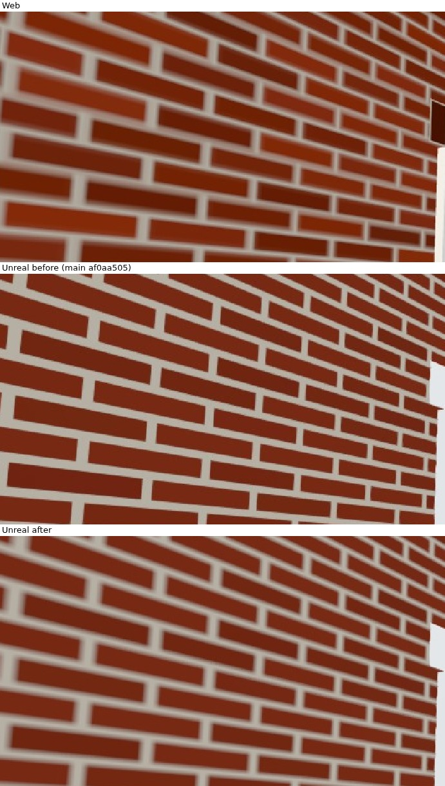
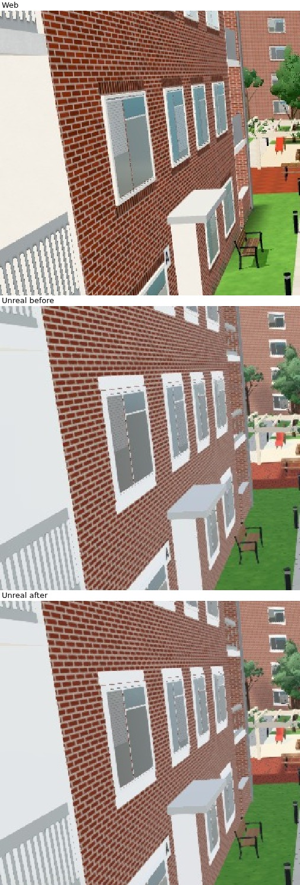
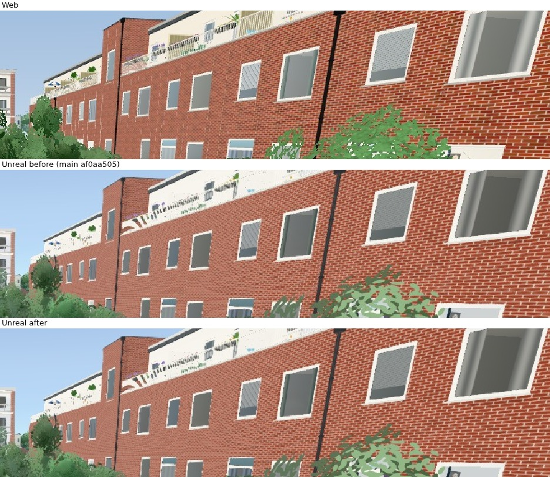
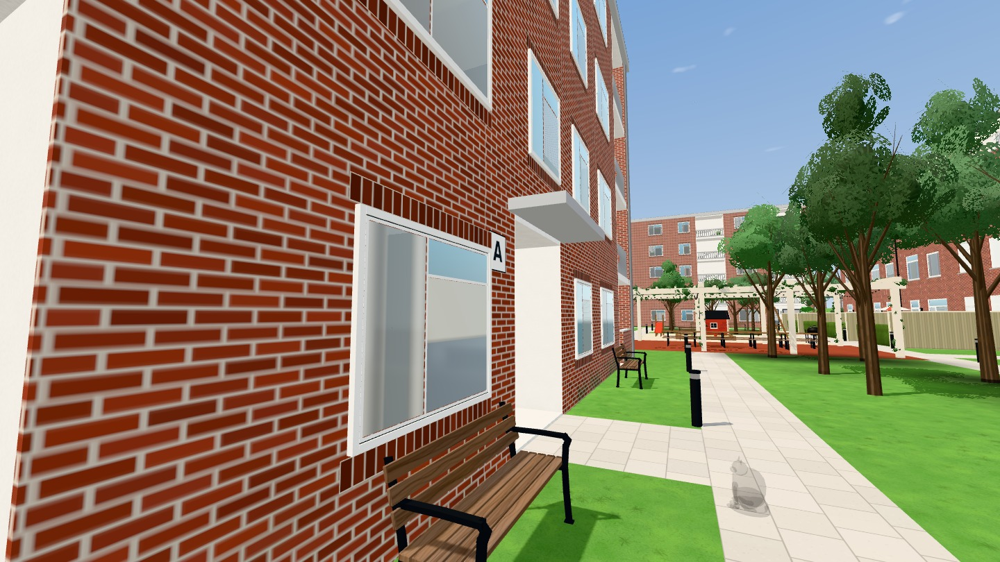
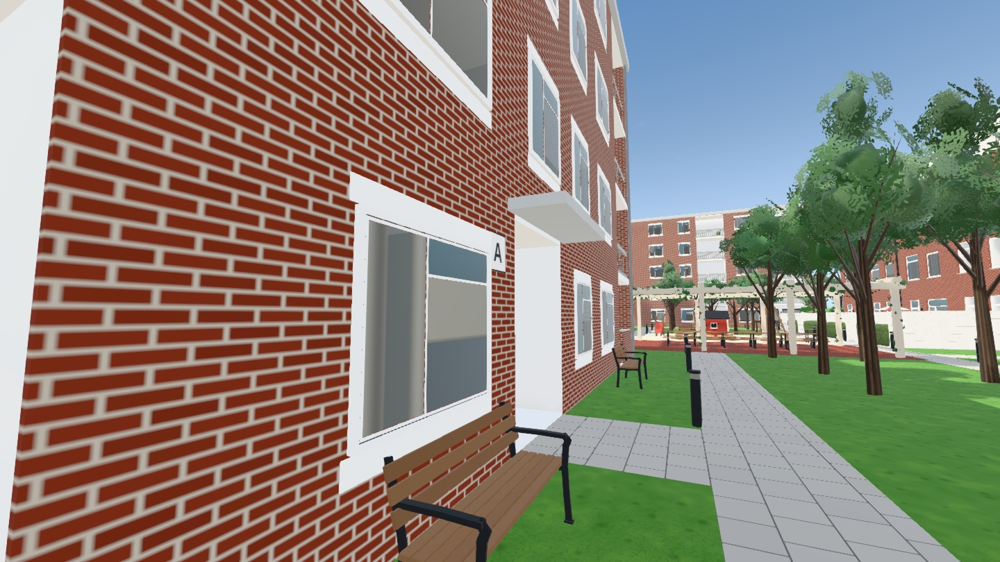
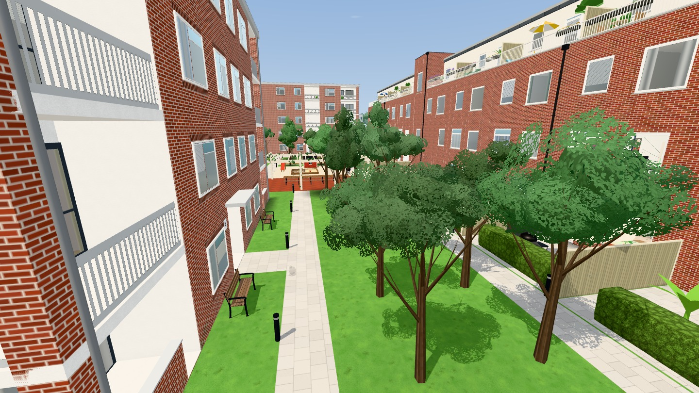
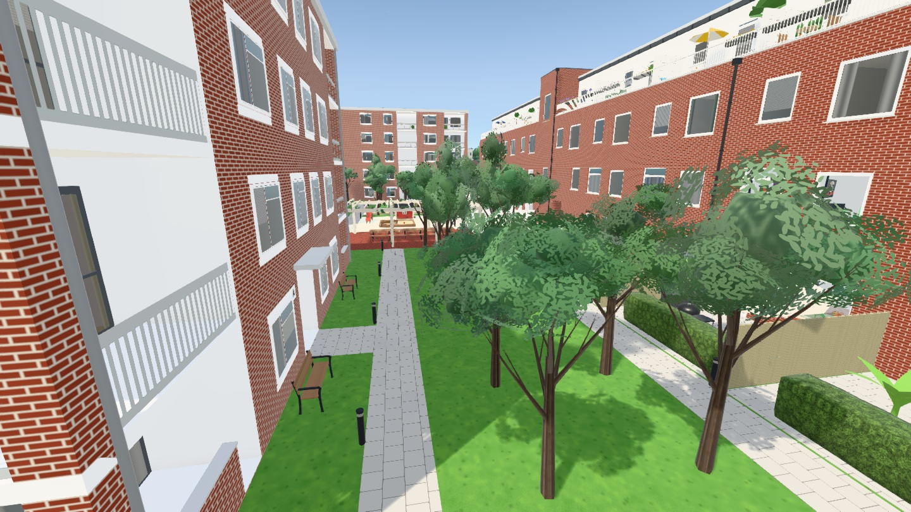

# Softer, narrower brick joints close up in Unreal (#2393)

Unreal Editor 5.8.4 on Windows 11, 2026-11-22, headless (`-nullrhi` for the material build and check,
`-RenderOffScreen` for the pictures), in the warm checkout `lunden-ue-wt/opus-2387` at `af0aa505` plus this change. How
the filter works: [unreal.md, Surface materials](../../development/unreal.md#surface-materials-2282) ("Patterned
surfaces").

## What changed

On the web, Hus A, B and C and the courtyard's retaining walls take their brick from a 256 px canvas per 3 m bay (2 m for
the retaining walls). The canvas draws 2 px head joints and 1.5 px bed joints. The canvas box-filters them, and the GPU
then magnifies them bilinearly, so up close they are soft and never reach the full mortar colour. Unreal drew them crisp,
in the full mortar colour, with one 0.007-unit joint in both directions. The tiled master's brick filter now has two
extra parameters:

- `BedJoint`: the bed joint along V. On the Å-husen and the retaining walls it is the canvas's 1.5 px (0.00586 units),
  and the head joint is its 2 px (0.0078 units).
- `TexelBlur`: the canvas blur in UV units. It replaces the pixel footprint while it is the wider of the two, so it acts
  only close up. Distant walls keep #2318's pixel integration unchanged. A box of 1.73 texels reproduces the web's
  profile best (rms 0.052 of full mortar against a canvas-plus-bilinear model). The pairs fit best at 1.3 texels,
  because Unreal's own anti-aliasing adds the rest. That is 0.00508 units on the 256 px canvases and 0.00254 on Hus
  L's 512 px canvas, whose 8 px joints hardly change.

`build_materials.py` rebuilt `M_LundenTiled` (spec `df947b5a55103e0a`), `MI_LundenFacadeBrickAHus` (`a407198a82b0934c`),
`MI_LundenBrickHistoric` (`c64030b11144e135`) and `MI_LundenFacadeBrick` (`51926b6d280e86a0`): `4 written, 46 kept`.

## Checks

| Check | Result |
|---|---|
| `build_materials.py --check` on the saved assets | pass: `LUNDEN_MATERIALS_CHECK_OK 50 materials` |
| WSL `tests/test_materials.py` on the checkout's export | pass: `MATERIAL_COVERAGE_OK` (brick 6 meshes, roof 10, asphalt 4, paving 8) |
| `tests/brick-joints.cjs` (new): joint share and joint L*, within ±15 % of the web | close up: pass; at a distance: Hus L passes, the Å-husen are at x1.17 (table below) |
| Moiré on the distant façades (Hus L and Hus A in the courtyard view) | none: the distant walls are the same as before. A narrower footprint brought the arcs back (see below) |

### Joint share and joint lightness

`brick-joints.cjs` takes crops that hold only brick ([`brick-crops.json`](brick-crops.json)). It splits each crop's CIE
L* in two with Otsu's threshold. The light class is the mortar. The tool prints the mortar's share of the pixels and its
mean L*. Pictures: 1440 × 810, 72° vertical, 21 June 14:00, clear. The web halves are #2325's
(`9f662b65`; no web brick source has changed since). The Unreal halves come from `capture_vegetation.py`'s cameras
([`unreal-capture.json`](unreal-capture.json)), run through a scratch wrapper. The wrapper sets the instance parameters
in memory for each variant and saves nothing. The "after" variant used the saved values.

| Crop | Web share / L* | Before: Unreal / web | After: Unreal / web (JPEG) | After (lossless PNG) |
|---|---|---|---|---|
| entrance A, wall close up | 0.372 / 58.0 | share x0.95, L* **x1.20** | x1.07, x1.08 | x1.07, x1.08 |
| courtyard, Hus A pier close up | 0.397 / 64.5 | x0.90, **x1.16** | x0.98, x1.07 | x0.98, x1.07 |
| entrance A, upper wall at a distance | 0.415 / 55.3 | **x1.23**, x1.05 | **x1.17**, x1.03 | x1.14, x1.04 |
| courtyard, Hus A at a distance | 0.385 / 56.9 | **x1.17**, x1.08 | **x1.17**, x1.03 | x1.14, x1.04 |
| courtyard, Hus L at a distance | 0.389 / 64.3 | x1.02, x1.00 | x1.01, x0.99 | x1.01, x0.99 |
| courtyard, Hus L, middle distance | 0.521 / 58.7 | x0.95, x1.04 | x0.95, x1.03 | x0.94, x1.03 |

Raw numbers: [`brick-joints.json`](brick-joints.json) (the committed JPEGs, both halves JPEG with 4:2:0 chroma) and
[`brick-joints-lossless.json`](brick-joints-lossless.json) (the editor's PNGs). Close up, the joints are now within
±15 % of the web for both share and lightness. Before, they were 16-20 % too light. At a distance the Å-husen show
14-17 % more joint pixels than the web, a little less than before. Hus L is unchanged and within the tolerance. The
mortar class there is right, but its brick class is about 4-5 L* lighter than the web's (contrast x0.82), because
the filter blends brick and mortar into one pixel where the web keeps them apart.

### Why the distant footprint stays

In the same editor session the pixel footprint was also scaled by 0.7, 0.5 and 0.35. That lowered the distant joint
share, but at 0.7 and below the moiré arcs from #2318 came back on Hus L's courtyard façade. Hus L's bricks are the
Å-husen's size, 0.26 × 0.075 m. The distant walls therefore keep the full footprint.
The remaining distant difference is [#2428](https://github.com/solwation/lunden-3d-apartment/issues/2428).

## Houses checked

- **Hus A**: the entrance close up and at a distance, and the courtyard façade (pier close up, wall at a distance).
- **Hus B and C**: one merged mesh with Hus A (key `std_ffffff_r95_m0_tex`, the Å-husen body), one instance
  (`MI_LundenFacadeBrickAHus`) and the same UV scale. The change applies to them unchanged. The house at the end of the
  courtyard view shows it at a distance.
- **Hus L**: the courtyard façade at middle and long distance (crops and moiré). Its instance only gets
  `TexelBlur` 0.00254, which barely touches its 8 px joints.
- **Retaining walls and the school wall** (`MI_LundenBrickHistoric`): the same canvas courses as the Å-husen, given the
  same joint values. They were not measured in a separate crop.

## Pictures

| | |
|---|---|
| Entrance A, close crops: web, Unreal before, Unreal after |  |
| Courtyard, Hus A's façade: web, before, after (no moiré) |  |
| Courtyard, Hus L's façade at a distance: web, before, after (no moiré) |  |

| Web | Unreal after |
|---|---|
|  |  |
|  |  |

Other differences in these pairs, each with an open issue:

- the paths are grey, the web's cream: #2392;
- the Å-husen's windows have a wide white surround and no soldier course of upright bricks above and below: #2425;
- the lawn in front of entrance A is darker: #2426;
- the bricks vary less in colour than the web's orange-to-dark-red canvas: #2427;
- the distant brick is a little lighter, with more joint pixels: #2428;
- surfaces such as the white render and the foliage are slightly paler and colder (sky reflection): #2424.
