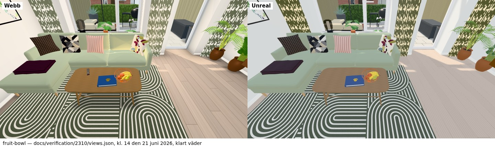
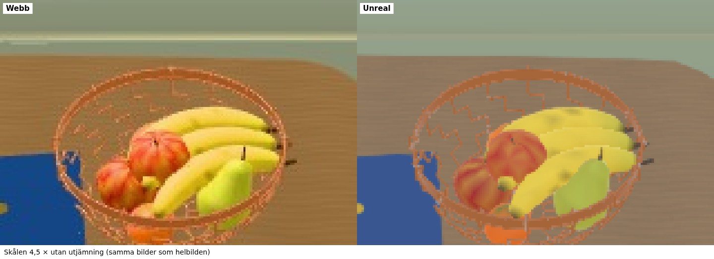
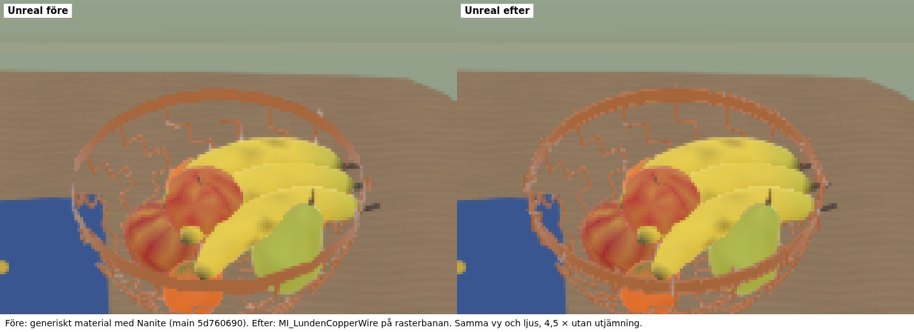

# #2395: the fruit bowl's copper wire in Unreal

In the #2310 pair the bowl's copper wire looked faint and see-through in Unreal. On the web it is solid copper.

## Diagnosis (UE 5.8.4, `L_Lunden`, the #2310 fruit-bowl view)

- **Material.** The wire mesh `furn_fruitbowl_l0_x332_z1052__1` was the only mesh with the key
  `std_c8845e_r22_m90_ds`. That key fell to Interchange's instance (parent `MI_Default_Opaque_DS`), which already
  carried the web's values: colour #c8845e (linear 0.578, 0.231, 0.112), metallic 0.9, roughness 0.22, two-sided.
- **Capture path.** Most of the faint, hazy look in the #2310 picture came from the old capture path, which #2396
  replaced. A fresh capture of the same view at main 5d760690, with no change, already shows a solid copper band.
- **Geometry.** What remained was geometry. The wires are 1.7 mm thick, about one pixel at this view, and Nanite
  simplified some of the zig-zag wires away (`before-after-close.jpg`, left). The mesh was switched off Nanite in
  memory, nothing saved. All the wires then came back, with the same colour, whichever material it wore.

## Change

- `material-map.json`: `MI_LundenCopperWire` (`M_LundenSurface`, BaseColor #c8845e, Roughness 0.22, Metallic 0.9), with
  `"twoSided": true` and `"raster"`. A rule sends `^std_c8845e_r22_m90_ds$` on mesh `^furn_fruitbowl_` to it.
- `build_materials.py`: an instance's `twoSided` sets its two-sided override, and `raster` is stamped as
  `Lunden.Raster`. `--check` verifies both.
- `prepare_nanite_materials.py`: a mesh that wears a `Lunden.Raster` material goes to the raster path.
  On l1007 that makes 74 raster meshes, one more than before.
- `tests/test_furnishing.py`, check 4, covers every `material-map.json` rule whose `mesh` selector picks a
  furnishing mesh, in every level:
  - the mesh wears the rule's material, not the generic key;
  - the colour, roughness, metalness and two-sided setting equal the export key's;
  - a `raster` material's mesh is off Nanite.

## Checks

Windows checkout `lunden-ue-wt/opus-2389` at main 5d760690 plus this change. Export of c871baa1, current for HEAD.

| Check | Result |
|---|---|
| `test_furnishing.py` before the import (bowl still on the generic key) | **fails as intended**: 3 errors, one per level (`Level_l1007`, `Level_l1007_interaction`, `L_Lunden`), *materials ['…/std_c8845e_r22_m90_ds'], want /Game/Lunden/Materials/MI_LundenCopperWire* |
| `build_materials.py`, then `--check` | `MI_LundenCopperWire: created`; `LUNDEN_MATERIALS_CHECK_OK 51 materials` |
| `sync-import.ps1`: all 10 zones re-imported (material map changed), derived levels, `import_world.py --check` | `LUNDEN_SYNC_IMPORT_OK`, `LUNDEN_CHECK_OK` |
| `test_furnishing.py` after the import | `LUNDEN_FURNISHING_TEST_OK`: 175 of 175 items, 231 of 231 textured meshes; bowl in all 3 levels with colour off 0.0, roughness 0.22, metallic 0.9, two-sided, Nanite off |
| `python3 tools/unreal-engine/tests/test_materials.py` | `MATERIAL_COVERAGE_OK` |

`material-map.json` and the Python builders are not export sources (`tools/unreal-engine/sources.mjs`), so the export
did not change and `check-export.mjs` was not needed. The sync reported the export as current.

## Pictures

Same camera on both sides: [the #2310 view](../2310/views.json), 21 June 2026 at 14:00, clear.
- Web: `capture-web-views.cjs`, desktop Ultra, SwiftShader, 1440 × 810.
- Unreal: `tests/capture_l1007.py` on `L_Lunden`, with the map's own light and the game's exposure.

| Picture | Shows |
|---|---|
|  | the whole view, web and Unreal (`web-fruit-bowl.jpg`, `unreal-fruit-bowl.jpg`) |
|  | the bowl at 4.5 ×, with no smoothing: the wire is solid copper on both sides, with the same zig-zag pattern |
|  | Unreal before (generic material with Nanite: some wires missing, band drawn too wide) and after |

**Other differences in the pair**, each covered by an open issue:
- Floor, sofa and walls are paler and cooler in Unreal: #2394.
- Curtains, rug, coffee-table and sofa fabric textures are darker: #2322.
- The patio, seen through the door, looks pale: #2388.
- Sky reflection on the surfaces: #2424.
- The TV remote on the coffee table is missing in Unreal: #2429, new.
