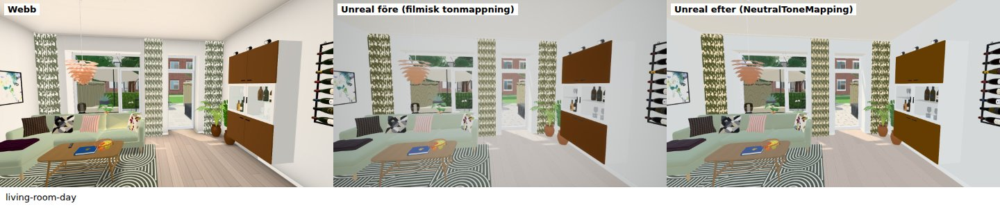
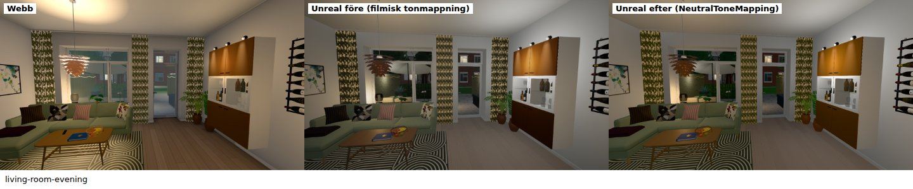
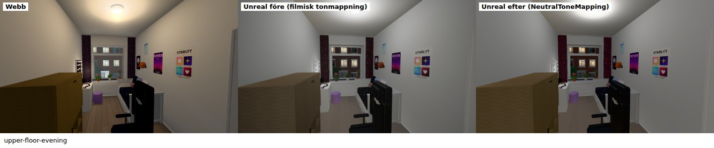
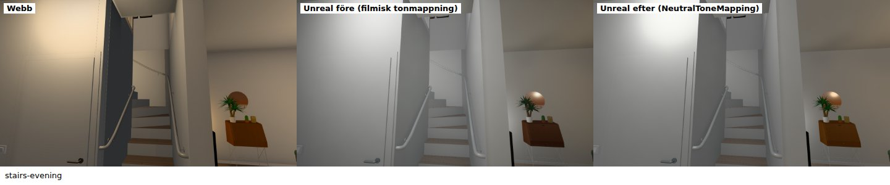
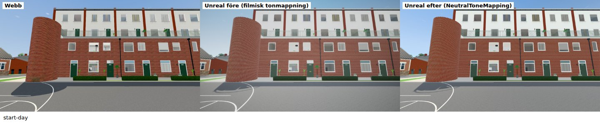
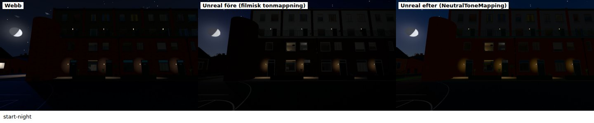
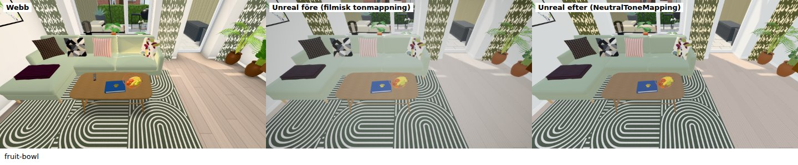
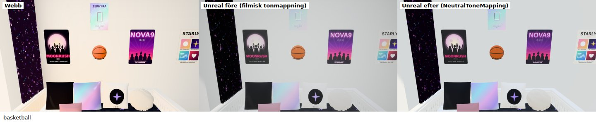

# #2396: the web's tone mapping in Unreal

The web renders with `THREE.NeutralToneMapping` (Khronos PBR Neutral, `src/main.js`) and writes sRGB. Unreal used its
default filmic tonemapper. `M_LundenNeutralTonemap` (`tools/unreal-engine/python/neutral_tonemap.py`, built by
`build_lighting.py` as a blendable of `BP_LundenSky`'s `Weather` component) replaces it with three.js r170's
`NeutralToneMapping` and `sRGBTransferOETF`, transcribed from three@0.170.0, the import map's version.

## The curve against three.js

`tests/neutral_tonemap_probe.py` (UE 5.8.4) renders 50 unlit emissive patches: 25 greys from 0 to 10 and 25 colours up
to 6. They go through the built material with the capture settings of `render_view`. `tests/check-neutral-tonemap.cjs`
renders the same inputs with three.js 0.170.0 itself (MeshBasicMaterial, NeutralToneMapping, sRGB output) and compares
each channel ([tonemap-check.json](tonemap-check.json)).

| Picture | Fitted exposure | Largest difference from three.js |
|---|---:|---:|
| [neutral, bias 0](probe-neutral-b0.png) | 0.9900 | 1/255 (OK) |
| [neutral, bias −2](probe-neutral-b2.png) | 0.2475 | 1/255 (OK) |
| [Unreal's filmic tonemapper, bias 0](probe-default-b0.png) | 0.70 (best fit) | 103/255 |

The exposure falls by 2.000 EV between the two biases, so Unreal's exposure reaches the curve.

**Why it is `PostProcessInput0` × `EyeAdaptation`.** At `BL_ReplacingTonemapper` the input arrives without Unreal's
pre-exposure. Multiplying by `EyeAdaptation` and also by `View.OneOverPreExposure` (the form of Unreal's own tonemapper
shader) left the picture at bias 0's brightness whatever the bias. That was the first version, caught by a −1 EV trial
on the real views.

## Captures show the displayed picture

Two capture faults turned up on the way. They are fixed in 48a7c75a and b442c723, before this change.

- **No view state, no post-process material.** `render_view` kept a view state only for Lumen captures. Unreal skips
  every post-process material on a view without one (`UMaterialInterface::OverrideBlendableSettings`), so the non-Lumen
  captures had no weather pass and could not show a replaced tonemapper.
- **The output target.** Both `render_view` and `capture_lighting` now take `SCS_FINAL_COLOR_LDR` into an RGBA8 target
  at `target_gamma` 2.2, as the viewport. At the target's default gamma 1, Unreal's tonemapper writes linear values (grey
  0.2 gave 50/255). On the former tone-curve HDR source into an sRGB target, a replaced tonemapper's output is encoded
  twice.
- Grey 0.1/0.2/0.5 through Unreal's own tonemapper now reads 78/125/190; the former path read 78/126/191.

## Pairs: web, before, after

Same cameras and shots as #2307/#2313 (`tests/lighting-shots.json`), the #2369 stairs and the #2310 views, on main
6046b552 (#2386's lighting). The web pictures are the committed references:
- #2313: living room by day, in the evening and with the dusk lamps, upper floor, START in rain and at night;
- #2386: START by day;
- #2369: the stairs;
- #2372: the living room without the pendant;
- #2310: the fruit bowl and the basketball.

Unreal before = main with its filmic tonemapper. After = this change, at the game's exposure (`capture_lighting.py
--exposure=game`, `capture_l1007.py`), with the display-path capture on both sides.

| | |
|---|---|
|  |  |
|  |  |
|  |  |
|  |  |

Mean relative luminance of the linear colour, Unreal ÷ web (`tests/crop-stats.cjs`, crops in [crops.json](crops.json),
full output in [before](crop-stats-before.txt) and [after](crop-stats-after.txt)), and the warmth R/B of the mean colour:

| Shot | Crop | Before | After | R/B web | R/B before | R/B after |
|---|---|---:|---:|---:|---:|---:|
| living-room-day | left-wall | 0.67 | 0.86 | 1.09 | 0.99 | 0.99 |
| living-room-day | right-wall | 0.98 | 1.12 | 1.10 | 1.01 | 1.01 |
| living-room-day | ceiling | 0.73 | 0.78 | 1.13 | 1.03 | 1.07 |
| living-room-day | frame | 0.88 | 0.96 | 1.17 | 1.06 | 1.09 |
| living-room-evening | left-wall | 0.53 | 0.70 | 1.29 | 1.20 | 1.20 |
| living-room-evening | right-wall | 2.07 | 1.94 | 1.35 | 1.03 | 1.04 |
| living-room-evening | ceiling | 1.12 | 0.94 | 1.36 | 1.11 | 1.13 |
| living-room-evening | frame | 0.85 | 0.82 | 1.50 | 1.25 | 1.34 |
| living-room-dusk | left-wall | 0.54 | 0.74 | 1.19 | 1.09 | 1.10 |
| living-room-dusk | right-wall | 2.13 | 1.99 | 1.33 | 1.02 | 1.02 |
| living-room-dusk | ceiling | 1.33 | 1.11 | 1.29 | 1.06 | 1.07 |
| living-room-dusk | frame | 1.09 | 1.06 | 1.44 | 1.20 | 1.28 |
| upper-floor-evening | left-wall | 0.90 | 0.83 | 1.31 | 1.01 | 1.01 |
| upper-floor-evening | right-wall | 0.95 | 0.96 | 1.28 | 1.02 | 1.03 |
| upper-floor-evening | ceiling | 1.05 | 0.81 | 1.25 | 1.07 | 1.09 |
| upper-floor-evening | frame | 1.03 | 0.93 | 1.33 | 1.07 | 1.10 |
| start-day | sky | 1.06 | 1.14 | 0.73 | 0.81 | 0.70 |
| start-day | frame | 1.16 | 1.18 | 1.08 | 1.05 | 1.05 |
| start-overcast | sky | 0.81 | 0.87 | 0.98 | 0.97 | 0.96 |
| start-overcast | frame | 1.18 | 1.22 | 1.15 | 1.06 | 1.08 |
| start-night | sky | 0.92 | 1.22 | 0.62 | 0.50 | 0.39 |
| start-night | frame | 1.02 | 1.25 | 0.89 | 0.77 | 0.80 |
| stairs-evening | frame | 1.24 | 1.19 | 1.31 | 1.05 | 1.06 |
| stairs-evening | shaft-wall | 6.74 | 4.82 | 0.94 | 1.00 | 1.00 |
| stairs-evening | riser | 2.05 | 1.63 | 1.25 | 1.01 | 1.01 |
| stairs-evening | tread | 3.06 | 2.37 | 2.08 | 1.17 | 1.23 |
| stairs-evening | hall-door | 0.95 | 1.14 | 1.32 | 1.00 | 1.01 |
| living-room-without-pendant | left-wall | 0.79 | 1.04 | 1.19 | 1.20 | 1.20 |
| living-room-without-pendant | above-pendant | 1.75 | 1.70 | 1.20 | 1.38 | 1.42 |
| living-room-without-pendant | right-wall | 2.24 | 2.10 | 1.34 | 1.03 | 1.04 |
| fruit-bowl | floor | 1.00 | 0.96 | 1.25 | 1.05 | 1.10 |
| fruit-bowl | sofa-seat | 0.94 | 0.76 | 1.14 | 1.00 | 0.99 |
| fruit-bowl | sofa-back | 0.94 | 0.72 | 1.32 | 1.03 | 1.05 |
| fruit-bowl | rug-dark | 0.79 | 0.97 | 1.14 | 0.99 | 0.99 |
| fruit-bowl | wall-left | 0.62 | 0.80 | 1.08 | 0.99 | 0.99 |
| fruit-bowl | table | 1.51 | 1.12 | 2.44 | 1.42 | 1.51 |
| fruit-bowl | frame | 0.92 | 0.95 | 1.20 | 1.06 | 1.08 |
| basketball | wall | 0.75 | 0.81 | 1.09 | 0.99 | 0.99 |
| basketball | wall-low | 0.78 | 0.82 | 1.11 | 0.99 | 0.99 |
| basketball | frame | 0.78 | 0.88 | 1.08 | 0.99 | 0.98 |

**`EXPOSURE_BIAS` stays at −2.55.** The geometric mean of the ten frame ratios after the change is 1.03: living room by
day and at 22:00, dusk lamps, upper floor, stairs, START by day, in rain and at night, fruit bowl and basketball. That
is −0.05 EV, within the scatter between views (0.82–1.25), so a new value would be noise. The day frames are
0.88–1.22, the 22:00 frames 0.82–1.25.

**What the tonemapper changed.** The pale darks and highlights.
- The fruit-bowl wall rose from 0.62 to 0.80 of the web, the rug from 0.79 to 0.97, the basketball wall from 0.75 to
  0.81, the 14:00 living-room left wall from 0.67 to 0.86, and the stairs' shaft wall came down from 6.7 to 4.8.
- The pictures gain the web's contrast and saturation: curtains, rug and the sofa's cushions.

**What it did not change: the cold cast.** NeutralToneMapping keeps hue, so R/B is the same before and after. Unreal
stays near 1.0 on the walls, floor and sofa where the web is warm, 1.08–1.50. Per channel, the blue of the white walls
is 23–26 % higher relative to red than on the web. That is the light colour or the base colours, #2394's subject, not
the tonemapper.

**Still outside 0.8–1.25** (other issues' lights; the tonemapper only stopped hiding them in the toe):
- the stairs' shaft wall, riser and tread at 22:00 (#2369, #2384);
- the living room's right wall by the cabinet at 22:00, 1.9–2.1 (#2322's cabinet spots);
- above the pendant without it, 1.7 (#2372);
- the sofa 0.72–0.76 (#2322's textures).

## Checks (UE 5.8.4, warm checkout at main 6046b552 with this change)

- `build_lighting.py` then `build_lighting.py --check`: `LUNDEN_LIGHTING_OK check passed`.
- `test_lighting` (PIE): passed.
- `neutral_tonemap_probe.py` + `check-neutral-tonemap.cjs`: within 1/255 at both biases, and a 2.000 EV step.
- `capture_lighting.py --exposure=game` (9 shots) and `capture_l1007.py` (2 views): OK.

## Re-measurement of #2390 and #2373 on 4af7f0bb

The same scenes and crops as [#2390](../2390/README.md) and [#2373](../2373/README.md), captured with
`tests/capture_vegetation.py` in the warm checkout at 4af7f0bb. The camera, the 14:00 sun and the exposure bias
(−1.965) are the same as #2390's committed pairs. The web halves and crops are #2390's and #2373's committed ones.
Triptychs `re-<view>.jpg` show the web, Unreal before #2396 (#2390/#2373's committed frames) and Unreal after.
The numbers are in `remeasure-2390-crop-stats.json` and `remeasure-2373-crop-stats.json`.

**#2390, scored with [`score.py`](../2390/score.py)** (Unreal / web; pass band 0.8–1.25):

| View | Luminance before | Luminance after | Saturation before | Saturation after |
|---|---|---|---|---|
| start (not counted) | 1.34 | 1.13 | 0.69 | 1.00 |
| patio-lawn | 1.37 | 1.13 | 0.57 | **0.74** |
| courtyard | 0.82 | 0.80 | 0.71 | 1.01 |
| courtyard-loggias | 1.04 | 1.09 | 0.52 | 0.83 |
| river | 1.28 | **1.29** | 0.65 | 0.84 |
| entrance-a | 1.17 | 1.18 | 0.77 | 0.99 |
| river-bridge | 1.38 | **1.27** | 0.65 | 0.84 |

Passing #2325 views: 0 of 6 before, 3 of 6 after.

What still fails is local to some surfaces, not the sun or the sky. Every sky crop is 0.89–1.14 in luminance and
0.90–1.09 in saturation. The outliers:
- the lawn by the river: far-lawn 1.31 and bridge lawn 1.65, while the courtyard lawn is 0.52, in tree shadow in Unreal;
- the far water: 1.56;
- the hedge: R/B 1.48 against 2.82, saturation 0.67;
- the bricks: saturation 0.65–0.69, which fits #2393's lighter joints;
- the letter plate: 1.39.

**#2373 at dusk** (23.5 h):

| Crop | Lum. ratio before | Lum. ratio after | R/B web | R/B Unreal before | R/B Unreal after |
|---|---|---|---|---|---|
| bulb-row | 0.70 | 0.58 | 3.44 | 1.73 | 2.53 |
| fence-pool | 2.59 | 2.00 | 13.27 | 1.52 | 2.00 |
| paving | 0.71 | 0.63 | 2.06 | 1.75 | 2.41 |

The string lights are dimmer and less orange than on the web, and the web's warm pool of light on the fence under them
is missing. The tonemapper only moved the colour part of the way. The open, bright parasol at dusk is #2403.

**Stale river materials in a warm checkout.** The first capture showed the river as flat grey. Both generated river
materials, `Generated/RiverMaterials/M_LundenRiverFlow` and `M_LundenRiverEdge`, failed to compile with
"CollectionParameter has invalid parameter None" and fell back to the default material:
- They had been generated at 18:09, before 390b0f08 (#2381) rebuilt `MPC_LundenWeather` with new parameter GUIDs.
- `build_materials.py` skips them because their spec hash is unchanged.

Rebuilding just those two materials restored the water: bridge water 1.19, saturation 0.91. The figures above are
from that capture. A fresh import generates them against the committed collection, so this affects only checkouts
whose river materials predate 390b0f08.
