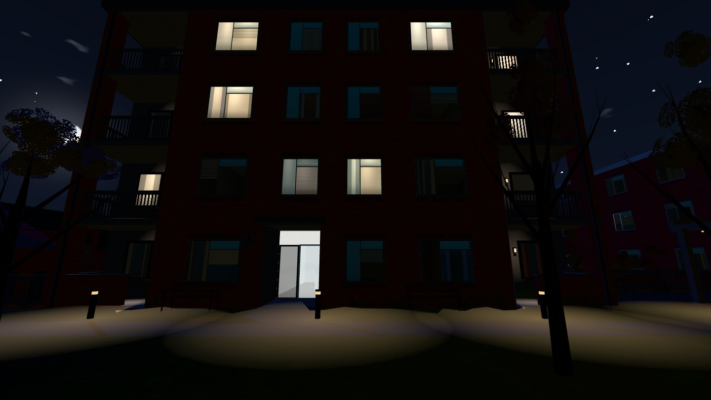
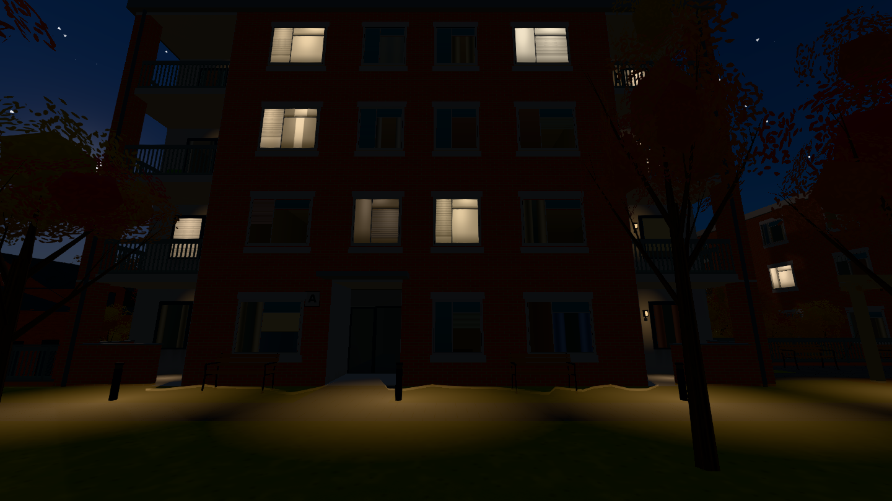
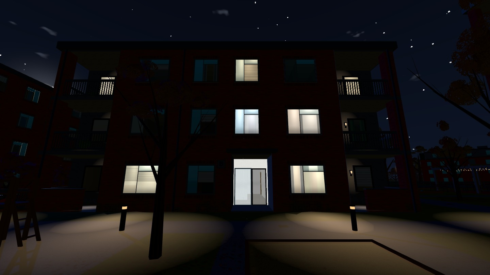
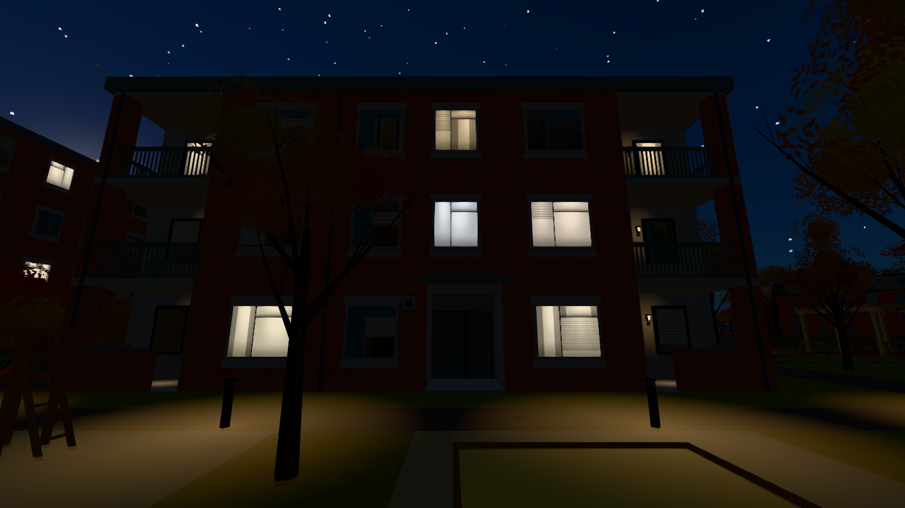
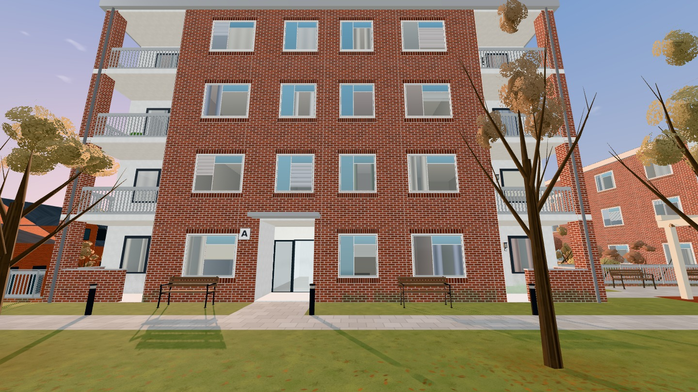
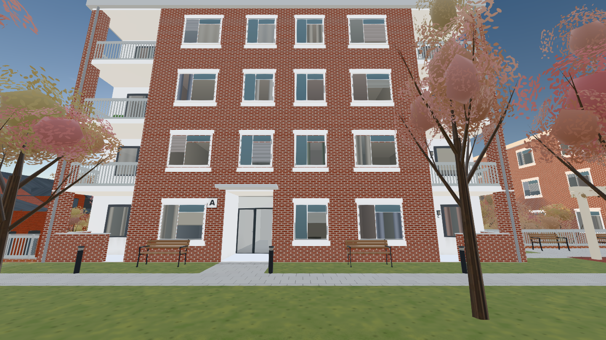
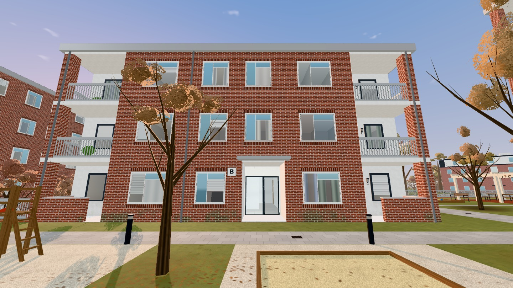
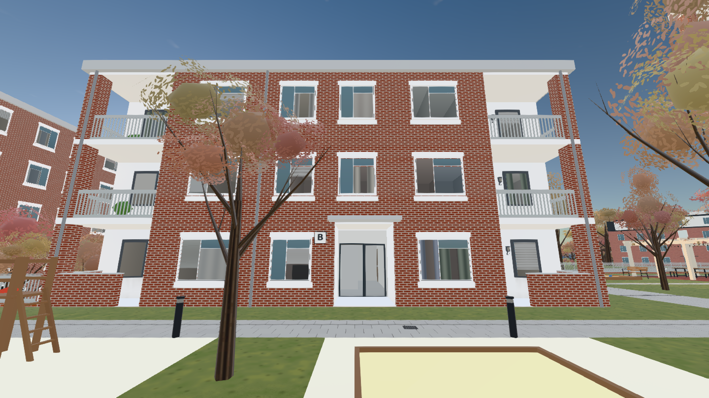

# Ljusfläckarna kring gårdens pollare i Unreal (#2397)

Webbens pollare lyser inte upp marken med något ljusobjekt. Ljusfläckarna är ett additivt markmesh,
`courtyard-bollard-pools` i `src/courtyard.js`, med ett ringformat nät på 5 × 20 segment per pollare som följer
terrängen. Meshet är dolt på dagen och kom därför aldrig med i gard-GLB:n. Sedan 488976a4 följer det med exporten
som en femte yta i `measurements.site.facadeLighting.surfaces` (`courtyardBollardPools`, 17 pollare och 3 060
trianglar). Ytan har webbens egen färg `0xffcf8f` och topp 0,45. `build_facade.py` ritar den med samma additiva
wash-material som entré- och loggialyktornas markljus från #2324 och med samma skymningsspärr.
Pollarnas tröskelvärden för på, av och toning är 0,35, 0,30 och 1,5 s, alltså samma som vägglyktornas. Webben tonar
båda från samma nattfaktor. `facade_scene.validate` stoppar en export där värdena skiljer sig åt.

## Bildpar, 16 november 2026

Webben är tagen vid 488976a4 och Unreal 5.8.4 vid samma revision med en fullständig lokal export.
Bildparen använder kamerorna `facade-a` och `facade-b` i [facade-views.json](../../../tools/unreal-engine/tests/facade-views.json),
klart väder, spelets exponering och klockslagen 14.00 och 18.15.

| Vy | Webb | Unreal |
| --- | --- | --- |
| Hus A, 18.15 |  |  |
| Hus B, 18.15 |  |  |
| Hus A, 14.00 |  |  |
| Hus B, 14.00 |  |  |

Bilderna före ändringen är #2324:s Unreal-bilder vid
[56f0bb65](https://github.com/solwation/lunden-3d-apartment/blob/56f0bb65c56f4086eae2bed6ef81e100e3ccb235/docs/verification/2324/unreal-facade-a-dusk.png).
De togs innan #2396 bytte tonkurva, så siffrorna före är bara ungefärliga.

## Mätning

Utsnitten finns i [bollard-crops.json](bollard-crops.json) och mäts med `tools/unreal-engine/tests/crop-stats.cjs`.
Råvärdena ligger i [bollard-crop-stats.txt](bollard-crop-stats.txt) och, för bilderna före ändringen, i
[bollard-crop-stats-before.txt](bollard-crop-stats-before.txt). Tabellen visar linjär relativ luminans kl. 18.15.

| Utsnitt | Webb | Unreal före | Unreal nu | Nu / webb |
| --- | --- | --- | --- | --- |
| A, mark vid vänstra pollaren | 0,0461 | 0,0022 | 0,0320 | 0,69 |
| A, mark vid mittpollaren | 0,0804 | 0,0026 | 0,0627 | 0,78 |
| A, mellan mitt- och högerpollaren | 0,0169 | 0,0026 | 0,0074 | 0,44 |
| B, mark vid vänstra pollaren | 0,1053 | 0,0025 | 0,0752 | 0,71 |
| B, mark vid högra pollaren | 0,1362 | 0,0026 | 0,0759 | 0,56 |
| B, gången mellan pollarna | 0,0027 | 0,0033 | 0,0021 | 0,78 |

Kl. 14.00 är markljuset släckt i båda versionerna. Där ligger samma utsnitt på 0,86–1,13 gånger webben.
Undantaget är förgrunden vid B, som ligger på 1,81 gånger webben. Den är gångens gräddvita grus (#2392), inte pollarljus.
I vy A står kameran 1,25 m från pollarraden. Därför ligger även utsnittet `outside` i förgrunden inom fläckarnas
radie på 3,4 m.

**Kvarstående avvikelse, dokumenterad.** Fläckarna når 56–78 procent av webbens luminans och är varmare
(R/B 2,6–3,3 mot webbens 1,2–1,5). Materialet använder #2324:s gemensamma kalibrering på 2,65 för allt additivt
markljus, som är en *guess*. Skillnaden kalibreras inte om för pollarna ensamma. Marken mellan fläckarna är också
mörkare och mindre blå i Unreal (0,44 gånger webben vid A). Webben lägger alltså fläckarna på ett blåare nattljus.
Den skillnaden gäller hela nattscenen och hör till #2421.

## Entré- och loggialyktornas ljus från #2324

Wash-materialet läser nu varje ytas färg som custom primitive data i stället för som en fast konstant.
För de fyra befintliga ytorna är värdena desamma som förut: topp 0,26 eller 0,45 och den linjära färgen av
`0xffd29a`. Det native testet `test_facade_lighting.py` godkände alla 1 397 fasadplan, fem markljusmesh
och kontrollerns sju steg genom spärr, toning och strömavbrott (`LUNDEN_FACADE_LIGHTING_OK`).
Mätningen i [facade-crop-stats.txt](facade-crop-stats.txt) ger lyktlinserna i A och B 0,81 och 0,83 gånger webben kl. 18.15.
Vid 56f0bb65 var värdena 0,86 och 0,88. Dagsbildernas nivåer har också flyttats. Lyktlinsen kl. 14 gick från 1,32 till
1,00 gånger webben. Det kommer från tonkurvan och fångsten i #2396 och solbalansen i #2386, inte från markljuset,
som är släckt på dagen.

Fläckarnas toning mot dimman på avstånd är inte jämförd. Webben tonar dem mot scendimman med `fadeGlowWithFog`.
Unreal använder sin egen dimma för genomskinliga material.
