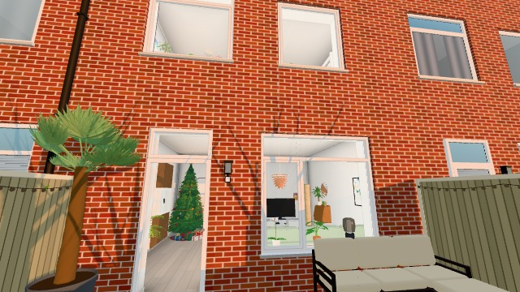
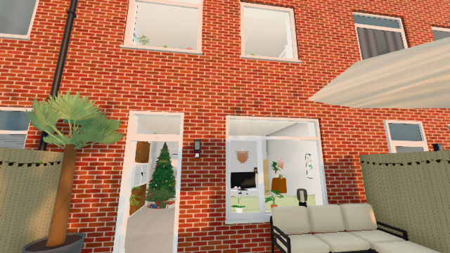
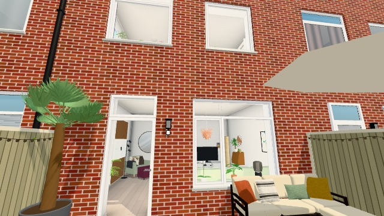
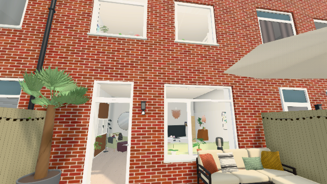

# #2398: source-owned low-sun colour

Verified partial delivery; #2398 stays open. The fresh saved-rig image process and
independent canonical functional test pass. The locked visual gate is still **3/4**:
winter brick warmth is **0.88349**, below the required 0.9. The Christmas and June
pairs retain the original brick/frame crops and R/B ±10% gate.

The web's `DayCycle.update` uses the exported linear `sunLow` and `sunHigh`, mixed by
`smooth(0.05, 0.4, sunDir.y)`. The native sky already updated solar direction and
intensity, but never set its Sun component's colour. `UpdateSky` now sends that same
linear blend to `SetLightColor` on every update. Its solar elevation is native Z,
corresponding to web Y. No fitted RGB, temperature, exposure or intensity change is
involved. The Moon remains unchanged; the separate Sun is off on the moon branch.
The shared Sun affects every house, including direct summer sunlight, so the June
control and existing material-profile gates must be reviewed with the native result.

The physical `Sun` bypasses the engine's additional atmospheric transmission. A
separate `SunAtmosphere` keeps the same source colour, intensity and direction for
the sky and ordinary height fog. Its lighting channels are all disabled, diffuse
and specular scales are zero, and it casts no shadows. Sun and Moon retain the
two original directional shadow roles. Physical Sun keeps volumetric scattering
1 and its original volumetric-shadow flag; the atmosphere component uses 0.
Corrected physical sunlight therefore also reaches enabled volumetric fog; this
does not preserve the previous extra atmospheric attenuation in that optional
path. The current authored fog and CPU image profile disable volumetric fog.
The canonical test checks these actual component roles and equal source colour,
intensity and direction at all eleven solar cases.

An initial saved colour-only candidate passed three of four image crops: the
winter frame remained too warm at 1.124 R/B relative to the web. Its overall native
run failed with the recorded package-reload ensure #2492 despite completed images;
a separate fresh-process canonical test passed. A no-save atmosphere-off diagnostic
also passed only three crops, moving the winter failure to brick at 0.884. Neither
candidate is recorded as a complete visual pass.

The split rig was actually built and seven authored Lighting packages saved, with
all 247 authored files returned to read-only mode. That combined build/canonical
process failed its unchanged clock assertion (zero advance, #2491). The successful
save prefix is reused explicitly; the failed overall test remains failed. Fresh
saved-package image and separate unmodified canonical processes subsequently passed
(see below). No repeated authored build or package reload was used for those checks.
The combined-process failure remains recorded rather than reclassified.

`test_lighting.py` adds the actual 24 December 2026, 14:00 acceptance case and reads
the real Sun component after each `UpdateSky`, including a return to the existing
seasonal cases. It checks the linear component colour against the export and records
both linear and stored sRGB8 values. The 0.005 linear tolerance accounts for Unreal's
sRGB8 `LightColor` storage; it does not permit the previous white fallback.
`check-sun.mjs` compares those observations against the web's source colours while
retaining the existing direction, cloud, weather and dusk checks. Historical results
without the new colour fields remain readable, but do not prove this new colour gate.

Source checks (no editor or asset writes):

- 26 emitted Blueprint math graphs evaluated against the actual solar colour statement
  from `DayCycle.update`: low/high boundaries, intermediate values, Christmas/June and
  modified exported colour values; maximum linear RGB error 0.
- Checker fixtures, explicitly synthetic colour observations on the prior source-bound
  direction result: positive 137/137 values and 21 directions, worst 0.0000°; replacing
  the Christmas colour with white exits 1 and fails green/blue. These are checker
  regressions, not new native execution evidence.
- Python/JavaScript syntax and `git diff --check` pass. Existing lamp event/38-colour
  assertions and material-profile constants are unchanged.

UE 5.8.4 primary source confirms `SetLightColor(FLinearColor, bSRGB)` stores
`NewLightColor.ToFColor(bSRGB)` and `GetLightColor()` converts that stored `FColor`
back to linear. Private scripts, fixtures and output are preserved under the active
session's `2398/`. Root owns native validation, asset locks and publication.

Original-only Unreal change. No web behaviour change, public downstream transfer or
player changelog is applicable.

## Actual split-rig verification

The [saved-rig image process](linux-split/native-outcome.json), source `fc87de55`,
completed with native/runner/outer exit 0 in 401.17 seconds. It executed the actual
20-step cached canonical sequence and eight images. All 247 authored packages stayed
byte/mode exact and read-only; imported ten-zone packages, export and source guards
passed, and all Generated files remained exact after the canonical prefix.

The [locked solar gate](linux-split/solar-gate.json) remains failed:

| Date | Brick R/B ratio | Frame R/B ratio |
| --- | ---: | ---: |
| 24 December, 14:00 | **0.88349 FAIL** | 1.08110 PASS |
| 21 June, 14:00 | 0.93243 PASS | 1.01697 PASS |

All [22 existing room/profile rows](linux-split/regression-gate.json) pass, including
14 material luminance rows, existing curtain/cabinet colour guards, two stair warmth
rows and four whole-frame luminance rows. [Whole room review](linux-split/regression-whole-review.json)
and [whole patio review](linux-split/solar-whole-review.json) identify the remaining
mismatches and their open issues. Numeric success is not a claim of full visual parity.
The [native sky-role control](linux-split/sky-role-comparison.json) uses the existing
#2371 camera and sky-only rectangle: all its RGB pixels are byte-identical between
split and original atmosphere roles, with actual role/binding restoration afterward.
Ground surface differences in that causal control are expected.

A separate [canonical NullRHI run](linux-split/canonical-outcome.json),
`20261127T191602242125-3186787`, completed with native/runner/outer exit 0 in176.96s.
It registered the literal unchanged canonical source (SHA256
`71f5c78cb9e422907990e18fa0be1089a029818f2056a5439577db1c1132b1d8`), without a build
prefix, observer or assertion edits. Clock advance was20.08 game minutes in the
unchanged two-second test;11 solar cases and actual atmosphere-role checks,8 dusk,
4 weather,3 cloud-drift cases and38 source light colours passed. Authored247,
GeneratedLighting and source guards passed. The byte-exact checker and its web imports
returned142/142 source values and22/22 directions, worst0.0000°
([checker proof](linux-split/check-sun-proof.json)). This does not remove the earlier #2491
or #2492 failures from their respective processes.

The [raw image manifest](linux-split/image-manifest.json) binds eight native originals
and two web originals to SHA256. Image comparisons use UE5.8.4 CPU Vulkan SM5,
640×360, FXAA1, conventional1024 shadows with3 cascades, separate translucency,
Lumen/Nanite off and volumetric fog off. They do not establish Windows release
performance or a rendered PIE clock pass.

Winter:

June:

