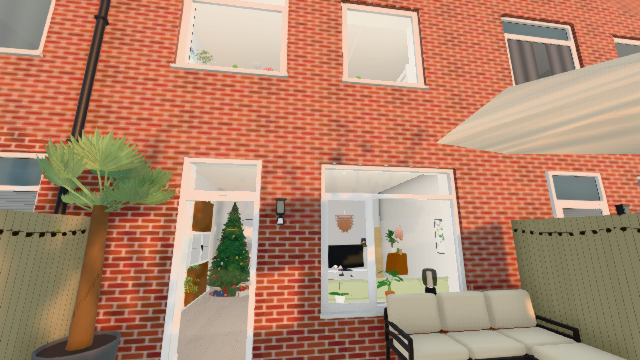
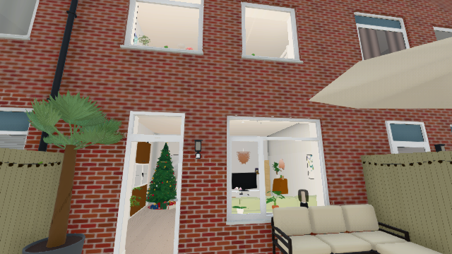
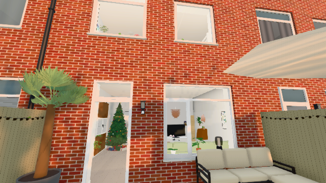
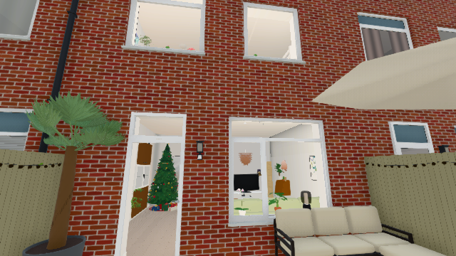

# #2398: private winter Sun/material causal observation

Evidence only. #2398 remains open; no product or asset correction is delivered here.
The earlier [published partial delivery](../README.md) and its failed winter gate remain unchanged.

The actual native/runner/outer process exited **0/0/0 in 273.14 seconds**.
[Postflight](postflight.json) confirms all 247 authored packages byte/mode exact and
read-only, all Generated packages exact, frozen export/source/dependencies exact,
and the three guarded original engine shader files unchanged. The private scene
was not rebuilt, imported or saved.

This is **not a published-stock full-scene acceptance run**. Its private scene uses
source `c4fb2986edccda814d97fa1d950e990074f28d0e`. One target component material slot
was switched transiently from its private sourceCanvas/M_Default chain to authored
`MI_LundenFacadeBrick -> M_LundenTiled`; the authored packages match the published
base. All other scene content was held fixed. The parasol remains visibly open in
this private winter view because the bootstrap did not invoke its editor controller.
That is a capture limitation, not an asserted product regression.

At the original 24 December 2026, 14:00 camera, each target chain was captured with
physical Sun intensity 19.449003219604492 and then zero. Clock, lamps, camera and
other lighting were held fixed; SkyLight realtime capture was frozen after the
normal date capture. [Chain comparison](chain-comparison.json) identifies the exact
component and both material chains. The effective original material, clock and
capture state were restored. The internal override array changed from `[]` to
`[None]`; it is explicitly **not** claimed to be internally identical. No disk asset
changed and the unsaved process was discarded.

## Observations and limits

The original locked brick (26x50 pixels) and frame (3x10 pixels) rectangles were
reused, with no changed tolerance, crop, RGB, gain or exposure fit. The decoded PNG
R/B values below are diagnostic readbacks, **not a new canonical browser gate**.

| Target material chain | Winter brick R/B relative to original web Sun-on |
| --- | ---: |
| Private sourceCanvas / M_Default | 0.69053242 |
| Authored legacy MI_LundenFacadeBrick / M_LundenTiled | 0.88350227 |

The authored target reproduces the previous 0.88349 winter failure; sourceCanvas
makes this held-scene diagnostic worse. Neither result completes #2398.

Separate SceneColor HDR observations confirm that real Sun intensity changes reach
all 1,300 brick and 30 frame pixels in both chains. The float transport sentinel is
exactly `[0.125, 1, 4]`. Frame on-minus-off R/B is 4.333276307 versus actual linear
Sun R/B 4.333881530 (a -0.013965% difference), and frame RGB observations are equal
between chains. Source-coloured sunlight therefore reaches the actual GPU.

Brick mean GBuffer BaseColor R/B is nearly equal (3.12612 versus 3.13155), while both
direct and Sun-off responses differ. Material distribution, roughness/BRDF and
indirect response have not been individually isolated. Source web Sun-off/linear
references are absent. The separate HDR capture disables postprocessing; its values
cannot decompose the canonical LDR pipeline. Raw per-pixel RGB and signed on-minus-off
values are retained in the two original readback reports, without clamping.

The actual Interchange IOR graph gives UE Specular 0.5 at IOR 1.5 (F0 0.04), and its
SpecularFactor is multiplied by texture alpha. The name `SpecularFactor=1` does not
prove doubled F0. No doubled-F0 correction or #2424 dependency is established.

[Conclusion](conclusion.json), [decoded LDR diagnostic](decoded-ldr-diagnostic.json),
[current original HDR/chain report](current-chain-readback.json),
[legacy original HDR/chain report](legacy-chain-readback.json), and
[compact outer capture metadata](capture.json) preserve the actual evidence.
The compact outer and chain reports replace duplicated embedded experiment data
with references to the two retained original HDR reports and pin the original hashes.
[Manifest](manifest.json) records byte-exact original copies and SHA-256 values.
The raw exporter files include original bytes after the first PNG IEND; these are
retained unchanged. PNG-stream CRC and complete 640x360 decoding pass for all four
originals; the manifest records the trailing-byte counts. The earlier failed V1
run and all private pinned inputs remain unchanged.

## Whole original LDR frames

Private current chain, Sun on:

Private current chain, Sun off:

Authored legacy target chain in the same private scene, Sun on:

Authored legacy target chain in the same private scene, Sun off:

Documentation and original-only Unreal diagnostic evidence. No web behaviour,
player changelog or public downstream transfer applies.
