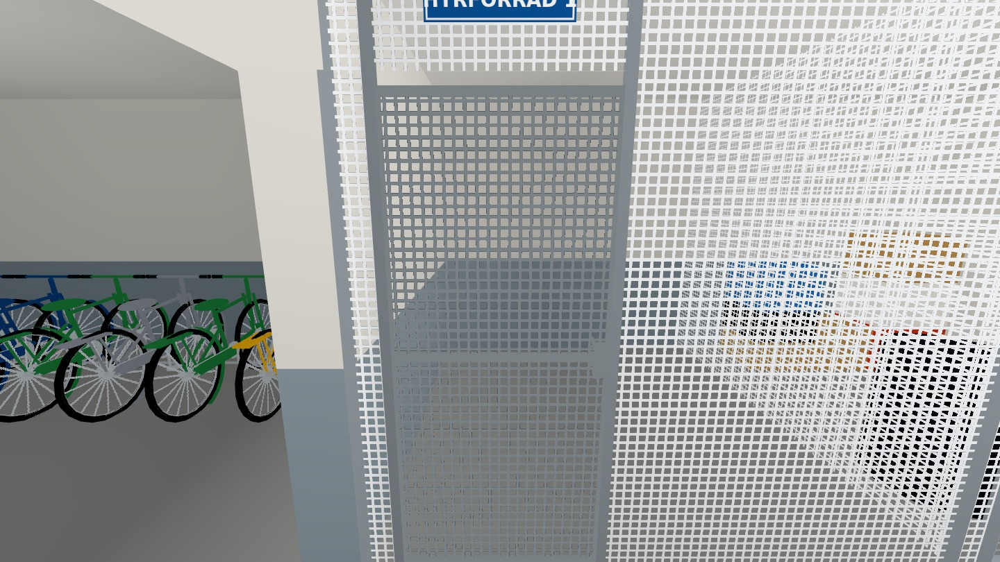
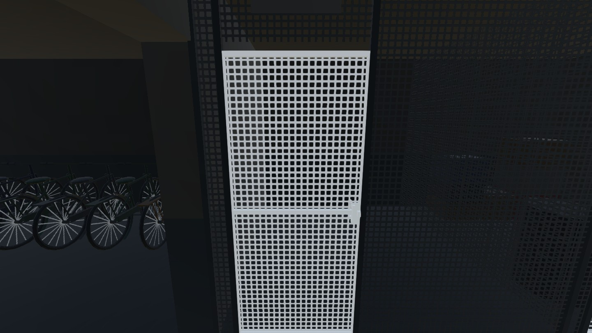

# Garage storage cages: the wire mesh is see-through in Unreal (#2399)

Unreal Editor 5.8.4 on Windows 11, 2026-11-21, headless. Warm Windows checkout at `66b9edc9` (after `b442c723`'s
capture path and #2396's tonemapper `4af7f0bb`) with the Actions export `unreal-export-c41541c7f4c66fee` of
`ba05c8ee`.

## Cause and fix

`src/garage.js` `meshTexture()` draws the cages' 64 × 64 wire grid on a canvas; the walls and the 37 door leaves use it
with `alphaTest: 0.5`, double-sided. The exporter kept canvas maps only for named site textures, so the GLB got
`bas_ffffff_r100_m0_tex_ds` without `baseColorTexture` and without `alphaMode`: an opaque white slab in Unreal.
`ba05c8ee` names the texture `garage-cage-mesh` and treats it like the slatted rails (#2325). The new export
has two keys, both with the PNG, `alphaMode: MASK`, `alphaCutoff: 0.5` and `doubleSided`:

| Key | Nodes | PNG |
|---|---:|---|
| `bas_353535_r100_m0_vc_tex_ds_garage_cage_mesh` (cage walls) | 4 | 64 × 64 |
| `bas_ffffff_r100_m0_tex_ds_garage_cage_mesh` (door leaves) | 37 | 64 × 64 |

`material-map.json` keeps their Interchange instances, and `tests/check_site_details.py` now covers both keys.

## Checks

| Check | Result |
|---|---|
| `sync-import.ps1 -ExportFrom …` | pass: `LUNDEN_SYNC_IMPORT_OK` |
| `tests/check_site_details.py` | pass: `LUNDEN_SITE_DETAILS_OK 55 nodes`; cage walls 4 of 4 and leaves 37 of 37 drawn by the world levels with Interchange's instance, the 64 × 64 texture, masked and two-sided ([`site-details-result.json`](site-details-result.json)) |
| `test_interaction` (PIE, door contracts) | pass: 1 passed, 0 failed |
| WSL `check-door-export.mjs` on the new export | pass: `DOOR_EXPORT_OK` (37 cage leaves, hinges and latch within 1 cm and 1°) |
| WSL `test_materials.py` on the new export | pass: `MATERIAL_COVERAGE_OK` |

The check reads the keys from the export, so it could not have caught the old export, where the keys did not exist.
With the keys present it fails if a cage slot is not the textured, masked, two-sided instance or if any cage node is
missing from the world levels. No negative run was made.

## Pictures

The closed leaf of hyrförråd 1 (`door_garage_cage_xm1063_z320`) from the aisle, 1.45 m away, 1440 × 810, 72° vertical,
21 June 14:00 ([`views.json`](views.json)). Web: `capture-web-views.cjs`, desktop Ultra, SwiftShader. Unreal:
`tests/capture_vegetation.py` on `L_Lunden` at the game's exposure, on `b442c723`'s capture path.

| Web | Unreal |
|---|---|
|  |  |

The leaf is a grid with the cage interior visible between the wires, where #2328's picture showed a solid white slab.
In the leaf's rectangle (x 0.40–0.59, y 0.20–0.60 of the frame), the share of pixels darker than halfway between the
crop's 5th and 95th luminance percentiles is 0.455 in Unreal and 0.688 on the web ([`gaps.cjs`](gaps.cjs)). The texture
itself has 1,892 of 4,096 texels (0.46) below the cut-off.

## Remaining differences in this pair

- **The garage is much darker in Unreal**, and the cage walls behind the leaf are dark grey where the web's are light:
  the web draws the garage with unlit `MeshBasicMaterial`s, and Unreal lights them with no garage lamps (#2404).
- **The "HYRFÖRRÅD 1" sign above the door is blank in Unreal.** The sign atlas key `bas_ffffff_r100_m0_tex` (50 nodes:
  the garage signs and the stairwells' flat number signs, see #2328's A1004) still has no `baseColorTexture`.
- **The wires look a little thicker in Unreal** (gap share 0.455 against 0.688), from texture filtering at this
  distance (probably; not measured further).
