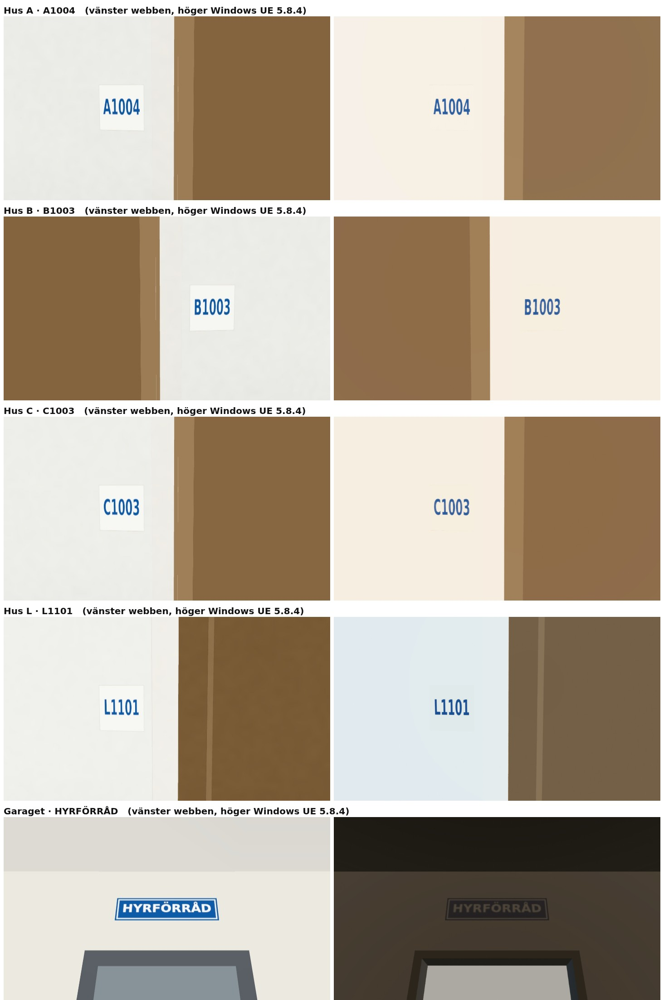

# Lägenhetsnummer och skyltar i Windows (#2400)

Webben (vänster) och Windows UE 5.8.4 (höger) från samma kamera framför nummerskylten vid en dörr på bottenvåningen i
Hus A, B och C, vid L1101 i Hus L och vid skylten HYRFÖRRÅD i garaget. Bilderna visar mittenhalvan av varje bild
(dubbel förstoring). Datum 15 november 2026 kl. 14, klart väder.

## Orsak och rättelse

Varje upplyst webbmaterial (`MeshBasicMaterial`) med en canvas-karta hamnade i exporten under samma vanliga nyckel,
`bas_ffffff_r100_m0_tex` (i garaget `bas_353535_r100_m0_vc_tex`), utan `baseColorTexture`. Under nyckeln låg 43 olika
utseenden: de fyra husens nummeratlas, garagets skyltar, utrymningspiktogram, golvmarkeringar och planer, trapphusens
våningsnummer, boulens poängtavla och skylten vid Nordic Wellness. Exporten (`export-scene.js`) behandlar nu sådana
material som möbeltexturerna (#2289). Varje bild får en egen nyckel `<key>_t<id>` och listas i
`furnishing.textures`. Exporten fick 28 sådana nycklar, och de fyra nummeratlasarna har var sin bild.

## Prov

- `node tools/unreal-engine/check-export.mjs --dir <export>`: aktuell, 11 filer och 9 356 noder.
- `node tools/unreal-engine/tests/sign-textures.mjs <export>`: OK på den nya exporten. Exporten före rättelsen
  (c871baa1) underkänns: `unlit textured keys without their image: bas_ffffff_r100_m0_tex, bas_353535_r100_m0_vc_tex`.
- `Editor.Python.Lunden.test_furnishing` i UE 5.8.4 (`-nullrhi`) gav `Success`. Provet kontrollerar 109 texturer och
  307 texturerade nät i `L_Lunden`. Varje nät har nyckelns material och en textur i rätt storlek. Skyltnäten i Hus A, B,
  C och L samt garaget ingår nu.
- Bilderna: `node tools/unreal-engine/tests/sign-views.mjs <export>` skriver kamerorna. Webbilderna togs med
  `LUNDEN_CAPTURE_VIEWS=<views.json> capture-web-views.cjs <server> <ut> 2026-11-15` (1440 × 810, vertikalt 72°).
  Windowsbilderna togs med `tests/capture_flat_signs.py`, kört som `Editor.Python.Lunden.test_flat_signs_capture` i
  PIE på `L_Lunden` med `-RenderOffScreen` (horisontellt 104,5°, samma 16:9-bild). Provet gav `Success` och
  `LUNDEN_SIGN_PICTURES_OK 5`. Exporten kommer från e8fda8da med ändringen (`f630751f`). Importen gjordes med
  `sync-import.ps1 -ImportOnly -ExportFrom`.

## Kvarstående skillnader i bilderna

- Skyltplattan är obelyst och vitare än väggen på webben. I Unreal är den belyst som väggen, så kanten syns knappt.
  Siffrorna är läsbara. [#2435](https://github.com/solwation/lunden-3d-apartment/issues/2435)
- Trapphusväggarna är krämgula i Hus A, B och C och blåvita i Hus L. Webben visar dem neutralt vita.
  [#2436](https://github.com/solwation/lunden-3d-apartment/issues/2436)
- Garaget är nästan svart och skylten mörk. Det beror på att garagets lampor saknas och att exporten tar med det
  släckta läget (`setLevel(a, 0)`, färgfaktor 0,035). [#2404](https://github.com/solwation/lunden-3d-apartment/issues/2404)
