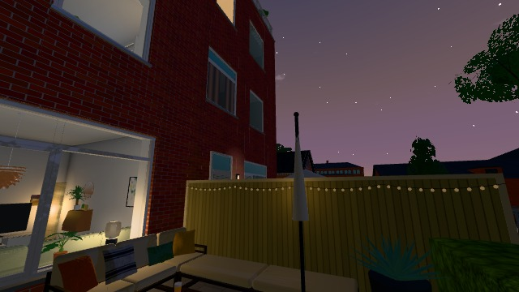
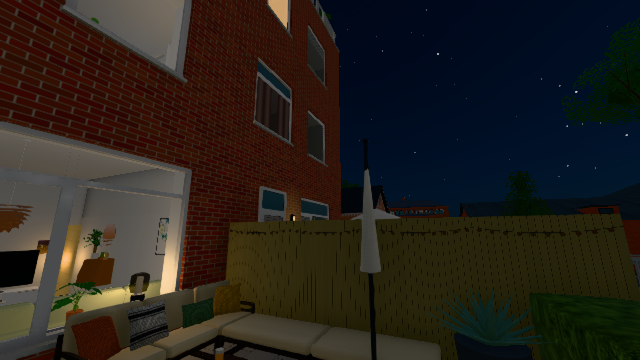
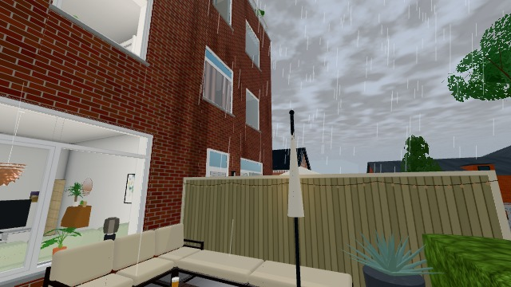
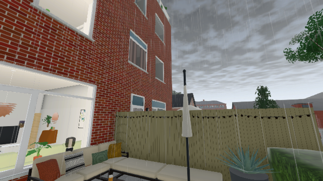
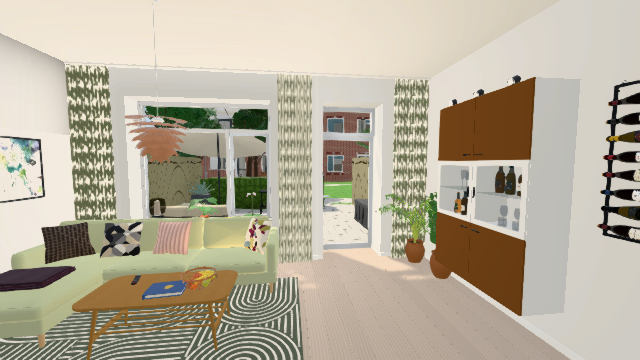
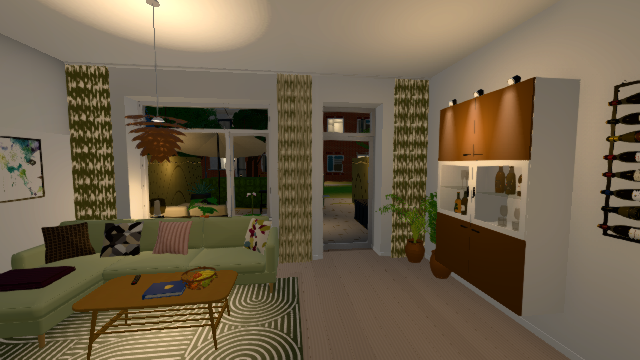
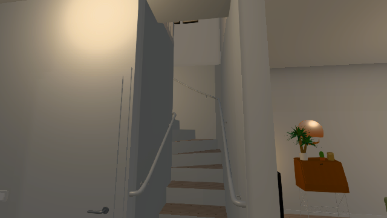
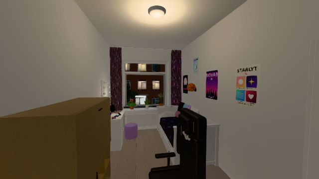

# #2403: Linux native parasol verification

The actual source-driven controller now folds the imported patio canopy in the two
required rendered states. Fresh canonical PIE acceptance now passes as documented below. The result images and report were published at `2b4b599bb2eef66fab5d19e423f05a3c0066a03a`;
all eight immutable raw-image URLs returned HTTPS200 with exact SHA256 before the
[completion image comment](https://github.com/solwation/lunden-3d-apartment/issues/2403#issuecomment-7227172932).

The RHI build/render run used source `b8a31c02d5c281e695f87e2eb580486905f97c39`,
UE 5.8.4, CPU Vulkan, 640×360 and the existing Linux rendering profile. Actual native,
runner and outer exit codes were 0; elapsed time was 409.69 s. Seven controlled
Lighting packages were saved, all 247 authored packages were made read-only
immediately, and the full 20-step cached canonical preparation passed. Clouds and
protected packages stayed unchanged; captures preserved all authored bytes and the
post-canonical Generated baseline. These are actual render/build results, not PIE
Automation results.

## Folded canopy pairs

The source and native camera is fixed at web eye `[2.3,1.62,16.1]`, yaw −65°,
pitch 12°, vertical FOV 72°, 640×360. Both actual source references show a visible
folded canopy; 718 web source files match before/after and the current source.
The original default patio camera put the narrow folded cloth outside the frame,
so that earlier control pair was excluded from acceptance.

The two states are 21 June 2026 at 22:00, clear, and 14:00, overcast 1. Native calls
the production `UpdatePatioParasol(2.0)`, with no direct canopy transform writes.
Both actual getters report fraction 0, native local scale `[0.09,0.09,1.15]` and
zero roll/pitch/yaw. The source mesh, parent and original pole remain in place.
Dusk matches the source's actual 19 small-lamp IDs; overcast has none. The one
unnamed exported floor lamp uses the exact `src/lights.js` fallback `golvlampan`,
validated before engine startup.

| State | Actual web | Actual native |
| --- | --- | --- |
| Dusk |  |  |
| Overcast |  |  |

Whole-original review found matching folded shape and placement. Existing screen
raster, sky, distant-brick, foliage and glass differences remain in their linked
open issues; see [the review](whole-parasol-review.json). The June dusk sky colour
is an additional exact-view cross-check for #2421; Root will append its pinned
raw-image links there after publication. #2451 covers clouds/moon, not sky colour. No colour fit, moved crop,
new numerical tolerance or precipitation-shader adjustment was introduced.

## Existing indoor profile controls

The unchanged 22-row gate passes: four full-frame luminance ratios are
0.95744/0.94181/0.87696/0.87661; all 14 material luminance rows, the existing curtain/cabinet hue guards and
both stair warmth guards pass. See [the gate](regression-gate.json) and
[whole-image mapping](whole-regression-review.json).

These four images are fixed editor lighting-profile captures. They reload the
composed map without advancing the canopy controller, so their exported open
canopy can remain visible through the evening window. They do not prove parasol
motion/state. The targeted pairs above run the actual production function;
separate PIE must prove actual game Tick, thresholds and transitions.

Existing unrelated AO, floor raster, stair contrast, halos, shade/mirror, wall-pool,
foliage and sofa-light differences are explicitly mapped in the whole-image review.

## Functional acceptance

[Actual functional acceptance](functional-status.json) is **PASS**. The fresh
parasol-only NullRHI process on source/assets
`79e9d401d3b5f32356f20bda584a18676d0a4013` finished with native/runner/outer
exit codes 0 in 210.55 s. The literal canonical test body passed all 108
month/sun/cloud boundaries, four manual intermediate poses, override hold/release,
settled endpoints and unchanged mesh/parent. Actual game Tick read the sky's weather
collection and moved the canopy from 1 to 0 (1.610503 s observed wall time).
All 247 authored packages stayed exactly read-only; Generated, production/test
sources and export files stayed byte-exact. See [the outcome](parasol-automation-outcome.json)
and [actual result](parasol-result.json).

The preceding fresh joint process independently passed `test_lighting.py` and
`check-sun.mjs` (142 values, 22 directions, worst 0.0000°), but its parasol setup
failed before the first boundary by attempting to edit private `ParasolManual`.
That joint process remains **FAIL**, native255/runner1/outer1, preserved in
[its classification](joint-automation-failure-classification.json). The only source
correction replaced that test write with a read assertion requiring a fresh false
manual flag. No product Blueprint or saved asset changed. The successful lighting
body/source and exact saved bytes are reused with
[explicit source proof](check-sun-proof.json), [actual lighting result](lighting-result.json)
and [checker output](check-sun.stdout.txt); the corrected parasol test passed separately.

The final test correction is integrated in `202b032d` over saved-asset integration
`38f4c686`. No observer, assertion relaxation, new RGB fit or redundant render/build
was used for this test-only correction.

The source-only precursor and failed/aborted attempts remain historical evidence;
none is relabelled successful. Root owns integration, native/LFS and publication.
Original-only Unreal change: no public downstream transfer or player changelog.
