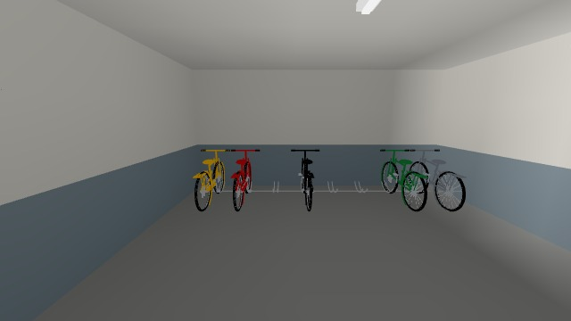
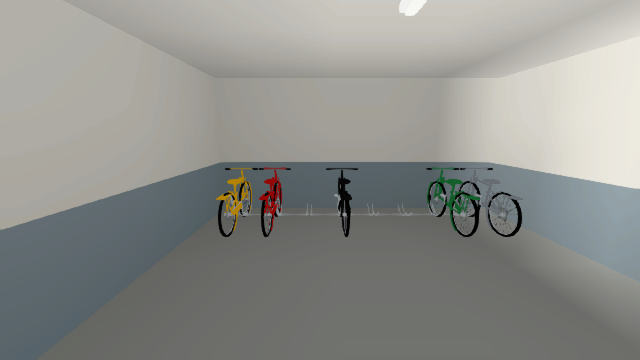
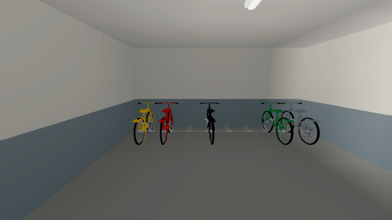
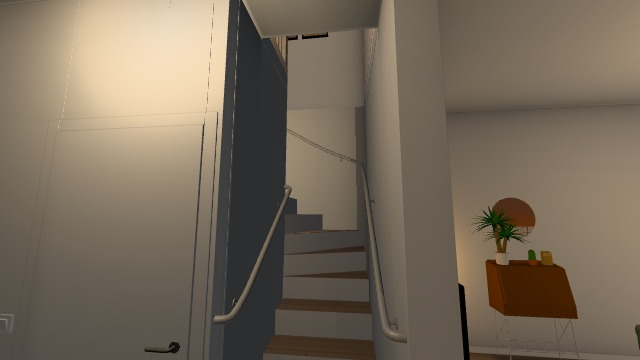
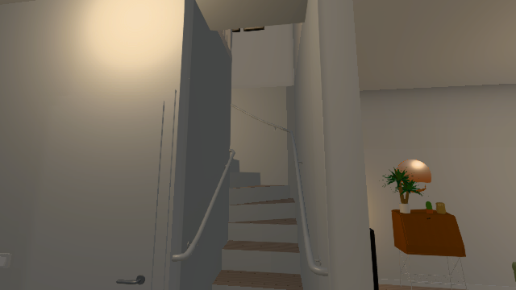
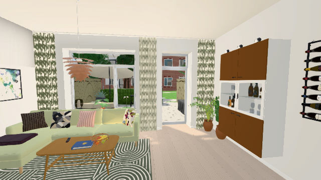
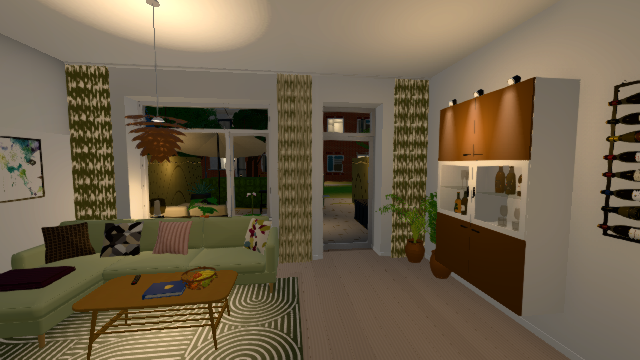
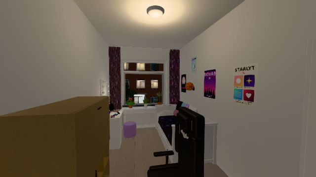

# Garage source lighting — #2404

The garage retains the actual full-on light baked into its source Basic materials, vertex colours, maps and instance tints. Row LOD materials follow the exact shared Color identity; independent equal numeric colours stay independent. Source power-off shares remain .035/.25/1. The established static full-on snapshot remains; sensors are Later #2332. No point lights, fitted gain or exposure override were added.

The source alphaTest (.35 spokes/.5 cages) is carried into the existing MF_Unlit_Body AlphaCutoff parameter, which UE5.8.4 Interchange omits for unlit MASK materials. All55 strict imported-material checks pass. Bicycle colours and cut-outs are restored; black spoke rectangles are gone. All477 nodes/1,075 typed geometry accessors retain pre-change geometry; nine other GLBs match byte for byte. Full10-zone export/schema/freshness/material coverage and saved Lighting signature pass. All718 web-reference source files are unchanged.

**Numeric limits:** garage night5/5 PASS (Y1.0348–1.0780), apartment22/22 PASS; garage day5/5 FAIL (Y1.4551–1.6253). Full parity and the combined numeric gate are FALSE, with unchanged criteria/rectangles. The independent missing camera-under exposure is tracked in open [#2495](https://github.com/solwation/lunden-3d-apartment/issues/2495): observed under=.92 gives1.04 from the web source formula, versus ordinary Native1.50. The web value is source-derived, not a browser exposure getter or fitted adjustment. All12 originals were reviewed;13 existing apartment gaps map to freshly verified open issues in whole-image-review.json.

**Execution limits:** V4 completed all20 actual canonical steps but failed the private in-process apartment fingerprint guard. A fresh process then computed exactly the original pre-build persisted hash00de1f6c… and completed all six images. It later crashed on private final map reload/GC with retained world/rig references: native−11/runner1/outer1,290.71s. External postflight independently verifies all247 read-only authored packages, the whole Generated tree, source/dependencies and export byte/mode exact. There is no after-semantic dump or passing whole-run claim. Failed/cancelled attempts remain in verification.json; completed build prefixes were reused.

One canonical crop browser batch measured all six pairs. Apartment frame Y ratios: .876965/.957438/.941812/.876608; stair warmth .929985/1.023520. Actual640×360 CPU-Vulkan SM5 profile: shadows3/1024/three cascades, SeparateTranslucency1, FXAA1, LightFunctionQuality2, Lumen off, Nanite disabled transiently. Normal gameplay/season Tick is absent; canopy state through interior windows is not runtime parasol acceptance. Fine grain/edge raster differs from desktop web. No authored assets changed. Windows release/performance is untested. Public downstream does not apply to original-only Unreal tooling.

| View | Web | Native |
| --- | --- | --- |
| Garage day |  |  |
| Garage evening22 |  |  |
| Stairs |  |  |
| Living room day |  |  |
| Living room evening |  |  |
| Upper floor |  |  |
