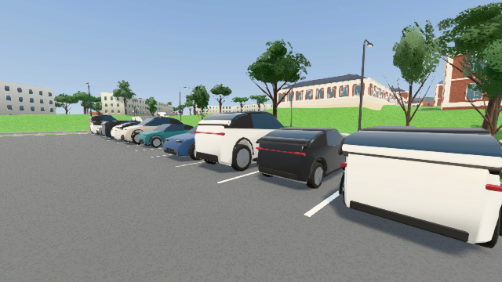
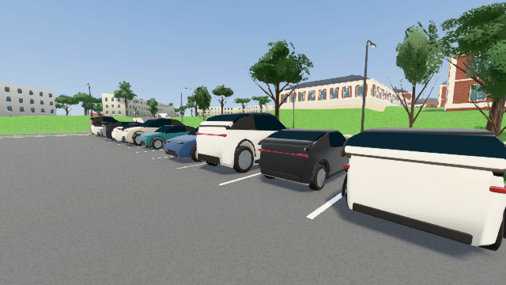

# Actual opaque car-glass AO isolation (#2405)

All68 glass bindings were identified in the composed world:45 outside and23 in the
garage, using11 shared meshes. The actual source factory and RoomProbe collection
leave these Standard materials opaque and without an environment map. Source
roughness0.05, metalness0.55, colour, direct PBR and all instance parameters were
retained. Only the unsaved copied roots' material AO input changed to0.

Actual parked-street camera: source[-39,1.62,-8.4],yaw44,pitch-6 maps through the
canonical coordinate module to Native[-3900,-840,162],yaw-134,pitch-6. Date June21
at14:00, clear, lamps off,640×360, vertical FOV72. All three whole images were reviewed.

Native/runner/tool passed0/0/0 in237.61/237.667 seconds, shared with the
[independent CPU context check](../../2424/context-propagation/README.md).
Original before/after have0 changed RGB pixels. AO0 changes8,939 pixels,
maximum channel change179. The glass visibly darkens. Source PBR and all68 original
bindings were restored. All250 authored assets remain exact/0444; all5,227 Generated
files,12 Import files and189/558 dependencies remain exact. No assets were saved.

This establishes a material-AO-dependent native lighting contribution under the
actual opaque DefaultLit/staticLighting0/SSR0/noLumen profile. AO0 removes diffuse
and specular indirect contributions together; it is not a source-correct product
fix or proof of Windows Lumen behaviour. Source Ambient/Hemi, source Fill and the
paint's own procedural environment remain to be represented. #2405 and #2424 stay
open. No matched current web colour acceptance or fitted material value is claimed.

The first attempt's actual processes also passed but its camera was180° wrong and
showed no cars. `invalid-v1-postflight.json` preserves that failure. No AO conclusion
is drawn from it; all original private V1 files and images remain unmodified.
V2 changes only camera derivation and verifies its forward vector against the
canonical conversion.

Original-only Unreal diagnostics; no web, downstream, player-changelog or release
change. Files beside this report preserve actual process results, capture/binding
readbacks, source checks, exact camera derivation and external postflight.
