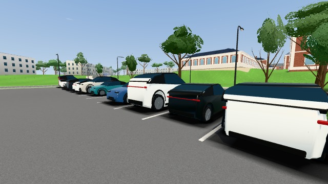
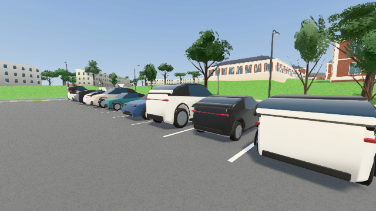
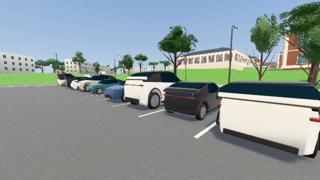

# Private source-lighting trial for parked-car glass (#2405)

**Diagnostic result, not an accepted product fix. #2405 and #2424 remain open.**
The nearest glass region changes from 5.506× the web luminance to 0.600×: the
replacement undershoots. Other glass regions still differ substantially. The
separate car-body region changes from 5.629× to 5.832× under the trial's global
Fill. No car-paint environment was attached and no full colour/parity acceptance
is claimed.

One actual render-RHI process completed Native/runner/outer-tool **0/0/0**, no log
errors, 269.69 s Native / 269.753 s outer. It rendered four 640×360 frames, then
imported and proved one separate car atlas. `native-result.json`, `outer-result.json`,
`batch-result.json` and `postflight.json` preserve the actual results. A successful
process/file guard is separate from the failed product-parity objective.

## Fixed camera and source contract

June 21, 2026 @14:00, clear, lamps off, desktop Ultra4 web, 640×360, VFOV72.
Source eye `[-39,1.62,-8.4]`, yaw44/pitch−6 maps through the canonical coordinate
module to Native `[-3900,-840,162]`, yaw−134/pitch−6. Both use the corrected car
camera, not the earlier invalid 180° camera. The fresh web frame used normal
point-pool settling. Source exposure is 1.5, ambient 0.275, hemisphere 1.55,
Fill 0.35, window sky 1.5, sun 3; raw colours/directions and the actual runtime
readbacks are recorded in `capture.json` and `web-capture.json`.

Native HEAD is `9b9abd58b4820334bdedb635889acad51f4ba15f`. Actual web export used
the same source head, sourceHash
`7521f0221644f26469aa35f8fcd29c47efb1c1f5e58ec959000444cee04276ec`,
THREE r170 and Chrome 1208; all 718 web inputs were exact before/after. The actual
source car-glass own envMap and scene.environment were both null. This does not
permit applying the paint's procedural cubemap to glass.

## What changed in the private frames

1. Original source parameters and native bindings.
2. Private native material-AO0 copies only.
3. Private source Ambient/Hemi/Window addition on the same glass copies,
   independent source AO 1/native AO 0, plus a separate transient **global** source
   Directional Fill. Original BaseColor, metallic, roughness, direct PBR and
   opacity remain inherited; no fitted RGB, alpha or image-derived gain.
4. Restored originals, with Fill removed.

The source Fill was shadowless and used the actual source colour/direction and
existing native sun-unit ratio. It affected other visible surfaces too; it was
not restricted to the glass or outdoors. Any product implementation must bound
its intended outdoor context rather than enable this global diagnostic as-is.
Global SourceAmbient policy remained OFF. The separately published
[CPU Fill proof](../../2424/source-fill/README.md) is not evidence of whole-scene
visual acceptance.

All 68 effective original bindings and entry runtime state were restored, and the
actor roster was exact. Decoded original-before/original-after RGB pixels are
identical; their PNG file hashes differ, so byte identity of the PNG containers
is not claimed. All 250 authored assets stayed exact/0444, all 5,227 preexisting
Generated files, 12 Import files and 636 dependencies stayed exact. No canonical
20-step run, import refresh, fresh release gate, packaged game, Windows/Lumen or
apartment regression result is claimed here.

## Fixed diagnostic regions

`diagnostic-rois.json` locked these rectangles before the candidate was available;
its thresholds are null. `diagnostic-result.json` preserves all actual RGB,
linear-luminance and saturation measurements. These are observations, not newly
introduced issue acceptance criteria. The fixed pixel regions do not identify every material pixel and cannot certify an individual material by themselves.

| Region | Original/web Y | AO0/web Y | Source+Fill/web Y |
|---|---:|---:|---:|
| Nearest white-car glass | 5.506 | 0.561 | 0.600 |
| Black-car rear glass | 3.477 | 2.197 | 2.245 |
| White-SUV side glass | 5.115 | 4.713 | 6.469 |
| Black-car body | 5.629 | 5.629 | 5.832 |

## Separate car-atlas upload proof

After the glass images, the actual car-paint procedural CubeTexture PMREM was
imported to the private diagnostic asset
`/Game/Lunden/Generated/Private2405CarAtlas_20261128V1/T_SourceCarAtlas`.
The source atlas is 384×512 linear RGBA16F/maxMip7. Integer Texture2D.Load and two
full raw RGB/alpha passes recovered **all 786,432 half components bit-exactly**;
compilerErrors were empty. Only after this proof was the one atlas saved.
Its physical uasset SHA is
`0d53336517cc4ad40bda37bb30e62109b249972ba9212d9b72596d97ed646b30`.
It is not bound to paint or glass and is not a promoted production material.
`atlas-proof.json` preserves the upload result. Raw source/native atlas data,
EXR, base64 payloads, uassets and engine SDK are deliberately not copied here.

## Original raw images

Fresh current web reference:

Native original before:

Private AO0:

Private source indirect plus global Fill:

Restored original:

Root reviewed all four Native originals and the web reference. `provenance.json`
records exact copied-file hashes and original private paths; `web-proof-summary.json`
retains selected actual export fields plus the original full-proof hash. The small
helpers are preserved for review, not as standalone portable run instructions:
they depend on the retained frozen private configuration and shared source files.
No web/product code or player changelog changed; this original-only Unreal
diagnostic has no downstream transfer.
