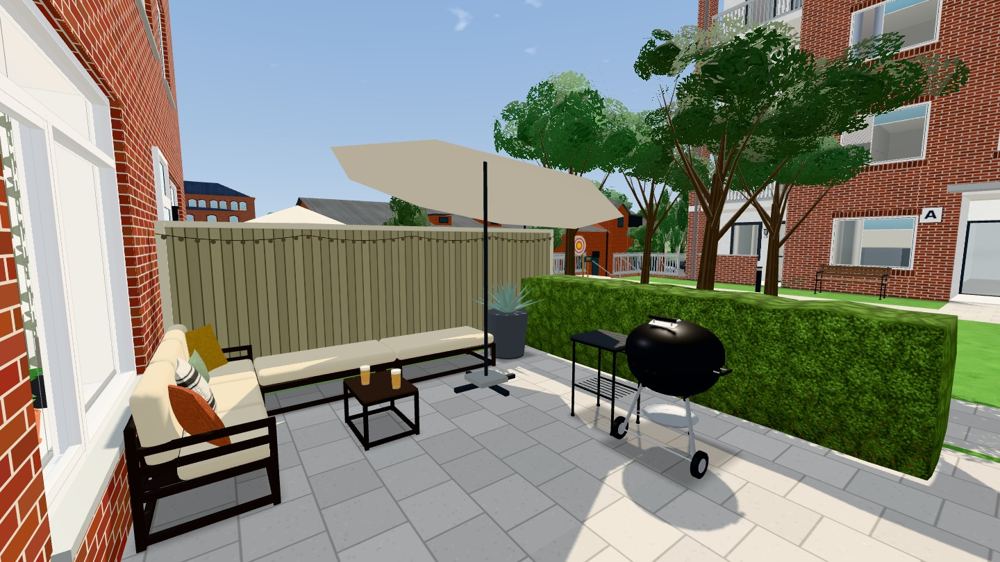
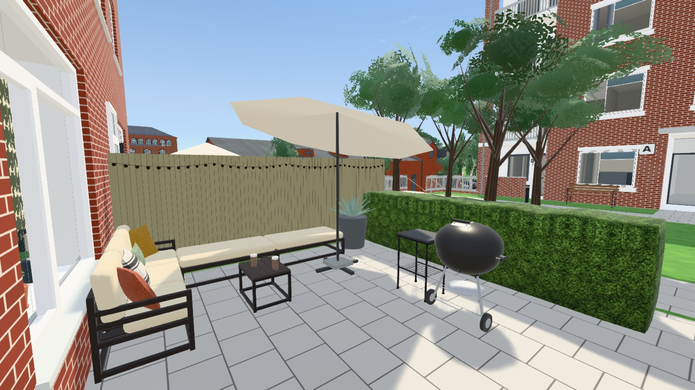
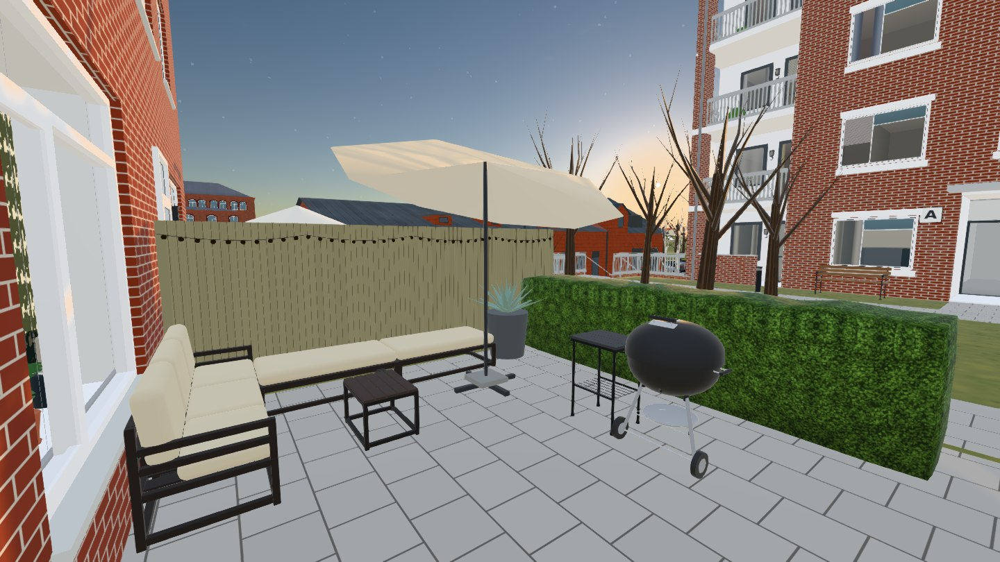
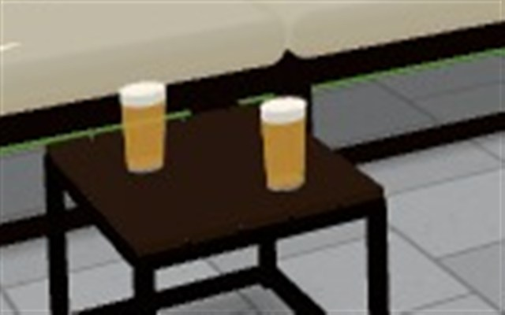
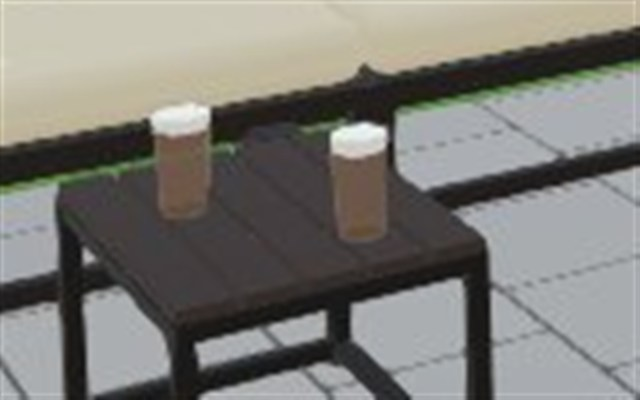

# Patio beers in Unreal (#2406)

The web stands two pints on the patio's slat table in `src/patio.js` `beersOut`'s months and clock hours (June to
August, from 12:00 until 23:00). Unreal had none. The exporter now exports them with that rule as a date window plus
an hour window, and `BPC_LundenSeasons` shows them only inside both; how it works:
[unreal.md, Seasons → Patio beers](../../development/unreal.md#seasons-2295).

Commits: `95d5de9d` (export, rule, tests), `f11f9d91` (`BPC_LundenSeasons` rebuilt), `c7d00fff` (captures at the
view's hour, pictures). Unreal Editor 5.8.4 on Windows 11, 2026-11-22, warm worktree `lunden-ue-wt\opus-2389` with a
full `sync-import.ps1 -ExportFrom` of a local WSL export of `87376708` (the same tree as `95d5de9d` before its rebase).

## Checks

| Check | Result |
|---|---|
| `check-export.mjs --dir <export>` | pass: 11 files, 9,367 nodes, 314 sources |
| `season-rule.test.mjs --export <export>` | pass: the 11 `beerTimes` rows agree with `beersOut`; the 11 `patioBeers` nodes (the group, 2 glasses, 4 meshes each) are slat-table parts with window 601..831, hours 12–23, no mismatch on 366 dates × 240 clock times; the table's own parts keep ids `__1`, `__2` |
| `sync-import.ps1` (full) | pass: `LUNDEN_SYNC_IMPORT_OK`, `BPC_LundenSeasons` saved with spec 33ab2c07 |
| `test_seasons` (PIE, `L_Lunden`) | pass: 11 beer actors with one window; BeginPlay at 12:14 on 22 Nov hid them and left `ClockDriven` on; `ApplySeasonAt` shows them with collision exactly on the true `beerTimes` rows (12:00 and 22:00 shown, 11:00, 23:00 and midnight hidden; 31 May and 1 Sep hidden, 1 Jun and 31 Aug shown) and stops the clock; `ClockTick` restores the PC date; tree, corner and cushions unchanged on all 14 dates; 202 seasonal actors |
| `test_furnishing` (editor world) | pass: 8 of 8 beer meshes within 0.00002 cm of the web's centres in `Level_l1007-uteplats` and `L_Lunden`, each with the date and hour tags; 175 of 175 furnishing items, 307 of 307 textured meshes |
| Patio, 21 June 14:00 | pass: two pints with foam on the table, where the web stands them |
| Patio, 24 December 14:00 | pass: no pints (and no cushions), as on the web |

## Pictures

Camera of #2373 ([views.json](../2373/views.json)), Unreal from `tests/capture_vegetation.py` at the game's exposure
([21 June](unreal-capture-2026-06-21.json), [24 December](unreal-capture-2026-12-24.json)). The web reference is
#2373's 14:00 picture; the web did not change.

| Web, 21 June 14:00 | Unreal, 21 June 14:00 | Unreal, 24 December 14:00 |
|---|---|---|
|  |  |  |

| Web, the table | Unreal, the table |
|---|---|
|  |  |

## Remaining differences in these pictures

- The beer is grey-brown in Unreal and golden on the web (sRGB 93, 81, 71 against 122, 91, 40), and the table top's
  slat gaps show more clearly: #2440.
- The web has small clouds in the sky: #2371.
- The hedge is colder and paler: #2411. The courtyard lawn is lighter: #2437.
- The red and white target beyond the fence (the web's game targets) is missing: #2356.
- The low winter sun at 14:00 on 24 December is neutral in Unreal and warm orange on the web: #2398.

## Not ported

- The rising bubbles in the beer: a web animation whose instance matrices are unset at export.
- The hour window follows the PC clock read every 60 s (`ClockTick`), not `BP_LundenSky`'s `TimeScale` (1 by default,
  the same); a pint turns at most a minute late.
