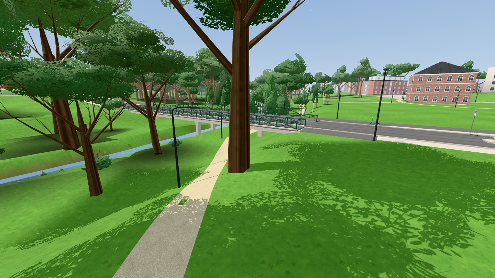
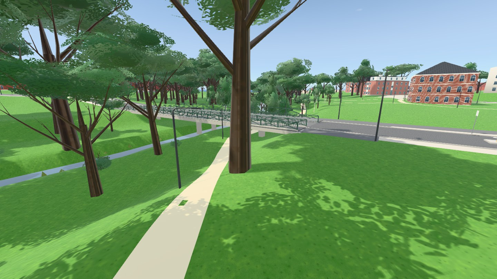
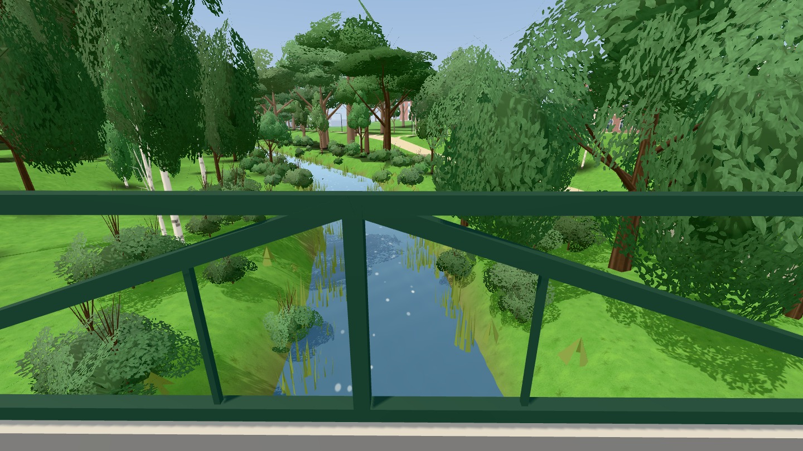
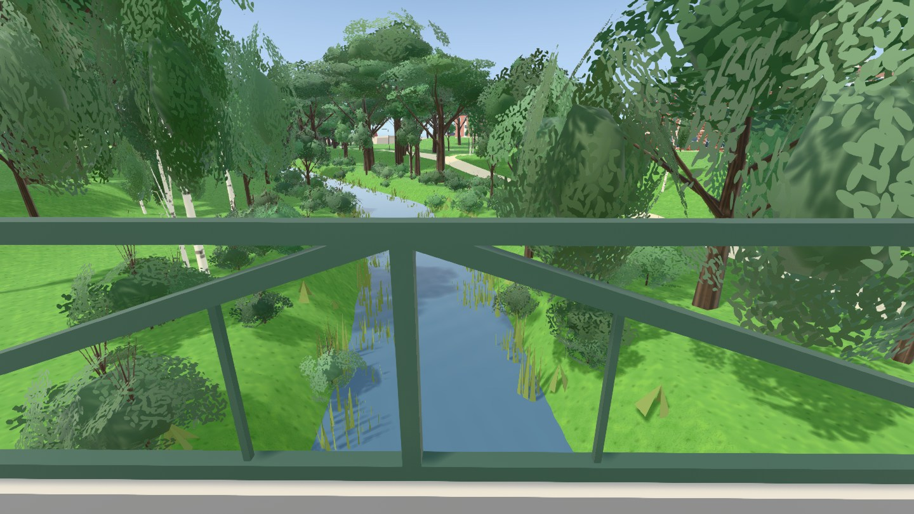

# Collection parameter GUIDs in material spec hashes and checks (#2408)

Unreal Editor 5.8.4 on Windows 11, 2026-11-22, headless (`-nullrhi` for builders and checks, `-RenderOffScreen` for the
river captures). Warm Windows checkout (`lunden-ue-wt/opus-2306`) on `955047ed` with the export from `9d978c9e`.

## Cause and fix

An Unreal `MaterialExpressionCollectionParameter` stores its parameter's GUID and resolves the parameter name through it
on load. When a collection is rebuilt with new parameter structs (as `MPC_LundenWeather` was in `390b0f08`, before
`#2381` preserved existing structs), any material built against the old GUID loads with parameter name `None` and either
fails to compile and falls back to the default grey material (`M_LundenRiverFlow` and `M_LundenRiverEdge`, `#2408`) or
reads `0` (`M_LundenFoliage`, `#2383`). Because `build_materials.py` did not include the collection parameter GUIDs in
its spec hash, a normal `import_world.py` / `build_materials.py` run in a warm checkout skipped the river materials.

`tools/unreal-engine/python/collection_ids.py` provides three shared helpers across the material builders:
- `ids(reads)`: extracts `{collection: {parameter: GUID}}` from the collection assets via `export_text()` for inclusion
  in builder spec hashes and stamps;
- `unresolved(material)`: returns any `CollectionParameter` expressions whose collection is missing or whose parameter
  name resolved to `""` / `"None"`;
- `clear_graph(material)`: deletes all expressions owned by the material (including any orphaned expression left behind
  by `delete_all_material_expressions`) before rebuilding.

Builders updated:
- `build_materials.py` and `river_material.py`: `spec_hash` includes `collection_ids.ids(...)` for `M_LundenGrass`
  (`MPC_LundenVegetation`: `Month`), `M_LundenRiverFlow` (`MPC_LundenWeather`: `SunDir`, `Rain`, `Snow`) and
  `M_LundenRiverEdge` (also `MPC_LundenVegetation`: `Month`); `check()` and the skip condition in `build_entries()`
  reject materials with `collection_ids.unresolved(asset)`.
- `build_facade.py`: includes the `MPC_LundenWeather` parameter GUIDs in `facade-stamp.json`, checks `unresolved_reads()`
  before skipping or passing `--check`, and clears graphs with `collection_ids.clear_graph`.
- `build_lighting.py`: checks `collection_ids.unresolved` in `precip_matches`, `clouds_match` and `--check`, and clears
  `M_LundenPrecipitation` with `collection_ids.clear_graph` on rebuild.
- `build_vegetation.py`: already hashes collection parameter GUIDs and clears orphaned expressions since `98e30542`
  (`#2383`).

## Checks

| Check | Result |
|---|---|
| Warm checkout before rebuild (`proof_2408.py check`) | fails as expected: `M_LundenRiverEdge` (`ad682225d58bc864 != 7684b97d53c77c74`, 3 `parameter 'None'` reads) and `M_LundenRiverFlow` (`5258c58e0252f08e != 546872e001d99f69`, 1 `parameter 'None'` read) fail `--check` |
| Simulated new `SunDir` GUID in memory (`proof_2408.py simulate`, then `proof_2408.py check`) | pass: replacing `SunDir` in memory gives it a new GUID (`1D9965FC412E625A3CA666B50D14D5DF`), fails `--check`, and rebuilds both river materials in a normal `build_entries` run without `--force` (`8057badf22ea406a`, `c77385ca0c0caf97`, `unresolved []`); a new process against the saved collection then fails `--check` on the simulated GUID |
| Normal sync without `--force` (`import_world.py`, `proof_2408.py check`, `import_world.py --check`) | pass: `import_world.py` automatically rebuilds `M_LundenRiverEdge` (`7684b97d53c77c74`) and `M_LundenRiverFlow` (`546872e001d99f69`); `proof_2408.py check` logs `LUNDEN_MATERIALS_CHECK_OK 2 materials` (`unresolved []`); `import_world.py --check` logs `LUNDEN_CHECK_OK` |
| `build_lighting.py`, `build_lighting.py --check`, `proof_2408.py lighting` | pass: `LUNDEN_LIGHTING_OK check passed (28 stair light functions)`; `M_LundenPrecipitation` (37 collection reads) and `M_LundenClouds` (1 collection read) both report `unresolved []` |
| `check-lighting.py` and `tests/lighting-freshness.py` | pass: `BP_LundenSky Lunden.SpecHash matches current lighting inputs: 3e5a5504f90eb5243571b3a52a3f8f76765b07a7d11fb877850fcc0f8da4f5a5`; `Lighting regressions OK` |
| `build_facade.py` (twice) and `build_facade.py --check` | pass: first run rebuilds with weather GUIDs in the stamp (`LUNDEN_FACADE_OK 1397 room, window and lens faces, 4 glow meshes`); second run and `--check` log `LUNDEN_FACADE_OK unchanged` |
| `build_materials.py --check` and `tests/test_materials.py` | 34 of 35 materials pass `--check` (including `M_LundenRiverFlow` and `M_LundenRiverEdge`); only `M_LundenGrass` reports stale (`6cba5e6e9c20009d != 618ef0cf991fdcf4`), which is locked by `#2317` (`ID:64983092`) for its pending seasonal lawn rebuild; `test_materials.py` logs `MATERIAL_COVERAGE_OK` |

## Pictures

1440 × 810, 72° vertical, 21 June 14:00, clear. Web references from [`docs/verification/2390/`](../2390/README.md).
Unreal: `tests/capture_vegetation.py` on `L_Lunden` in the warm checkout after the normal sync without `--force`
([`unreal-capture.json`](unreal-capture.json); `LUNDEN_VEGETATION_CAPTURE_OK 2 views`, zero material compile errors).

| Web | Unreal |
|---|---|
|  |  |
|  |  |

Mean colours and relative luminance of matching crops ([`crops.json`](crops.json), [`crop-stats.json`](crop-stats.json)):

| View | Crop | Web sRGB | Unreal sRGB | Web lum | Unreal lum | Ratio (Unreal ÷ web) | R/B web | R/B Unreal |
|---|---|---|---|---:|---:|---:|---:|---:|
| river | sky | 150.1, 178.1, 206.7 | 153.9, 185.1, 217.8 | 0.4548 | 0.4821 | 1.06 | 0.73 | 0.71 |
| river | far-lawn | 126.0, 147.7, 107.1 | 146.2, 168.5, 133.9 | 0.2903 | 0.3806 | 1.31 | 1.18 | 1.09 |
| river | far-water | 88.8, 119.5, 120.5 | 120.2, 149.9, 150.1 | 0.1827 | 0.2823 | 1.55 | 0.74 | 0.80 |
| river-bridge | sky | 140.7, 173.0, 188.6 | 146.6, 179.8, 190.2 | 0.4194 | 0.4383 | 1.05 | 0.75 | 0.77 |
| river-bridge | water | 85.9, 126.4, 142.6 | 98.1, 136.3, 153.7 | 0.1914 | 0.2276 | **1.19** | 0.60 | 0.64 |
| river-bridge | lawn | 52.5, 95.2, 51.9 | 86.5, 124.6, 84.1 | 0.1181 | 0.1947 | 1.65 | 1.01 | 1.03 |

Both river materials compile and render blue water in the warm checkout without `--force` (`river-bridge` near water
luminance ratio `1.19`, R/B `0.64` vs web `0.60`; `river` far water `sRGB 120.2, 149.9, 150.1`, R/B `0.80` vs web `0.74`).

## Remaining visible differences in these pictures

Every visible difference between the web and Unreal pairs maps to an open issue:
- **Lawns along Höje å and the distant water strip are 1.31–1.65× brighter than on the web:** `#2410` (open).
- **The cycle bridge's steel railings are a lighter green than on the web:** `#2391` (open).
- **Tree crowns, bark, foliage shading and the versioned `M_LundenGrass` asset awaiting its seasonal rebuild:** `#2317` (open).
- **The parked e-scooter on the road by the bridge in `web-river.jpg` is not in the R1 export:** `#2357` (open, Later group G18).
- **Small white sun-glint sparkles on the near water surface in `web-river-bridge.jpg`:** `#2362` (open, Later group G19 surface reflections and details).
