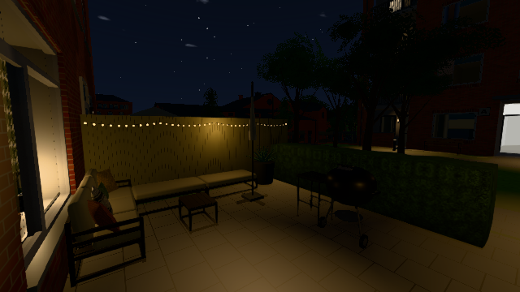
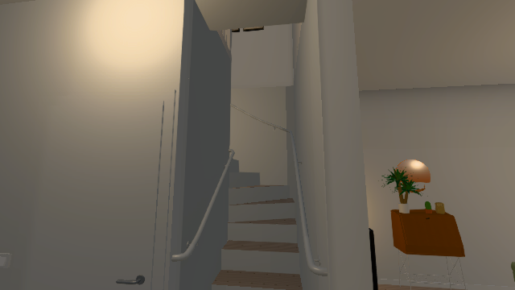
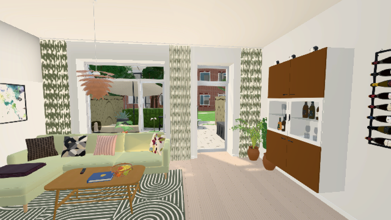
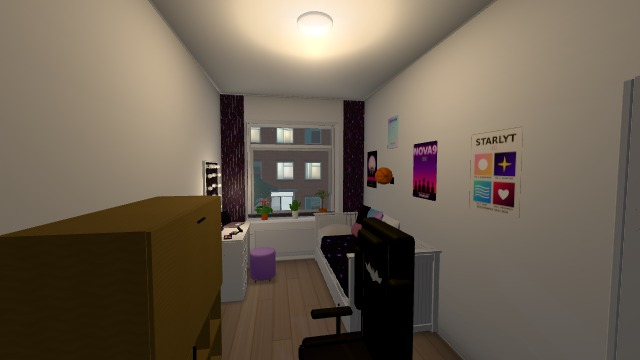

# Patio string source colours — partial delivery for #2409

**#2409 remains open. Its original visual acceptance still FAILS.** This slice restores the source bulbs' `toneMapped:false` path and verifies its storage/mask behavior. It does not claim that the whole patio or its fence light pools match the web.

Previous failed baseline evidence remains pinned in the [prior report](https://github.com/solwation/lunden-3d-apartment/blob/f1cee0ef665dd0e41d2962f291db383a8bc4e26a/docs/verification/2409/README.md) and its linked original files.

Native source: `2a01339854f7340b69ed585868504ea8b7075bbc`, on the public #2434 base. The actual source export retains commit `2e8547db2a996fcfc5206aca3777aca5e4be7d20`: all 322 export sources were byte-identical after this shader-only change. No manifest was relabelled and no geometry was re-exported or imported. The previous actual 20 canonical steps are reused at their recorded revision; this run actually rebuilt Lighting, ran its `--check`, the native PBR contract, and captured all five views. [Export/source reuse](source-export-reuse.json).

## Measured result

The original patio camera/date/time, exposure, crop rectangles and thresholds are unchanged: 21 June 2026, 23:30, clear, eye `[1,1.62,13.2]`, yaw -126°, pitch -6°, vertical FOV 72°, 640×360. Native is exact Linux UE5.8.4, CPU Vulkan/llvmpipe, FXAA1, conventional shadows3, SeparateTranslucency1 and Lumen off. Web is the unchanged actual Chrome1208/Three0.170 reference. No Windows full-profile, Shipping or physical-device pass is claimed.

| Original patio field | Before Y | Current Y | Current relative R/B | Result |
| --- | ---: | ---: | ---: | --- |
| Bulb row | 0.315249 | 0.626100 | 1.254773 | **FAIL** |
| Fence pool | 0.479272 | 0.479272 | 1.621508 | **FAIL** |

Y must remain within 0.8–1.25 and relative R/B within 0.85–1.15. Paving is reported only. The unchanged canonical evaluator measured all five pairs in **one browser batch**; its execution exit was0, while the combined visual gate correctly exits1. [Patio gate](patio-gate.json), [apartment gate](apartment-gate.json), [combined gate](combined-gate.json), [statistics](crop-stats.json), [locked crops](crops.json).

All **22 apartment checks PASS**, including fourteen furnishing/spot fields, the original hue guards and four whole-frame luminance rows. Whole-frame Y: living-room day0.957438, living-room evening0.940012, stairs0.876423, upper floor0.877193. Root reviewed all five native originals and the original web patio; unchanged apartment web originals were already reviewed and their hashes were rechecked. Known scene/material differences remain; [whole-image review](whole-image-review.json).

## Actual shader, controller and file checks

The old selector assumed RGBA16F throughout. Stock UE postprocess translucency composition can allocate R11G11B10 independently of `r.SceneColorFormat=4`. Production ReplacingTonemapper Input0 and the diagnostic's pre-tone Input2 use the same slice. The engine's actual pack/unpack reproduces all three observed source-pre-exposure values exactly. The corrected selector compares exact half words against the source's16F or engine-packed R11 representation; it never packs the observed scene to admit a whole bin. There is no fitted gain, epsilon or threshold change. [Source/storage proof](storage-source-proof.json), [implementation and ambiguity](source-tone-candidate.md).

Actual GPU checks all PASS:172 original pixels selected from178 stencil239 pixels; opaque self-depth accepted, foreground glass/opaque/fog interventions rejected, capture and scene restored. This proves the tested fixtures, not every possible transparent composite: the stock material cannot query which format was used, so an RGBA16F composite exactly equal to the R11 representation remains ambiguous. [GPU record](gpu-observation.json).

The real canonical `Editor.Python.Lunden.test_patio_strings` passed at2e8547db:82 bulbs and two pools across rain, dusk and power cut, **native0/runner0/outer0,172.016s**. Its test/controller source and collector functions are unchanged by the subsequent shader-only correction. This controller result is explicitly reused, while V5 compiled and tested the changed shader; [actual test](functional-test.json), [reuse proof](functional-test-reuse.json). CPU verification passed3 tests with733 selector cases; this is not substituted for the GPU result.

V5 actually completed in **351.48s, native exit0**, no native log errors, five images, GPU checks and scene restoration complete. The supervising outer command nevertheless returned **143** before recording its runner return: the runner code is **unknown**, not inferred as0. This known independent supervision issue remains #2473. The scoped image/native evidence is manually reviewed; no clean outer or all-process pass is claimed. All247 authored packages remained read-only and exact after the controlled Lighting prefix; Generated, export, dependencies and HEAD remained exact. [Native verification](native-verification.json), [postflight](native-postflight.json), [Lighting build](lighting-build-result.json).

The earlier setup failures and unsuccessful16F-only candidate remain preserved in private checkpoints; they are not counted as passed runs. The actual V5 generated map and imports are not versioned. Only the genuinely changed authored Lighting payloads are carried, bound by the published package manifest.

## Remaining work

The original bulb-row aggregate still includes a scene that is too dark/warm, and the fence pool remains below its unchanged targets. Source tracing finds a different fence material/board representation and a different night hemisphere palette; their pixel contributions are not isolated. Neither a candela gain, a new general #2424 dependency nor a full-colour-match claim is justified. Actual NullRHI readback now confirms both fence slots bind directly to `MI_LundenScreenWall → M_LundenTiled`, with their expected parameters and no fallback. Both pools use inverse-square/candelas with the recorded source range. That probe completed native/runner/outer0; [bindings](fence-readback.json), [probe result](fence-outcome.json). The final imported UV/raster/shadow contribution remains unmeasured; the short dark board marks are not explained by the measured shader parameters.

Original-only Unreal work; no public downstream/web port applies. The player changelog describes the brighter bulbs only. **Do not close #2409 from this partial delivery.**

## Unmodified originals

| View | Web | Native |
| --- | --- | --- |
| Patio dusk |  |  |
| Stairs |  |  |
| Living room, day |  |  |
| Living room, evening |  |  |
| Upper floor |  |  |
