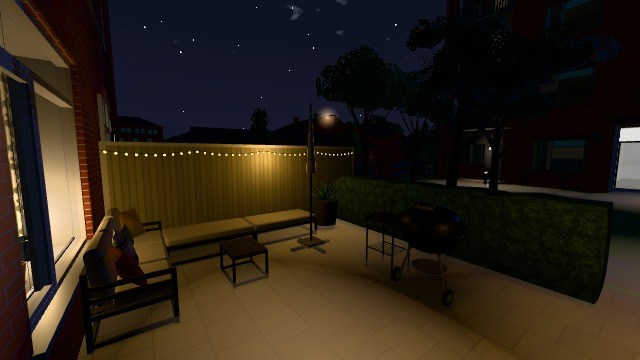
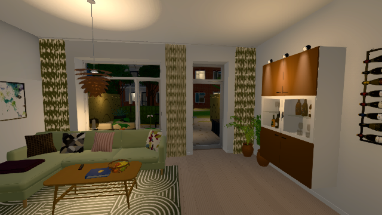

# Current patio-string diagnosis — #2409 remains OPEN

No product code or assets changed. The current five-frame capture completed in 234.59s with Native/runner/outer exit0. All247 authored packages remained byte/mode exact and read-only; all5,187 Generated files, export and pinned dependencies remained exact. This is actual capture-only evidence, not a fresh build, full canonical, Automation, `test_patio_strings` or Windows acceptance run. The historical20-step prefix belongs to an earlier overall FAILED run and is not promoted to success here.

Original2373 camera: web eye[1,1.62,13.2], yaw−126°, pitch−6°, verticalFOV72°, 640×360, June21 2026 at23:30 clear. The fresh web reference uses the actual settled source controller: on=true, glow=1, supply=1, forced=false, both point-pool slot shares1, renderer exposure getter1. All718 source files match before/after and the Native source. The old2396 crop values used a different reference state; no improvement trend against those values is claimed. Existing #2485 covers unsettled historical point-light references.

One canonical pixel batch measured all five pairs. The existing apartment22 rows PASS, with unchanged rectangles and bounds. Both target patio fields FAIL the unchanged issue criteria: linear luminance ratio0.8–1.25, relative mean-sRGB R/B0.85–1.15. Paving is reported only. Overall visual/numeric acceptance is FALSE.

| Field | Native/web Y | Relative R/B | Result |
| --- | --- | --- | --- |
| bulb-row | 0.315249 | 2.059368 | FAIL |
| fence-pool | 0.479272 | 1.621347 | FAIL |
| paving | 0.469645 | 1.256705 | report only |

All82 bulbs share the actual imported unlit dynamic material, with source linearRGB[1.460000,.910982,.371062]. Both real point lights read source sRGB#ffcf8a, K1/Supply1,3.92candela/400cm and visible=true. Thus the remaining fence difference cannot be called a missing light or the former component-colour reset. The web bulb material bypasses Neutral (`toneMapped:false`); Native does not. The existing source-derived display gain improves full-on material values but its analytic luminance ratio.72552 still fails; no fitted replacement or new overlay was introduced. No small verified fix is claimed.

Whole original images and existing visible-gap mappings are recorded in whole-image-review.json. Actual source/readback/gates and execution limits are retained beside this file. Original-only Unreal diagnosis; no public-web transfer or player changelog applies.

| View | Web | Native |
| --- | --- | --- |
| Patio23:30 |  |  |
| Stairs |  |  |
| Living room day |  |  |
| Living room evening |  |  |
| Upper floor |  |  |
