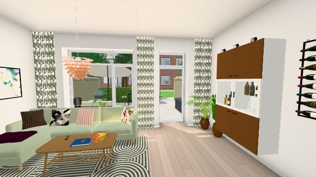
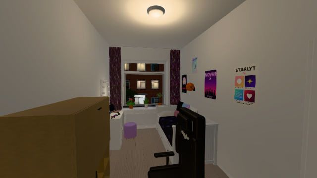

# Patio string source colours — accepted V6 evidence for #2409

**The original #2409 bulb-row and fence-pool criteria PASS in V6, with all 22 apartment checks unchanged and passing.** The source bulbs retain their `toneMapped:false` path; the two literal patio point lights use the source-derived energy conversion. Root reviewed the patio and all four apartment originals. The original runner record remains incomplete under #2473; this is not an all-process success claim.

Previous failed baseline evidence remains pinned in the [prior report](https://github.com/solwation/lunden-3d-apartment/blob/f1cee0ef665dd0e41d2962f291db383a8bc4e26a/docs/verification/2409/README.md) and its linked original files.

Final V6 native source: `14184e22da8704ec2bfadd516aa3ed61671975fb`, on the public #2434 base. Source energy helper: `695a74b0f092f7b83b4d31c63da737fcb06ed7b5`. The actual source export retains commit `2e8547db2a996fcfc5206aca3777aca5e4be7d20`: all 322 export sources were byte-identical after these shader/point-energy changes. No manifest was relabelled and no geometry was re-exported or imported. The previous actual 20 canonical steps are reused at their recorded revision; V6 actually rebuilt Lighting, ran its `--check` and the native PBR contract, and captured all five views. It did not rerun the full20, GPU fixtures or controller Automation. [V6 export/source reuse](source-export-reuse-v6.json).

## Measured result

The original patio camera/date/time, exposure, crop rectangles and thresholds are unchanged: 21 June 2026, 23:30, clear, eye `[1,1.62,13.2]`, yaw -126°, pitch -6°, vertical FOV 72°, 640×360. Native is exact Linux UE5.8.4, CPU Vulkan/llvmpipe, FXAA1, conventional shadows3, SeparateTranslucency1 and Lumen off. Web is the unchanged actual Chrome1208/Three0.170 reference. No Windows full-profile, Shipping or physical-device pass is claimed.

| Original patio field | Before Y | Current Y | Current relative R/B | Result |
| --- | ---: | ---: | ---: | --- |
| Bulb row | 0.315249 | 0.888563 | 1.140513 | **PASS** |
| Fence pool | 0.479272 | 0.995956 | 0.975456 | **PASS** |

Y must remain within 0.8–1.25 and relative R/B within 0.85–1.15. Paving is reported only. The unchanged canonical evaluator measured all five pairs in **one browser batch**; its execution exit was0, and the combined numerical gate is PASS. [V6 patio gate](patio-gate-v6.json), [V6 apartment gate](apartment-gate-v6.json), [V6 combined gate](combined-gate-v6.json), [V6 statistics](crop-stats-v6.json), [unchanged locked crops](crops.json).

All **22 apartment checks PASS**, including fourteen furnishing/spot fields, the original hue guards and four whole-frame luminance rows. Whole-frame Y: living-room day0.957438, living-room evening0.942412, stairs0.876423, upper floor0.876608. Root reviewed all five native originals and the original web patio; unchanged apartment web originals were already reviewed and their hashes were rechecked. Known scene/material differences remain; [whole-image review](whole-image-review.json).

## Actual shader, controller and file checks

The old selector assumed RGBA16F throughout. Stock UE postprocess translucency composition can allocate R11G11B10 independently of `r.SceneColorFormat=4`. Production ReplacingTonemapper Input0 and the diagnostic's pre-tone Input2 use the same slice. The engine's actual pack/unpack reproduces all three observed source-pre-exposure values exactly. The corrected selector compares exact half words against the source's16F or engine-packed R11 representation; it never packs the observed scene to admit a whole bin. There is no fitted gain, epsilon or threshold change. [Source/storage proof](storage-source-proof.json), [implementation and ambiguity](source-tone-candidate.md).

The actual **V5** GPU checks all PASS:172 original pixels selected from178 stencil239 pixels; opaque self-depth accepted, foreground glass/opaque/fog interventions rejected, capture and scene restored. This proves the tested fixtures, not every possible transparent composite: the stock material cannot query which format was used, so an RGBA16F composite exactly equal to the R11 representation remains ambiguous. [GPU record](gpu-observation.json).

The real canonical `Editor.Python.Lunden.test_patio_strings` passed at2e8547db:82 bulbs and two pools across rain, dusk and power cut, **native0/runner0/outer0,172.016s**. Its test/controller source and collector functions are unchanged by the subsequent selector and two-point energy changes. V6 explicitly reuses that controller result and the V5 GPU5/5 evidence: selector HLSL is byte-exact and identity/MID/controller functions are AST-identical. No fresh GPU/controller run is claimed; [actual test](functional-test.json), [prior test reuse](functional-test-reuse.json), [V6 GPU/controller reuse](gpu-controller-reuse-v6.json). The energy helper's offline checks cover the two-ID scope and exposure/unit algebra; four behavioural tests include733 selector cases, without substituting for rendered evidence.

Earlier V5 actually completed in **351.48s, native exit0**, no native log errors, five images, GPU checks and scene restoration complete. Its visual result still failed: bulb Y0.626100/relative R/B1.254773, pool Y0.479272/relative R/B1.621508. These failed results remain preserved. The supervising outer command nevertheless returned **143** before recording its runner return: the runner code is **unknown**, not inferred as0. This known independent supervision issue remains #2473. The scoped image/native evidence is manually reviewed; no clean outer or all-process pass is claimed. All247 authored packages remained read-only and exact after the controlled Lighting prefix; Generated, export, dependencies and HEAD remained exact. [Native verification](native-verification.json), [postflight](native-postflight.json), [Lighting build](lighting-build-result.json).

V6 independently records **native exit0** by the actual kernel zombie exit status, five completed source14184 images, scene restoration and exact file guards. The original runner remains **incomplete/unknown**, and outer exit is **143**; #2473 remains open. No runner0, clean outer or all-process pass is inferred from the images or Python completion. All247 authored packages are post-prefix read-only/exact, and Generated/export/dependencies/HEAD match their guards. [V6 native verification](native-verification-v6.json), [V6 postflight](native-postflight-v6.json), [kernel exit observation](kernel-exit-observation-v6.json), [original incomplete runner record](runner-result-incomplete-v6.json), [V6 Lighting build](lighting-build-result-v6.json). Earlier setup failures and the unsuccessful16F-only candidate remain retained. Generated maps/imports are not versioned; only actual changed authored Lighting payloads are carried.

## Source energy correction and limits

Only the two source patio point IDs use `sourceIntensity / 2**EXPOSURE_BIAS`: source1.4 becomes8.1988798973 cd at the existing bias−2.55. Global `CANDELA_PER_WEB=2.8`, source colour, range, inverse-square mode, point size, materials and acceptance are unchanged. This removes the fixed exposure from the two literal source light energies rather than fitting a crop. The [point-unit proof](point-unit-exposure-proof.json) and [source/unit analysis](source-tone-candidate.md) document the physical regularizers and unverified transition-exposure limits.

The V5 fence readback already proved both slots bind to `MI_LundenScreenWall → M_LundenTiled`, with expected parameters and no fallback; [bindings](fence-readback.json), [probe result](fence-outcome.json). The short dark board marks remain a detail difference without an established cause. Paving remains report-only (V6 Y0.517755, relative R/B1.256279); it is not silently promoted to a passed acceptance field. Existing scene/material differences and the selector's storage ambiguity are retained, without a new general #2424 dependency or universal transparent-composition claim.

Original-only Unreal work; no public downstream/web port applies. Root owns final package/image publication, pinned HTTP/SHA verification, embedded issue evidence and closure. The source and measured V6 criteria are accepted; this report does not fabricate a clean runner/outer result.

## Unmodified originals

| View | Web | Native |
| --- | --- | --- |
| Patio dusk |  |  |
| Stairs |  |  |
| Living room, day |  |  |
| Living room, evening |  |  |
| Upper floor |  |  |
