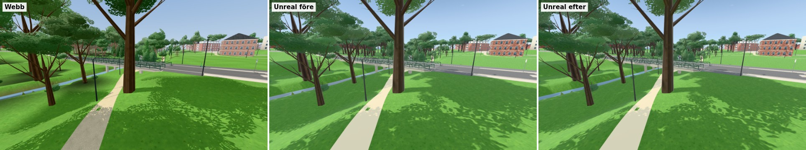
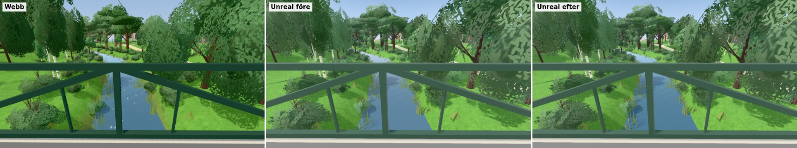
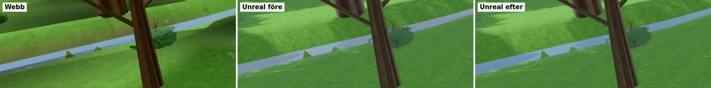
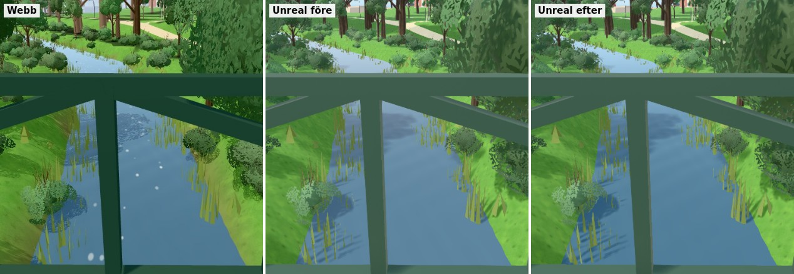

# Höje å's water and riverside grass in Unreal (#2410)

Unreal Editor 5.8.4 on Windows 11, 2026-11-22, headless (`-RenderOffScreen`, `-nullrhi` for the builders). Warm Windows
checkout `lunden-ue-wt/opus-release-2419` at main `7895ad76` with this change applied, imported at importer v7 (the
export sources are unchanged since #2426's full sync). Web halves: #2390's committed captures (`9f662b65`; no grass,
river, sky or tone-mapping source changed since), entrance A from #2392. Unreal: `tests/capture_vegetation.py` with
#2390's cameras, 21 June 14:00, clear, the game's exposure −1.965 EV ([`unreal-capture.json`](unreal-capture.json)).

**Result:** the water was a real material fault and is fixed; the grass is within the luminance band and its remaining
paleness is Unreal's sky reflection, which belongs to #2424.

## The issue's crops were mixed

Three of the #2390 crops behind the issue's 1.31–1.65 measure more than grass or water:
- `river-bridge lawn` (x 0.02–0.08, y 0.42–0.50): the bridge railing's top rail covers almost half of it. The railing is
  2.2–2.4 × the web's luminance in Unreal (#2391, #2424).
- `river far-lawn` (x 0.75–0.85, y 0.43–0.47): about two thirds of it are the road, the cycle path's edge line, a lamp
  post and a scooter.
- `river far-water` (x 0.005–0.03, y 0.652–0.664): 36 × 10 px across the water's edge, the bank and the grass.

[`crops.json`](crops.json) replaces them with crops that hold only grass, and water crops that keep only water pixels
(blue above green and red). The measurement is [`masked-crop-stats.cjs`](masked-crop-stats.cjs): the mean sRGB of the kept
pixels, the luminance of their linear colour and the HSV saturation of the mean, Unreal ÷ web as in
[#2390's `score.py`](../2390/score.py), with the per-channel deviation. Full output: [`crop-stats.txt`](crop-stats.txt).

## Water: the reflected sky in the wrong units, and a second reflection

`M_LundenRiverFlow` and `M_LundenRiverEdge` add the web's own reflected sky (`src/riversurface.js`) through Emissive.
Two things differed from the web:
- **Units.** The web adds that sky in its radiance units and shows it at three's `toneMappingExposure`. The game's
  locked exposure is that exposure × 2^`EXPOSURE_BIAS` (#2313), and Unreal shows an emissive value as three.js shows
  it at exposure 1 (#2396's probe). The sky term therefore reached the screen at 2^−2.55 = 0.17 of the web.
- **A second reflection.** The web has no environment map, so its water reflects only that sky and the sun. Unreal also
  reflected its own sky on the water (Lumen, the whole sky at grazing angles), which filled in grey and paled the water.

Tests on the same frames, in memory (cumulative; nothing saved):

| Crop | Before | Sky × 2^2.55 and Specular 0 | + Metallic 0, colour × (1 − 0.2) = after |
|---|---|---|---|
| river, far water | 1.03 / 0.77 | 1.51 / 0.80 | **0.97 / 1.10** (−2, 0, +3 %) |
| bridge, water below | 1.19 / 0.90 | 1.22 / 0.98 | **1.06 / 1.03** (+1, +3, +4 %) |
| bridge, water upstream | 1.02 / 0.72 | 1.31 / 0.73 | **1.00 / 1.05** (−1, 0, +2 %) |

(luminance / saturation, Unreal ÷ web; with Specular 0 alone the metallic part still mirrored the sky at grazing angles.)

The change (`python/river_material.py`): the sky term is multiplied by `display_gain()` = 2^−`EXPOSURE_BIAS`, read from
`build_lighting.py` and part of the materials' spec hash, so it follows the exposure at every hour. The water takes the
web's diffuse colour (`COLORS.water` × (1 − metalness)), Metallic 0 and Specular 0; on the edge mesh only the masked
water does, while its land and lying snow keep the engine default. `build_materials.py --check` checks the gain, the
Specular and the Metallic wiring. The sun's glint on the ripples is not carried (#2362).

| | |
|---|---|
|  |  |
|  |  |

## Grass: Unreal's sky reflection (#2424)

| Crop | Luminance | Saturation | Per channel | With the grass's Specular 0 (test) |
|---|---:|---:|---|---|
| river, lawn beyond the road | 1.22 | 0.78 | +14, +8, +45 % | 1.00 / 1.05 (−5, +1, −8 %) |
| river, lawn in the sun | 1.14 | 0.80 | +7, +8, +13 % | 1.10 / 0.96 (+4, +6, +7 %) |
| bridge, lawn left | 1.17 | 0.86 | +10, +7, +30 % | 1.03 / 1.06 (−3, +2, −9 %) |
| bridge, lawn right (shade) | 1.23 | 0.78 | +27, +12, +62 % | 1.12 / 0.94 (+15, +8, +22 %) |
| entrance A, lawn (#2437's crop) | 1.15 | 0.89 | +7, +6, +26 % | 1.03 / 1.06 (−4, +2, −8 %) |

Every lawn crop is within the 0.8–1.25 luminance band; two are just under 0.8 in saturation, and blue is high
everywhere. `M_LundenGrass` already has the web's values (roughness 1, metallic 0, the engine's default specular, F0 0.04
as on the web): what differs is the reflected sky, which the web never has. Removing the grass's reflection in a test
brings every sunlit crop within ±10 % per channel ([test picture](lawn-specular-test.jpg)). That is #2424's rule in the
light chain (`build_lighting.py`/`BP_LundenSky`, Lighting locks held for #2394), not a per-material switch, so the grass
is left unchanged here; #2424 has these crops to measure again.

## Other checks

- `build_materials.py`: the two river materials rebuilt, no other asset changed (no versioned asset, no LFS lock);
  `build_materials.py --check`: `LUNDEN_MATERIALS_CHECK_OK 51 materials`.
- `tests/river-water.test.mjs` on the checkout's import: both river slots still match the web builders.
- Courtyard and patio views before and after: mean colour of the whole frame and of the lawn identical (the #2317
  courtyard views are untouched; the change reaches only the river materials).

## Other visible differences in the pairs

- The grass paler and bluer, also at entrance A: #2424 (reflection); the tree crowns at the courtyard: #2437.
- The bridge railing lighter: #2391 / #2424. The hedges and shrubs: #2411.
- No sun glint on the water: #2362. The white dots on the web's water and the river plants: #2345.
- The opposite bank of the river has a darker olive band on the web where Unreal's slope is plain lawn green: new
  issue #2441.
