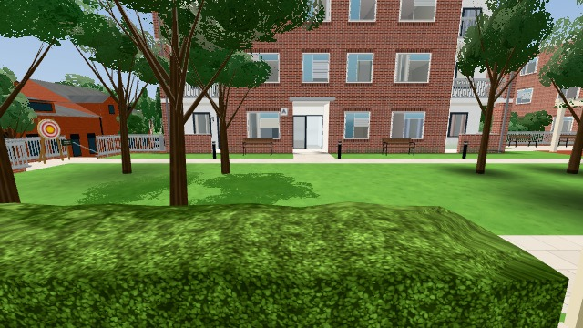
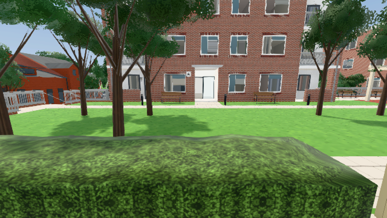
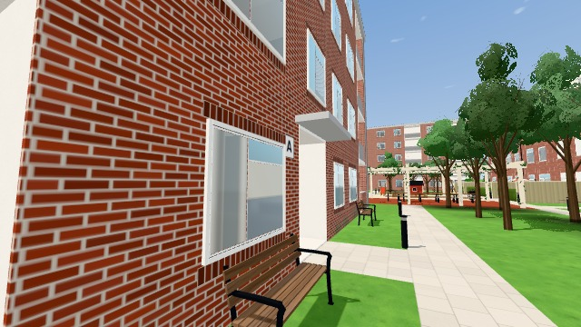
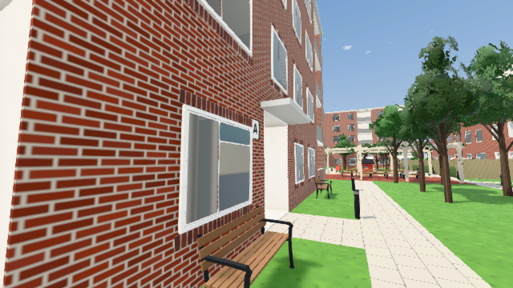

# Hedge and entrance letter — current baseline for #2411

**#2411 remains OPEN: the letter passes, but hedge colour still FAILS.** This is reusable evidence from the current public source, not a product fix or finished handoff. No source, material, exposure, acceptance or RGB gain was changed; no new #2424 dependency or root cause is inferred.

Source: `525bb4dc276ac0ab577d1619f4f1d67bbcae657a`. The fresh web batch used Chrome1208/Three0.170, Ultra4 and software WebGL; native used Linux UE5.8.4 CPU Vulkan/FXAA1, conventional shadows3, SeparateTranslucency1 and Lumen off. Both views are 640×360, vertical FOV72°, 21 June2026 at14:00, clear, lamps off, normal power. The original cameras and normalized rectangles are [unchanged](measurement-contract.json). This is not Windows full-profile evidence.

| Original acceptance field | Native/web Y | Relative R/B | Relative saturation | Result |
| --- | ---: | ---: | ---: | --- |
| Patio hedge | 1.031056 (report only) | 0.553793 | 0.717775 | **FAIL** |
| Entrance A letter | 1.081075 | report only | report only | **PASS** |

Hedge R/B and saturation must each remain within0.85–1.15; letter Y within0.8–1.25. One canonical browser batch completed with evaluator exit0, while the actual acceptance meter exits**1**. No rectangle or threshold was moved. [Gate](acceptance-gate.json), [statistics](crop-stats.json), [rectangles](crops.json).

Actual native/runner/outer exits are **0/0/0**,194.65s, independently supported by the kernel exit observer and durable runner result. Both native images and scene restoration completed. All247 authored packages remain read-only/exact; Generated, export, dependencies and HEAD match their guards. [Postflight](native-postflight.json), [runner](runner-result.json), [kernel observation](kernel-exit-observation.json), [verification](native-verification.json), [capture metadata](native-capture.json). Process/file success does not turn the hedge failure into product acceptance.

The fresh web images bind322 unchanged source files to this HEAD, source hash `97dab0bbfa3e7235257b8ca77a428e7437ca59e0f5d0f727a5da680b2285e20a`. Actual source runtime is identical across both views: daylight1, overcast/under/dim0, sun intensity3, sky strength1.5, exposure1.5. Camera, lamp, profile, uniform and image proofs are [recorded](web-proof.json) with the [actual web metadata](web-capture.json). The previous export retains its real source commit; [byte-exact source/export reuse](current-export-reuse-proof.json) is explicit, with no relabelled manifest or fresh import claim. [Four raw image hashes](image-manifest.json).

## Bounded material and vertex findings

Actual slot/chain/parameter readback binds the hedge to the expected Standard/vertex-colour graph, BaseColor texture and sRGB setting/factors. This is binding evidence, not universal PBR or GPU-buffer validation. Texture dimension readback32 reflects the current runtime/placeholder API; it is **not** asserted to be the source image's true dimensions. [Actual material readback](material-readback.json).

The [exact5.8.4 SDK trace](vertex-color-sdk-trace.json) shows GLTF vertex-colour compensation followed by the StaticMesh builder's8-bit `FColor` conversion. Above-one values can be lost. The [current-GLB clipping bound](current-glb-hdr-clipping-bound.json) is bound to the actual three GLB SHA values and nine meshes:10,914 vertices,5,275 HDR vertices. For the patio hedge, unweighted clipping-only mean warmth factor is0.968241. The conservative bound is approximately[0.92308,1.04000] for common nonnegative sampling/channel-independent scalar weights. Under those stated assumptions, clipping alone does not explain the observed0.553793 crop ratio.

This is not a readback of actual imported GPU vertex values. It excludes8-bit rounding, nonlinear tone mapping, lighting, occlusion and differences in screen weights. Equal vertex averages are not pixel averages. The evidence does not establish the remaining colour cause or justify a fitted correction. Root reviewed both native and both web originals; the current hedge difference is retained openly for the next concrete investigation. No player changelog or downstream transfer applies to this baseline-only original Unreal evidence.

## Unmodified originals

| View | Web | Native |
| --- | --- | --- |
| Patio hedge |  |  |
| Entrance A |  |  |
