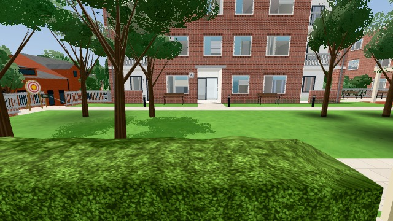
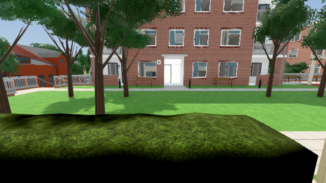
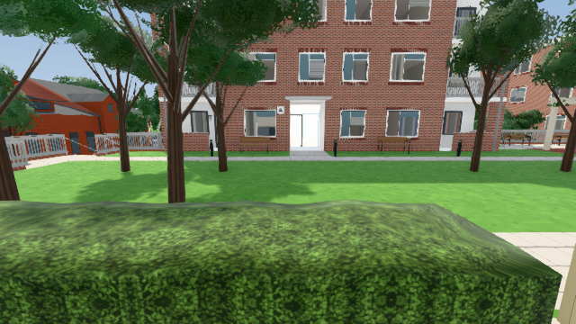

# Hedge source-ambient trial — #2411 remains open

**Whole image REJECTED: the candidate turns the hedge front nearly black.** Its original R/B and saturation criteria pass, but this is a bounded partial result, not a product fix or acceptance. The darkness cause is **unknown**; omitted SourceFill is not established as the explanation.

The unsaved candidate preserves actual PBR, BaseColor texture/vertex-colour graph and direct shadow Sun, routes native material AO to0 and supplies exact shared source Ambient/Hemisphere/window radiance through a private MF/MPC. **SourceAO is explicitly1.** SourceFill is omitted, global SourceAmbient remains OFF and no source/saved asset was changed. Linux UE5.8.4 SM5 CPU Vulkan low-profile evidence only; no Windows/Lumen product claim.

| Original locked hedge field | Original | Candidate | Result |
| --- | ---: | ---: | --- |
| Native/web R/B | 0.553793 | 0.981034 | Candidate PASS |
| Native/web saturation | 0.717775 | 0.942211 | Candidate PASS |
| Native/web luminance, informational only | 1.031056 | 0.360248 | No new threshold |

The original [contract](../measurement-contract.json), ROI `[.05,.72,.60,.95]` and0.85–1.15 limits are unchanged. Pillow decoding with the existing canonical rectangle/linear Rec.709/rounding formulas reproduces both previously recorded web and native statistics exactly; no browser, fitted colour/gain or changed crop. [Measurement](measurement.json).

Actual Native/runner/tool exits **0/0/0**,268.84s Native and268.899s outer. All16 effective bindings across9 source identities restore; all250 authored packages remain read-only/exact,5228 Generated files,12 import files,677 dependencies and HEAD match. Original-before and original-after have **zero changed RGB pixels and identical file SHA**. [Projected postflight](postflight.json), [provenance and raw hashes](provenance.json).

The [already published12-value shared-MF GPU proof](https://github.com/solwation/lunden-3d-apartment/blob/276bdfecd6501a2de83313b9bf0470d2df805e95/docs/verification/2405/paint-source-trial/mf-gpu-values.json) is reused by exact HLSL hash; **no new GPU probe** ran here. Process/file success and that shared-kernel proof do not override the rejected whole image.

All9 source hedge AABBs lie strictly outside the WindowDaylight box. The visible patio hedge starts at web z16.815044, beyond box z12.5686; the camera-near gate passes but the per-position inside gate cannot. The window branch therefore cannot explain the dark front through this source geometry. [Actual POSITION/hierarchy bounds](window-bounds.json). No further cause is inferred.

Full private reports and earlier failed preparations are retained. JSON files here are explicitly marked compact projections with original SHA; the three PNGs below are byte-exact originals. Before/after share one Git blob (two unique PNG blobs total1049197bytes). Original Unreal-only verification; no public downstream web change or player changelog applies.

| Unmodified web reference | Original before |
| --- | --- |
|  |  |

| Rejected source-ambient candidate | Restored original |
| --- | --- |
|  |  |
