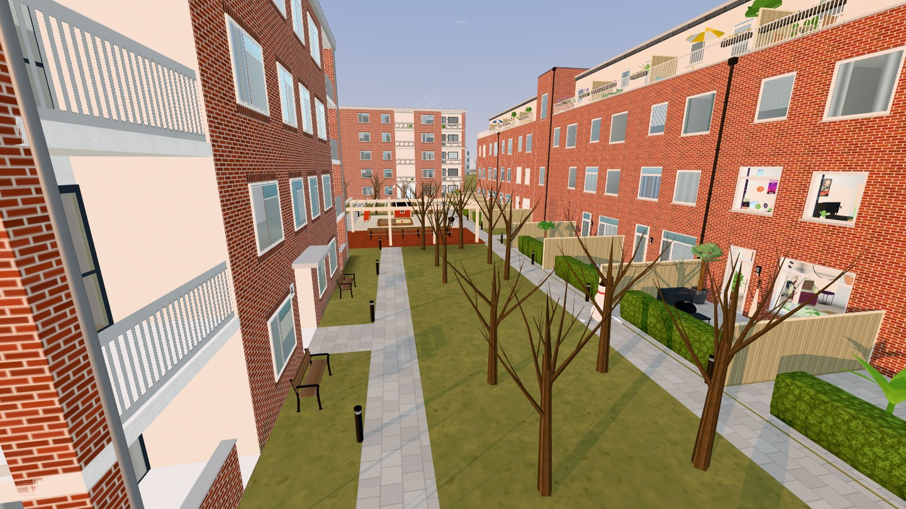
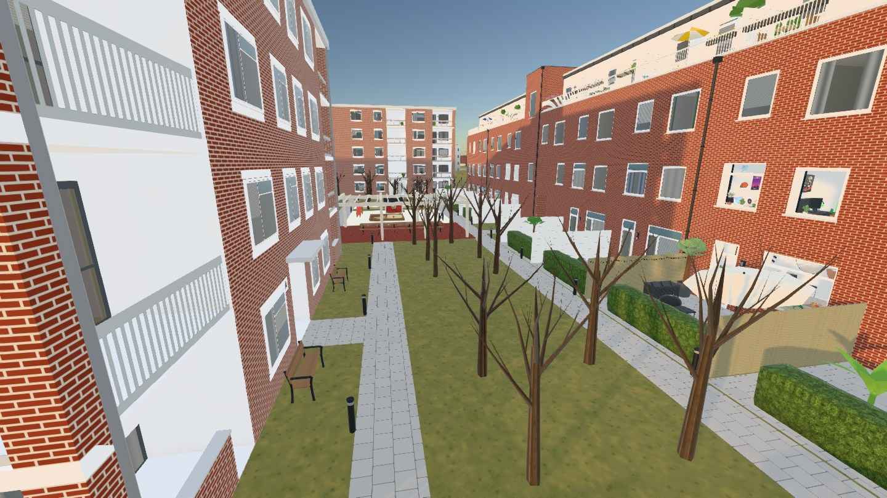
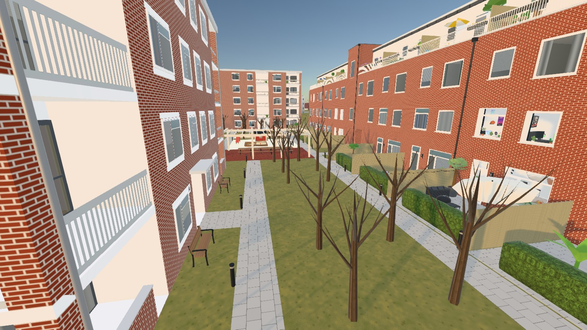
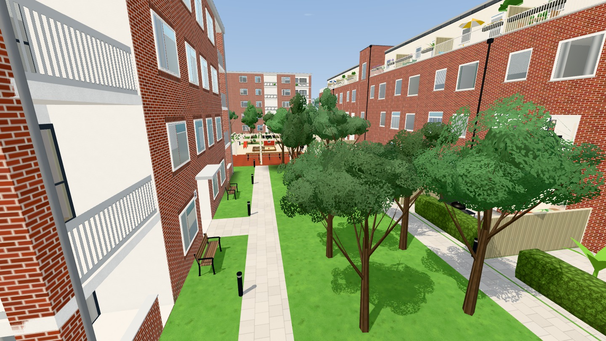
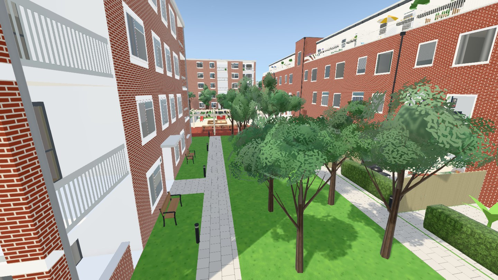
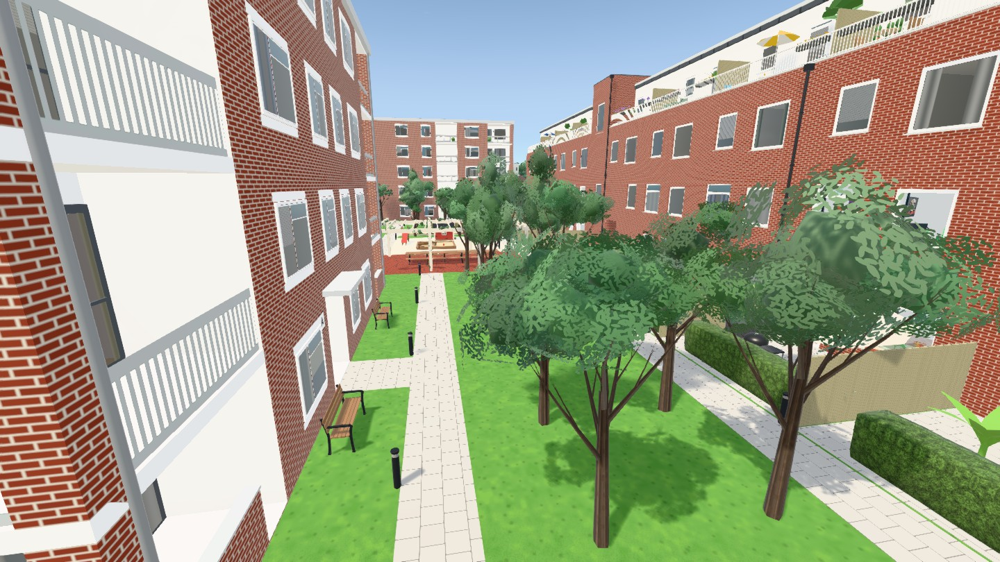
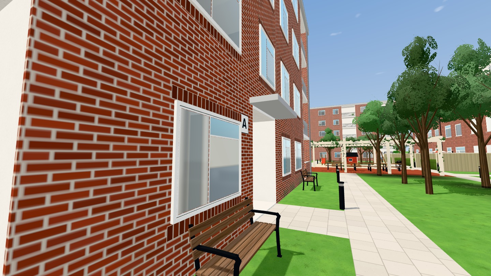
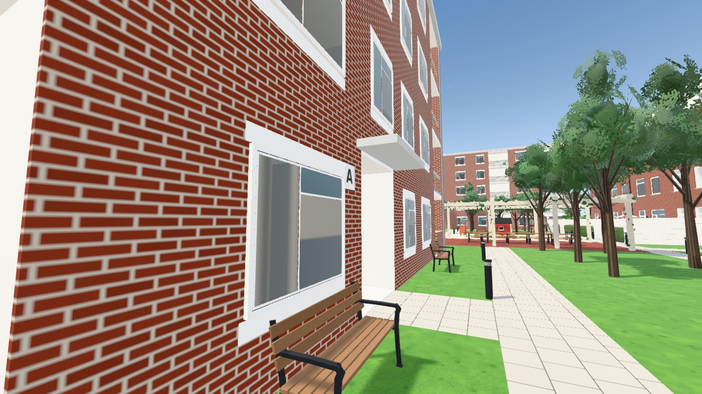
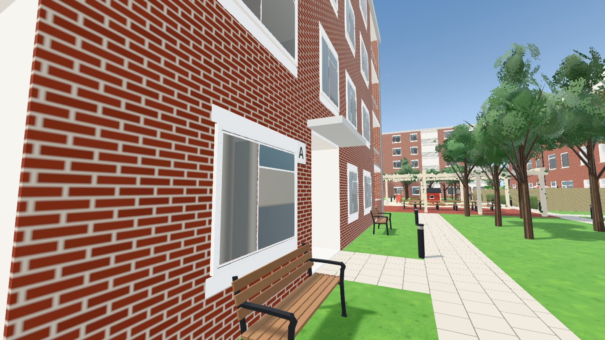

# Neighbours' patio fences in Unreal (#2416)

Unreal Editor 5.8.4 on Windows 11, 2026-11-22, headless (`-RenderOffScreen`). Warm Windows checkout
`lunden-ue-wt/opus-2387` at `ea1e090a` plus this change, full `sync-import.ps1 -ExportFrom` of the CI export
`unreal-export-c1799b6964b43ec4` (every zone re-imported for the changed material map; `LUNDEN_SYNC_IMPORT_OK`,
`LUNDEN_CHECK_OK`). Unreal pictures: `tests/capture_vegetation.py` with #2325's `courtyard` and `entrance-a` cameras
([January](unreal-capture-january.json), [June](unreal-capture-june.json)). Web pictures: #2317's courtyard pair
(`?snow=0` in January) and #2392's entrance A, both unchanged since.

**Result:** Hus L's patio fences and roof-terrace screen walls draw the screen-wall boards like L1007's own instead of
white wall tiles, in January and June and from entrance A.

## Cause and change

Not the season, snow or Nanite. The export gives the web's screen walls (`src/world.js` and `src/exterior.js`
`mats.fence`, #1786) the shared tile key `std_ffffff_r100_m0_tex`, which `material-map.json` resolves per StaticMesh name.
The screen-wall rule named only L1007's two walls; Hus L's fences and terrace screens are one merged mesh
(`hus-l/mesh_l0_xm1509_z1425_y563`) and fell to the key's catch-all, `MI_LundenTileWall` (white tiles). In June the
crowns hide the far fences, which is why the courtyard June view looked right.

- `material-map.json`: the screen-wall rule also selects Hus L's mesh.
- `tests/test_materials.py` check 8: meshes drawing the same web canvas (`materials[].looks[].mapIndex` in
  `measurements.json`) must reach the same material in every zone. On `main` before the change it fails with
  `key std_ffffff_r100_m0_tex canvas 98 (untagged) reaches different materials: MI_LundenScreenWall:
  l1007-uteplats/mesh_l0_x4_z1522_y90, l1007-uteplats/mesh_l0_x571_z1522_y90; MI_LundenTileWall:
  hus-l/mesh_l0_xm1509_z1425_y563`; with it, 221 canvases pass, 20 of them shared by several meshes.

## Checks

| Check | Result |
|---|---|
| `python3 tools/unreal-engine/tests/test_materials.py <export>` | fails on `main` (above), `MATERIAL_COVERAGE_OK` with the change |
| `sync-import.ps1 -ExportFrom <export>` (import, builders, `import_world.py --check`, release gate) | `LUNDEN_SYNC_IMPORT_OK` |
| fence colour, web JPEG against the lossless Unreal PNG (`tests/crop-stats.cjs`, [`crops.json`](crops.json), [`crop-stats.txt`](crop-stats.txt)) | see below |

| View | Crop | Web sRGB | Unreal before | Unreal now | Luminance now / web |
|---|---|---|---|---|---|
| courtyard, 15 January | Hus L fence | 178, 150, 103 | 212, 215, 216 (×2.09) | 174, 152, 106 | ×1.00 |
| courtyard, 15 January | L1007's wall (reference) | 174, 149, 104 | 172, 153, 108 | 172, 153, 108 | ×1.02 |
| entrance A, 21 June | Hus L fence | 163, 153, 113 | 244, 241, 234 (×2.78) | 169, 159, 121 | ×1.10 |

## Pictures

| Web | Unreal before | Unreal now |
|---|---|---|
|  |  |  |
|  |  |  |
|  |  |  |

## Houses checked

- **Hus L:** affected (patio fences and roof-terrace screens), fixed.
- **L1007:** its two screen walls already had the boards; unchanged (reference crop ×1.02 before and after).
- **Hus A, B and C:** not applicable; the web has no screen walls there (`screenWallParts` is used only by
  `src/world.js` and `src/exterior.js`).
- The same shared key also sends Hus L's portik paving and the visitable flats' wet-room floors and splashbacks to the
  wall tiles; those use canvases of their own, so check 8 cannot see them: #2442.

## Other visible differences in these pairs

- The screen walls lack the web's cream frame and board stripes and look olive and dotted: #2443 (new).
- The bare January trees cast no shadows on the lawn and fences: #2444 (new).
- The January snowman on the courtyard lawn is missing: #2445 (new).
- The kettle grill at the courtyard pergola is not ported: group G13 is Later.
- The lawn and the crowns are lighter and paler: #2437. Brick #2427, #2428; window surrounds #2425; winter sun colour
  #2398; patio wall shadows #2423.
