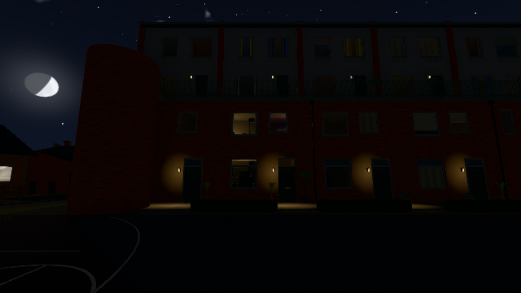

# External neighbour windows — partial #2421

The exporter no longer drops the86 scheduled external-house windows. An explicit LocalPower primitive value keeps their source schedule independent of apartment power; A/B/C windows retain local-power gating. The normal build now contains735 actual window actors (649A/B/C +86external), checked against the export. The left source routine28.17,1.70,7.95 is actually bound at Native[2817,795,170], LocalPower0.

[Source reference](web-start-night.jpg)

Root viewed both complete images: the formerly omitted neighbour window is visibly lit at the left edge. Component presence alone was not treated as pixel evidence. Normal facade build/check passed in NullRHI; a fresh separate rendered process captured this view with both #2443 views, Native/runner/tool0. Exact guards and runtime restoration passed; [compact actual readbacks](result.json), [shared process/postflight evidence](../../2443/source-canvas/result.json).

This is a partial delivery. #2421 remains open for the pale upper facade, grey foreground and yellow lamp-pool differences. Prior accepted sky/APT evidence is reused, not rerun. No new full20, global sync stamp, release gate, Shipping or Windows parity claim. The ten-group normal export/check and bounded source schedule/power tests passed without RGB/gain changes. Original-only Unreal: no public downstream transfer.
