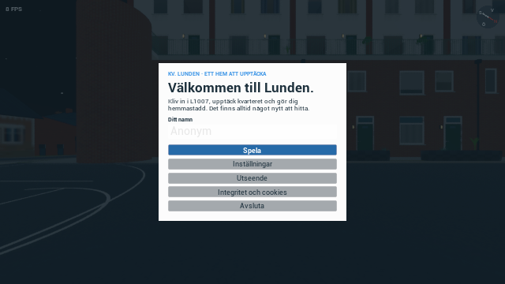

# #2422 Linux Shipping verification

## Current verified result (2026-11-28)

The real Linux Shipping cook completed **5807 packages and 6496 shader jobs**;
UAT and its outer command returned **0**. The same archived runtime then rendered
the packaged START scene and welcome UI in an actual **640×360** own-process
window in v3, accepted `WM_DELETE_WINDOW` and exited **0**; its outer smoke also
returned **0**. See [raw v3 image](packaged-client-v3.png),
[unaltered smoke outcome](packaged-client-v3-outcome.json),
[preseeded normal user profile](packaged-client-v3-preseed-profile.json) and
[source/observation proof](packaged-client-v3-review.json).

V1 and v2 actually opened **2560×1440** despite `-ResX=640 -ResY=360`.
Adding `-nohighdpi` in v2 did not reduce it, so the former DPI explanation is
withdrawn. The saved v2 GameUserSettings already contained 640×360 but used
`FullscreenMode=1` (borderless desktop). The existing UI calls `ApplySettings(false)`
on startup, applying that persistent mode without command-line overrides.
V3 kept the same archive and command flags and used a fresh private UserDir with
normal GUS current/confirmed mode **2** (Windowed), 640×360 and Version5. It also
set PreferredFullscreenMode2; that preference getter maps every nonzero value to
borderless, while current FullscreenMode2 controls this windowed request. The
[exact preseed](packaged-client-v3-preseed-profile.json) and
[post-run GUS](packaged-client-v3-GameUserSettings.ini) are retained. No SaveGame,
product source, exposure, authored asset or game binary was changed for this mode.
The actual X11 drawable dimensions are the window-size authority. The retained
profile requests `sg.ResolutionQuality=50`; 640×360 is the drawable size, not a
claim that every internal rendering pass used full window resolution.

These are software-Vulkan/SM5-requested Shipping smoke results, not ordinary GPU,
Windows/Lumen, full gameplay or performance acceptance. The visible 8 FPS is an
observation only. The official [Linux beta0.3.0 release](https://github.com/solwation/lunden-3d-apartment/releases/tag/app-v0.3.0)
is now published and latest after protected P256 signing of both Linux channels
and successful promotion run[46121486570](https://github.com/solwation/lunden-3d-apartment/actions/runs/46121486570).
That gate anonymously verified all four Windows/Linux stable/test channels and
every declared payload's size and SHA256, then rechecked release identity before
promotion. Windows0.2.0 binaries and signed manifests are retained unchanged.
See [official release proof](official-release-proof.json),
[official-key signature checks](official-signature-verification.json),
[real production-manifest launcher dry-run](official-launcher-production-dry-run.json)
and [final asset checksums](SHA256SUMS). The dry-run exited0; it did not download,
activate or launch the game. Actual installation verification is recorded separately.
Historical checkpoints below retain their original pending/untested scope as of
execution; they are superseded only by the explicitly recorded later results.

## Historical source checkpoint (before actual cook)

This was an open implementation checkpoint, not a distributed game or issue closure.
Linux source `e78af5a8a1af59d30ec85d6b23633eebfed34a45` was reapplied as
`12f5d1963af29c5a4ad331a8b708dddde1b6e63a` on public `8afc03f1`, then
integrated with the verified night-sky correction as `d78eb3abcab4c40e8cc091bfa1ae56c21e8b70b9`.
No private C4/15c prototype ancestry was imported. The24 implementation files
are byte-exact against the tested checkpoint; only development-document context differs.

The source adds a content-only Linux x86_64 Shipping cook, a self-contained Linux
launcher, platform-bound P256 signed manifests, atomic installation and rollback
with persistent saves, ELF validation and rejection of wrong-platform downloads.
Windows trust and the union of Windows/Linux release channels are retained.
Linux launcher self-update currently requires an official manual update.

Existing source-bound results are reused without automatic suite repetition:
launcher58 PASS/6 SKIP (64 total); release protocol33 PASS/1 Windows SKIP.
Subsequent targeted checks overlap those suites and are not added as new totals.
A real self-contained ELF was published locally from the clean e78 source;
a signed Linux manifest passed the real launcher's --dry-run with exit0.
No game payload or engine started in that dry-run. See the exact proof files.

The installed exact Epic5.8.4 has a real Linux Shipping runtime, installed
Game/Shipping receipt and all973 declared receipt paths/globs. RunUAT,
precompiled AutomationTool and bundled .NET10 are present. The native compiler
SDK is absent; whether the content-only route needs it is left to actual UAT
validation, without guessing a blocker or installing unrelated compiler versions.

The first actual --plan on clean d78eb3ab passed the current322-source export
and every zone's import fingerprints, then correctly failed the global sync
builder fingerprint changed by the night-sky work. Nothing bypassed this gate.
Next: one genuine canonical sync using the existing valid imports, then a new
release plan and actual Shipping cook. The sync stamp is written only after all
required real steps succeed. Current247 authored packages were preserved exactly
and remain readonly.

Still untested: actual Shipping cook, ordinary Linux desktop/GPU gameplay and
performance, hosted signed distribution/update/rollback, and current Windows
build. Version0.3.0/content20 in the local trial is provisional test metadata.
Nothing here publishes an official binary release or claims whole-issue acceptance.
This Unreal-only implementation has no public web downstream transfer.

## Historical actual sync and first UAT invocation

On the published clean84e35c47, one normal NullRHI invocation actually executed
all20 canonical steps, including source-bound cached builders, import checks,
normal fresh sync stamp and the real release gate. Native/runner/outer0,
148.67seconds, no logged errors; all247 authored files stayed exact/readonly.
The following real release plan passed. This is not reused execution or a
manually fabricated current stamp.

The first real UAT call failed before cook (exit1, no game archive):
`Found no script module records`. The earlier editor-only installation had
excluded Intermediate; the original EpicZIP contains the43 real ScriptModules
JSON records. Root restored only these exact distributor bytes. All27 relevant
Automation DLL targets already existed and were SHA-identical to ZIP. No
records, SDK versions or successful build results were invented. V2 then
initialized UAT successfully and entered the actual Cook commandlet. Its
outcome remains pending; no successful Shipping build is claimed here.

The native compiler SDK is also present in the originalZIP (3.28GiB) but is
not installed. Linux SDK INVALID messages alone have not been treated as a
fatal requirement. Any installation decision follows the real cook result.
OriginalZIP byte provenance is recorded; no separate cryptographic SDK-signature
verification was performed.

Published Linux CI job140892617791 passed. Windows CI failed one unchanged
process fixture after reporting memory-resource errors. The same test was
previously documented unstable in#2420; no Linux-caused product regression is
proved. This separate test defect is tracked in#2501; no protection or assertion
was weakened and no blind CI rerun was used to manufacture green status.

The clean84e35c47 source also produced a real self-contained0.3.0 Linux ELF
launcher with the repository's official public manifest key, read from its public
Actions variable. Its actual --help returned0; this does not download or start
the game. BinarySHA and public-keySHA are in official-linux-launcher-build.json.
No private key was read. The first actual game cook is still running; at the
10minute review it had5465/5807 packages complete,20GiB RAM available,
15 active build processes and no error lines. It continues rather than restarting.

## Actual Shipping archive and first client window

The real full cook completed all5807 packages and6496 shader jobs. UAT then
staged, packaged and archived successfully (1376.07seconds BuildCookRun;
AutomationTool exit0, outer0, release result passed/no shaderlogerrors).
The native C++SDK was not needed for this actual content-only route.

Staging initially retried one readonly engine input, TessellationTable.bin,
with permissiondenied on DrvFS. Root temporarily added ownerwrite only to
this exact supplier file (555→755), without changing bytes; the ongoing copy
recovered and the same build finished without any recook. Its original555 mode
and originalSHA were restored immediately after UAT. The transaction, actual
retries and completion are preserved; no failure log was rewritten.
Afterward all247 authored packages remained exact/readonly and source84e35c47
was clean. The archive's runtime hash equals the installed Epic Shipping ELF.

The actual packaged client started under WSLg with a fresh private UserDir,
explicit software VulkanICD and SM5 requested. It rendered the START pilot and
Swedish welcome menu, remained alive over60seconds, then accepted WM_DELETE
and exited0; the external smoke exited0. Root reviewed the raw own-windowPNG.
Only that exact process's drawable was captured. This is a real Shipping image,
not an editor frame, fixture or mocked ELF. Actual window2560×1440 despite
requested640×360; the initial DPI explanation was not established. V2 with
`-nohighdpi` retained that size; observed borderless GUS mode1 and the successful
normal mode2 v3 are documented above. V1 is not a low-resolution pass. EightFPS
shown in this software-rendered frame is not hardwareperformance
acceptance. Full GPU/Lumen/Windows parity is untested; existing lighting issues
remain recorded separately.

The actual manifest generator accepted the finished archive and official-key
launcher, producing a Linux-bound draft with13 mappings/12 content-addressed
payloads (825494703 bytes). At this checkpoint it had not been signed, uploaded
or promoted; this document
does not establish the separately ongoing release publication.
