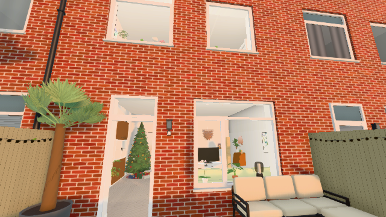
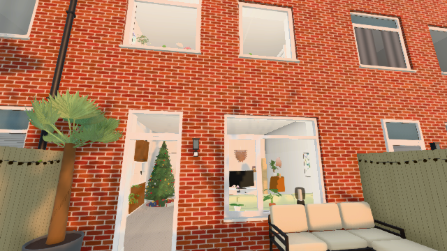

# Bark-group shadow diagnostic — #2423 remains open

On 24 December 2026 at 14:00, clear weather and lamps off, one existing bark HISM component was captured normally, with `cast_shadow=False`, and restored. The component contains **812 instances**. Source candidate `mesh_tree-trunks-0-0_l0_x776_z2034_y239` is actual instance 83; this is a group experiment, not an isolated-trunk test. No geometry, material, gain, saved asset or global lighting policy changed.

The group-off image changes **49,611 RGB pixels**. Root's whole-image inspection confirms visible bark/branch shadow contributions. Original and restored images differ in **0 RGB pixels**. Actual component shadow flags were enabled; all 812 GLB source shadow fields are **unknown**, because those fields are absent. This establishes neither a source flag bug nor a unique cause for the remaining appearance gap.

Native, runner and tool exited **0/0/0** (212.26 s native, 212.321 s outer). Clock, flash, lamps, visibility, calendar/weather MPC, RTC, profile CVars and actor roster restored. External postflight confirmed the then-frozen `9b9abd58` source, 250 authored readonly packages, 5,228 Generated files, 12 Import files and 668 dependencies exactly. These are historical run facts; the active Native checkout subsequently advanced.

The original #2423 winter **and June** contrast requirement (within ±20% of web) remains unchanged and **was not evaluated by this diagnostic**. No product fix or completed acceptance is claimed. Linux software-rendered SM5, 640×360; no Windows/GPU delivery claim. Render-only native season visibility was applied; gameplay collision was not synchronized.

| Original | Bark group shadows off | Restored |
|---|---|---|
|  |  |  |

[Readbacks](readback.json), [external postflight](postflight.json) and [run/image provenance](provenance.json) retain compact actual evidence. Full private reports are pinned by SHA-256; no 812-transform dump or SDK source is included. Earlier source identity evidence: [caster audit](../caster-audit/README.md).
