# #2424 — actual Linux shader trial, not accepted

The two legacy environment-BRDF sources were removed in a private, temporary UE5.8.4 LinuxSM5 trial. **The product is unchanged and #2424 remains open.** Palm, hedge and entrance-sign targets pass, but the existing daytime-rug gate regresses; the same private #2428 brick candidate still fails three rows. No material colour, exposure, ROI or tolerance was fitted.

The actual nine-image run took295.99s; native, runner and outer execution all exited0, with no shader errors. All247 authored packages remained exact/read-only, Generated5187,12export files and195 pinned dependencies stayed unchanged. All six registered same-run legacy CVars were0. Both original engine shader files, modes and mtimes were restored after all owned editor/compiler processes ended. [Actual command/profile](proof/native-result.json), [LowEngine.ini](proof/LowEngine.ini), [capture/guards](proof/trial-verification.json), [engine journal](proof/engine-transaction.json), [provenance](provenance.json).

| Existing criterion | Actual result | Decision |
| --- | --- | --- |
| Palm mean RGB, each within±10% |1.048142 /1.038516 /1.023725|PASS|
| Hedge R/B and saturation, each±15% |0.953546 /0.981926|PASS|
| Entrance-A sign linear luminance,0.8–1.25 |1.000000|PASS|
| Daytime living-room rug linear luminance,0.8–1.25 |0.821398 before →0.718148 after|FAIL, regression|
| Other existing21 APT guards |within unchanged intervals|PASS|
| Courtyard Hus-A near mortar share,±10% |0.891463|FAIL|
| Courtyard Hus-A mid brick L*,±10% |1.109652|FAIL|
| Courtyard Hus-L far brick L*,±10% |1.104782|FAIL|

See the complete [additional target results](measurements/additional-target-gate.json), [APT gate](measurements/apartment-gate.json), [brick gate](measurements/brick-gate.json) and [before/after brick table](measurements/before-after-brick.json). Exactly one Chromium batch measured all nine pairs; before pixels were not remeasured. The before/after comparison keeps the same unaccepted brick master,247packages, Generated, export, production Python and actual runtime/exposure fields; it does **not** compare old versus new filters. [Matched source/runtime/pose proof and causal limitations](measurements/comparison-preflight.json).

The four rail ROIs are raw diagnostics only. No current neutral-grey pair exists, so historical daylight normalization and numerical #2391 acceptance are not claimed.

## Whole originals and remaining scope

Root viewed all five exterior pairs; the independent reviewer viewed all four APT pairs. [Exterior review](proof/whole-review-outdoors.json), [APT review](proof/whole-review-apt.json), [exact remaining finish scope](proof/outdoor-scope-mapping.json). Known paving dots remain#2497, window-edge waves#2498, patio screens#2443, grass/tree contrast#2437, glazing#2459 and existing interior gaps retain their documented open issues. Water glitter, bench grain and the specific remaining palm-stem bark finish are recorded under open#2362; the stem tone's cause remains unknown. No broad curved brick moire was observed in these complete1440px frames, without claiming temporal/all-distance or complete filter acceptance.

## Scope and failed first attempt

This is a legacy LinuxSM5 diagnostic, not a WindowsSM6/Lumen/cook/package delivery. The two small shader gates preserve direct sun/lamp BRDFs and diffuse lookup; source-policy coverage for every rendering model is not established. The current Windows project uses Lumen, whose other reflection paths are unsupported by this prototype. A three-file [candidate reconstruction patch](candidate.patch) records the private transformer/manifest/fixture source against publisheda3f6456e; no Epic source file, signed engine binary or `.uasset` is published. The normal launcher has no patch hook. The engine ownership guard is advisory, not protection against a foreign manual launch or lost supervising process.

The first attempt failed, and is retained as [failed-first proof](proof/failed-first-trial.json). Its outer launcher vanished143 before final result writing while the editor continued (#2473); manual bounded recovery reaped only owned children and restored both original engine files. Its first valid PNG was incorrectly rejected because it contained29796bytes of Unreal metadata after IEND. The retry changed only that private image guard to CRC-check complete PNG chunks while preserving original trailing bytes. [Four offline fixtures](proof/png-guard-fixtures.txt) passed. The later successful process completion does not establish the cause of the first143. Eight transformer/rollback/profile fixtures had already passed before the actual trial; they do not substitute for lifetime protection of a real lost launcher.

[Rug material/source chain](proof/rug-source-chain.json) confirms that the source has no rug-specific environment map, and identifies the remaining shared diffuse approximation as an unproven next candidate. [Brick filter audit](proof/filter-source-audit.json) identifies why the tent candidate changes resolved-near filtering and is not an exact source-texture reconstruction. No further image run was performed after these failed numeric results. This Unreal-only evidence has no applicable public-web transfer.

## Saved raw pairs

### patio-palm

| Web original | Unreal original |
| --- | --- |
| 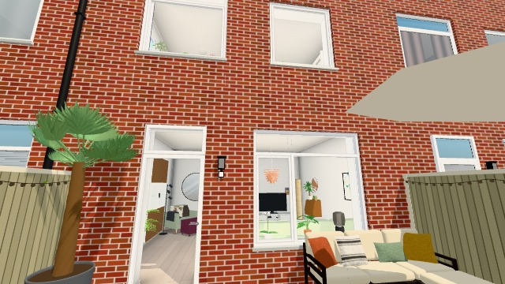 | 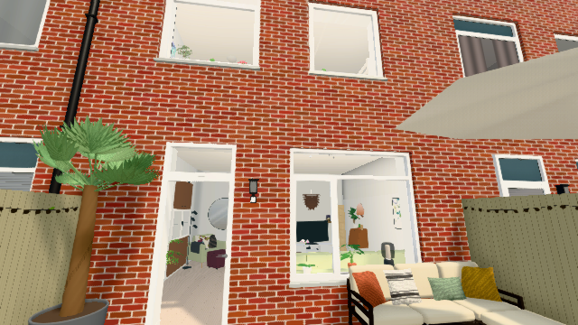 |

### river-bridge

| Web original | Unreal original |
| --- | --- |
| 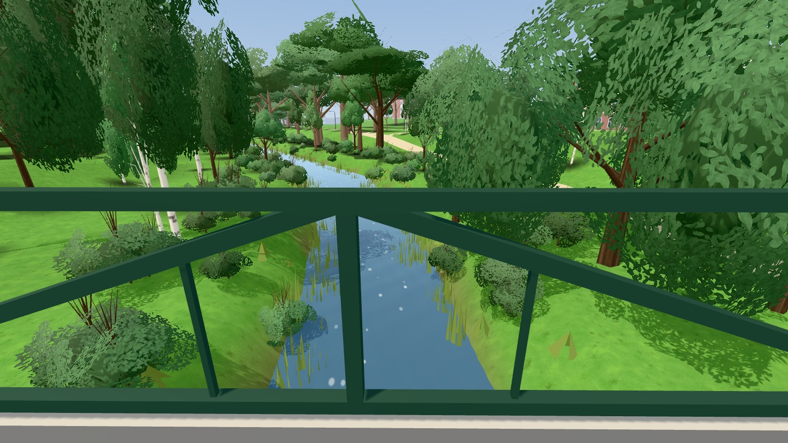 | 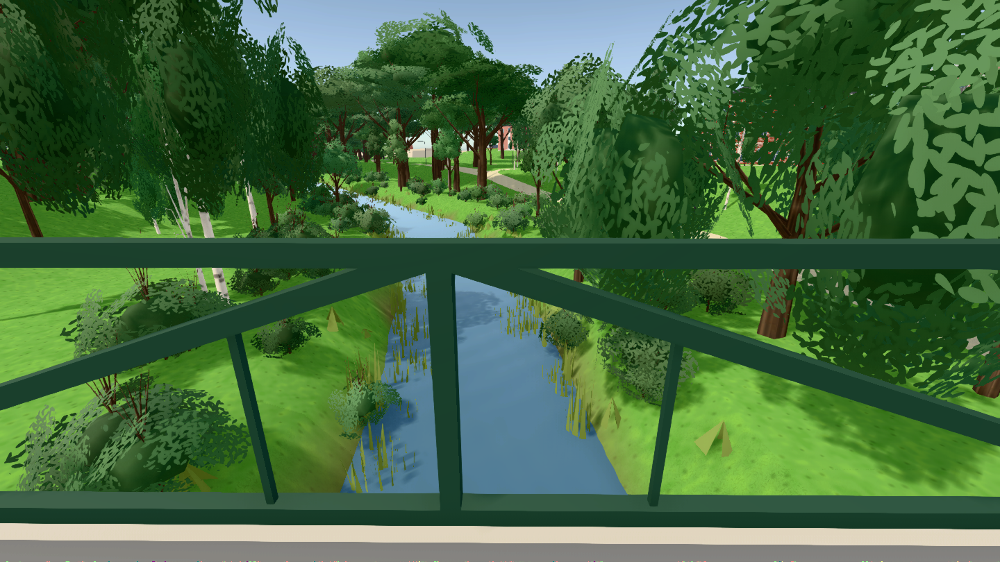 |

### patio-lawn

| Web original | Unreal original |
| --- | --- |
| 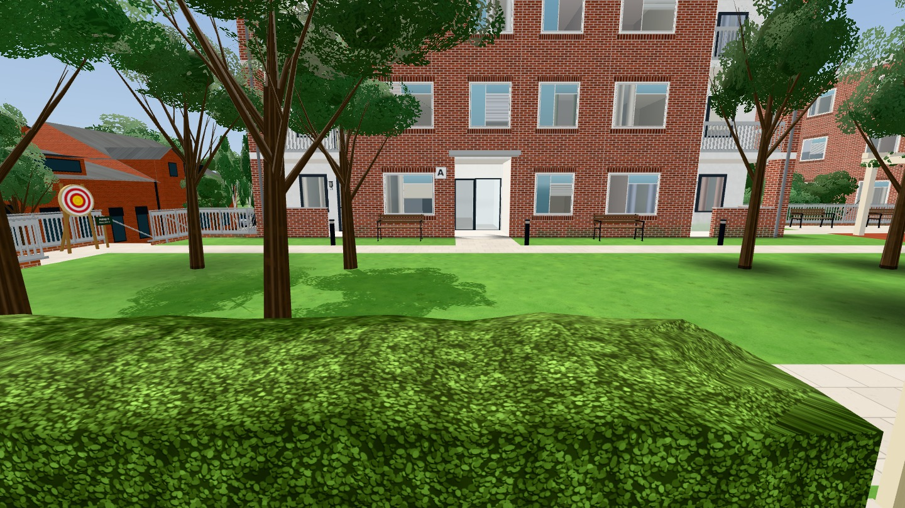 | 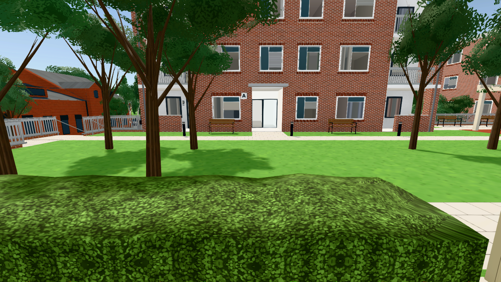 |

### entrance-a

| Web original | Unreal original |
| --- | --- |
| 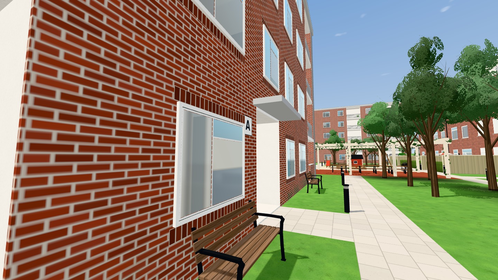 | 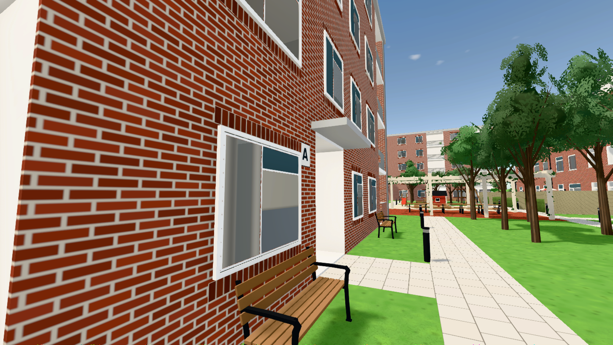 |

### courtyard

| Web original | Unreal original |
| --- | --- |
| 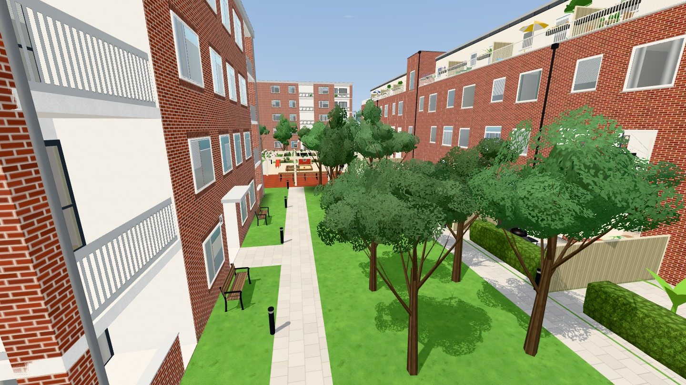 | 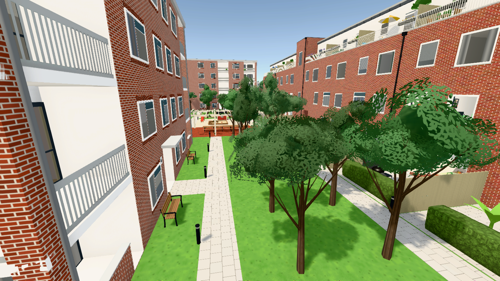 |

### stairs-evening

| Web original | Unreal original |
| --- | --- |
|  | 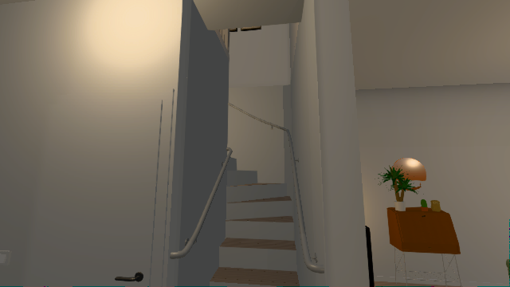 |

### living-room-day

| Web original | Unreal original |
| --- | --- |
|  | 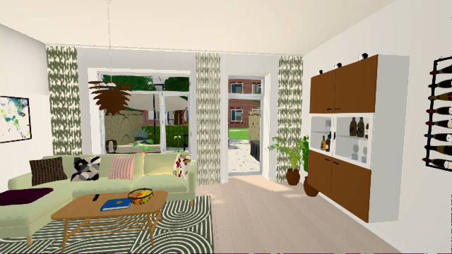 |

### living-room-evening

| Web original | Unreal original |
| --- | --- |
| 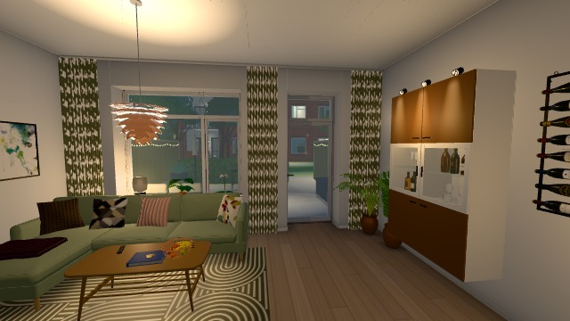 | 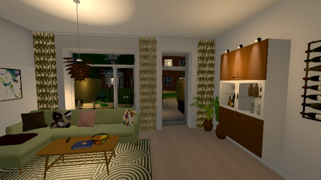 |

### upper-floor-evening

| Web original | Unreal original |
| --- | --- |
|  | 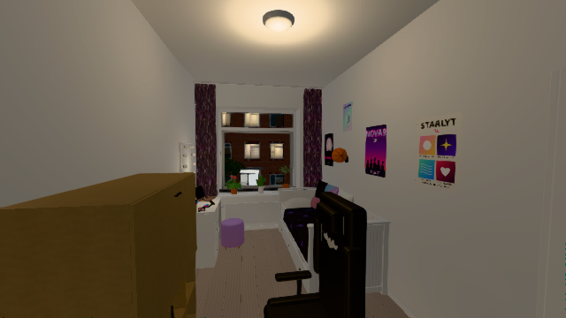 |
