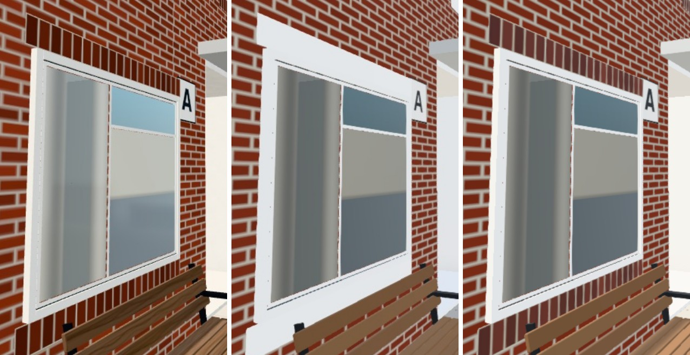
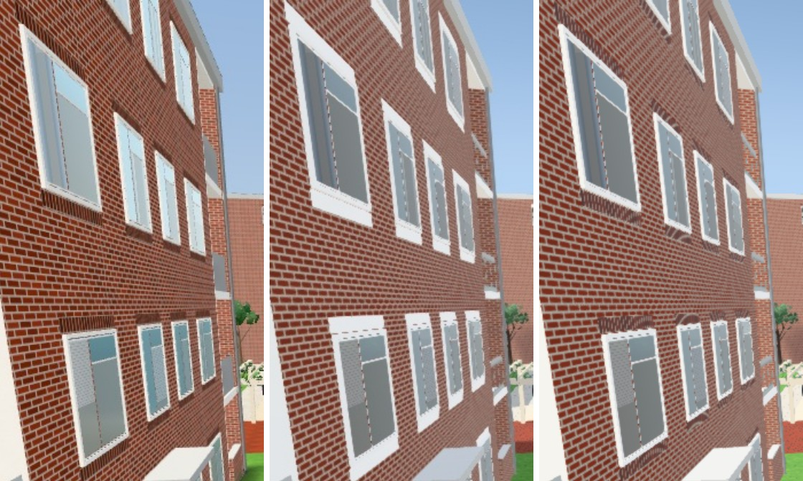
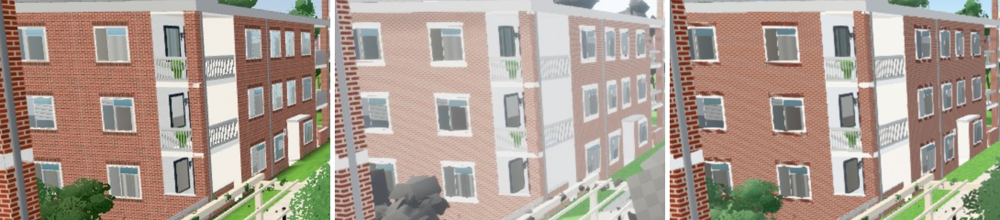
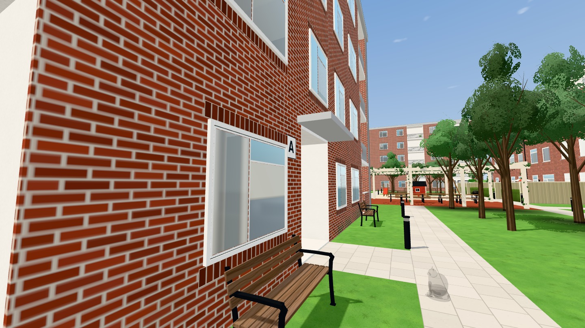
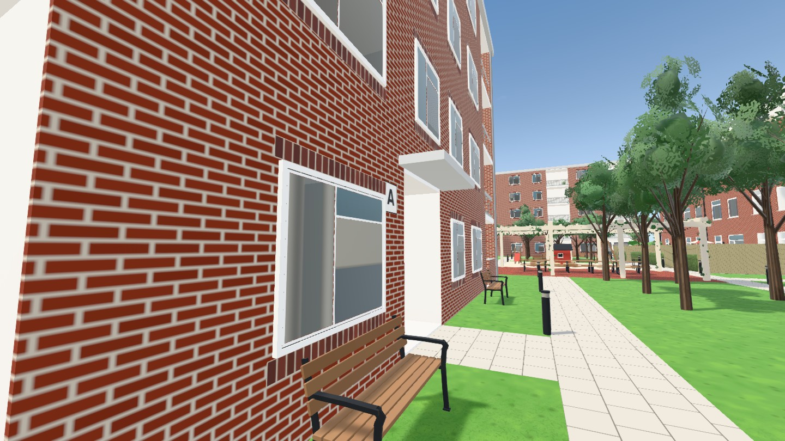
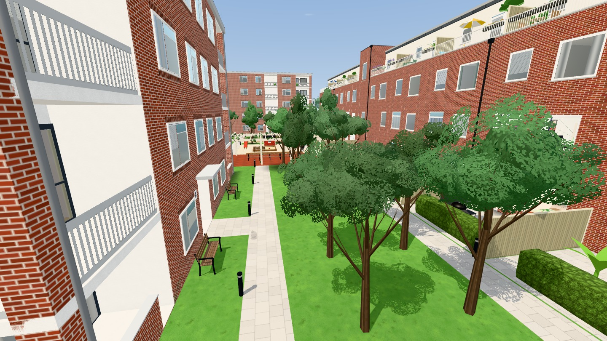
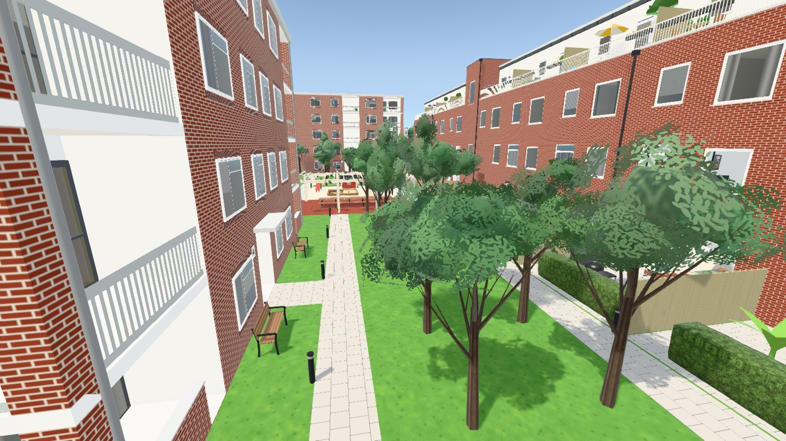
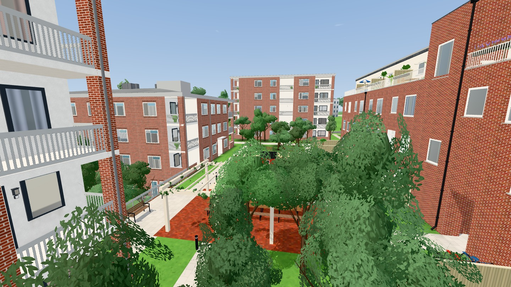
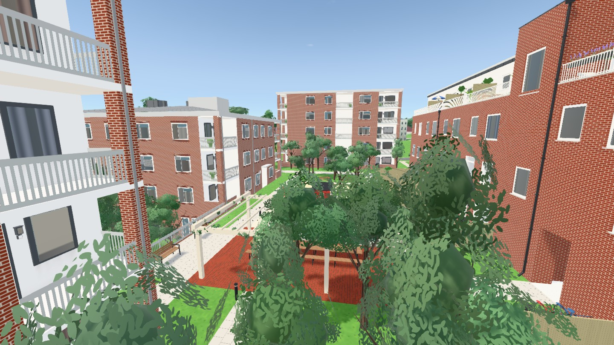

# Soldier courses round the A/B/C windows in Unreal (#2425)

Unreal Editor 5.8.4 on Windows 11, 2026-11-22, headless (`-nullrhi` for the import and checks, `-RenderOffScreen` for the
pictures), in the warm checkout `lunden-ue-wt/opus-2389` at `362619e4` after a complete `sync-import.ps1` from a WSL
export of the same revision. How it works: [unreal.md, Vegetation](../../development/unreal.md#vegetation-trees-shrubs-and-hedges-2281)
("A/B/C window soldier courses", after the courtyard rails and letters).

## Cause and change

On the web the listed A/B/C openings get their soldier courses (upright bricks over and under each window) from decals
15 mm proud of the brick (`src/surroundings.js` `openingDecals`, canvas `openingTexture`); the narrow white frame and
sashes are geometry. The decals' key `std_ffffff_r60_m0_tex` reached Unreal without its canvas, so Interchange drew each
course plain white: an 18 cm band over and under every window and 6 cm at the sides, which read as a wide white surround.

`362619e4` names the canvas `site-opening-soldiers`, the exporter keeps it like the courtyard rails (#2325), and the key
`std_ffffff_r60_m0_tex_site_opening_soldiers` (256 × 320 PNG, clamped, trilinear mips) stays on Interchange's textured
instance. The web output is unchanged (only the texture's name is new). The brick material and #2393's
`TexelBlur`/`BedJoint` filter are untouched.

## Checks

| Check | Result |
|---|---|
| WSL `tests/test_materials.py` (new check 9) | fails on the export before the change (`no export key draws the soldier courses`); passes on `362619e4`: `MATERIAL_COVERAGE_OK` |
| `check-export.mjs` on the WSL export | `Unreal export is current: 11 files, 9385 nodes … exported from 362619e4` |
| `sync-import.ps1 -ExportFrom` (import, derived levels, `import_world.py --check`, release gate) | `LUNDEN_SYNC_IMPORT_OK`, `LUNDEN_CHECK_OK` |
| `tests/check_site_details.py` (soldier key added) | `tex_site_opening_soldiers: 1 of 1 nodes drawn as the web's surface (PNG [256, 320])`, `LUNDEN_SITE_DETAILS_OK 56 nodes` |
| Picture pairs (below) | soldier courses over and under, narrow white frame, as on the web; no moiré on the distant A/B/C or Hus L façades |

## Houses checked

- **Hus A**: entrance A close up, the courtyard façade from the ramp landing and over the loggias.
- **Hus B and C**: the decals of all three houses are one merged node (`mesh_l0_xm3059_z3498_y605`) with one key, so the
  change applies to them unchanged; Hus B/C's courtyard façades appear at a distance in the loggia view.
- **Hus L**: not applicable. The web draws no soldier courses on Hus L (`src/exterior.js` has its own brick and window
  geometry); its façade appears unchanged at a distance in both courtyard views.
- The garage's park-facing windows (`boxWindowOpenings`) get only the frame trim on the web, no decals: not applicable.

## Pictures

1440 × 810, 72° vertical, 21 June 14:00, clear. Web halves: #2325's captures (`9f662b65`, via #2393); no web source
they draw has changed since. Unreal: `tests/capture_vegetation.py` with #2393's and #2325's cameras
([`unreal-capture.json`](unreal-capture.json), `LUNDEN_VEGETATION_CAPTURE_OK 3 views`).

Crops, left to right: web, Unreal before (#2393 at `690250f7`; loggia view #2325 at `9f662b65`), Unreal after.

| | |
|---|---|
| Entrance A |  |
| Hus A's courtyard façade |  |
| Over the loggias (Hus A/B at a distance) |  |

| Web | Unreal after |
|---|---|
|  |  |
|  |  |
|  |  |

Other differences in these pairs, each with an open issue:

- the bricks vary less in colour than the web's canvas: #2427;
- the distant brick is a little lighter, with more joint pixels: #2428;
- window panes and white surfaces reflect the sky (greyer panes): #2424;
- the courtyard lawn and tree crowns are lighter and paler: #2437;
- the hedges are colder and paler: #2411.
