# The web's sun shadows in Unreal (#2426, #2392)

Unreal Editor 5.8.4 on Windows 11, 2026-11-22, headless (`-RenderOffScreen`). Warm Windows checkout
`lunden-ue-wt/opus-release-2419` fast-forwarded to the change, full `sync-import.ps1 -ExportFrom` of a local WSL export of
that commit (every zone re-imported by importer version 7; `LUNDEN_SYNC_IMPORT_OK`, release gate current). Web pictures:
#2392's captures (web unchanged since). Unreal pictures: `tests/capture_vegetation.py` with #2325's cameras
([`unreal-capture.json`](unreal-capture.json)) and `tests/capture_lighting.py patio-christmas`.

**Result:** the export carries the web's `castShadow` per mesh node and the importer turns Cast Shadow off where the web
casts none. The Å-husen and their loggia rails no longer shadow the courtyard walks and the lawn at entrance A, and the
walks are the web's cream within +0.6 … +6.2 % per channel. Things that cast on the web still cast (the bench, the
bollards, the trees, the patio wall's winter shadows).

## Cause and change

On the web the sun is the only shadow-casting light, and only meshes with three's `castShadow` on cast into it (three's
default is off). Unreal cast from every imported component. At 14:00 the sun stands behind Hus A's courtyard façade,
so in Unreal the walks and lawn within about 6 m of the façade lay in the house's shadow (#2392's rays and its
no-sun-shadow render).

- `export-scene.js` writes `extras.castShadow: false` on every mesh node whose web mesh does not cast
  (`shared/schema/node-extras.schema.json`; absent = casts).
- `import_world.py` (version 7) sets `cast_shadow` false on those actors, fails the import and `--check` when an actor
  differs from its node (`LUNDEN_IMPORT_SHADOW`), and adds the switch to the content fingerprint where it is off.
- Unreal has no per-component receive-shadow switch for opaque surfaces, so `receiveShadow` does not travel.

## Checks

| Check | Result |
|---|---|
| `check-export.mjs --dir <export>` | pass: 11 files, 9,356 nodes, 314 sources |
| `tests/shadow-flags.test.mjs <export>` | pass ([`shadow-flags.txt`](shadow-flags.txt)): Hus A's loggia rails and the Å-husen body carry `castShadow: false`; the patio's screen walls, Hus L's loft rails, the flat's walls and a courtyard bicycle do not |
| import and `--check` in a new editor (`LUNDEN_IMPORT_SHADOW`) | pass in all ten zones ([`import-shadow-check.txt`](import-shadow-check.txt)): every mesh actor casts exactly when its node does, e.g. kvarteret 434 of 476 without, hus-l 143 of 1,195, vegetation 1 of 4,163 |
| `tests/test_materials.py <export>` | pass (`MATERIAL_COVERAGE_OK`): the walks still draw `MI_LundenPatioPaving` |
| colour of the walks (#2392, ±10 % per channel) | pass, see below |
| lawn at entrance A (#2426, ±15 % luminance) | ×1.151, on the limit; the shadow is gone, the rest is the grass colour (#2437) |
| patio wall winter shadows (24 December 14:00) | present and unchanged against [#2387's capture](../2387/unreal-patio-christmas.jpg) |

## Crops

[`crops.json`](crops.json) holds #2392's walk crops and #2426's lawn crop. `tests/crop-stats.cjs`
([`crop-stats.txt`](crop-stats.txt)), web JPEG against the lossless Unreal PNG:

| View | Crop | Web sRGB | Unreal sRGB before (#2392) | Unreal sRGB now | Deviation now |
|---|---|---|---|---|---|
| entrance-a | walk near | 235.5, 226.1, 212.3 | 165.1, 168.9, 172.0 | 236.8, 230.5, 218.7 | +0.6, +1.9, +3.0 % |
| entrance-a | walk left | 233.6, 224.5, 209.6 | 167.3, 171.2, 174.3 | 238.4, 231.4, 219.9 | +2.1, +3.1, +4.9 % |
| entrance-a | lawn | 112.4, 173.3, 64.6 | 70, 125, 49 (luminance ×0.48) | 120.7, 184.2, 81.5 | +7.4, +6.3, +26 % (luminance ×1.15) |
| patio-lawn | courtyard walk | 236.4, 229.7, 212.4 | 171.6, 175.8, 179.6 | 241.6, 235.3, 224.3 | +2.2, +2.4, +5.6 % |
| patio-lawn | Hus L's terrace | 223.5, 217.8, 198.7 | 228.7, 224.3, 211.1 | 228.8, 224.3, 211.1 | +2.4, +3.0, +6.2 % |

Hus L's terrace was never shadowed and did not change, which shows the light level otherwise stayed the same.

## Pictures

| Web | Unreal before | Unreal now |
|---|---|---|
| 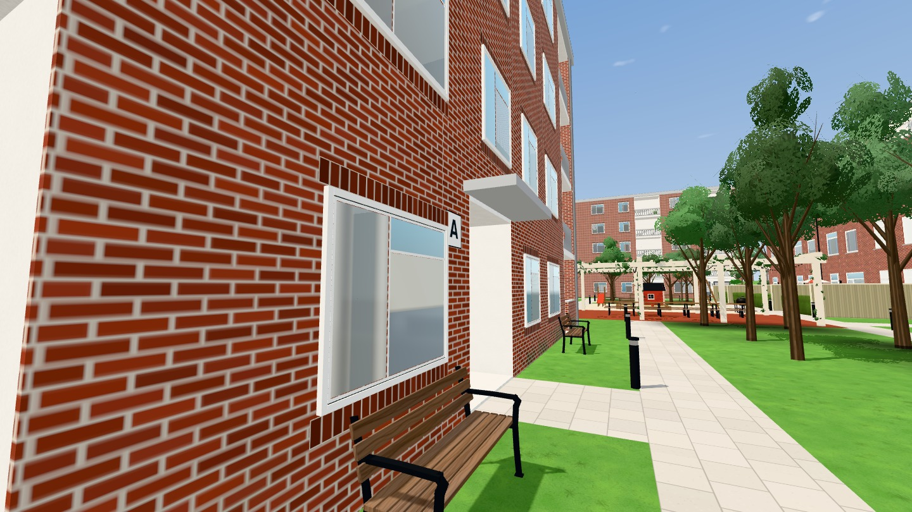 | 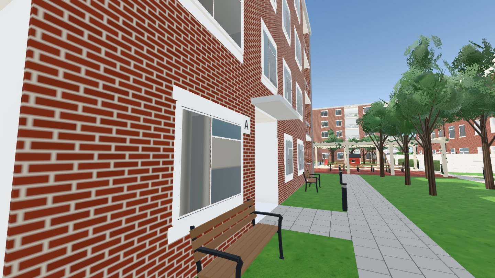 | 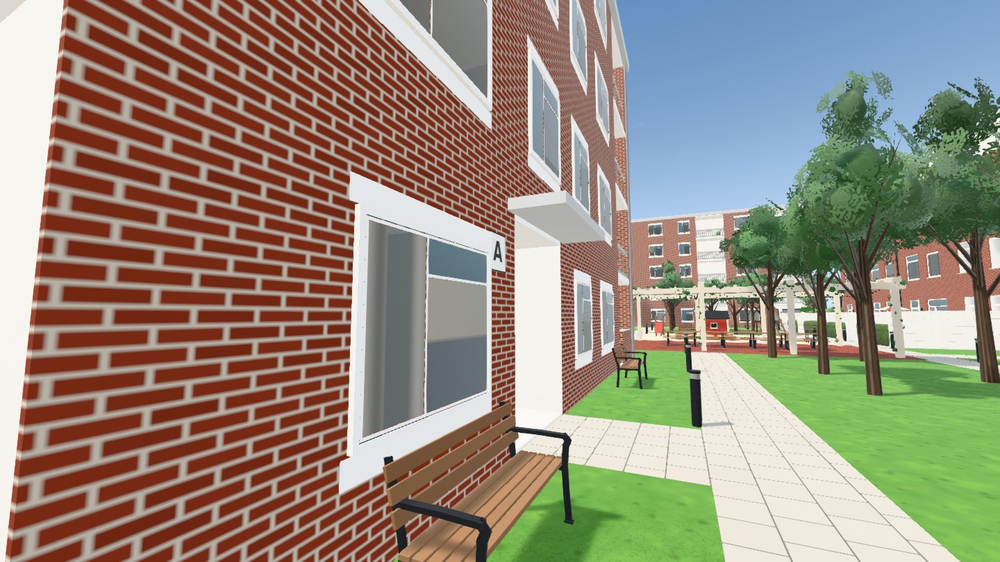 |
| 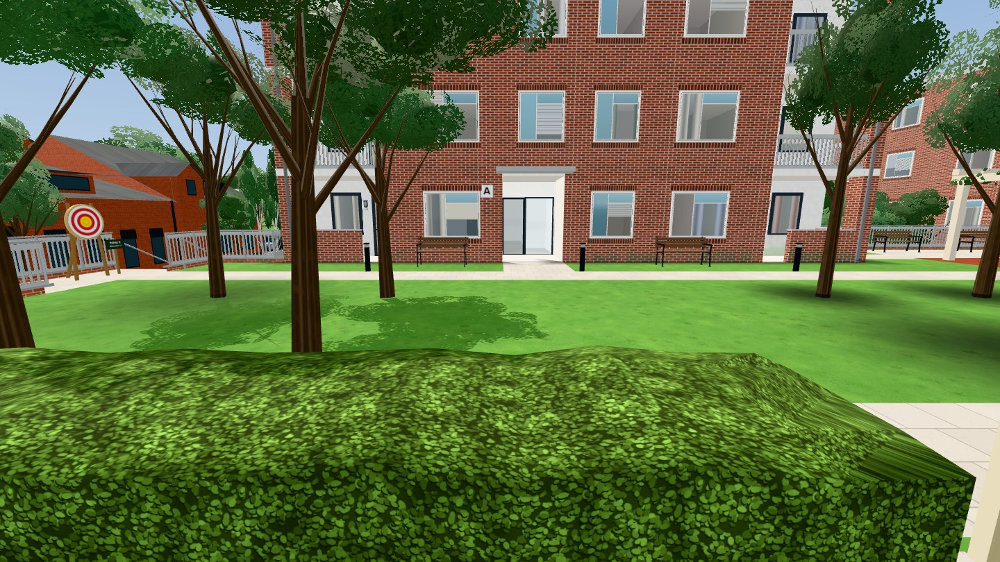 | 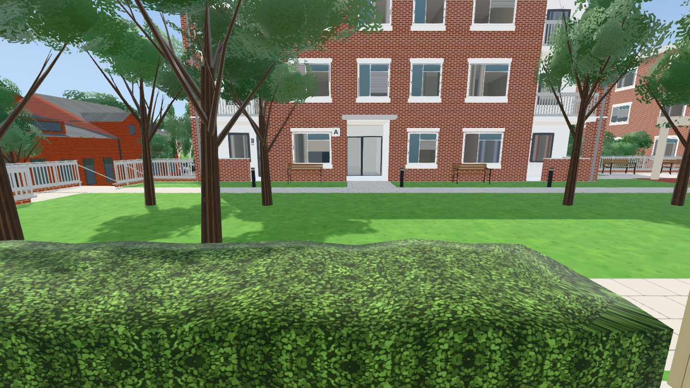 | 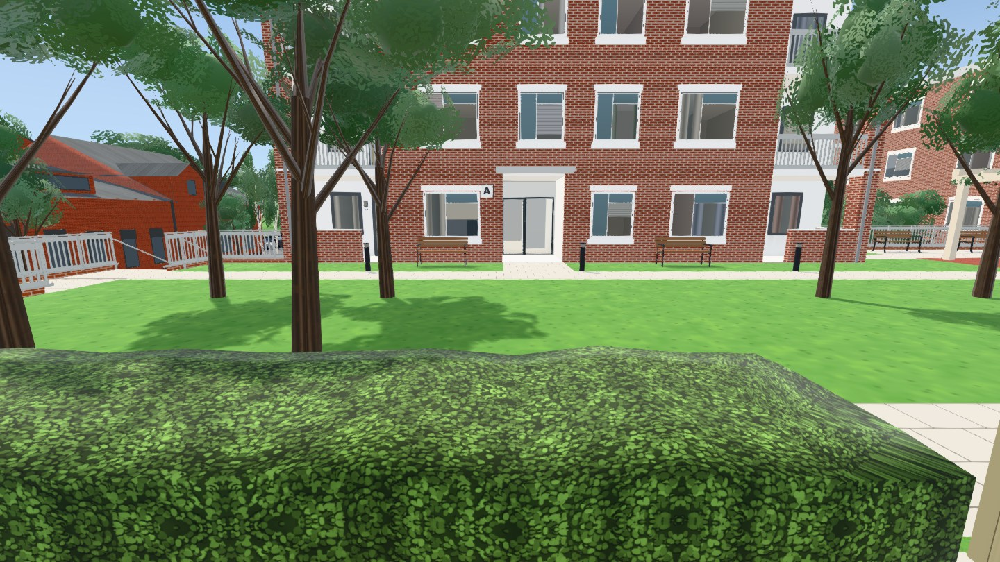 |
| 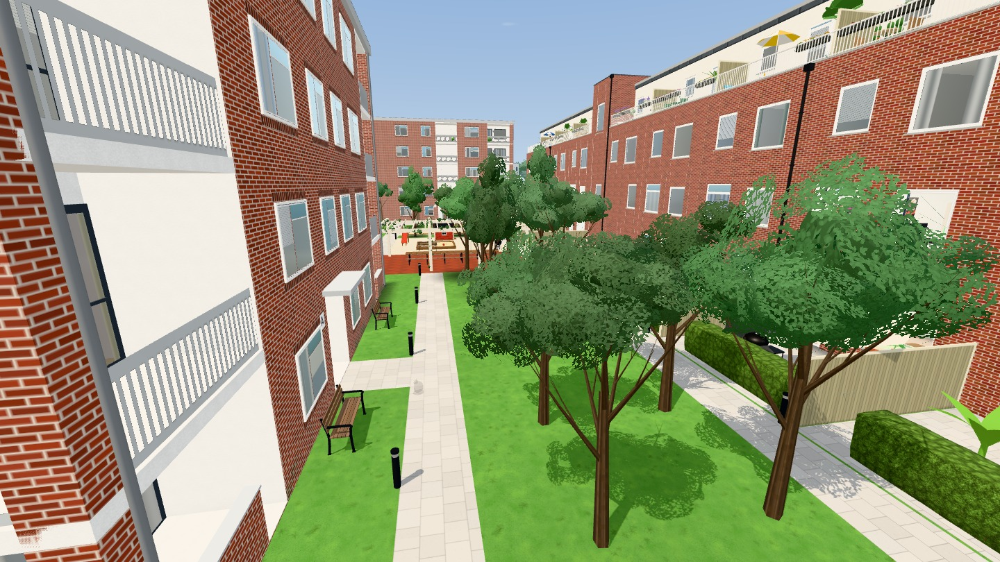 | | 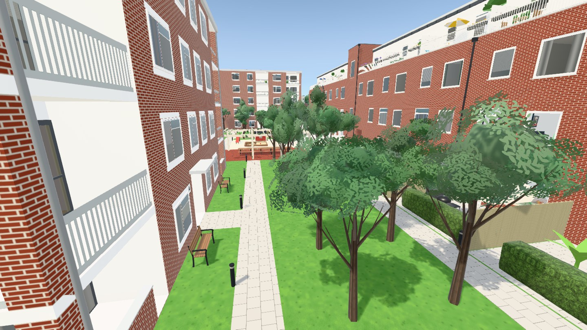 |
| 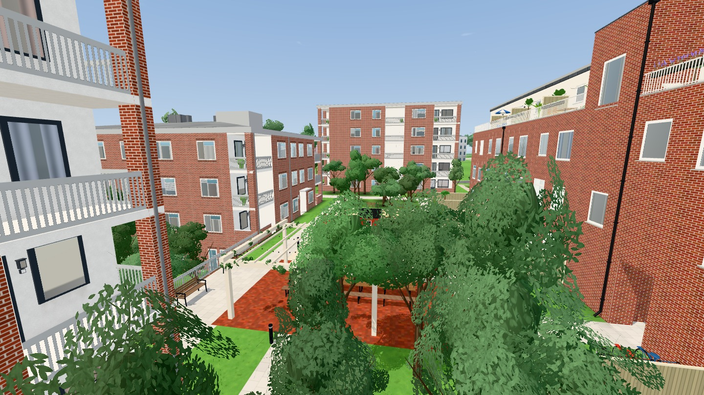 | | 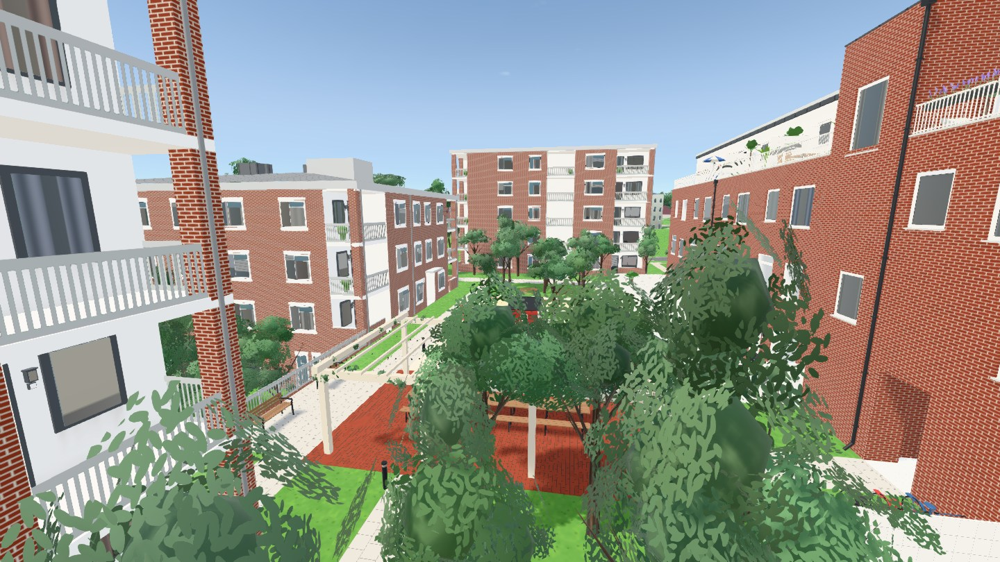 |
| | 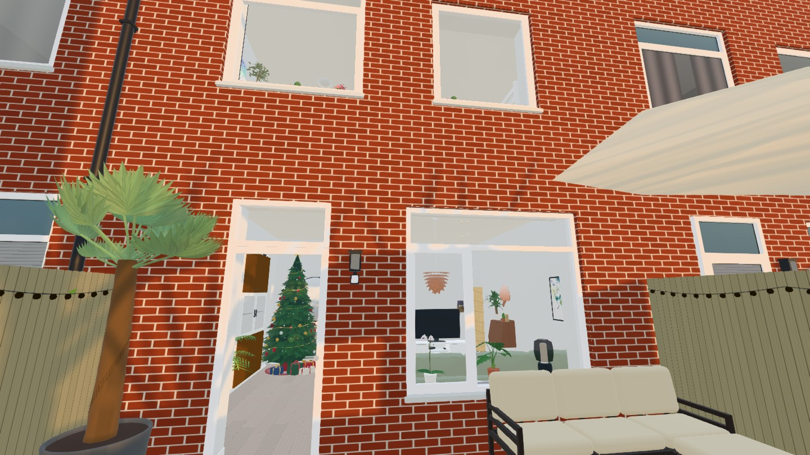 | 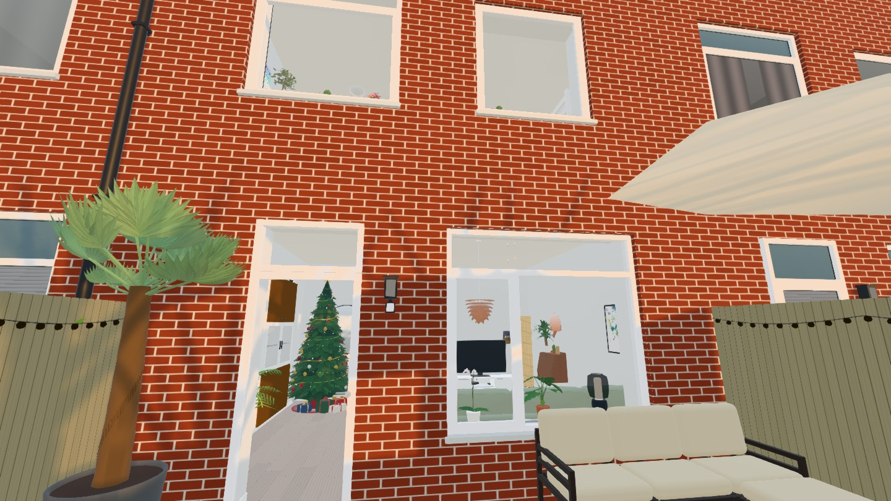 |

## Houses checked

- **Hus A, B and C:** one shared body mesh (`kvarteret/mesh_l0_xm3059_z3497_y600_2`) and the loggia rails; none casts
  on the web, so all three now cast nothing in Unreal, as on the web. Kv. Lunden as a whole: 434 of 442 mesh nodes
  cast nothing on the web (its stair cores and garage are unlit on both sides; the web darkens the wall feet with the
  baked bands of `src/groundao.js`, which do not travel).
- **Hus L:** casts on the web (1,052 of 1,195 mesh nodes, among them the façade and loft rails) and keeps casting.
- **L1007:** the walls and the patio's screen walls cast as before; lamps, rugs, vents and small fittings (444 of 2,117
  nodes) cast nothing, as on the web.

## Other visible differences in these pairs

- The lawn and the tree crowns are lighter and less saturated: #2437 (new).
- The far neighbour patio fence at the right of entrance A is white: #2416 (commented with this June pair).
- The archery target on the patio view's left is not ported: group G18 is Later (#2356).
- The animal on the courtyard walk is not ported (animals, Later).
- Brick variation and distant joints #2427, #2428; window surrounds #2425; sky reflection #2424; hedges #2411;
  the winter sun's colour #2398; the patio wall's winter shadows being softer #2423.
