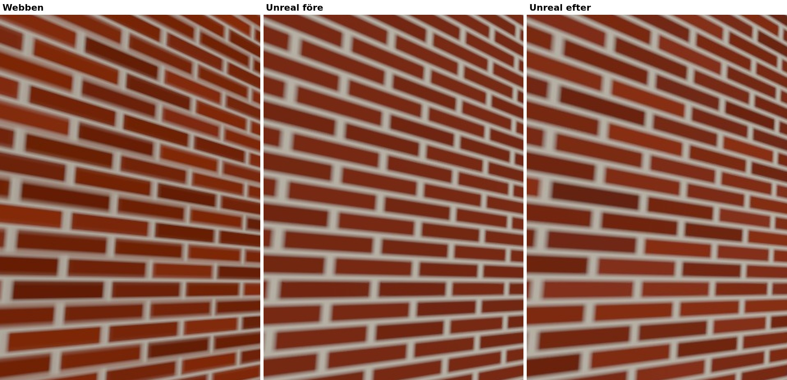
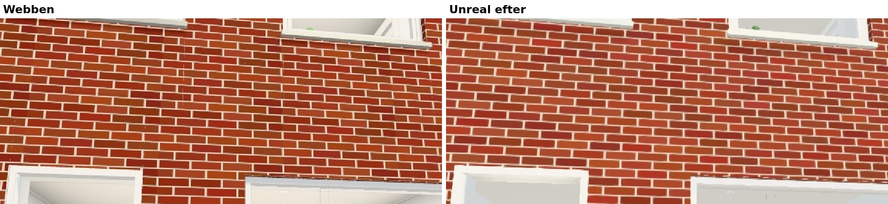
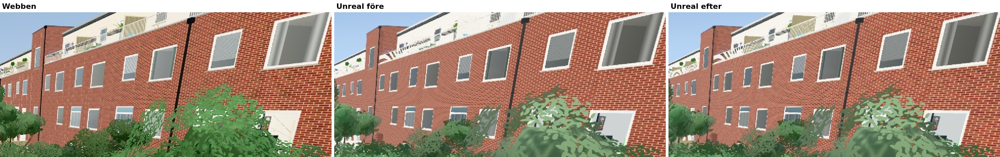
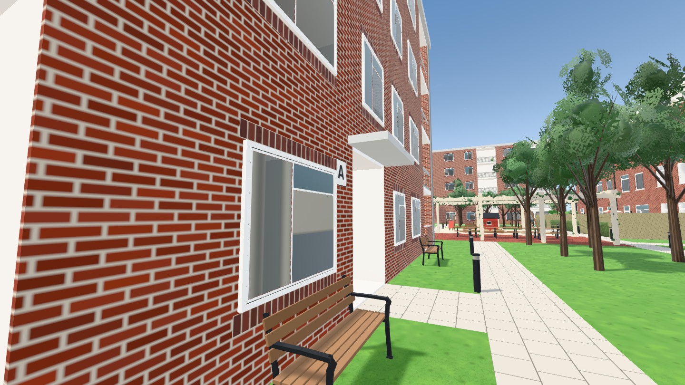
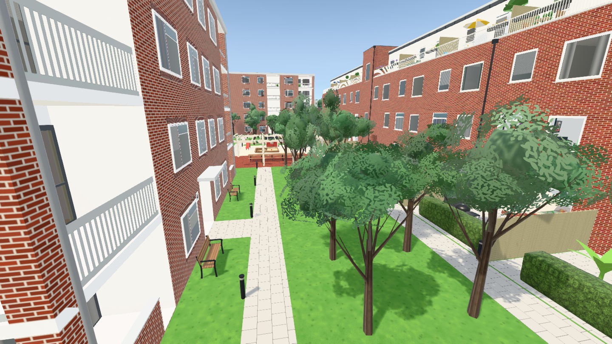
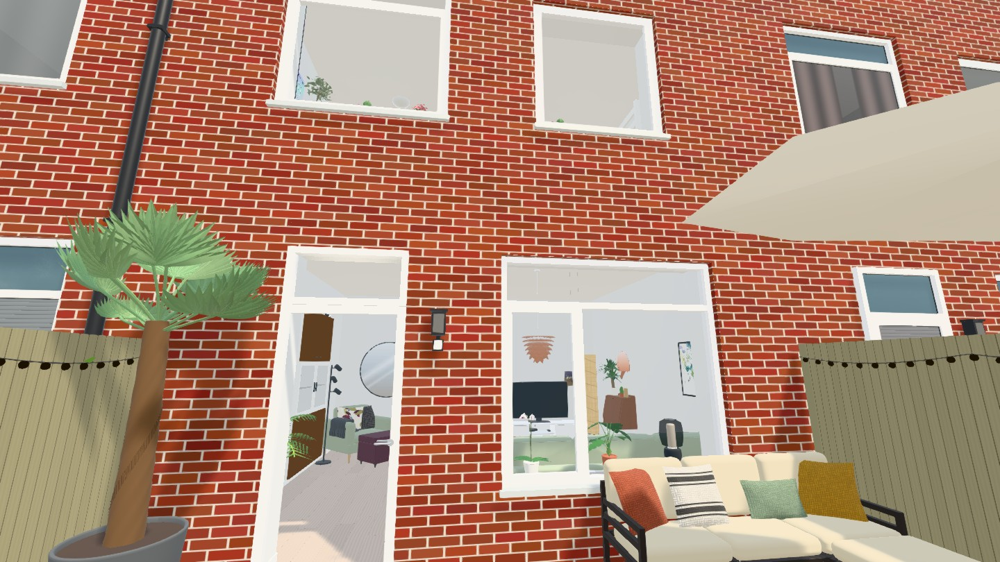
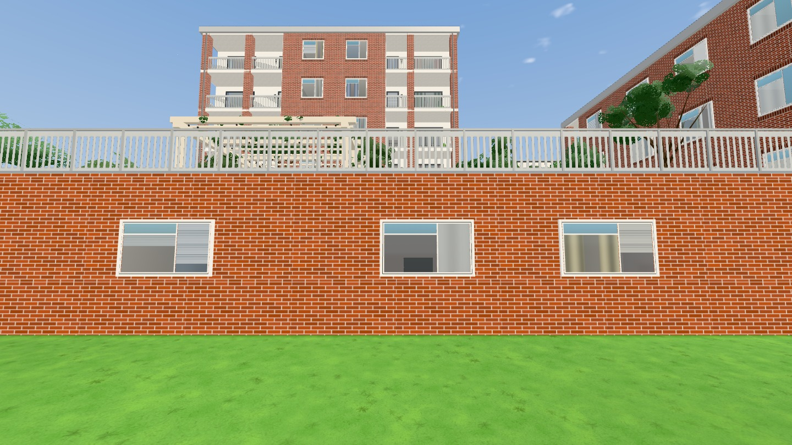
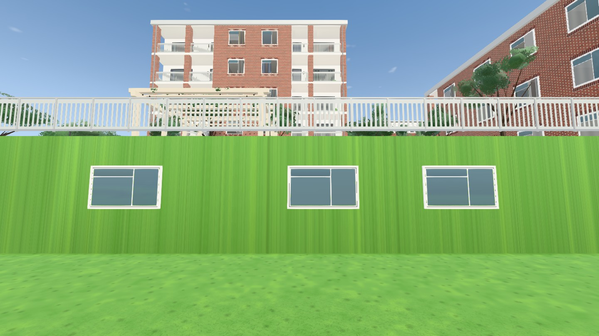

# Per-brick colour in Unreal follows the web's canvases (#2427)

Unreal Editor 5.8.4 on Windows 11, 2026-11-22. The material build and `--check` ran headless (`-nullrhi`), the
pictures with `-RenderOffScreen`. Checkout: the warm `lunden-ue-wt/opus-2389` at `e0e0ce0f` plus this change. How it
works: [unreal.md, Patterned surfaces](../../development/unreal.md#surface-materials-2282) ("Per-brick colour").

## What changed

On the web every brick of the brick canvases gets its own colour from
`THREE.Color.offsetHSL((rand - 0.5) * range, …)`, applied to the HSL of the *linear* colour:

| Canvas | Unreal instance | Hue | Saturation | Lightness |
|---|---|---|---|---|
| `src/exterior.js` brickTexture (Hus L) | `MI_LundenFacadeBrick` | 0.02 | 0.1 | 0.07 |
| `src/surroundings.js` facadeTexture (Hus A, B and C) | `MI_LundenFacadeBrickAHus` | 0 | 0.1 | 0.08 |
| `src/surroundings.js` brickCourses (historicBrick: retaining walls, school wall) | `MI_LundenBrickHistoric` | 0 | 0.1 | 0.08 |

Before this change, `M_LundenTiled` scaled the brick's linear colour by 1 ± 0.15 (`Variation`, *guess*). It changed
lightness only and spread L* across the bricks less than half as much as the web. The master now has `HueJitter`,
`SaturationJitter` and `LightnessJitter`. Its Custom node (`TILED_HSL`) does three.js's `getHSL`/`setHSL` arithmetic
per cell, with three hashes per cell. The three brick instances carry the ranges above and `Variation` 0.
`build_materials.py` wrote `M_LundenTiled` (spec `250a3f1c47589b67`), `MI_LundenFacadeBrick` (`1716df2eae942bb8`),
`MI_LundenFacadeBrickAHus` (`b912e7e4eb719394`) and `MI_LundenBrickHistoric` (`ada9bc8d9773a039`):
`4 written, 47 kept`. The new block sits after the face line, so the other materials' spec hashes did not change.

Model distribution (`tests/test_brick_colour.py --stats`, 20,000 bricks, p10-p90 width):

| Instance | Web canvas | Old Variation 0.15 | New |
|---|---|---|---|
| Hus L | L* 7.5, C* 9.1, hue 10.8° | L* 2.9, C* 7.3, hue 6.3° | identical to the web |
| Å-husen | L* 8.0, C* 8.9, hue 2.8° | L* 2.9, C* 7.3, hue 6.3° | identical to the web |
| Retaining walls | L* 6.9, C* 9.8, hue 3.1° | L* 3.2, C* 7.6, hue 6.6° | identical to the web |

## Checks

| Check | Result |
|---|---|
| `build_materials.py --check` on the saved assets | pass: `LUNDEN_MATERIALS_CHECK_OK 51 materials` |
| WSL `tests/test_materials.py` on the checkout's export | pass: `MATERIAL_COVERAGE_OK` |
| WSL `tests/test_brick_colour.py` (new) | pass: `BRICK_COLOUR_OK`. With a deliberately wrong `LightnessJitter` (0.05 on the retaining walls) it fails and names the source range |
| `brick-joints.cjs --colour-check entrance-a/wall-near,patio/husL-near`: per-brick spread within ±20 % of the web | pass: `BRICK_COLOUR_SPREAD_OK` (table below) |
| `brick-joints.cjs --check`: #2393's joints | close-up crops unchanged and within ±15 %. The distant Å-husen crops stay at x1.15-1.16 (x1.17 in #2393), which is [#2428](https://github.com/solwation/lunden-3d-apartment/issues/2428) |
| Moiré on the distant façades | none: Hus L's and Hus A's courtyard façades are unchanged apart from the brick colours (`pair-courtyard-far.jpg`) |

### Per-brick colour spread in the pictures

`brick-joints.cjs` now also segments the bricks. Each brick is a 4-connected region of the Otsu brick class, eroded by
one pixel so that no joint blend remains, and at least 6 pixels. The tool takes each brick's mean colour and reports the
p10-p90 width over the bricks. Pictures: 1440 × 810, 72° vertical, 21 June 14:00, clear. Web: the #2325/#2393 halves
for entrance A and the courtyard (no web brick source has changed since), plus new `capture-web-views.cjs` captures
for the patio and the retaining wall ([`web-views.json`](web-views.json)). Unreal: `tests/capture_vegetation.py` on
`L_Lunden` ([`unreal-capture.json`](unreal-capture.json)). Both halves are JPEG.

| Crop | Bricks web / Unreal | Before: L*, C*, hue (Unreal / web) | After: L*, C*, hue |
|---|---|---|---|
| **entrance A, wall close up** (acceptance) | 86 / 87 | x0.33, x0.27, x0.38 | **x0.97, x0.94, x1.09** |
| **patio, Hus L close up** | 174 / 172 | (not captured) | **x1.07, x1.07, x1.11** |
| courtyard, Hus A pier close up | 27 / 25 | x0.70, x0.82, x0.85 | x0.96, x0.78, x0.63 |
| entrance A, upper wall at a distance | 15 / 11 | x0.33, x0.53, x0.83 | x1.13, x0.78, x1.76 |
| courtyard, Hus A at a distance | 49 / 47 | x0.32, x0.50, x1.35 | x1.02, x1.08, x1.68 |
| courtyard, Hus L at a distance | 31 / 25 | x0.32, x0.22, x0.30 | x0.68, x0.62, x0.95 |

Raw numbers: [`brick-joints.json`](brick-joints.json) (after, crops [`brick-crops.json`](brick-crops.json)) and
[`brick-joints-before.json`](brick-joints-before.json) (the #2393 pair, the state before this change).
Close up, both measured houses are now within ±11 % of the web for L*, C* and hue. The hue widths are only 2-10°, so
a few JPEG-shifted bricks in a small crop move their ratio a lot. The pier (25 bricks, 2.6° on the web) and the distant
Å-husen crops (11-47 bricks) are therefore reported only. Hus L at a distance keeps less lightness spread (x0.68): the
filter blends brick and mortar there, and it fades the jitter along with `Variation` once a brick covers less than about
two pixels. That distant difference belongs to [#2428](https://github.com/solwation/lunden-3d-apartment/issues/2428),
the next brick issue.

## Houses checked

- **Hus A**: the entrance close up (the acceptance crop) and at a distance, and the courtyard pier and façade.
- **Hus B and C**: one merged mesh and one instance with Hus A (`MI_LundenFacadeBrickAHus`), so the change applies
  unchanged. They appear in the courtyard and retaining-wall views (Hus C's loggia façade behind the wall).
- **Hus L**: close up from the patio (new pair) and at middle and long distance in the courtyard view.
- **Retaining walls** (`MI_LundenBrickHistoric`): parameters checked against `brickCourses` by `test_brick_colour.py`.
  The picture pair of the box wall south of Hus C could not measure them. In Unreal that wall shows the lawn's grass, not
  brick, with plain glass in its windows. This is a separate bug from before this change, [#2448](https://github.com/solwation/lunden-3d-apartment/issues/2448). The school wall
  shares the instance.

## Other visible differences in these pictures

- The box wall south of Hus C is grass green in Unreal and its windows show plain glass:
  [#2448](https://github.com/solwation/lunden-3d-apartment/issues/2448) (new).
- Courtyard shrubs and the trees' lower leaves are lighter and more see-through in Unreal:
  [#2449](https://github.com/solwation/lunden-3d-apartment/issues/2449) (new).
- Distant brick slightly lighter, with more joint pixels: [#2428](https://github.com/solwation/lunden-3d-apartment/issues/2428).
- Glass reflects the sky: [#2424](https://github.com/solwation/lunden-3d-apartment/issues/2424). The living room looks
  pale through the patio door: [#2388](https://github.com/solwation/lunden-3d-apartment/issues/2388). The patio palm:
  [#2389](https://github.com/solwation/lunden-3d-apartment/issues/2389).
- The web's cat by entrance A belongs to the later cats group (#2344).

## Pictures

| | |
|---|---|
| Entrance A close up, web / Unreal before / Unreal after |  |
| Hus L from the patio, web / Unreal after |  |
| Hus L courtyard façade at a distance (moiré check), web / before / after |  |
| Unreal after: entrance A, courtyard, patio |    |
| Retaining wall south of Hus C, web / Unreal (the separate grass bug) |   |
