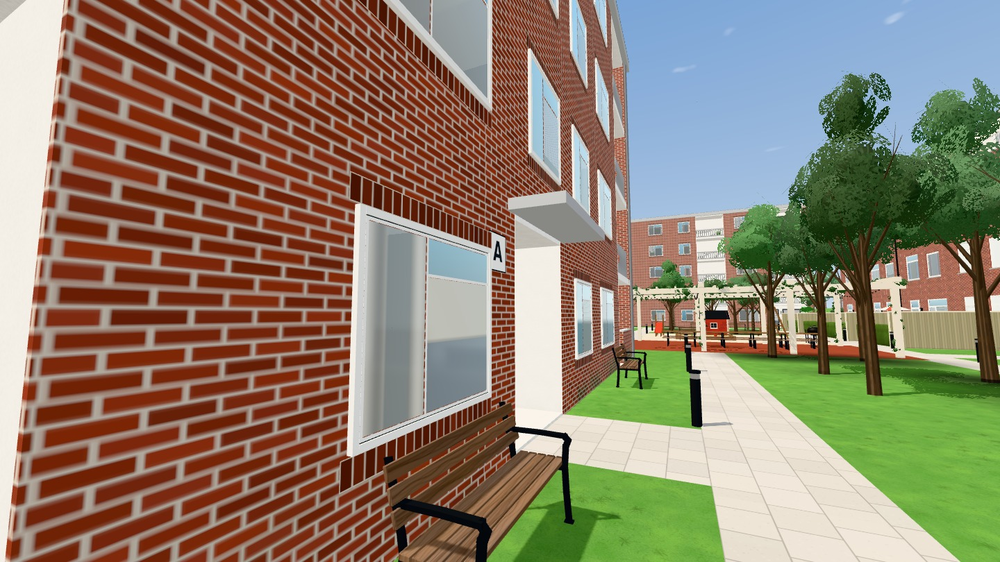
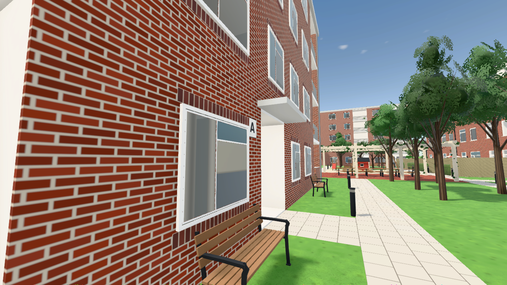
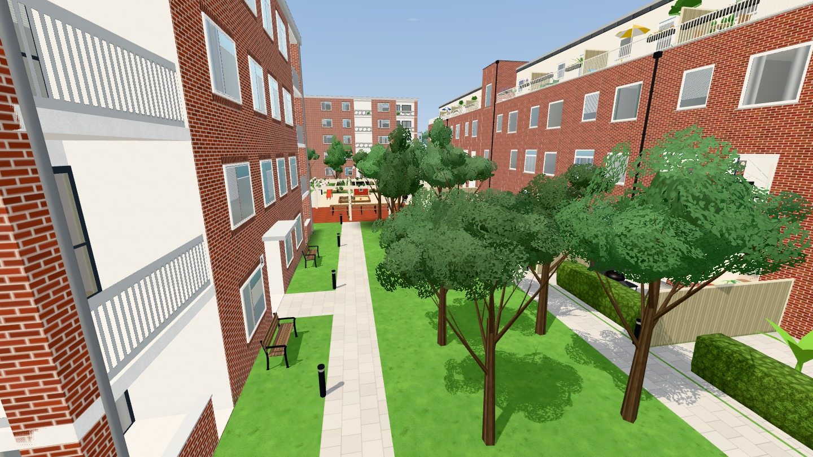
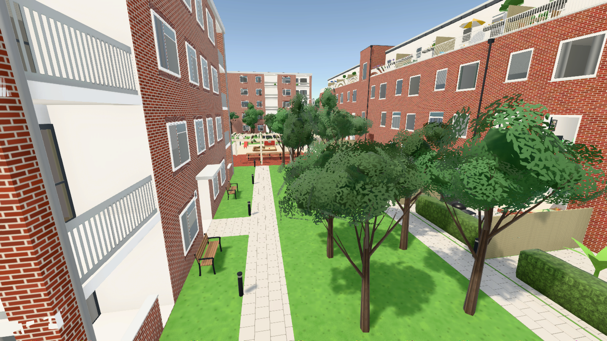
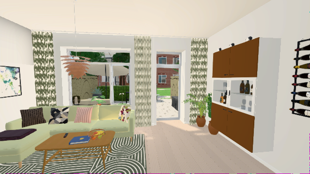
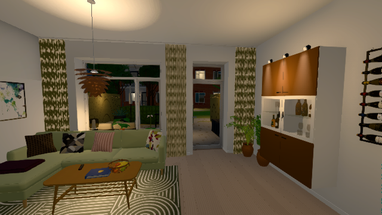
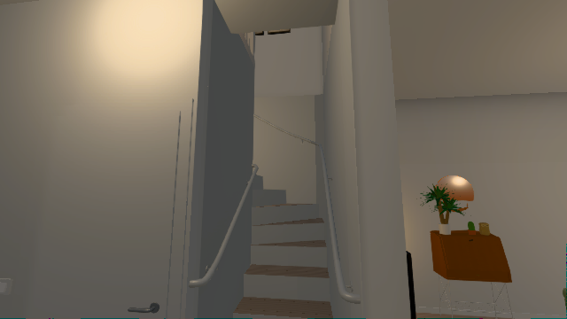
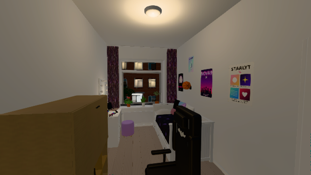

# Unaccepted brick-filter diagnostic (#2428)

**Negative result: #2428 remains OPEN.** This commit publishes evidence, not the filter or rebuilt material. The
current candidate fails the brick acceptance. All existing apartment regression guards pass. No acceptance criteria,
exposure, crop or source colour was fitted to these pictures.

## Actual execution and source scope

UE5.8.4 LinuxCPU Vulkan SM5, actual FXAA1, conventional shadows3/1024/3cascades, SeparateTranslucency1,
LumenFalse; imported Nanite meshes disabled in memory only. Actual AA quality is not established by the invalid old
getter. This is not Windows performance or full renderer parity acceptance.

Run `20261127T223400285476-3447041`: **native0, runner0,325.72s, shader/logErrors[]**; singleton master build,
full material check, all20 actual cached canonical steps and fresh release gate, actual PBR contract and all6 frames
completed. All247 authored packages were read-only after the one permitted master save; protected authored assets,
export/dependencies and Generated during capture were exact. **The outer execution still returned143** (existing
[#2473](https://github.com/solwation/lunden-3d-apartment/issues/2473)); native0/runner0 is not an overall outer0 claim.
See [native outcome](native-outcome.json), [outer status](outer-status.json), [raw verification](native-verification.json),
[actual20 steps](canonical20.json) and [six capture records](capture-six.json). Duplicate snapshot/season lists are
explicitly omitted from compact publications; [provenance](provenance.json) pins every complete private original SHA.

Actual unpublished source `a1ff6c9cfbb790f5014965e62219b6921cf57db6` contains the four-file candidate from
`392e945b691580fa1b4e3c9c9cd6d6af2e5f27e3`. Those commits are **private review identifiers, not public source links**.
[candidate.patch](candidate.patch) reconstructs exactly those four files against public base
`a3f6456e6b766ee5115897fff354a85cecdeebea`; reconstruction and equality to actual Native source were checked per file.
The [provenance table](provenance.json) lists all four SHA256 values. The patch is an unaccepted attachment; applying it
is not part of this documentation commit. No candidate source file was changed in production by this publication.

The rebuilt `M_LundenTiled` asset at private commit `6a5960547b43bcff051389a397ff555e16f49ab4` is
**PRIVATE, UNACCEPTED, NOT PROMOTED**. No `.uasset` is copied here. All18 child material files were unchanged,
including the three foreign locked tile instances.

## Fixed references and numerical result

The two targets preserve #2393's exact cameras, six rectangles,1440×810,VFOV72,21June2026@14clear/lampsnone.
Old #2393 source `9f662b65` cannot prove equality to the current718 web inputs. These are fresh canonical desktopUltra4
web references with normal pool settling and actual source718 before/after equality; no numerical improvement trend
against historical Windows pictures is claimed. Four apartment controls use their existing640×360 immutable references.
[Locked target contract](locked-acceptance.json); [single canonical measurement publication](measurement.json).

One aggregate six-pair measurement used **one Chromium**, running the existing crop-stats and brick-joints algorithms.
The latter used `--check --brick-check --tolerance0.10`; original #2393 defaults were not changed. The table separates
mortar share, mortarL* and brickL*; each ratio must lie in0.9–1.1. The original #2428 far criterion and all-six result are
both FAIL. The existing apartment four-frame/stair-warmth/fourteen-material criteria (including all curtain/cabinet hue
and spot guards, historically called the22-guard contract) all PASS.

| Crop | Mortar share | Mortar L* | Brick L* | Result |
|---|---:|---:|---:|---|
| entrance-a / wall-near (near) | 0.9639 | 1.1084 | 1.0223 | FAIL: mortarL |
| entrance-a / wall-far (far) | 1.1240 | 1.0188 | 1.1711 | FAIL: mortarShare, brickL |
| courtyard / husA-near (near) | 0.8993 | 1.0751 | 1.0190 | FAIL: mortarShare |
| courtyard / husA-mid (far) | 1.0800 | 1.0389 | 1.1916 | FAIL: brickL |
| courtyard / husL-far (far) | 1.0242 | 0.9924 | 1.1382 | FAIL: brickL |
| courtyard / husL-mid2 (far) | 0.9680 | 1.0327 | 1.1190 | FAIL: brickL |

All four far brickL* checks fail. Entrance far mortar share also fails. Near entrance mortarL* and near HusA mortar share
fail. This is not excused by the separately active [#2424](https://github.com/solwation/lunden-3d-apartment/issues/2424)
reflection investigation; a controlled lighting experiment may isolate a contribution, but these measurements do not
establish its cause.

The candidate combines pixel/source blur in quadrature and selects a normalized tent for resolved joints, retaining
whole-pixel boxes for unresolved joints. Its thresholds are documented reconstruction **guesses**, with no colour/gain
fit. Source-only numerical integration tests pass; actual HLSL compilation is shader-clean here. Quadrature can broaden
the footprint by up to√2 relative to the oldmax rule. The current Native near joints look crisper/brighter than the web,
not conspicuously overblurred, but **no matching current-source/current-profile old-filter before image exists**. These
near mismatches are proven; their attribution as a newly introduced filter regression is unknown.

No broad curved moiré bands were visible on the full1440 courtyard HusL rightwall or HusA/B background walls.
Fine alias/raster remains; this static review is not temporal/all-distance verification. The candidate stays unaccepted
while the already planned controlled #2424 trial is considered. Nothing here closes #2428.

## Whole-image review and remaining differences

All12 original images were opened; [whole-image review](whole-image-review.json) pins their exactSHA and retains every
formal failure. Existing apartment differences remain mapped to OPEN #2480/#2490 (stairs/mirror), #2482/#2460
(lamp surfaces/emission), #2481 (halo), #2484 (highwall), #2486 (Tilly wood), #2459 (translucency), #2447 (sofaback),
#2489 (otherAO), #2487 (timber dots), #2488 (evening exterior through glass) and #2470 (bottom-edge colour noise).
No new shared-master apartment regression was observed.

Exterior lawn/foliage colour and contrast differ (#2437; the foreground in these images does not establish the same
historical lighter/bleacher direction). Railing sampling remains #2483. Fine patio-screen raster belongs to #2443 when
that exact screen surface is observed; **exterior paving/fence dots are not relabeled as that screen or #2487 timber**.
Paving/fence raster and bright/scalloped window-surround highlights are **new issue registration pending Root**; no ID
is invented here, and closed #2425 is not presented as OPEN coverage. Sky/cloud and fine-shadow sampling differences
are recorded without asserting a new brick-filter cause. These pending mappings do not turn whole acceptance true.

## Raw originals

| Target / control | Web | Native candidate |
|---|---|---|
| entrance-a |  |  |
| courtyard |  |  |
| living-room-day |  |  |
| living-room-evening |  |  |
| stairs-evening |  |  |
| upper-floor-evening |  |  |
