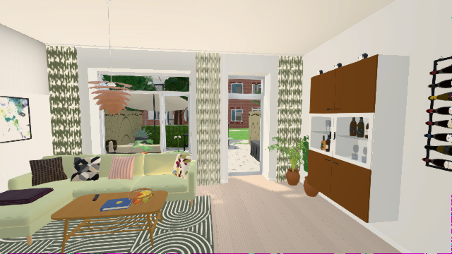
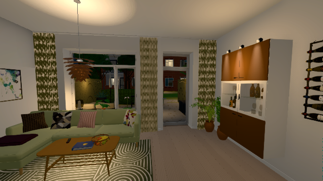
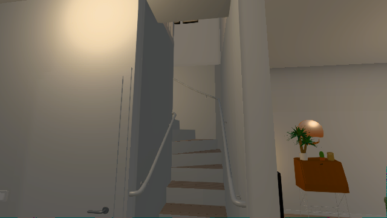
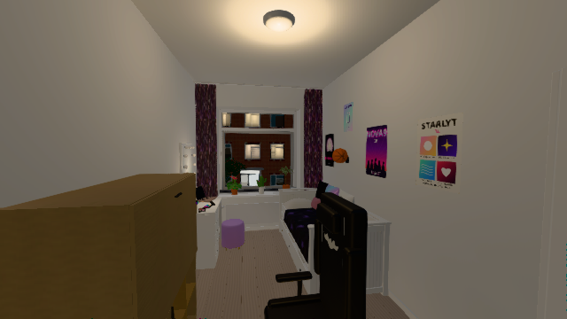
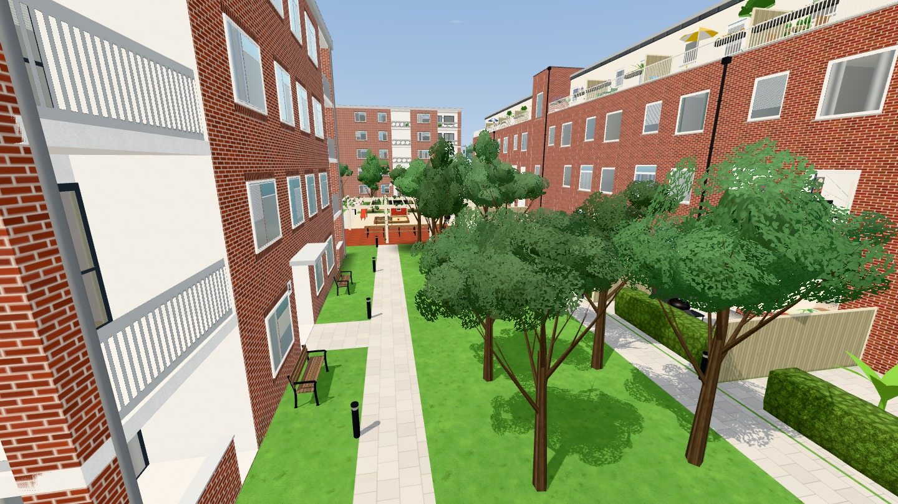
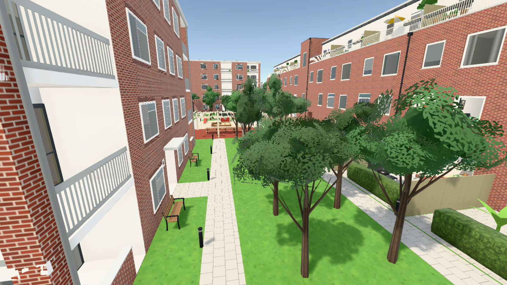
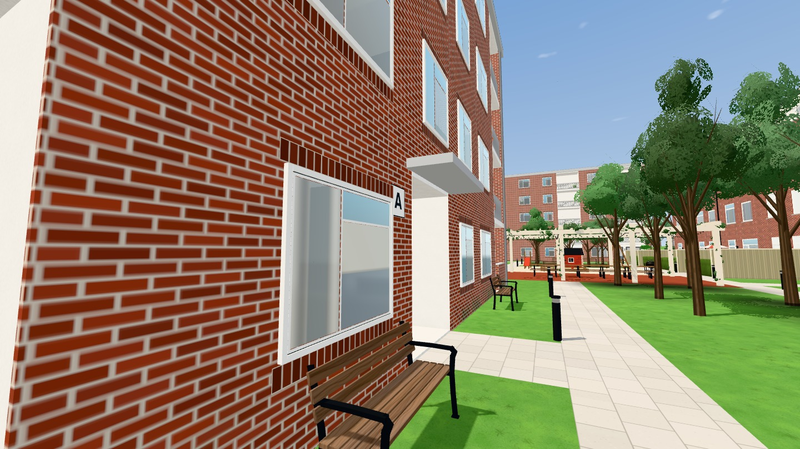
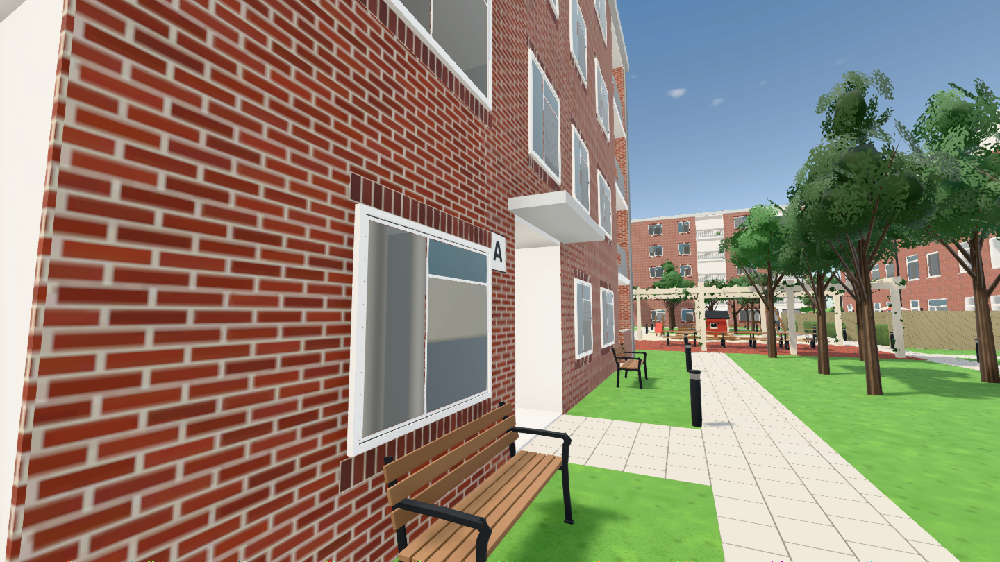

# Original brick Canvas import — unaccepted trial

Source `c4fb2986edccda814d97fa1d950e990074f28d0e`, stock tiled master `f440606d…`, original Unreal5.8.4 engine. This replaces the private analytic reconstruction with the existing source Canvas colour maps and Hus L roughness data. No product acceptance or issue closure is claimed.

The actual full export and material checks pass. Four GLBs change only the intended texture/material payload; exact geometry/nodes/accessors are preserved, and six GLBs are byteidentical. The source-bound existing web references are reused. The same actual Native session executes all20 canonical steps, reads real loaded texture bindings and saves six images. Native/runner/outer exits are0/0/0,823.67s; all247 authored packages stay byteexact and readonly, capture changes no Generated packages.

One Chromium batch retains the original six brick rectangles/three ratios/±10% and all22 apartment controls. Apartment22 PASS; every brick row FAIL. Whole1440 images also show visible waves on Hus L. This is an unaccepted result, not evidence that source image identity alone fixes filtering.

| Target/crop | Mortar share | Mortar lightness | Brick lightness | Result |
|---|---:|---:|---:|---|
| entrance-a/wall-near | 1.050578 | 1.030157 | 1.110609 | FAIL |
| entrance-a/wall-far | 1.320173 | 0.965630 | 1.334862 | FAIL |
| courtyard/husA-near | 1.001763 | 1.026687 | 1.115106 | FAIL |
| courtyard/husA-mid | 1.393924 | 0.944425 | 1.332150 | FAIL |
| courtyard/husL-far | 1.562677 | 0.960815 | 1.280899 | FAIL |
| courtyard/husL-mid2 | 1.167210 | 1.041546 | 1.255575 | FAIL |

Actual imported brick textures use explicit `TF_TRILINEAR`; queried `r.MaxAnisotropy` is4. The source Hus L colour AND roughness request anisotropy8; A/B/C and shared historic maps request4. Exact5.8.4 SDK selection shows explicit trilinear bypasses anisotropy. A dedicated-group aniso+linear-mip diagnostic is being prepared, not yet accepted. No brightness or crop fitting is used, and no failure is excused as #2424.

The apartment whole-original review finds no distinct new import regression; its existing open mappings are in the retained JSON. Exterior remaining gaps include #2428(brick waves/metrics),#2437(lawn/crowns),#2483(rail sampling),#2443(patio screen),#2497(paving dots),#2498(window edges). Sky/cloud and fine-shadow differences remain recorded without declaring closure or inventing an aliasing waiver. Original-only Unreal work; no public downstream implementation applies.

## Raw originals

| View | Web | Native source-map trial |
|---|---|---|
| living-room-day |  |  |
| living-room-evening |  |  |
| stairs-evening |  |  |
| upper-floor-evening |  |  |
| courtyard |  |  |
| entrance-a |  |  |
