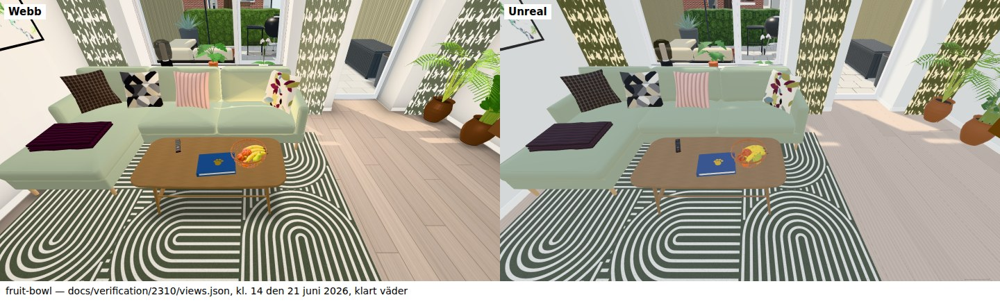
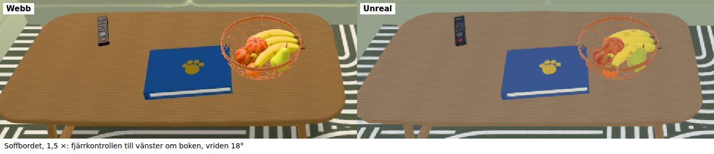

# #2429: the TV remote on the coffee table in Unreal

`main.js` builds the TV remote (`src/remote.js`, #101) next to the world, so the export never had it. Since 10fe6e67,
`tools/unreal-engine/export-scene.js` builds the same `Remote` class at its home pose, the way #2310 brought in the fruit
bowl. Only the object is exported: pointing it at a TV belongs to the TV group (#2354). Web code is unchanged.

## Checks

Export from WSL at ea1e090a plus the change (current for 10fe6e67). Windows checkout `lunden-ue-wt/opus-release-2419`
at 10fe6e67, UE 5.8.4.

| Check | Result |
|---|---|
| `node tools/unreal-engine/check-export.mjs --dir <export>` | current: 11 files, 9385 nodes, 315 sources; one new `furniture` node `furn_remote_l0_x398_z1072` (176 items instead of 175) |
| `sync-import.ps1 -ExportFrom <export>` | `LUNDEN_SYNC_IMPORT_OK`; no versioned asset changed |
| `test_furnishing.py` (point 6 is new) | `LUNDEN_FURNISHING_TEST_OK`: 176 of 176 items within 0.005 cm, 307 of 307 textured meshes. The remote is in `Level_l1007`, `Level_l1007_interaction` and `L_Lunden`, 0.00003 cm and 0.002° from the web's pose, with its black body material `std_17181b_r55_m10` in all three. The bowl, the ball and the remote are each found by their `source` |

Point 6 fails when the export loses the bowl, the ball or the remote, or when the remote lacks its body material. It
was not run against an export without the remote.

## Pictures

Same camera on both sides: [the #2310 view](../2310/views.json), 21 June 2026 at 14:00, clear.
- Web: the #2395 picture (`capture-web-views.cjs`, desktop Ultra). The web is unchanged since then, so it was not
  captured again.
- Unreal: `tests/capture_l1007.py` on `L_Lunden`, with the map's own light and the game's exposure.

| Picture | Shows |
|---|---|
|  | the whole view, web and Unreal (`web-fruit-bowl.jpg`, `unreal-fruit-bowl.jpg`) |
|  | the coffee table at 1.5 ×: the remote lies left of the book, turned 18°, at the same place on both sides |

**Other differences in the pair**, each covered by an open issue:
- Floor, sofa and walls are paler and cooler in Unreal: #2394.
- The rug, coffee-table and sofa fabric textures differ in tone: #2322.
- The patio, seen through the door, looks pale: #2388.
- The remote's black plastic is nearly black in Unreal; on the web it has a grey sheen: ISSUE_REMOTE.
- The web's warm yellow light on the back of the sofa is missing in Unreal: ISSUE_SOFA.
