# Pollarnas ljusband i Unreal (#2430)

På webben lyser ett varmt band under varje gårdspollares lock efter skymningen. Det sköts av `update()` i
`src/courtyard.js`: bandet får färgen `0xffd08a` när nattfaktorn är strikt över 0,35 och strömmen är på, och annars
dagfärgen `0x8d8b84`. Det finns ingen spärr eller toning. Värdena ligger nu i `COURTYARD.bollards.band` i
`src/config.js`, så att webben och exporten läser samma källa. Webbens beteende är oförändrat.

Med gard följer banden med exporten som `measurements.site.facadeLighting.bollardBands`. Det är bandens stående
ytor för 17 pollare (408 trianglar), flyttade 1 mm utåt längs normalen så att de ligger utanför det importerade bandet
i gard-GLB:n. `build_facade.py` ritar dem med det olysta, ogenomskinliga materialet `M_Facade_band`. Tröskeln och
de två linjära färgerna ligger i materialets custom primitive data. Materialet läser `MPC_LundenWeather.Night` och
`PowerAvailable` och har samma exponeringsomräkning som lyktlinserna från #2324. Inga Lighting-tillgångar ändrades.

## Bildpar, 16 november 2026

Unreal 5.8.4 är tagen vid df995f47 med en fullständig lokal export, `sync-import.ps1` och `capture_lighting.py`
(spelets exponering). Kamerorna är `facade-a` och `facade-b` i
[facade-views.json](../../../tools/unreal-engine/tests/facade-views.json), med klart väder kl. 14.00 och 18.15.
Webbens beteende ändrades inte, så webbilderna är #2397:s bilder vid be384771.

| Vy | Webb (be384771) | Unreal nu |
| --- | --- | --- |
| Hus A, 18.15 | 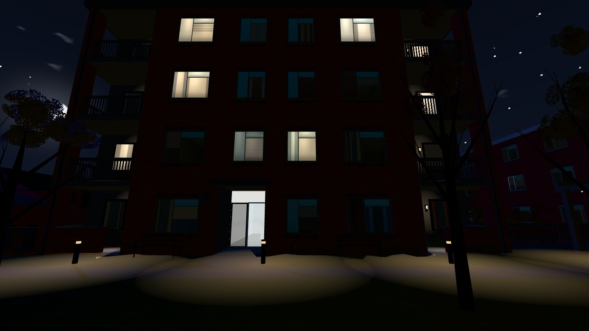 | 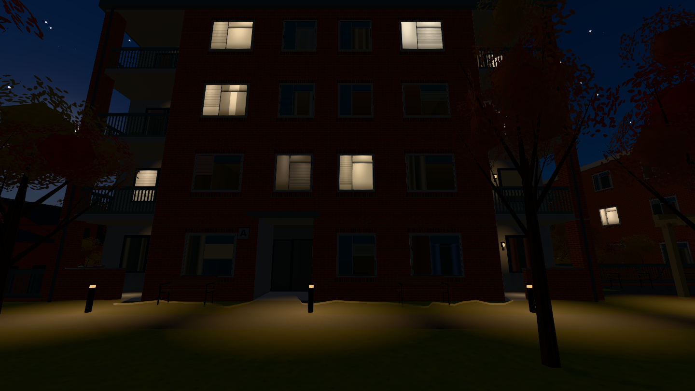 |
| Hus B, 18.15 | 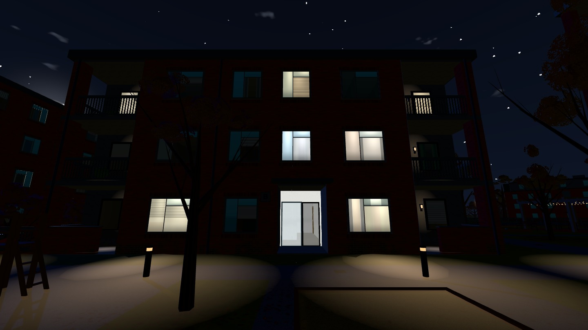 | 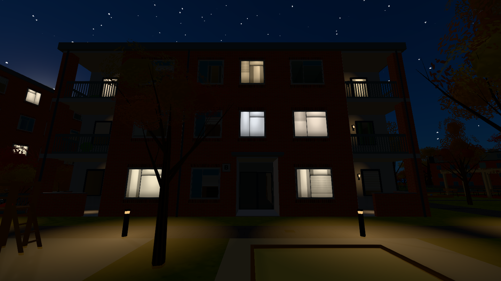 |
| Hus A, 14.00 | 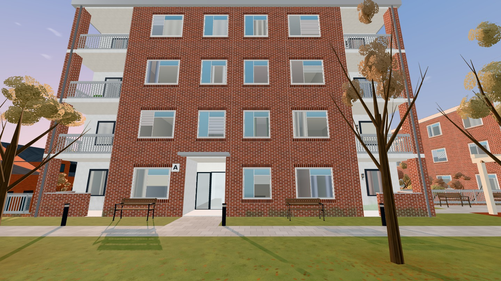 | 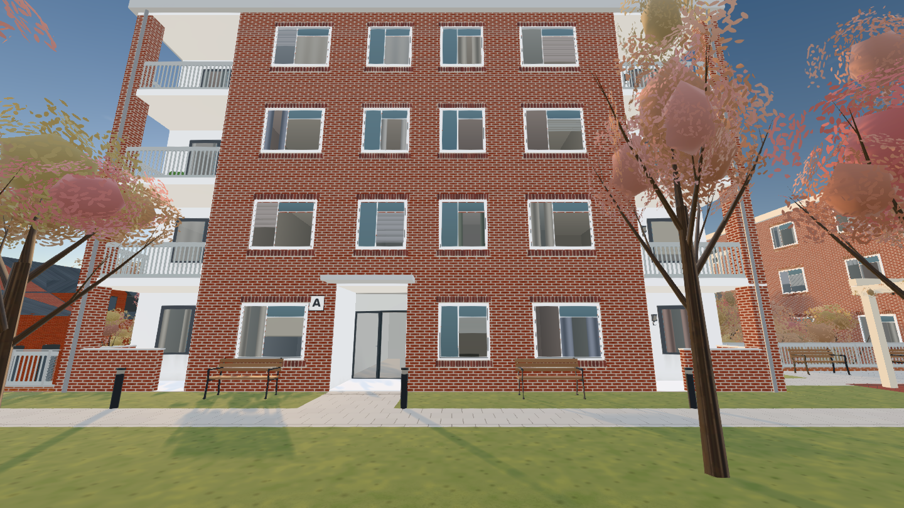 |
| Hus B, 14.00 | 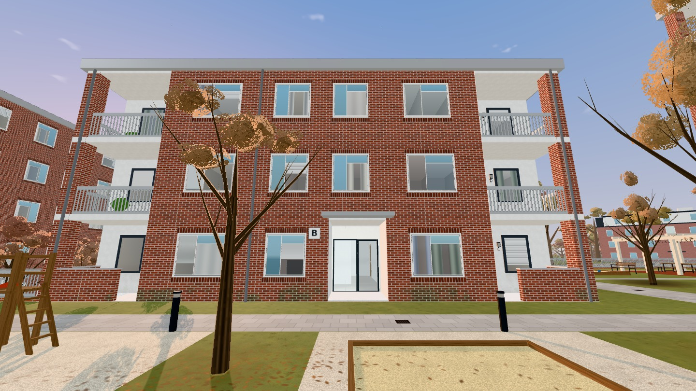 | 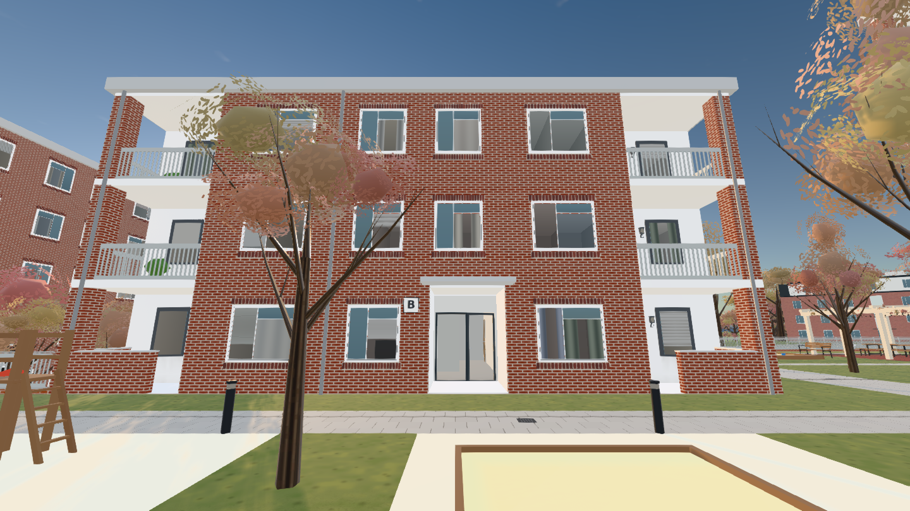 |
| Hus A, 18.15, strömavbrott | (ingen webbild) | 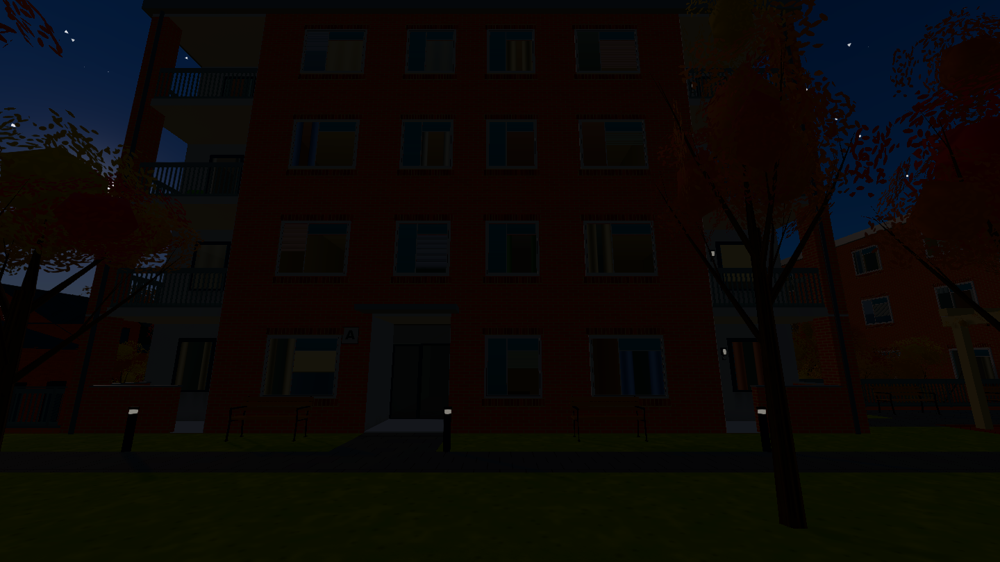 |

Bilden med strömavbrott sätter `PowerAvailable` till 0 med det nya fältet `power` i en capture-shot
(`capture_lighting.py`). Lamporna är släckta i den bilden.

Närbild av vänstra pollaren vid Hus A, förstorad sex gånger. Från vänster: webben, Unreal nu och Unreal före (#2397, be384771).

| 18.15 | 14.00 |
| --- | --- |
| 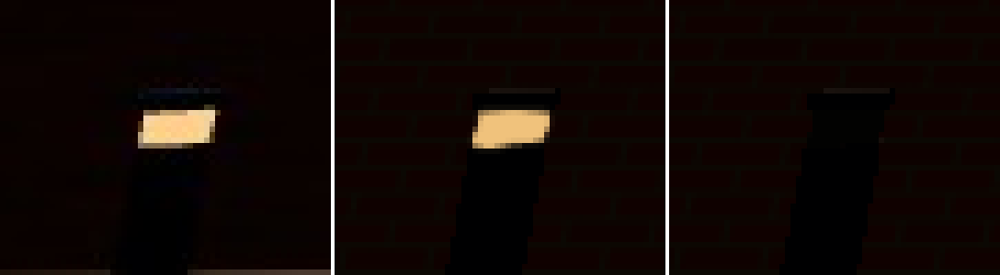 | 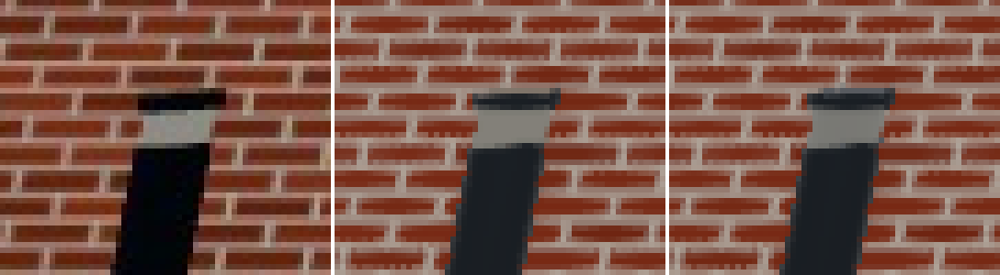 |

## Mätning

Utsnitten i [band-crops.json](band-crops.json) ligger inne i banden och mäts med `tools/unreal-engine/tests/crop-stats.cjs`.
Råvärdena finns i [band-crop-stats.txt](band-crop-stats.txt) och, för #2397:s Unreal-bilder före ändringen, i
[band-crop-stats-before.txt](band-crop-stats-before.txt). Tabellen visar linjär relativ luminans.

| Utsnitt | Webb | Unreal före | Unreal nu | Nu / webb |
| --- | --- | --- | --- | --- |
| A vänster, 18.15 | 0,626 | 0,0006 | 0,549 | 0,88 |
| A mitten, 18.15 | 0,679 | 0,0006 | 0,586 | 0,86 |
| B vänster, 18.15 | 0,680 | 0,0006 | 0,586 | 0,86 |
| B höger, 18.15 | 0,680 | 0,0006 | 0,583 | 0,86 |
| A vänster, 14.00 | 0,240 | 0,187 | 0,213 | 0,89 |
| A mitten, 14.00 | 0,256 | 0,189 | 0,216 | 0,84 |
| B vänster, 14.00 | 0,259 | 0,190 | 0,216 | 0,84 |
| B höger, 14.00 | 0,258 | 0,189 | 0,216 | 0,84 |

Kl. 18.15 är banden lika varma som på webben (R/B 1,93–1,94 mot 1,76–1,80) och når 0,86–0,88 gånger webbens
luminans. Vid strömavbrott kl. 18.15 har banden dagfärgen: 0,203 och 0,216 i A:s två utsnitt, alltså samma som
Unreal-bilden kl. 14.00. På dagen är banden nu olysta som på webben. De ligger därför närmare webben än förut
(0,84–0,89 mot 0,73–0,78). Resten av dagsbilderna är oförändrad.

## Kontroller

- `node --test tools/unreal-engine/tests/facade-lighting.test.mjs`: banden exporteras med gard, bara stående ytor,
  1 mm utanför, med tröskel och färger från `COURTYARD.bollards.band`.
- `node tools/unreal-engine/check-export.mjs`: exporten är aktuell (11 filer, 9 385 noder, 315 källor).
- `sync-import.ps1 -ExportFrom <lokal export>`: `LUNDEN_FACADE_OK 1397 room, window and lens faces, 5 glow meshes,
  the bollard bands` och `LUNDEN_SYNC_IMPORT_OK`.
- `run-python.ps1 tools/unreal-engine/tests/test_facade_lighting.py`: `LUNDEN_FACADE_LIGHTING_OK`. Testet
  kontrollerar bandens mesh, material, kollision och switchdata i den sammansatta världen.
- Materialets växling vid tröskeln mättes inte på GPU med `facade-shaders.py`, eftersom Vulkan-verktygen saknas här.
  Testfallen för banden finns i skriptet. Växlingen syns i bildparen kl. 14.00, kl. 18.15 och vid strömavbrott.

## Andra skillnader i bilderna

- Entréhallarna är mörka i Unreal: #2431.
- Novemberträdens kronor är rosa och klumpiga: #2432.
- Markljusets ton och nattscenens färg: #2421, och #2397:s dokumenterade avvikelse för pollarnas ljusfläckar.
- Novemberhimlen kl. 14 är mättat blå: #2434. Teglet varierar mindre i färg: #2427.
- Pergolans ljusslinga lyser inte i Unreal kl. 18.15 (längst till höger i bilden av Hus B): #PERGOLA.
- Kvällshimlen har varken moln eller måne över Hus A och B i Unreal: #SKY.
