# Upplysta entréhallar i Unreal (#2431)

Webben har inga ljuskällor i trapphusen. `src/corehouse.js` (Hus A, B och C med entréskalen) och `src/core.js`
(Hus L) bakar hallampornas ljus i vertexfärgerna och ritar väggar, golv och trappor med ett obelyst
`MeshBasicMaterial`. Därför lyser hallen bakom entréglaset på kvällen. Unreal importerade samma yta som belyst
`M_Default` utan lampor i trapphusen, så glaset var mörkt.

Nu pekar `material-map.json` trapphusnyckeln `bas_ffffff_r100_m0_vc_ds` och de fyra vita lampbrickorna på det
genererade, obelysta `M_LundenStairwellLight`: vertexfärg × 2^-EXPOSURE_BIAS × strömfaktor. De fasta glasrutorna
bredvid entrédörrarna (`bas_bfd3dc_r100_m0_a35_ds`, obelyst 35 % glas på webben) får `M_LundenStairwellGlass`.
Båda byggs av `import_world.py` och läser bara `MPC_LundenWeather.PowerAvailable`. Inga låsta Lighting-assets
ändrades. Beskrivning: [Stairwells and entrance halls](../../development/unreal.md#buildings-hus-l-hus-abc-and-the-garage-2279).

## Bildpar, 16 november 2026

Webben och Unreal 5.8.4 är tagna vid e0e0ce0f plus ändringen, med en fullständig lokal export. Kamerorna står i
[views.json](views.json): `facade-a` och `facade-b` från [facade-views.json](../../../tools/unreal-engine/tests/facade-views.json),
plus `entrance-c` framför Hus C:s port och `portik-l` i Hus L:s portik. Klart väder och spelets exponering.

| Vy | Webb | Unreal |
| --- | --- | --- |
| Hus A, 18.15 | 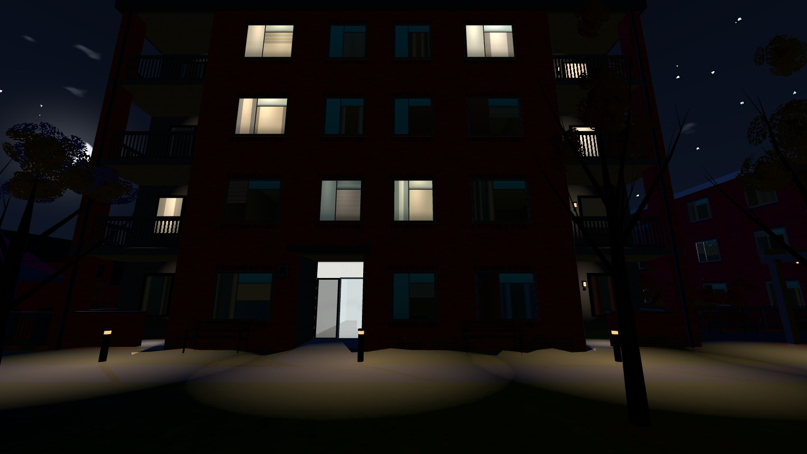 | 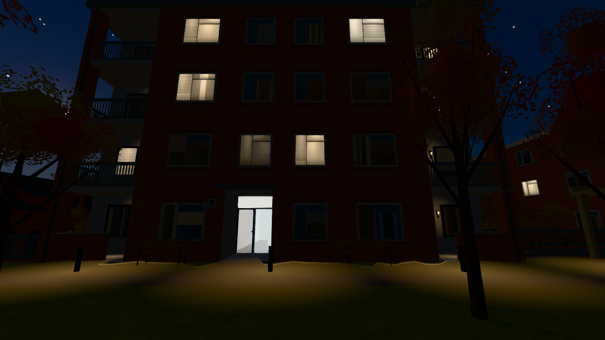 |
| Hus B, 18.15 | 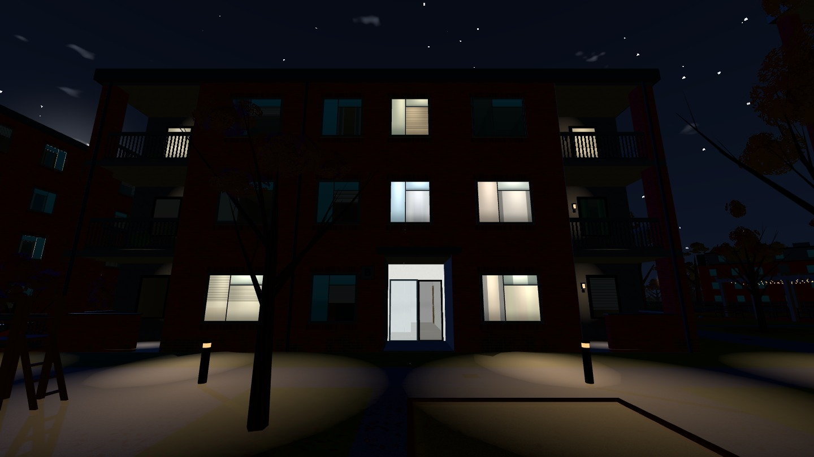 | 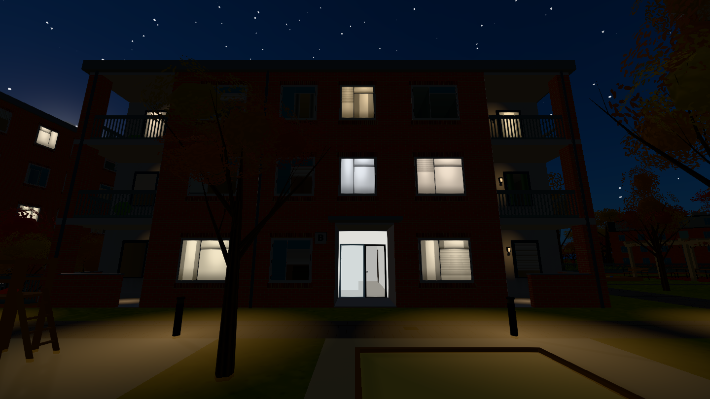 |
| Hus C, 18.15 | 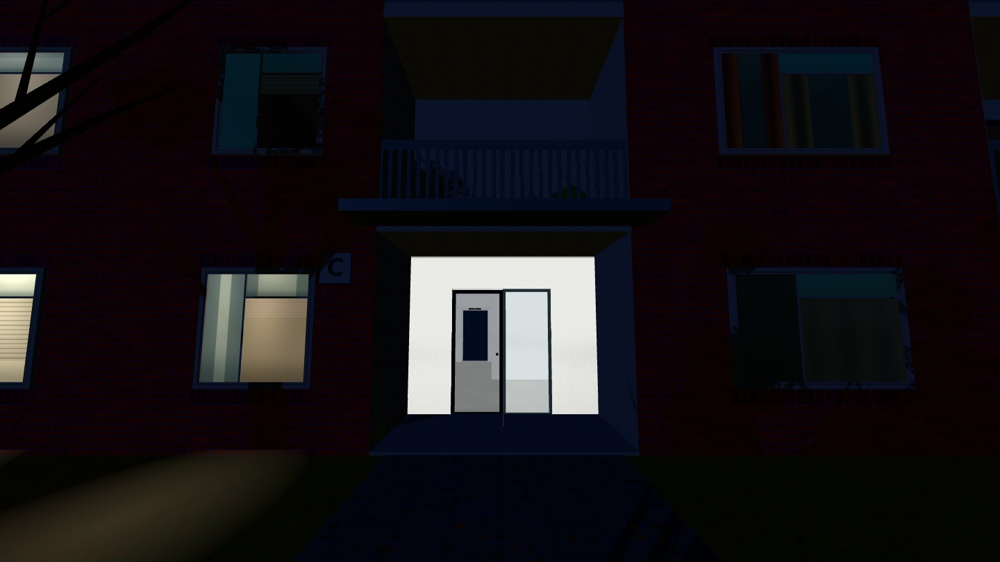 | 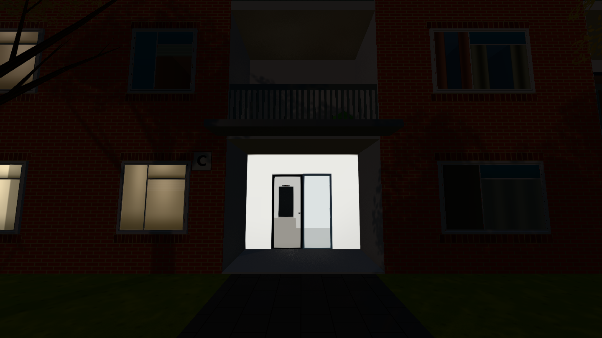 |
| Hus L, portiken, 18.15 | 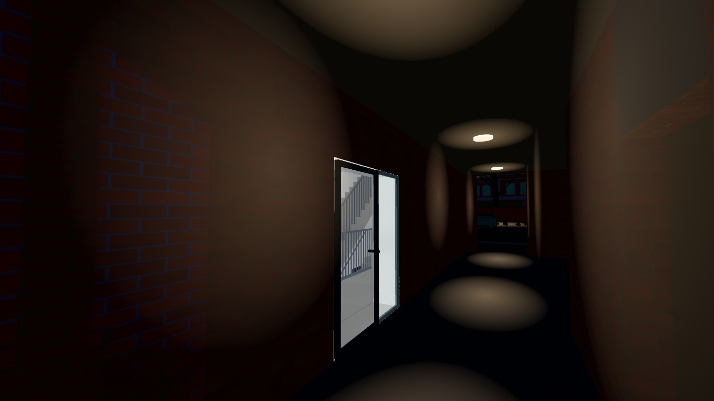 | 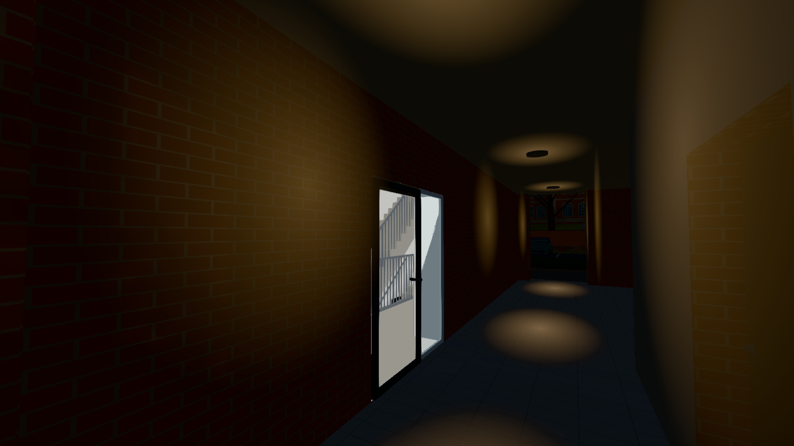 |
| Hus A, 14.00 | 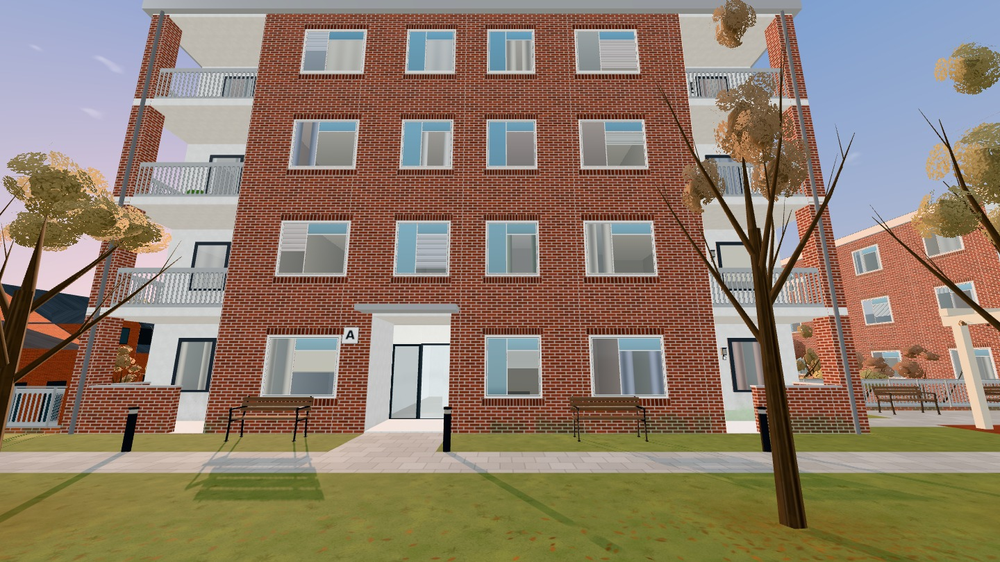 | 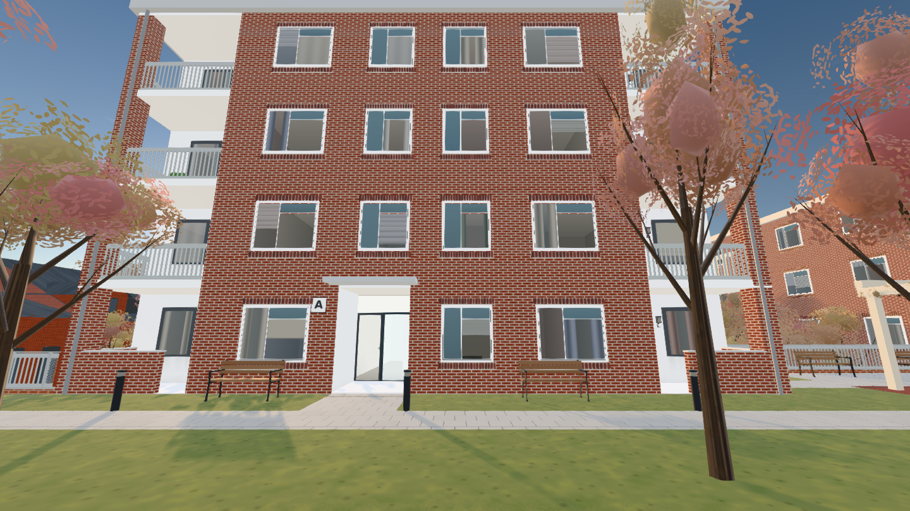 |
| Hus L, portiken, 14.00 | 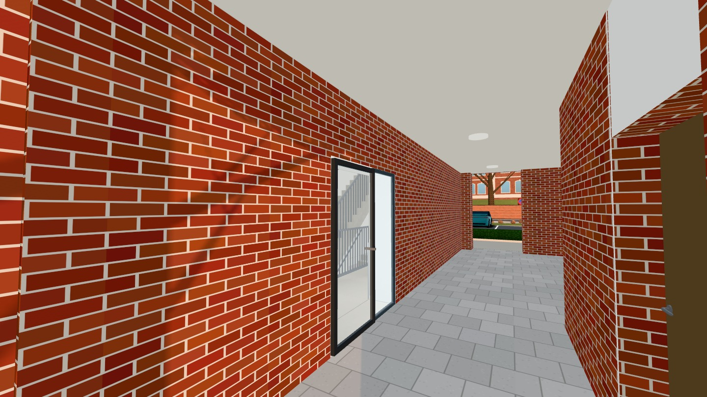 | 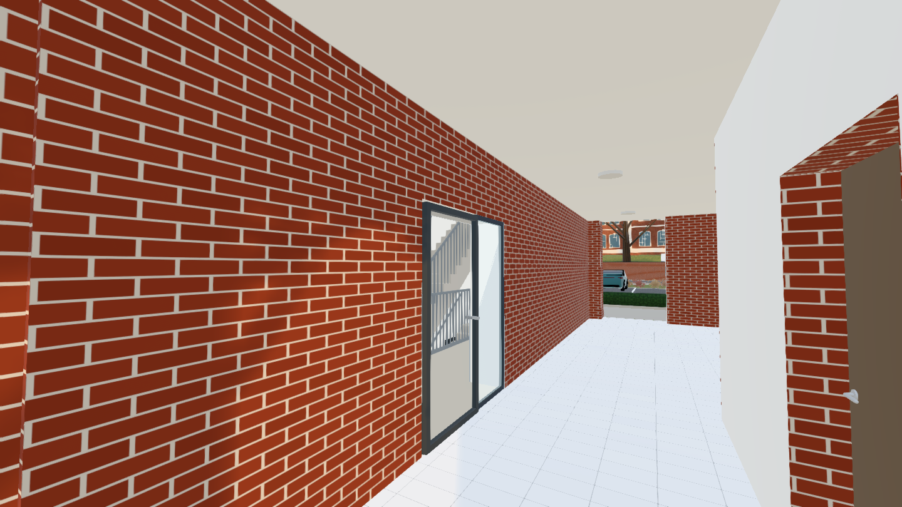 |

Bilderna före ändringen är #2397:s vid
[be384771](https://github.com/solwation/lunden-3d-apartment/blob/be384771ded92ccfe80110b72efe5dbdb99e1834/docs/verification/2397/unreal-facade-a-dusk.png).

## Mätning

Utsnitten finns i [hall-crops.json](hall-crops.json) och mäts med `tools/unreal-engine/tests/crop-stats.cjs`.
Råvärdena ligger i [hall-crop-stats.txt](hall-crop-stats.txt) och, för #2397:s bilder före ändringen,
i [hall-crop-stats-before.txt](hall-crop-stats-before.txt). Tabellen visar linjär relativ luminans, Unreal / webb.

| Utsnitt | 18.15 före | 18.15 nu | 14.00 före | 14.00 nu |
| --- | --- | --- | --- | --- |
| A, glaset vid dörren | 0,00 | 1,19 | 0,69 | 1,28 |
| A, överljuset | 0,00 | 0,99 | 0,76 | 1,11 |
| B, sidoglaset | 0,00 | 1,02 | 0,54 | 1,11 |
| B, överljuset | 0,00 | 0,99 | 0,76 | 1,11 |
| C, entrénischens vägg | — | 1,00 | — | 1,09 |
| C, sidoglaset | — | 1,02 | — | 1,13 |
| L, portikdörrens glas | — | 1,47 | — | 0,92 |

Acceptansen gäller A och B kl. 18.15: alla fyra utsnitt ligger på 0,99–1,19 gånger webben, inom ±25 procent.
Före ändringen låg de på 0,00. Kl. 14.00 låg hallen på 0,54–0,76 gånger webben och ligger nu på 1,11–1,28.
Skillnaden är att webbens dagsljusblandning (`src/stairdaylight.js`, #2183) inte förs över: bakningen visar sin
kvällsnivå hela dygnet.

## Hus som kontrollerades

Orsaken är gemensam för alla fyra trapphus, och regeln gäller samma nyckel i alla.

- **A och B:** hallen lyser kl. 18.15 som på webben (tabellen ovan).
- **C:** entrénischen och hallen lyser som på webben, 1,00–1,02 gånger webben.
- **L:** trapphuset bakom portikdörren lyser nu också. Portikdörrens eget glas (`std_9fb4bf_r5_m30_a35`, ett belyst
  glas på webben) blir 1,47 gånger webben på kvällen, och en mörk kil syns bakom sidoglaset.

## Andra synliga skillnader

Varje skillnad i bildparen är kopplad till ett öppet ärende, utom pollarbanden:

- Webbens dagsljusblandning i trapphusen saknas (14.00 något för ljust): #2452.
- Mörka obelysta detaljer i trapphusen och portiken (hissdelar, lägenhetsdörrar, portikens lampbrickor, kilen bakom
  sidoglaset i L): #2453.
- Portikdörrens glas i Hus L är ljusare än på webben: #2454.
- Portikens golv och högra vägg är vita i stället för stenlagda och tegel: #2442.
- Pollarnas lysande band saknas framför Hus B. Bilderna togs innan #2430 levererade banden på main, så den skillnaden är inte en lucka.
- Teglet och natthimlen är ljusare och blåare än på webben: #2421 och #2428.
- Trapphusväggarnas färg i dagsljus (#2436) bör mätas om, eftersom väggarna nu är obelysta.
- Rumsfärgen i Hus C:s nedre vänstra fönster skiljer: #2455.
