# Höstträdens kronor i Unreal (#2432)

I november var Unreals gårdsträd täta, rosa till röda och hade stora runda klot. På webben har de glesa gulbruna tofsar.
Det hade tre orsaker:

1. **Klumpstorlek.** `src/seasons.js` krymper varje lövklump till `leaves × (0,85 + 0,3 r2)`, högst 1. November har
   `leaves` 0,45. Unreal behöll full storlek och glesade bara ut korten. Den täta kärnan stod därför kvar som ett stort
   klot. Nu krymper `M_LundenFoliage` klumpen kring dess egen mittpunkt med en world position offset. Skalan är månadens
   storlek delad med den exporterade junistorleken, så juni får skala 1. Kortens täthet följer inte längre månaden.
2. **Ett träd, en färg.** Webben färgar alla klumpar i ett träd från trädets egna slumptal (`r1` kulör, `r2` mättnad och
   storlek, `r3` ljushet, `r4` blom). Unreal drog i stället ett eget slumptal per klump, så en krona blandade gult, orange
   och rött. Exporten skriver nu varje klumps och rankas slumptal (`vegetation.seeds`, 3 322 st.). Byggaren lägger dem
   som custom data 0–3 på foliage-instanserna.
3. **Lövatlasens ton.** Webben multiplicerar lövfärgen med sin canvasatlas, en linjär gröngrå mask. Unreal saknade den,
   så alla kronor blev för ljusa och för blå. Det syntes som rosa i november och blekgrönt på sommaren. Exporten ger
   atlasens medelvärde (`look.atlasTint`: kort 0,736/0,763/0,658, kärna 0,514/0,536/0,461). Materialet multiplicerar
   korten och kärnan med var sitt värde.

Pergolans rankor har nu `MI_LundenVine`. De följer säsongen som kronorna men svajar inte i vinden.

## Bildpar

Webben och Unreal 5.8.4 är tagna vid samma källa, med en fullständig lokal export och klart väder. Unreal använder spelets
exponering. Kamerorna `facade-a`, `facade-b` och `facade-l-courtyard` kommer från
[facade-views.json](../../../tools/unreal-engine/tests/facade-views.json). Tiderna finns i [shots.json](shots.json).

| 16 november kl. 14 | Webb | Unreal före | Unreal nu |
| --- | --- | --- | --- |
| Hus A | 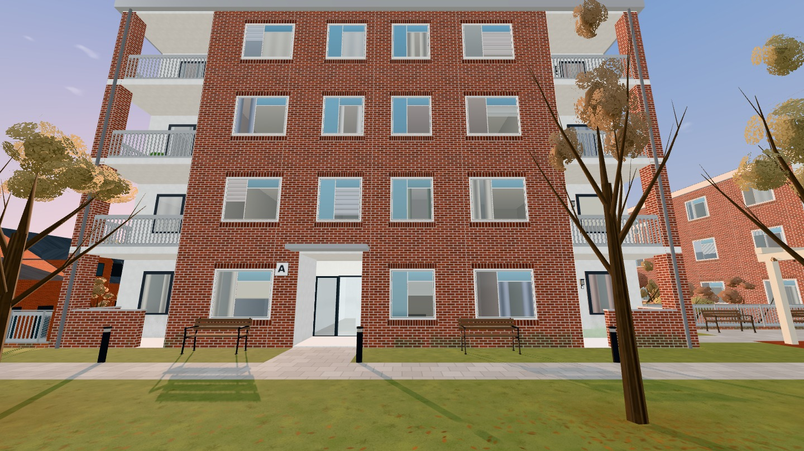 | 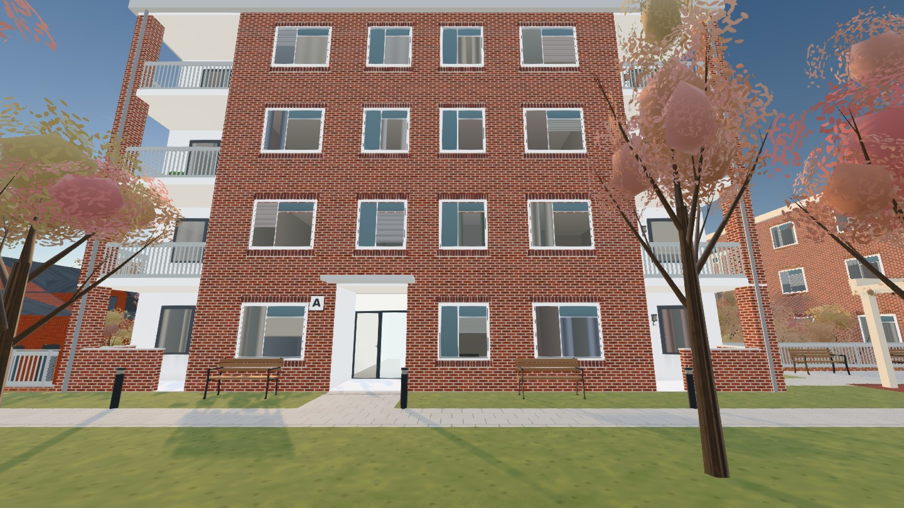 | 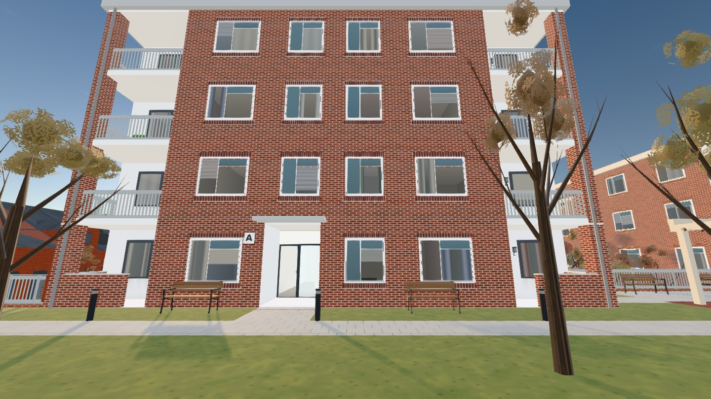 |
| Hus B | 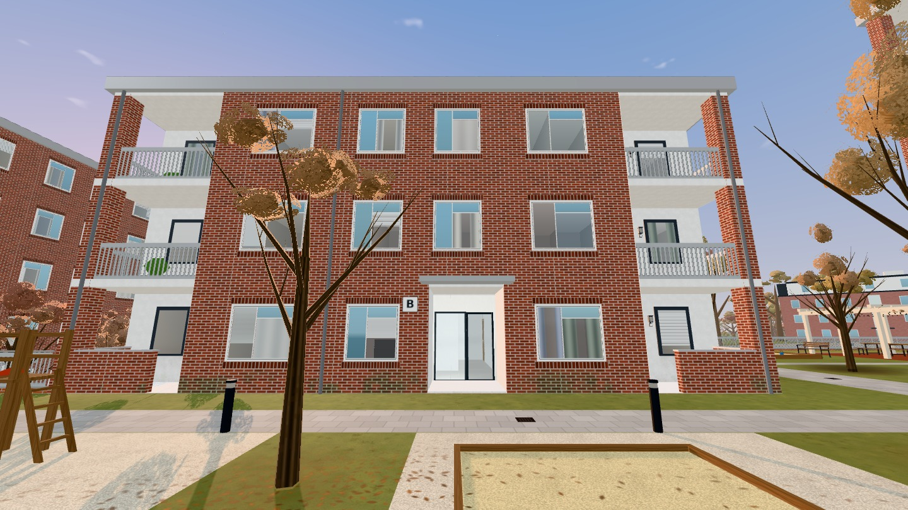 | 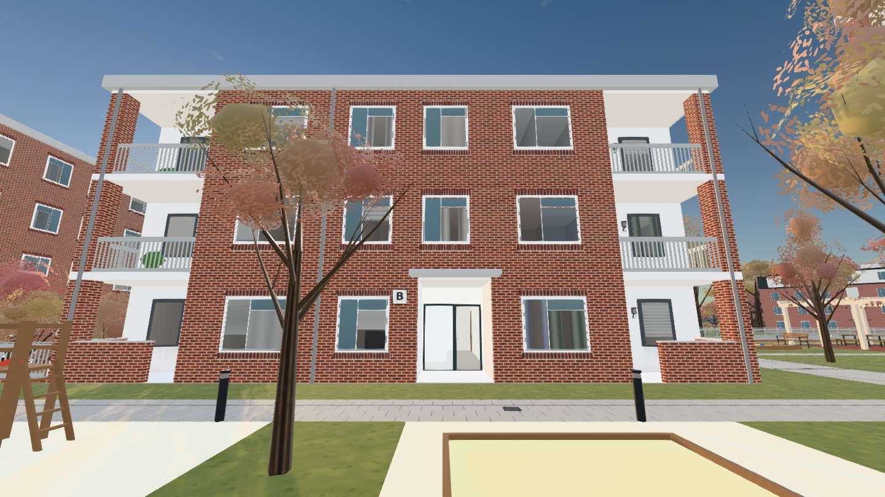 | 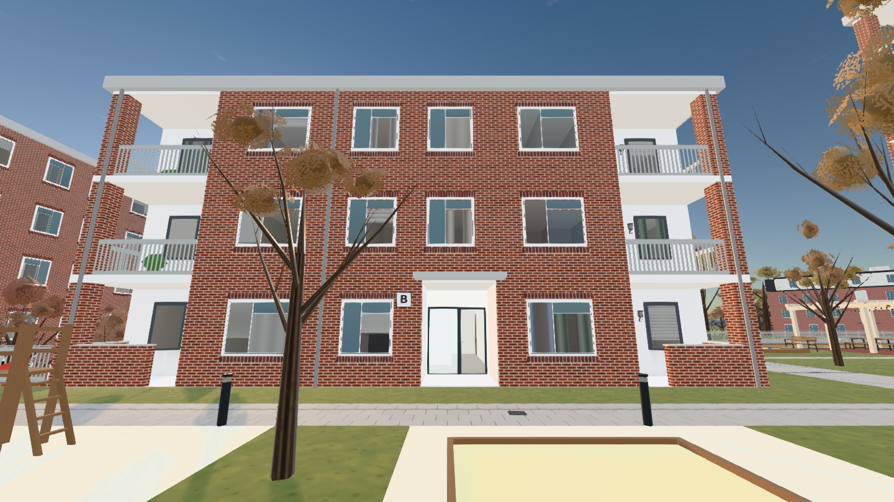 |
| Gården mot Hus L | 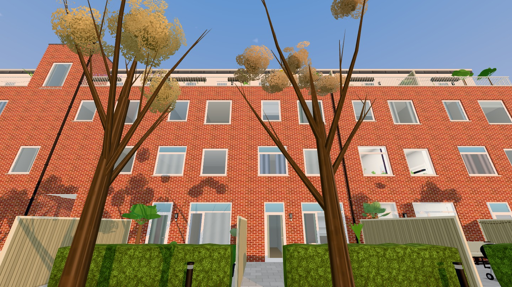 | 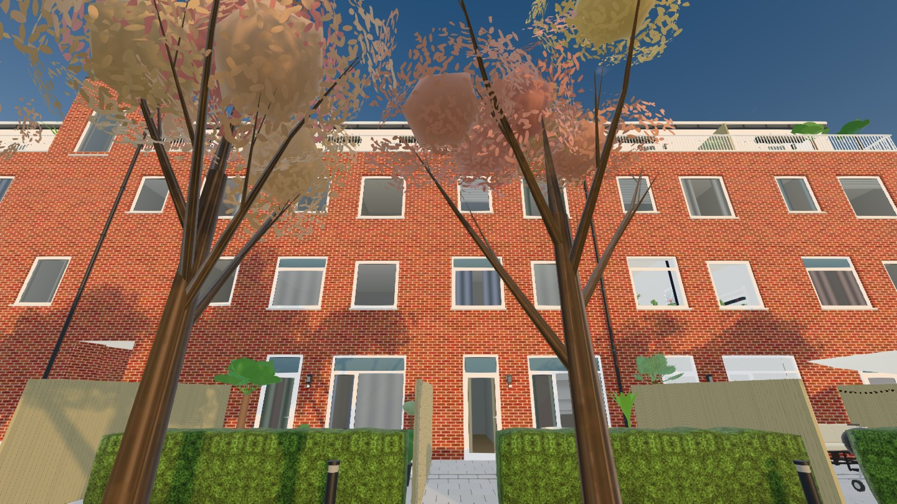 | 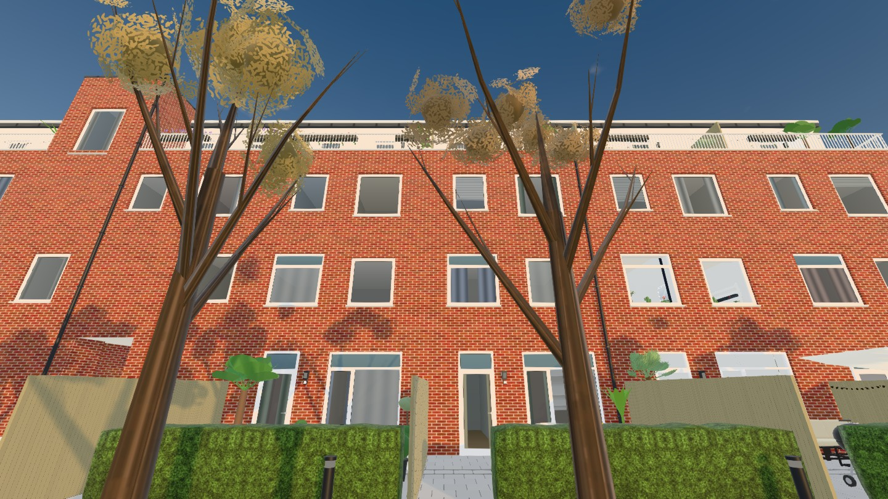 |

| Kontroll | Webb | Unreal före | Unreal nu |
| --- | --- | --- | --- |
| Hus A, 21 juni kl. 14 | 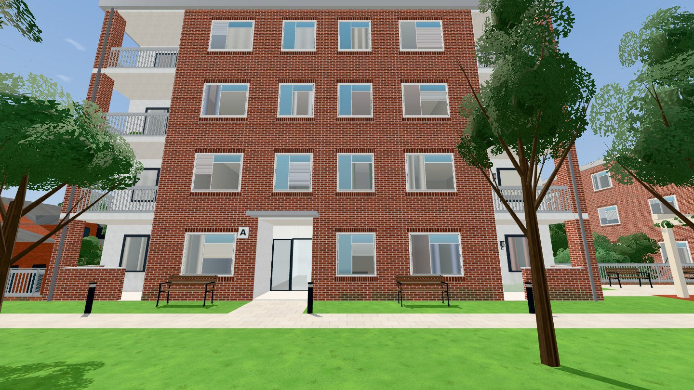 | 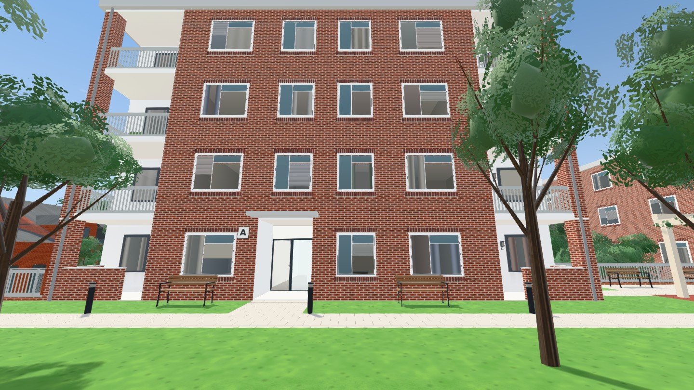 | 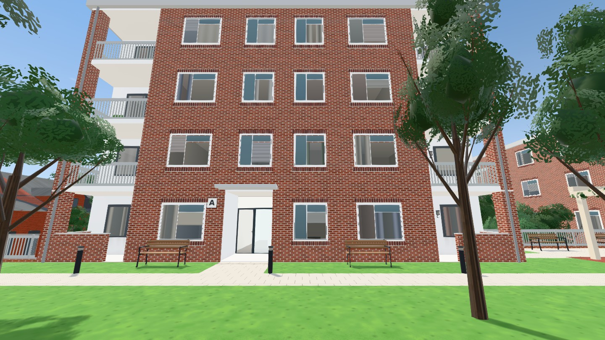 |
| Hus B, 21 juni kl. 14 | 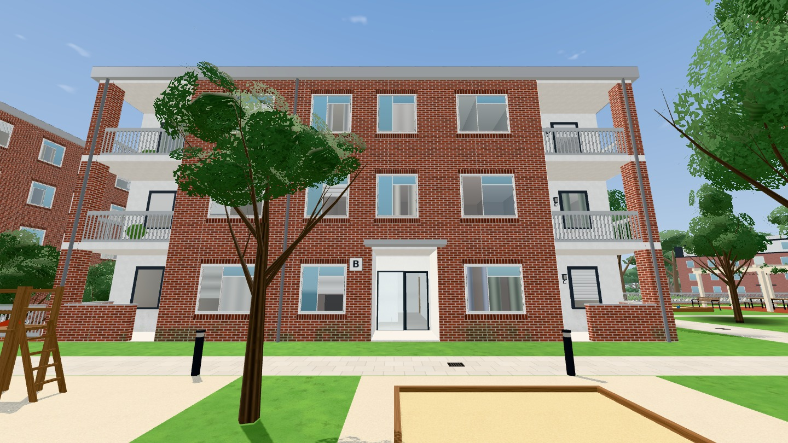 | | 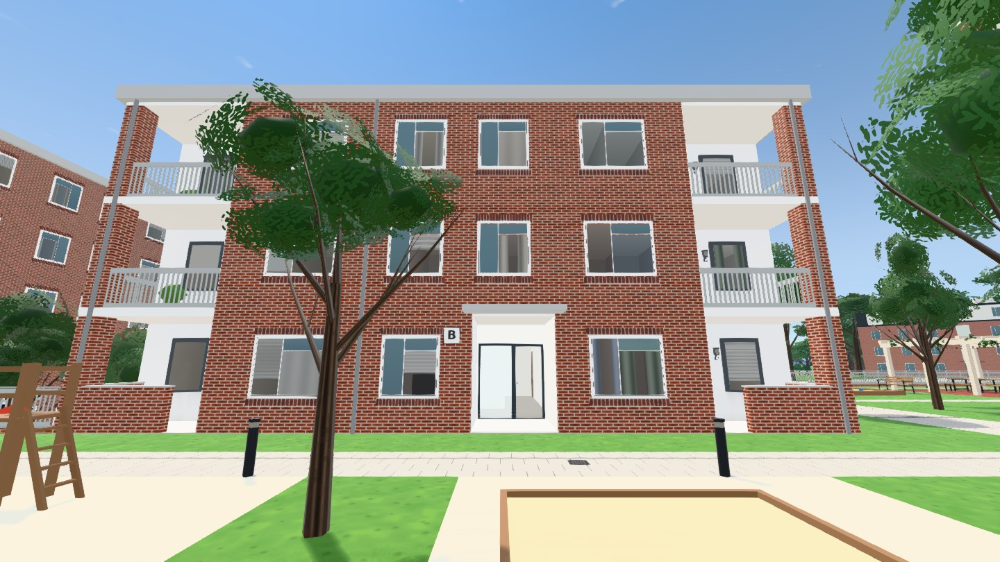 |
| Gården, 21 juni kl. 14 | 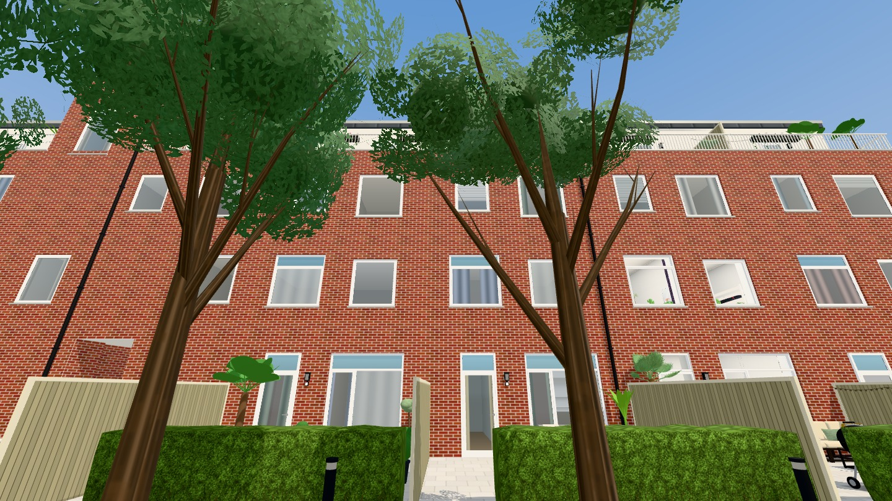 | | 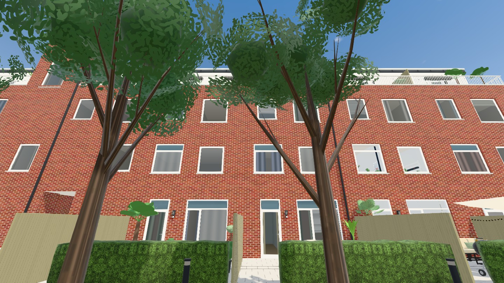 |
| Hus A, 16 januari kl. 14 | 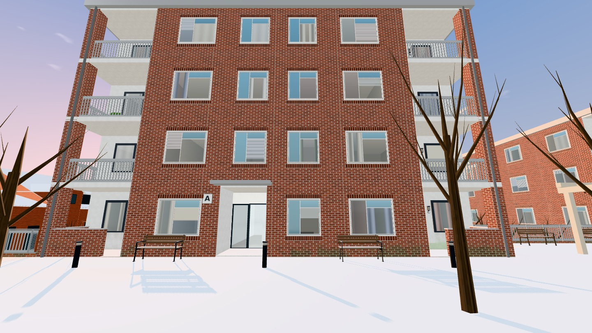 | | 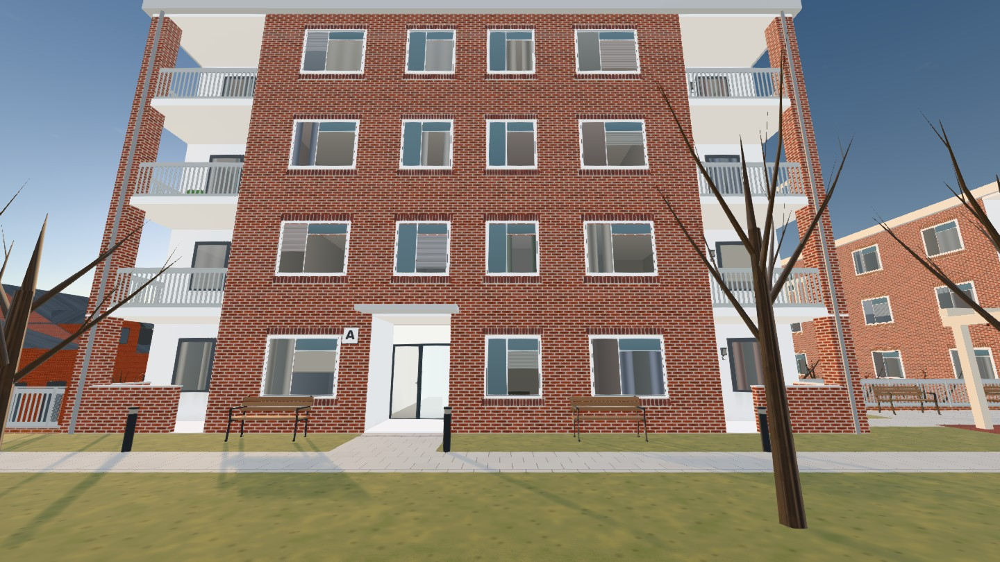 |

## Mätning

[`leaf-stats.cjs`](../../../tools/unreal-engine/tests/leaf-stats.cjs) räknar bladpixlarna i kronutsnitt mot himlen.
Pixlar med blå himmel räknas bort. Andelen visar hur mycket av utsnittet som täcks av löv och grenar. Råvärdena finns i
[leaf-stats.txt](leaf-stats.txt).

| Utsnitt | Webb | Före | Nu |
| --- | --- | --- | --- |
| A, högra trädet nov: andel | 0,389 | 0,741 | 0,353 |
| A, högra trädet nov: kulör | 40° | 9° | 44° |
| B, högra trädet nov: andel / kulör | 0,389 / 28° | 0,574 / 31° | 0,340 / 31° |
| B, bortre trädet nov: andel / kulör | 0,496 / 29° | 0,695 / 22° | 0,423 / 37° |
| A, vänstra trädet nov: kulör / mättnad | 26° / 0,32 | 25° / 0,24 | 43° / 0,25 |
| A, högra trädet juni: andel | 0,850 | 0,844 | 0,852 |
| A, högra trädet juni: ljushet / mättnad | 0,28 / 0,33 | 0,32 / 0,25 | 0,24 / 0,28 |
| B, högra trädet juni: andel | 0,724 | 0,657 | 0,668 |
| B, högra trädet juni: ljushet / mättnad | 0,29 / 0,43 | 0,37 / 0,22 | 0,28 / 0,34 |

Novemberkronorna täcker nu 0,85–0,91 av webbens yta i stället för 1,5–1,9 gånger. Kulören ligger inom några grader
i A och B. Undantaget är vänstra trädet vid A, som är gulare än på webben. På sommaren har kronorna samma storlek som
förut, med en andel på 0,852 mot 0,844 och 0,668 mot 0,657. De är nu mörkare och mättare, alltså närmare webben. I januari
är kronorna fortfarande helt kala.

Det native testet `test_vegetation` godkände alla 507 träd och 9 häckar. Det kontrollerade också att kronor och rankor
räknar med world position offset, att alla 193 rankor har `MI_LundenVine` och att kronorna har fyra custom data-värden i
spelet (`LUNDEN_VEGETATION_OK`). `vegetation-look.test.mjs` godkände exportens atlaston och 3 322 slumptal. Alla tio
GLB-filerna är byte-identiska med exporten före ändringen. Bara `measurements.json` har ändrats.

## Kvarstående skillnader

- Tofsarna är något glesare än webbens, med 85–91 procent av täckningen. Kortens utklippning ritas av en egen shader,
  eftersom webbens atlas inte följer med (*guess*). Det hör till #2449, som gäller genomskinligt lövverk.
- Sommarkronorna är fortfarande mindre mättade än på webben, 0,28–0,36 mot 0,33–0,52. Himlens blå ljus på bladen hör
  till #2424 och #2437.
- Novemberhimlen är mättat blå i Unreal och lavendelfärgad på webben (#2434). Fallna löv på gräset och sandlådans
  struktur saknas (#2433). Snötäcket i januari saknas (#2331).
