# Höstlöv på gräs och grus i Unreal (#2433)

Webben lägger fallna löv på den belysta marken (`src/leaflitter.js`, `LEAF_LITTER`). Ett fragmentsteg ritar två
förskjutna rutnät av små spetsiga ellipser i världskoordinater. Tätheten kommer från en 8-bitarskarta över `WALK`:
gles överallt, tät under kronorna och längs kantstenarna. Den multipliceras med månadens andel (september 0,2,
oktober 0,6, november 1, inga löv övriga månader) och ytans andel (gräs 0,85, grus 0,8). Långt bort tonar löven över i
sin medelton och ett brutet förnalager. Unreal hade inga löv alls.

"Sandlådan" i Hus B-vyn är boulebanan. Den är grus med webbens stenkarta i sandton (`BOULE_TINT`), inte sandlådans
släta sand. I Unreal låg gårdsgruset och boulebanan på Interchange-materialet med exportnyckelns färg `#fff8e0`. Den
färgen är `0xcfc6b2 / 0,6` klippt till 1, så gruset blev slätt gräddvitt och banan slätt gul.

## Ändringen

- **Exporten** bakar täthetskartan med webbens egna `bakeLitterDensity` och `litterRoads`, som nu delas med
  `main.js` utan att webben ändras. Kartan, månadstonerna (linjära) och talen skrivs till `measurements.json`
  `site.leafLitter`. Webbens stenkarta (`gravelData`) skrivs till `site.gravelSurface`. Båda är PNG-bilder med en
  hash av texlarna. Alla tio GLB-filerna är byte-identiska med exporten före ändringen.
- **`build_materials.py`** importerar bilderna som `T_LundenLeafLitter`, `T_LundenGravelColour` och
  `T_LundenGravelSurface`. `M_LundenGrass` och det nya `M_LundenGravel` kör samma lövsteg som webben efter sin egen
  färg (`ground_litter.py`), med samma rutnät och hashfunktion i webbmeter. Löven ligger därför på samma ställen som på
  webben. Månaden läses från `MPC_LundenVegetation.Month`, och månader utan löv kör bara månadsuppslaget.
- **Gruset** ritas med stenkartan i världsmeter gånger `Color / medelvärde` (webbens `gravelColor`), gånger
  vertexfärgen och den breda tonen. `MI_LundenGravelCourtyard` (`#cfc6b2`, vertexfärg för boulebanans sandton) och
  `MI_LundenGravelPark` (`#b5ac90`) ersätter Interchange-materialet för de två grusnycklarna.

## Bildpar, 16 november kl. 14

Webben är tagen vid 9bbdbabd (#2432). Webben ändras inte här: `litterRoads` är samma uttryck som förut, flyttat ur
`main.js`. Unreal 5.8.4 är tagen med den nya exporten, klart väder och spelets exponering. Kamerorna `facade-a` och
`facade-b` kommer från [facade-views.json](../../../tools/unreal-engine/tests/facade-views.json) och tiderna från
[shots.json](shots.json). "Före" är #2432:s Unreal-bilder vid
[9bbdbabd](https://github.com/solwation/lunden-3d-apartment/tree/9bbdbabd94f363f45668d689646680231f689805/docs/verification/2432).

| 16 november kl. 14 | Webb | Unreal före | Unreal nu |
| --- | --- | --- | --- |
| Hus A | 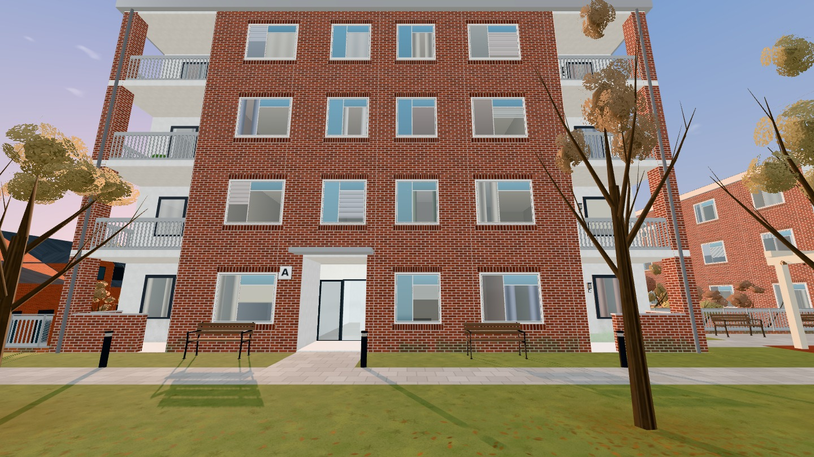 |  | 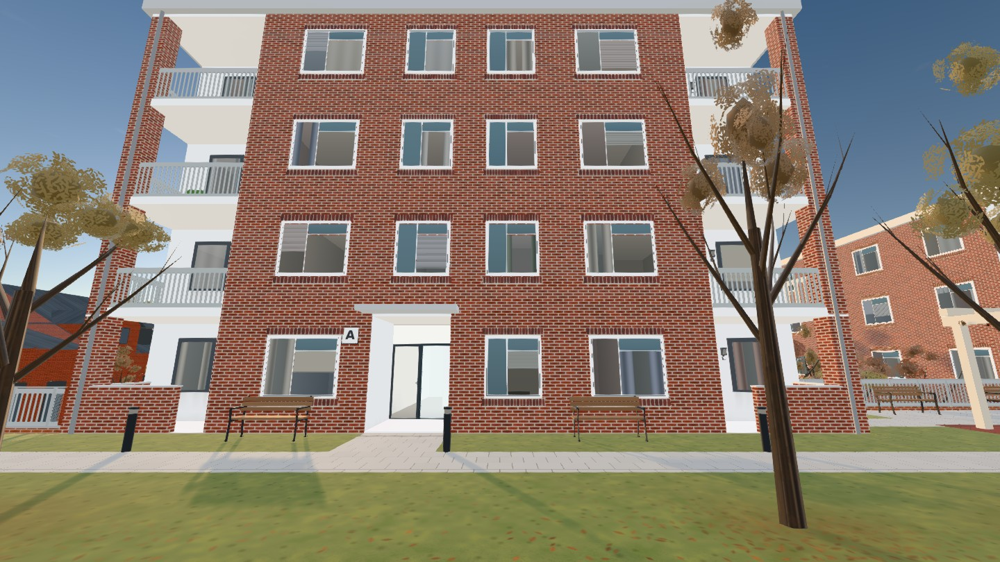 |
| Hus B | 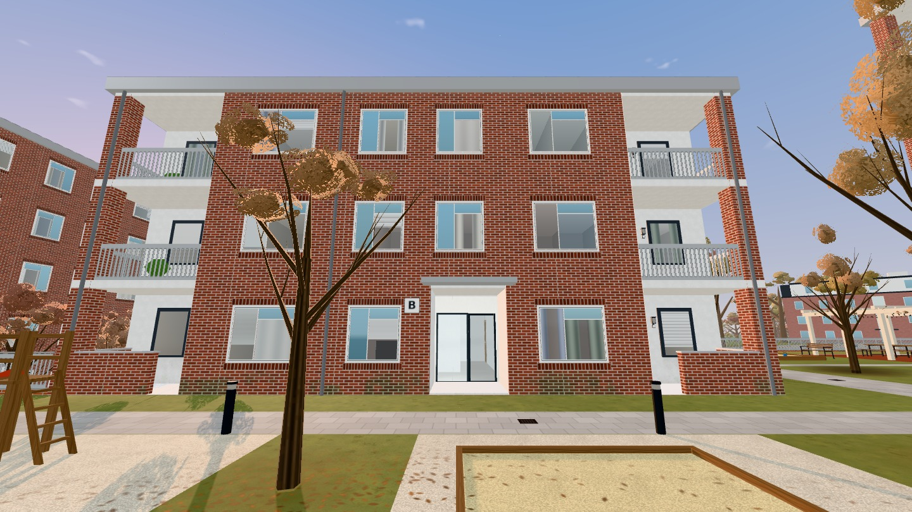 | 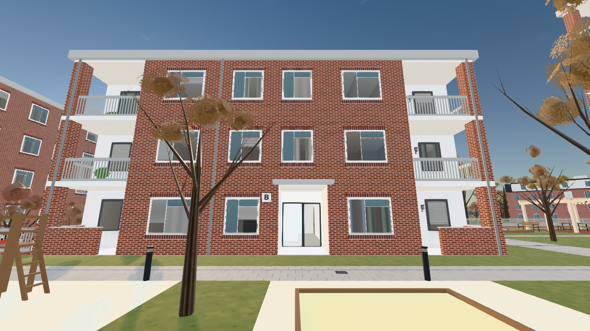 | 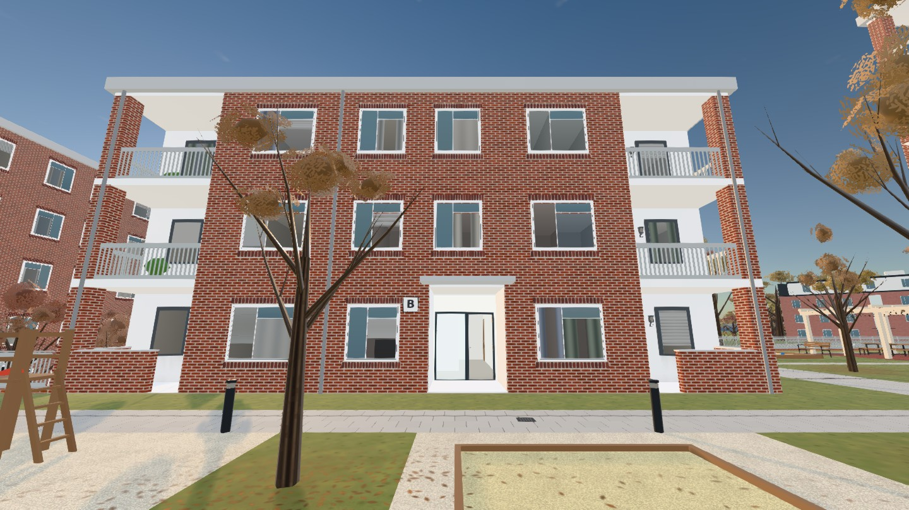 |

Marken i förgrunden, i full upplösning:

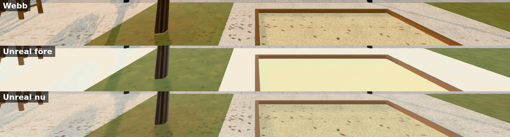

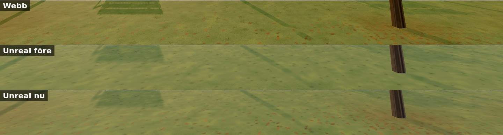

| Kontroll | Webb | Unreal nu |
| --- | --- | --- |
| Hus A, 21 juni kl. 14 | 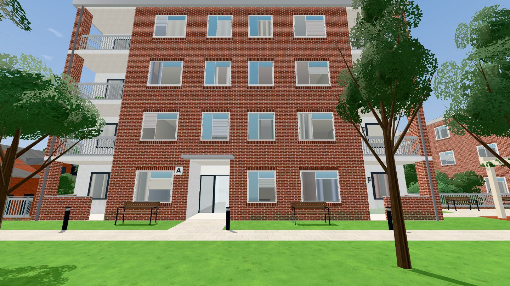 | 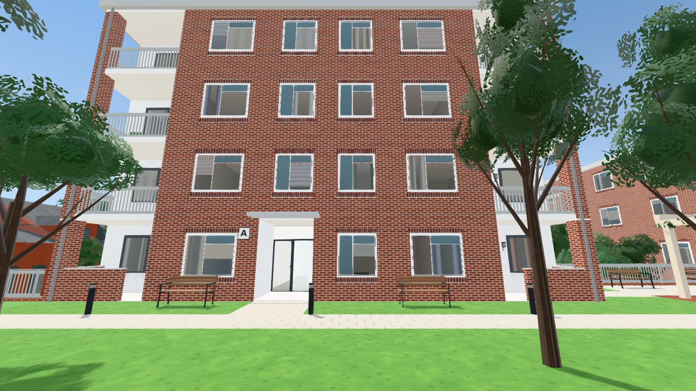 |
| Hus B, 21 juni kl. 14 | 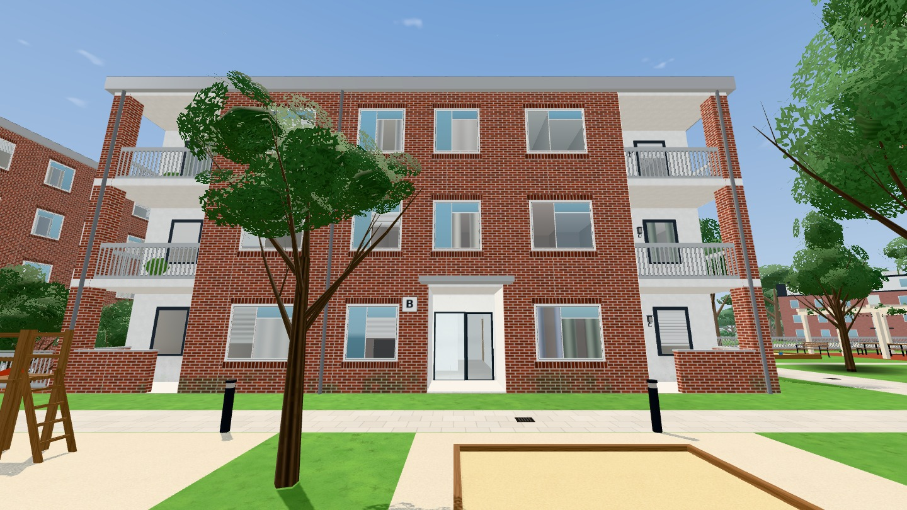 | 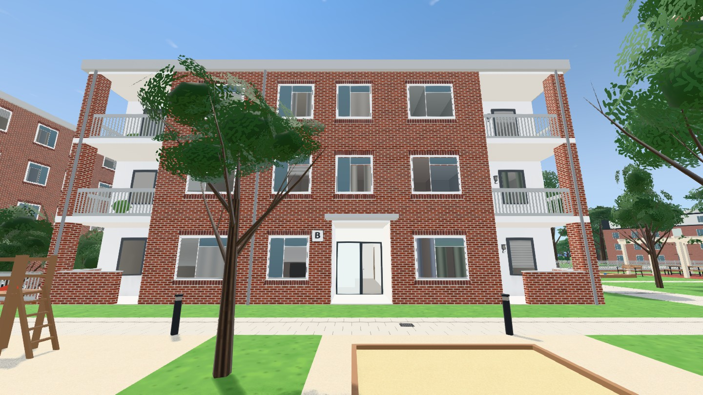 |
| Hus A, 16 januari kl. 14 | 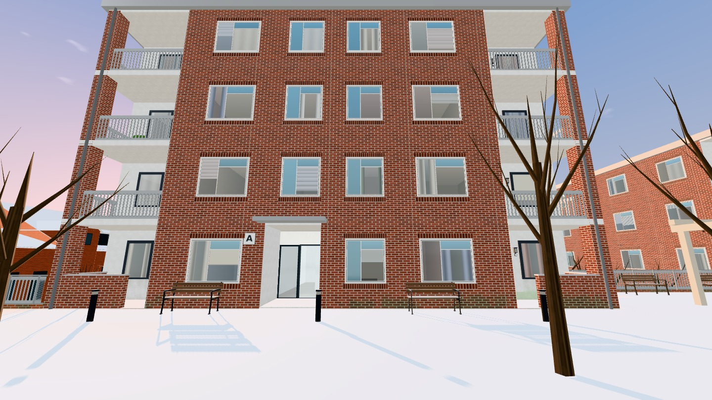 | 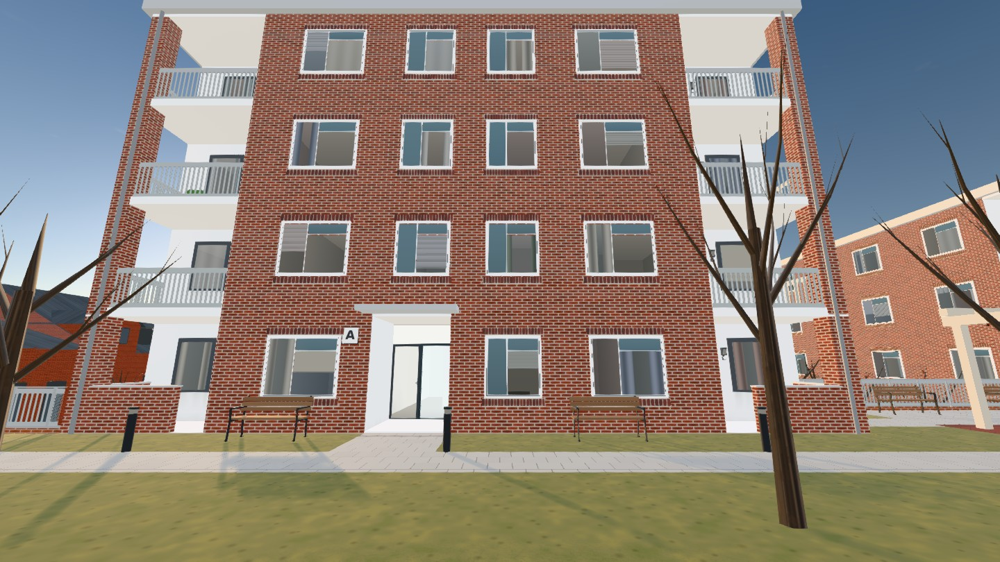 |

## Mätning

Utsnitten finns i [ground-crops.json](ground-crops.json) och mäts med `tools/unreal-engine/tests/crop-stats.cjs`.
Råvärdena finns i [ground-crop-stats.txt](ground-crop-stats.txt) och, med #2432:s Unreal-bilder, i
[ground-crop-stats-before.txt](ground-crop-stats-before.txt). Tabellen visar Unreals linjära luminans som andel av webbens.

| Utsnitt | Före | Nu |
| --- | --- | --- |
| B nov, boulebanan | 1,51 | 1,06 |
| B nov, gruset till vänster | 1,71 | 1,11 |
| B nov, gruset till höger | 1,48 | 1,21 |
| B nov, gräset vid stammen | 1,26 | 1,13 |
| A nov, gräsmattan | 1,18 | 1,15 |
| A juni, gräsmattan | 1,14 | 1,14 |
| B juni, boulebanan / gruset | 1,14 / 1,10 | 1,06 / 1,03 |
| A januari, gräsmattan | 0,25 | 0,25 |

Boulebanan har nu webbens sandton: sRGB 209, 195, 151 mot webbens 211, 187, 139 (före 240, 229, 182). Gräset i
november blev varmare (R/B 1,79–1,86 mot 1,71–1,74 före; webben 2,2–2,3). Juni är oförändrad på gräset (0,4153 mot
0,4152) och januari likaså. Gruset ändras året om, eftersom webben har stenkartan året om. I juni ligger det nu närmare
webben än förut.

Kontroller:
- `node tools/unreal-engine/tests/leaf-litter.test.mjs <export>`: `LEAF_LITTER_OK months 0 0 0 0 0 0 0 0 0.2 0.6 1 0,
  density 605x652 (mean 0.247), 4 lawn/gravel keys with litter`. Testet underkänner löv i någon av månaderna
  december–augusti.
- `python3 tools/unreal-engine/tests/test_materials.py <export>`: `MATERIAL_COVERAGE_OK`, med de två grusnycklarna på
  grusmaterial med webbens färg. Testet underkänner Interchange-materialet, fel färg och en ignorerad vertexfärg.
- `build_materials.py --check`: `LUNDEN_MATERIALS_CHECK_OK 56 materials`. Kontrollen omfattar texelhashar, kod,
  `Month` och texturkopplingar. En andra körning skriver ingenting (`0 written, 56 kept`).

## Kvarstående skillnader

- Gångarna och asfalten har inga löv i Unreal. De ritas av `M_LundenTiled`, som var låst av #2428: #2457.
- Gräset är ljusare och blekare än på webben, 1,13–1,16 gånger både i juni och november: #2437.
- Novemberhimlen är mättat blå i Unreal och lavendelfärgad på webben: #2434.
- Trädkronornas skuggor på gruset i den låga novembersolen saknas nästan i Unreal. Det har samma orsak som de kala
  vinterträdens saknade skuggor: #2444.
- Snötäcket i januari saknas: #2331.
- Grusets relief ritas inte som bump. Webbens djup är 0,6 mm (*guess*).
