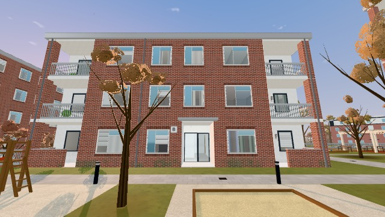
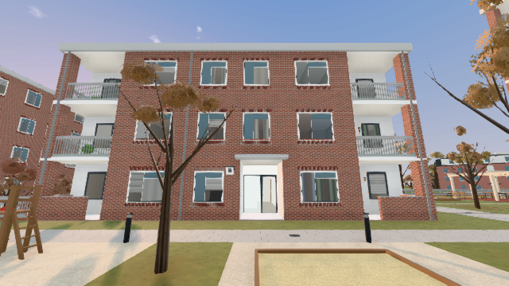
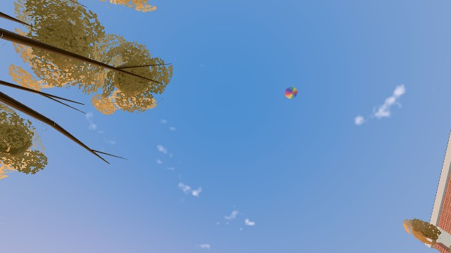
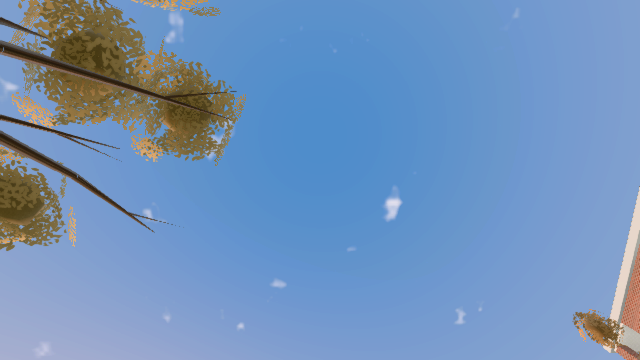
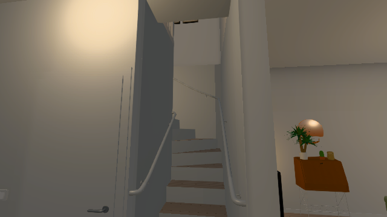
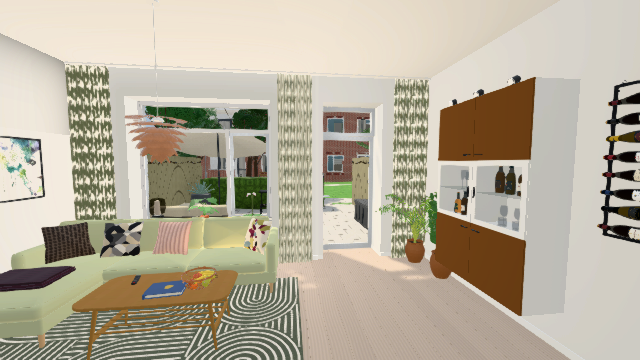
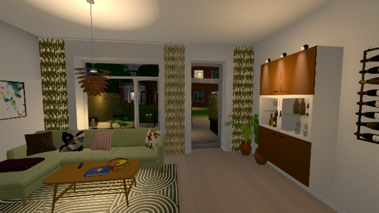
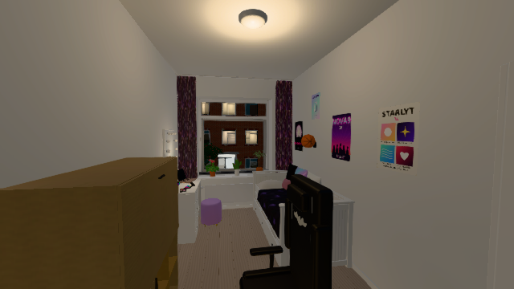

# November daylight sky — #2434

The original facade-B view and a supplementary upward view now use the web's lavender horizon and blue zenith. The existing sky branch follows the exported DayCycle palette/glow/scatter and inverts the complete Neutral output curve instead of retaining atmosphere luminance. There is no fitted RGB gain, new exposure setting or depth-only final-tonemapper overlay.

Tested source: `511dc7996c9d3a7668b65f6aac992dfd9d07ee39`, public base `23f58e800e51b51c44ddbc9d091eb57c6069bfcf`, source change `6d14dbb3e320fd7c3eb0d375322c22d5d18088fd`. The six actually changed saved Lighting packages are included byte-for-byte; [published package hashes](published-packages.json) bind them to the accepted native build. [Image hashes](image-manifest.json) bind all twelve unmodified originals below.

## Conditions and results

Both sky pairs are 640×360, vertical FOV 72°, 16 November 2026 at 14:00, clear weather, lamps off, frozen source cloud phase `[0,0]`. Eye: web `[-33.2,1.62,23.6]`; yaw 180°, pitch 12°/80°. Native: Linux CPU Vulkan, FXAA 1, conventional shadows 3, SeparateTranslucency enabled, Lumen off. Web: Three 0.170/Chrome 1208 SwiftShader, desktop Ultra. This is not Windows full-profile delivery evidence.

The three patches were frozen from web/source geometry before native inspection: linear luminance ±15%, existing R/G and B/G ±10% convention, plus whole-image hue review. One unchanged canonical browser batch measured these patches and all 22 apartment checks.

| Sky patch | Native/web Y | R/G ratio | B/G ratio | Result |
| --- | ---: | ---: | ---: | --- |
| Near horizon | 0.977423 | 1.001320 | 0.999983 | PASS |
| Upper gradient | 0.975376 | 0.999410 | 0.999059 | PASS |
| Zenith | 0.962692 | 1.013890 | 0.995659 | PASS |

All **22 apartment rows PASS**, including fourteen furnishing/spot fields and existing hue guards. Full-frame Y ratios: living-room day 0.957438, living-room evening 0.939412, stairs 0.876423, upper floor 0.876608. See [sky gate](sky-gate.json), [apartment gate](apartment-gate.json), [canonical statistics](crop-stats.json) and [locked rectangles](crops.json).

The fresh clean public export contains 322 sources and 9,402 nodes. Four private-brick GLBs differed; the real canonical importer restored the public material bindings rather than relabelling copied import stamps. V3 executed all 20 canonical steps and the native PBR contract. Actual native/runner/outer exits were **0/0/0**, 659.33 s, no log errors; all 247 authored packages were read-only, protected bytes and post-build Generated/export/source/dependencies remained exact, and scene restoration passed. Config SHA: `b38973393aae4234fe30796e293685ae46f225c86482740245250f6f72d6a45f`. See [postflight](native-postflight.json), [steps](canonical-steps.json), [build](lighting-build-result.json) and [export](public-export-proof.json).

Earlier attempts remain **failed**: V1 **1/1/1, 110.33 s**, before building because taking the eight owned LFS locks changed modes after preflight; V2 **1/1/1, 117.64 s**, after the controlled Lighting build but before canonical steps because the directory-only Git ignore did not cover the Import symlink. V3 reused the real saved build and a byte-identical materialized Import directory. Neither failure is relabelled as a successful full run. Their [V1](setup-v1-postflight.json)/[V2](setup-v2-postflight.json) postflights are retained.

All twelve whole originals were reviewed. Cloud positions differ. Existing brick/rail, mirror/glass, pendant and local-light gaps remain mapped in the [whole-image review](whole-image-review.json). No broad sky overwrite was observed on sampled foliage, buildings, windows or curtains. SceneDepth alone does not exclude every depth-unwritten BeforeDOF foreground: no universal transparency-preservation claim is made. Night/cloud paths are source-byte-preserved and Moon remains later; prior evidence was reused, with **no new night/Moon run**. The known #2421 night-luminance failure remains open. Pure source checks are recorded [separately](source-checks.json).

Original-only Unreal change; no downstream/web transfer applies. The player changelog records the visible sky correction. Publication is followed by pinned HTTP/SHA verification and embedded issue images before closure.

## Original images

| View | Web | Native |
| --- | --- | --- |
| Facade B |  |  |
| Zenith |  |  |
| Stairs |  |  |
| Living room, day |  |  |
| Living room, evening |  |  |
| Upper floor |  |  |
