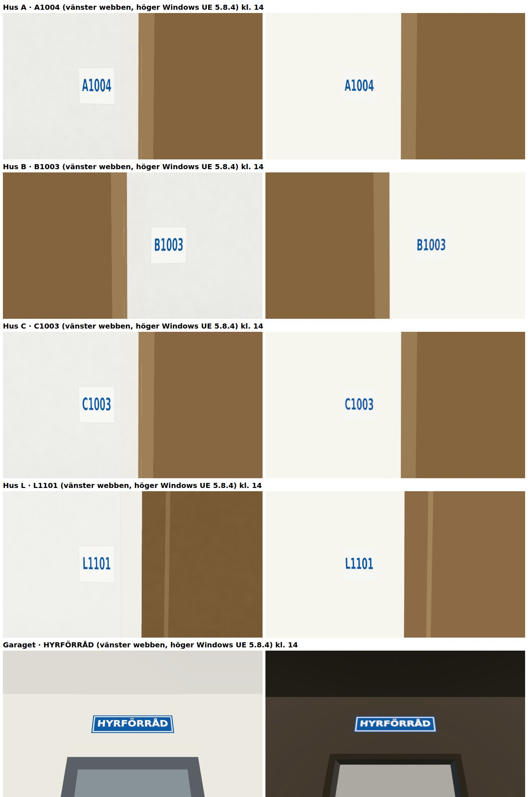
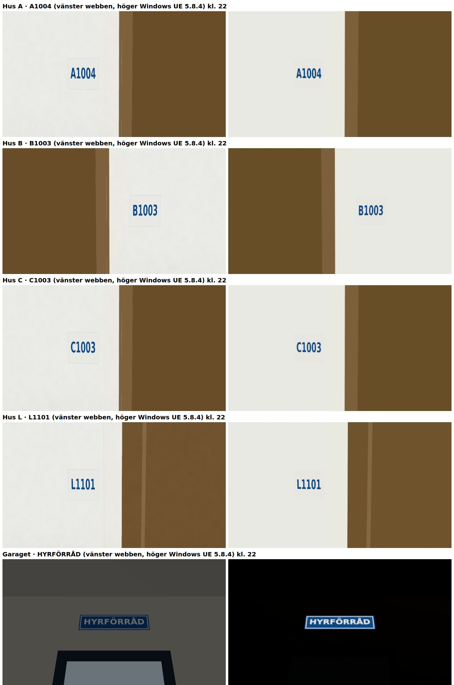
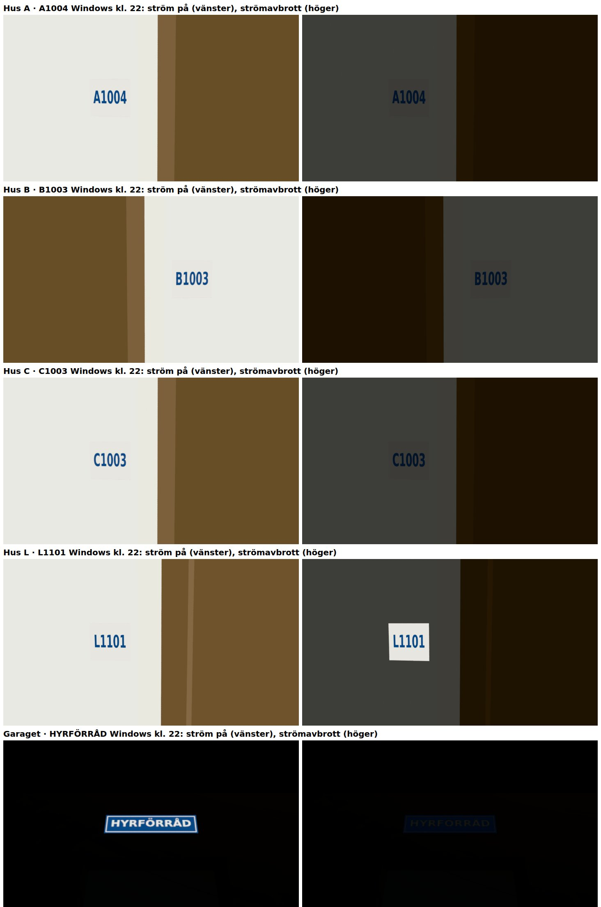

# Obelysta skyltar i Windows (#2435)

Samma kameror som i [#2400](../2400/README.md): nummerskylten vid en dörr på bottenvåningen i Hus A, B och C, vid L1101
i Hus L och skylten HYRFÖRRÅD i garaget. Bilderna visar mittenhalvan av varje bild. Datum 15 november 2026, klart väder.

## Kl. 14: webben till vänster, Windows UE 5.8.4 till höger

Skyltplattan har nu webbens ljushet: sRGB (246, 246, 242) i Windows mot (246, 247, 242) på webben (Hus A, plattans
övre kant). Hus A/B/C:s dörrblad är också obelysta på webben och har nu samma färg, (132, 101, 62) mot (132, 100, 62).
Garageskylten är blå och läsbar som på webben, (129, 164, 202) mot (116, 157, 200).

## Kl. 22: webben till vänster, Windows till höger

Plattan (231, 230, 224) och väggen (233, 233, 227) i Hus A ligger inom ett par steg från webbens (232, 233, 228) och
(234, 235, 230). Skylten blir inte längre mörk på kvällen.

## Kl. 22 i Windows: ström på till vänster, strömavbrott till höger

Som på webben dämpas Hus A/B/C:s skyltar och dörrblad till nödljuset (`POWER.emergency` 0,1) vid strömavbrott, plattan
går från 231 till 60. Hus L:s skyltar behåller sitt ljus (webbens `core.js` dämpar dem inte). Garagets skyltar faller
till lysrörens släckta nivå (0,035).

## Prov

- `node tools/unreal-engine/tests/sign-textures.mjs <export>`: OK, 28 obelysta nycklar med bild, alla med
  `KHR_materials_unlit`; 6 dämpas till 0,1 och 5 garageskyltar till 0,035. Exporten före ändringen (39c6c8a9) underkänns:
  `web unlit labels exported lit: …` (28 nycklar).
- `python3 tools/unreal-engine/tests/test_materials.py <export>`: `MATERIAL_COVERAGE_OK`, punkt 10: 28 obelysta nycklar,
  11 dämpas vid strömavbrott. Samma prov på den gamla exporten ger 28 fel `is exported lit`.
- `node tools/unreal-engine/check-export.mjs --dir <export>`: aktuell, 11 filer och 9 385 noder.
- `sync-import.ps1 -ExportFrom <export> -Zones hus-l,kvarteret,l1007,gard,fond` i UE 5.8.4: importen och
  `import_world.py --check` gav `LUNDEN_CHECK_OK`; `LUNDEN_IMPORT_UNLIT_LABELS` hus-l 9, kvarteret 23 (11 dämpade),
  l1007 1, gard 1, fond 1, var och en obelyst på `M_LundenGltfUnlitLabel` med sin textur och strömfaktor.
  `build_materials --check` för de genererade masterna: `LUNDEN_MATERIALS_CHECK_OK`.
- `Editor.Python.Lunden.test_furnishing` (`-nullrhi`): `Success`, skyltarnas texturer finns kvar på sina nät.
- Bilderna: webben med `LUNDEN_CAPTURE_VIEWS=<views> capture-web-views.cjs <server> <ut> 2026-11-15` (ljus `day` och
  `evening`), Windows med `tests/capture_flat_signs.py` som `Editor.Python.Lunden.test_flat_signs_capture` i PIE på
  `L_Lunden` med `-RenderOffScreen` och `Saved/sign-shots.json` = dag kl. 14, kväll kl. 22 och strömavbrott kl. 22
  (`LUNDEN_SIGN_PICTURES_OK 15`).

## Kvarstående skillnader i bilderna

- Kl. 14 är trapphusväggen ljusare i Windows än på webben, (246, 246, 239) mot (235, 236, 231), så plattans kant syns
  svagare än på webben. Webben blandar trapphusets bakade ljus med dagsljuset (`src/stairdaylight.js`); Windows visar
  nattnivån hela dygnet. Samma sak gör Hus L:s dörrblad ljusare på dagen. [#2452](https://github.com/solwation/lunden-3d-apartment/issues/2452)
- Väggarnas färgton i trapphusen. [#2436](https://github.com/solwation/lunden-3d-apartment/issues/2436)
- Garaget är nästan svart runt skylten i Windows (inga lysrör). [#2404](https://github.com/solwation/lunden-3d-apartment/issues/2404)
  Webbens kvällsbild av garaget är troligen tagen medan lysrören blinkar igång (rörelsesensorns uppstart), därför är webbens
  skylt mörk där; när lysrören lyser ser den ut som i dagbilden. Windows har ingen sensorstyrning och visar alltid den
  tända nivån.
