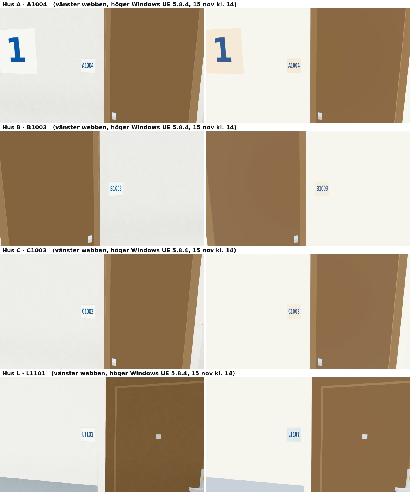

# Trapphusväggarnas färg i Windows efter #2431 (#2436)

Ommätning av #2400:s skyltvyer i Hus A, B, C och L. Webben (vänster) och Windows UE 5.8.4 (höger) från samma kamera,
15 november 2026 kl. 14, klart väder. Ingen kod ändrades: sedan #2431 (`5c7ab148`) ritas trapphusens väggar, golv och
trappor obelysta med webbens bakade vertexfärg (`M_LundenStairwellLight`), så lamp- och himmelsljuset som färgade
väggarna krämgula (A, B, C) och blåvita (L) i #2400 når dem inte längre.

Enskilda bilder: `web-hus-<a|b|c|l>.jpg` och `unreal-hus-<a|b|c|l>.jpg` (Unreal-bilden utan svarta kanter, skalad till
webbens 1440 × 810).

## Så togs bilderna

- Kameror: `node tools/unreal-engine/tests/sign-views.mjs <import>` med de fyra husvyerna (garaget hör till #2404),
  sparade som [views.json](views.json).
- Webben: `LUNDEN_CAPTURE_VIEWS=views.json capture-web-views.cjs <server> <ut> 2026-11-15` vid `a32cc0d7`
  (1440 × 810, vertikalt 72°).
- Windows: `tests/capture_flat_signs.py` som `Editor.Python.Lunden.test_flat_signs_capture` i PIE på `L_Lunden`,
  `-RenderOffScreen`, i den varma checkouten `lunden-ue-wt/opus-2389` vid `a32cc0d7` med importen från `33c6c991`
  (innehåller #2431). Provet gav `Success` och `LUNDEN_SIGN_PICTURES_OK 4`.

## Mätning

Utsnitten finns i [crops.json](crops.json) och mättes med `tools/unreal-engine/tests/crop-stats.cjs`; råvärden i
[crop-stats.txt](crop-stats.txt). Före-värdena är mätta på samma ställen i #2400:s
[skyltar.jpg](https://github.com/solwation/lunden-3d-apartment/blob/d545f100/docs/verification/2400/skyltar.jpg).

**Tolerans för väggen:** varje sRGB-kanal inom ±10 % av webben och värmen R/B (medel-sRGB) inom ±0,02.

| Vägg | Webb sRGB | Unreal före | Unreal nu | Kanaler nu / webb | R/B webb · före · nu |
| --- | --- | --- | --- | --- | --- |
| A | 235, 236, 231 | 247, 241, 230 | 246, 246, 238 | +3,4 … +6,2 % | 1,02 · 1,07 · 1,03 |
| B | 235, 236, 231 | 246, 238, 225 | 246, 246, 238 | +3,5 … +6,2 % | 1,02 · 1,09 · 1,03 |
| C | 237, 238, 233 | 246, 238, 225 | 246, 246, 238 | +2,4 … +4,8 % | 1,02 · 1,09 · 1,03 |
| L | 240, 241, 236 | 225, 234, 239 | 246, 246, 238 | +1,4 … +2,8 % | 1,02 · 0,94 · 1,03 |

Väggarna ligger inom toleransen i alla fyra hus. Den krämgula och den blåvita tonen är borta. Alla fyra hus visar
samma vita vägg, liksom på webben. Kvar är en ljusnivå på 1,05–1,14 gånger webbens linjära luminans, eftersom webbens
dagsljusblandning (`src/stairdaylight.js`) inte förs över. Det är
[#2452](https://github.com/solwation/lunden-3d-apartment/issues/2452).

| Dörrblad | Webb sRGB | Unreal nu | Luminans Unreal / webb | Material i exporten |
| --- | --- | --- | --- | --- |
| A | 132, 100, 62 | 138, 104, 67 | 1,10 | `bas_ffffff_r100_m0_vc_tex_t…` (belyst i Unreal) |
| B | 132, 100, 62 | 142, 109, 74 | 1,20 | samma |
| C | 135, 103, 65 | 142, 109, 74 | 1,13 | samma |
| L | 120, 90, 52 | 139, 107, 69 | 1,42 | `bas_ffffff_r100_m0_vc_ds` (trapphusets bakning) |

Dörrbladen är inte varmare än webbens (R/B 1,92–2,07 mot webbens 2,08–2,29). De är något ljusare och blekare.

- **A, B och C:** bladen är på webben ett obelyst `MeshBasicMaterial` med skyltatlasen som karta. I Unreal är de
  belysta. Det är samma orsak som skyltarna, och #2435 gör dem obelysta.
  [#2435](https://github.com/solwation/lunden-3d-apartment/issues/2435)
- **L:** bladet hör till trapphusets bakade yta. Kvoten 1,42, och golvets 1,35, ligger nära 1 / 0,68, alltså webbens
  dagsljusdämpning djupt inne i trapphuset. Det är [#2452](https://github.com/solwation/lunden-3d-apartment/issues/2452).

## Övriga skillnader i bilderna

- Skyltplattorna är krämgula (A, B, C) och blåvita (L) i Unreal. De är belysta, se
  [#2435](https://github.com/solwation/lunden-3d-apartment/issues/2435).
- Webbens vägg har en svag målarstruktur och ett slitageband (`src/stairdaylight.js`). Unreals vägg är slät. Golvet i
  Hus L är ljusare. Båda hör till [#2452](https://github.com/solwation/lunden-3d-apartment/issues/2452).
- De svarta kanterna i rå-Unrealbilden kommer från fönstret i 16:10 och är inte en skillnad i spelet.

## Hus som kontrollerades

A, B, C och L: alla fyra hus är påverkade av samma gemensamma orsak och åtgärdade av #2431. Garaget ingår inte, för det
är inget trapphus och hör till #2404.
