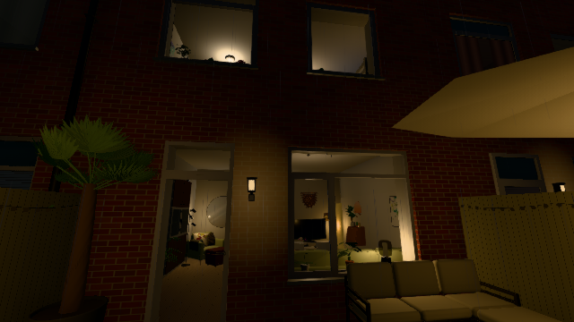
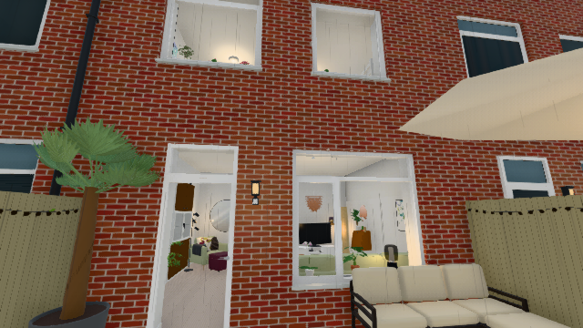

# #2439 Hail, storm and synchronized flash

The actual saved Unreal sky now has mutually exclusive Hail/Storm controls.
Audio reads these sky states. Its existing Strike clock triggers the sky flash
before the optional sound-device branch, retaining distance/343 thunder delay.
The source flash envelope advances in real DeltaSeconds, independently of calendar
TimeScale. Ambient normalization reserves the source peak without clipping its
blend weight; zero-flash effective fill remains unchanged.

## Actual verification

- Normal Lighting/Audio build and both checks: Native/runner/outer0,108.03s.
  Valid Lighting saved by the prior failed-Audio attempt was cached normally;
  the successful invocation rebuilt Audio and checked both signatures.
- Both canonical Automation tests actually Success in one session:
  test_audio and test_lighting, Native/runner/outer0,180.48s.
  Hail→audio, Storm replacing Hail, Strike→immediate Flash, distance/343 delay,
  actual component intensity/weight at day/night peak/decay/end all passed.
  [Actual lighting results](lighting-result.json), [audio results](audio-result.json),
  [Automation](automation-index.json). No audible sound-device test was performed.
- One actual two-image rendered batch: Native/runner/outer0,216.61s;
  [matching cameras, component values and complete restoration](capture.json).
  Root viewed both original640×360 images; the flash is plainly visible.

At Flash0→0.675 the actual SkyLight intensity changes1.40→3.38,
Ambient effective intensity×weight0.021835→0.813901, and the actual MPC agrees.
The existing lamp/palm/brick/window/sofa geometry stays in the same camera.
Brightness changes between these frames are the intended short flash.
The loaded editor parasol pose is retained in both frames; automatic furnishing
controls are outside this fixture. No obvious default-grid/magenta fallback was seen.

All247 authored packages remained exact/readonly after tests and captures.
Only31 explicitly locked Lighting/Audio assets were writable during normalbuild;
216 protected assets and foreign Generated content stayed unchanged.21 LFS
objects plus the normal Audio stamp were actually changed and saved.
See [final postflight](final-postflight.json) and [source identity](delivery-proof.json).

Two earlier failures remain recorded: own LFS lock acquisition made files
writable, correctly rejected before any build; then Audio revealed FlashSky
being called before its graph declaration. Root restored readonly before the
controlled write window and moved the declaration before Strike. Neither failed
invocation is claimed successful. All following scoped checks passed.

The unchanged prior20-step/import/geometry evidence is reused explicitly.
No fresh global sync stamp, release gate, Shipping cook or broad scene suite ran.
The extra sky colour still falls back outside Neutral's finite inverse domain;
this is functional flash acceptance, not complete all-weather RGB parity.
CPU Vulkan/SM5 images do not establish physical-GPU/Lumen performance.
This is original-only Unreal work; no public web transfer applies.
The existing Linuxbeta0.3.0 download remains bound to its recorded84e source;
this change is delivered in the Unreal project's main source/assets.
