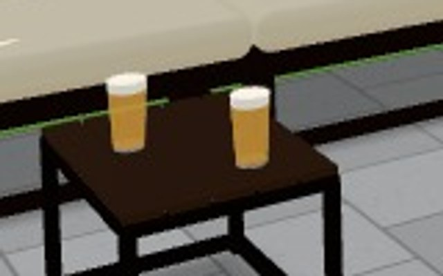
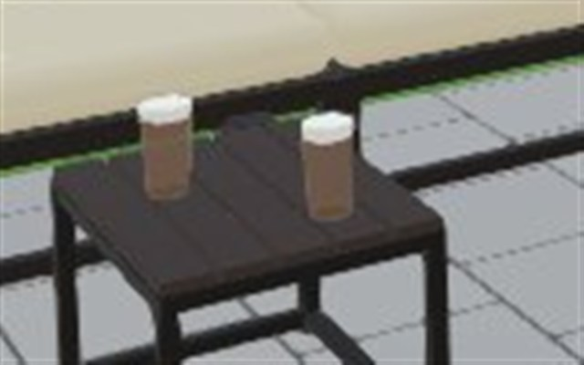
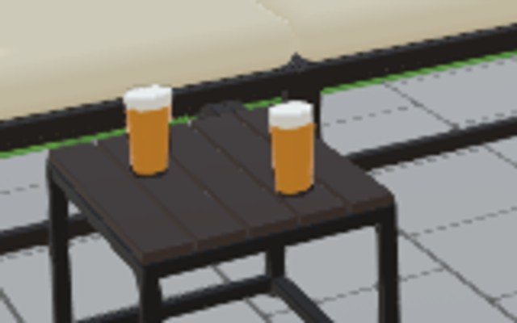
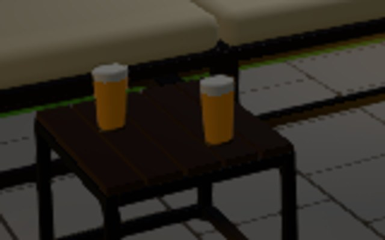

# Golden patio beer in Unreal (#2440)

The patio beers of #2406 stood in Unreal but looked grey-brown instead of golden. The cause is translucent lighting.
Interchange's glTF master lights a translucent instance from the translucency volume (`TLM_SURFACE`). The volume lit
the 88 % beer (`std_d88a1c_r20_m0_a88_e6a3a05`) at about 0.3 of the same colour drawn opaque. It also gave the 24 %
pint glass (`phys_f5fafb_r4_m0_a24_ds`) a blue sky veil. The export's colour, roughness and emissive arrived intact.
The fix uses `material-map.json` `instanceOverrides`: the beer is drawn opaque on its own Interchange instance, and the
glasses are re-parented onto `M_LundenGltfSurfaceForward`, a generated copy of M_Default with Surface ForwardShading.
Both apply in `l1007-uteplats` only. How it works:
[unreal.md, Surface materials → Instance overrides](../../development/unreal.md#surface-materials-2282).

Unreal Editor 5.8.4 on Windows 11, 2026-11-22. Warm worktree `lunden-ue-wt\opus-2389` at `ea0f804c` plus this change.
`import_world.py --zones l1007-uteplats` re-imported the zone from the checkout's export of `33c6c991` (the patio
GLB is unchanged since). The pictures are from `tests/capture_vegetation.py` on `L_Lunden` at the game's exposure
([capture](unreal-capture.json)), with #2373's camera ([views.json](../2373/views.json)). The web reference is #2406's
14:00 picture.

## Measurement

The numbers are mean sRGB over the beer's own pixels. The beer mask is the set of pixels that change when the two beer
meshes are hidden in an otherwise identical Unreal capture (538 pixels). The interior is that mask shrunk by one pixel
(401 pixels). The web picture is the same camera. Every row except the last is an in-memory experiment on the old
import, with nothing saved.

| Variant (21 June 14:00) | Mask sRGB | R/B | Interior sRGB | R/B |
|---|---|---:|---|---:|
| Web | 168, 128, 60 | 2.8 | 176, 131, 55 | 3.2 |
| Unreal before (Interchange's translucent instances) | 107, 89, 76 | 1.4 | 108, 87, 72 | 1.5 |
| Beer translucent, glass hidden | 111, 71, 12 | 9.6 | | |
| Beer translucent, volumetric lighting modes, glass hidden | 112–113, 72–73, 11 | 10 | | |
| Beer emissive at the web's strength × display gain (1.46 × the import's), glass `SpecularFactor` 0 | 109, 88, 73 | 1.5 | | |
| Glass with `SpecularFactor` 0, beer translucent | 106, 86, 73 | 1.5 | | |
| Beer opaque, glass hidden | 195, 133, 59 | 3.3 | | |
| Beer opaque, glass as imported | 180, 129, 80 | 2.3 | 186, 130, 75 | 2.5 |
| **After: beer opaque, glass on the ForwardShading copy** | **172, 116, 48** | **3.6** | **179, 117, 39** | **4.6** |

On the mask, R is +2 % against the web, G −9 % and B −20 % (12 levels). Hiding the glass, or leaving it as imported,
keeps the B gap or overshoots it: the imported glass gives +33 % and a pinkish beer. The glass also stays visibly
transparent. The remaining G and B gap is the lit colour of an orange surface. The web lights the beer's shaded side
with its hemisphere and ambient light, Unreal with Lumen. The opaque sofa cushions in the same picture differ by a
similar amount (orange cushion web 117, 46, 9, Unreal 128, 59, 35; yellow 136, 100, 5 against 148, 112, 38).

## Checks

| Check | Result |
|---|---|
| `python3 tools/unreal-engine/tests/test_materials.py <export of 0422fa87>` | pass: 2 overridden keys; with the old `material-map.json` it fails on `translucent emissive key l1007-uteplats/std_d88a1c_r20_m0_a88_e6a3a05 stays on Interchange's translucent instance` |
| `import_world.py --zones l1007-uteplats` | pass: `M_LundenGltfSurfaceForward` generated, `LUNDEN_IMPORT_INSTANCE_OVERRIDES … 2 imported instances changed`, its check `2 overridden instances, each as listed`, `LUNDEN_IMPORT_OK` |
| `import_world.py <export of 49f726d7> --zones l1007-uteplats`, after rebasing onto #2435's unlit labels | pass: the same 2 overrides and checks, fingerprint `451dc53a56e10104` as in the picture run |
| Beer colour, 21 June 14:00 | golden; R +2 %, G −9 %, B −20 % against the web; R/B 3.6 against 2.8 (before 1.4) |

## Pictures

| Web, 14:00 | Unreal before (#2406) | Unreal after, 14:00 | Unreal after, 22:00 |
|---|---|---|---|
|  |  |  |  |

Whole view: [Unreal after, 14:00](unreal-patio-2026-06-21.jpg), [Unreal after, 22:00](unreal-patio-2026-06-21-22h.jpg),
[web, 14:00](../2406/web-patio-2026-06-21.jpg). At 22:00 the beer stays orange: its emissive and the evening exposure
light it. No web picture at 22:00 was taken.

## Table top

The table top's slat gaps are sky reflection, not geometry or shadow. Lumen reflects the bright sky in the dark slats
(key `std_3d3029_r75_m0`) at a flat angle, and the web has no environment map.
Crop x 505–595, y 562–580: web 48, 38, 32, Unreal 74, 70, 70. With `SpecularFactor` 0 on the wood, as a test only, it
is 59, 49, 43 and evenly dark brown like the web. #2424 says not to switch reflection off per material, so the table
is left to that rule (measurement posted there).

## Remaining differences in these pictures

- Slat table top lighter, gaps visible: sky reflection, #2424.
- Translucent surfaces in general (the Bestå's crystal glasses use the same glass key, door glass, shower screen):
  #2459. Emissive keys without the web's strength and display gain: #2460.
- Screen wall boards paler and without the cream frame: #2443. Clouds: #2371. Hedge: #2411. Lawn and crowns: #2437.
  The target beyond the fence: #2356.
